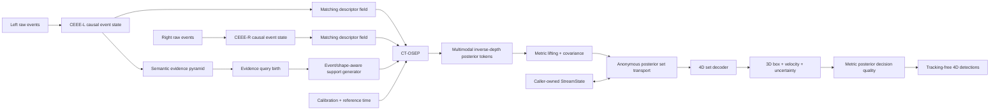

# EpiPosterior4D：双目事件流、无 ID 的 4D 目标检测重构方案

> **项目**：`labor-fight/StereoDETR`  
> **目标数据集**：DSEC-3DOD  
> **目标任务**：双目事件流的流式 4D object detection（3D 空间状态 + 时间状态），不输出 track ID / ReID ID  
> **目标对手**：EvStereo3D  
> **报告日期**：2026-08-26  
> **建议论文名**：**EpiPosterior4D: Event-Native Stereo Posterior Transport for Tracking-Free 4D Object Detection**  
> **建议方法简称**：**EP4D**

---

## 阅读结论

这份文档不是“再给 StereoDETR 加十个模块”的建议，而是一次基于仓库代码、`docs/EXPERIMENTS_AND_PITFALLS.md`、冻结评测协议、失败账本和 2023–2026 高相关论文的**架构判决**。

最重要的结论只有四条：

1. **当前无法超过 EvStereo3D 的主因不是 query 数量、Hungarian 正样本数、loss 权重或训练时长，而是测量模型错误。**  
   双目事件证据在进入 3D 决策前经历了“固定窗口/固定 bins → 伪 RGB → 稠密相关 → 深度 softmax → 求期望 → 单点采样 → 三个深度线索等权平均”的连续压缩。远距离、小尺寸行人最依赖多峰深度后验，却最早丢失后验。

2. **问题约 75% 属于框架，约 25% 属于局部算法、数据泛化和系统纪律。**  
   继续在现有 decoder、query 分配、quality head 或 temporal feature fusion 上修补，成功概率很低。应保留数据、评测、标定、训练基础设施，冻结旧模型，另建新的事件原生主干和对象条件双目后验路径。

3. **最优主线不是复制 EvStereo3D 的 plane-sweep/voxel/BEV/anchor/ROI，而是：**  
   `事件原生因果状态 → 2D evidence query → 对象条件连续时间极线后验 → 标定驱动的度量 lifting → 匿名后验集合传输 → 严格 3D 指标风险评分`。

4. **不能诚实地保证尚未运行的方案一定产生 SOTA。**  
   本文给出的，是当前证据下最可能跨过对手的路径，并用不可放宽的测量门阻止再次浪费训练。最终只有在同一 evaluator、同一官方 query 集、至少 3 个 seed、配对置信区间均通过时，才能写 “surpass” 或 “SOTA”。

---

# 0. 执行摘要

## 0.1 远端仓库的真实状态

远端 `main` 当前只有一个研究总档案：

```text
docs/EXPERIMENTS_AND_PITFALLS.md
```

2026-08-24 的合并提交明确记录：

- EPiSet4D 在 Gate D1 后停止；
- EPST-4D 在第一个 Gate D2 后停止；
- D3–D8 标记为 `CLOSED_BY_D2`；
- 研究代码已回退到公开 StereoDETR 版本；
- `reports/` 中的大型运行产物并未随远端 `main` 保留，文档中的机器收据路径是历史证据索引。

因此，本报告区分两类事实：

| 事实类型 | 可复核范围 |
|---|---|
| 远端仓库事实 | 当前 `main` 的代码、总日志、提交记录 |
| 本机历史实验事实 | 总日志中已经落档的 checkpoint hash、scoreboard、Gate 结果；远端没有对应大文件时，不能声称已重新复算 |

任何尚未推送的 F2、G3D、LCv3 或其他本机实验，只有在其机器 JSON、checkpoint hash、完整命令和 evaluator fingerprint 可见后，才能进入主结论。

## 0.2 冻结主记分板

主比较应使用同一个 evaluator 下的 moderate R40，不能把早期 aggregate mAP、AP11、论文表格或不同 decode 尺子混在一起。

| 模型/实验 | Vehicle 3D strict R40 | Pedestrian 3D strict R40 | 判定 |
|---|---:|---:|---|
| control p1b, 12 ep | 3.7376 | 0.0705 | 早期冻结对照 |
| A0+, 60 ep | 4.7426 | 0.0291 | 长训练未修复行人 |
| R1, stereo mirror | **6.2552** | **0.1896** | 当前最强内部联合基线 |
| D1, training-only dense head | 5.4986 | 0.7787 | 行人涨、车辆跌，联合门失败 |
| EvStereo3D public checkpoint | **8.0215** | **3.6448** | 同 evaluator 外部对手 |

由此得到两个完全不同的差距：

\[
\text{Vehicle gap}=8.0215/6.2552\approx 1.28\times
\]

\[
\text{Pedestrian gap}=3.6448/0.1896\approx 19.2\times
\]

所以这不是一个“整体再涨 20%”的问题，而是：

- Vehicle：需要稳健改善几何与评分；
- Pedestrian：需要改变信息路径，否则几乎不可能靠调参追平。

## 0.3 最终推荐路线

十个 Plan 不是十个并行大工程。最合理的执行顺序是：

```text
Plan 8 事件对应预训练
    ↓ 通过 correspondence Gate
Plan 1 EP4D-Core 静态对象条件后验
    ↓
Plan 2 Ped-first 双尺度与边界支持
    ↓ 静态检测过门
Plan 9 频率鲁棒的因果状态
    ↓ 时序破坏臂证明有效
Plan 10 严格指标风险评分与校准
    ↓
3 seeds × full-val × public-checkpoint 同尺终评
```

条件分支：

- Plan 3：当事件后验接近可用但泛化不足时，使用训练期稠密 teacher；
- Plan 4：当局部运动证据确实能提升深度后验时，再联合 disparity–motion；
- Plan 5：只有 oracle ego compensation 明确有效时才实现；
- Plan 6：只有遮挡/截断桶成为主要残差时才实现；
- Plan 7：只有 proposal recall 重新成为硬瓶颈时才实现。

---

# 1. “为什么理论上能做，但现有框架就是做不到”

## 1.1 第一性原理：严格 3D 检测首先是度量测量问题

校正双目相机的理想深度关系为：

\[
z=\frac{fB}{d},
\]

其中 \(f\) 是焦距，\(B\) 是基线，\(d\) 是视差。小扰动下：

\[
|\delta z|\approx\frac{z^2}{fB}|\delta d|.
\]

这意味着：

- 深度误差随距离近似二次放大；
- 小行人在像素域可用支持点更少；
- 一个像素级视差偏差，对 10–30 m 行人的 3D IoU 可能是毁灭性的；
- 只提高 2D recall，并不必然提高 strict 3D AP。

事件相机又增加了一层困难。左右相机观测的不是同一时刻的灰度纹理，而是异步亮度变化事件：

\[
e_i=(x_i,y_i,t_i,p_i).
\]

真正可匹配的对象不是“两个像素值”，而应是带有：

- 时间；
- 极性；
- 局部运动；
- 可见性；
- 相机射线；
- 深度假设

的时空证据。把事件先压成固定 10-bin 张量，再投成 3 通道伪图像，会让最有价值的 \(\Delta t\) 和运动相位在匹配前被折叠。

## 1.2 现有 StereoDETR 路径中的五次不可逆信息塌缩

当前公开代码的核心路径可概括为：

```text
event voxel / image-like input
    → RGB-oriented backbone
    → multi-scale dense stereo correlation
    → depth logits
    → softmax depth distribution
    → weighted_depth = Σ p(z)·z
    → query center grid_sample(weighted_depth)
    → average(depth_reg, depth_geo, depth_map)
    → scalar depth + sigma
    → stateless DETR decoder
```

### 塌缩 A：事件时序被伪 RGB 化

旧事件适配器的思想是把事件 bins 映射为图像通道，使 ImageNet backbone 可直接使用。它能快速得到可训练基线，但它隐含假设：

> 事件流的关键统计可以被一张同步图像近似。

D2 的结果反驳了这个假设对双目对应的充分性：

- 合成正控制 AUC = 1.000；
- 真实 direct-event、\(K=9\) 聚合后 truth-beats-wrong 只有 0.359；
- 虽比 pseudo-RGB 有小幅优势，但远低于可用匹配所需的 0.90–0.95；
- 60.8% 左支持点和 58.2% 右支持点存在非空事件，故不是简单“没有事件”。

根因是**描述子不具备可迁移的时空辨别力**，而不是事件数量为零。

### 塌缩 B：稠密后验先求均值

代码先计算：

\[
P(z\mid E_L,E_R)=\operatorname{softmax}(\text{depth logits}),
\]

随后立刻得到：

\[
\bar z=\sum_j P(z_j)z_j.
\]

当 \(P(z)\) 多峰时，\(\bar z\) 可能落在所有真实模式之间。对于对象边界、遮挡、低事件率和重复纹理，多峰不是异常，而是正确的不确定性表达。求期望把“两个合理假设”变成“一个不合理深度”。

### 塌缩 C：查询只在单一中心点读取深度

3D query 通过预测中心在 `weighted_depth` 上做一次 `grid_sample`。这会产生三个问题：

1. 中心落在背景/玻璃/遮挡区时，整个对象深度被一个坏点控制；
2. 小行人框高度小，中心偏差造成的相对位置误差更大；
3. 结构和边界支持点没有参与度量估计。

### 塌缩 D：三个深度线索被固定三等分

当前查询深度近似为：

\[
z_q=\frac{
z_{\text{reg}}+
z_{\text{geo}}+
z_{\text{map}}
}{3}.
\]

三个估计量：

- 误差分布不同；
- 相关性不同；
- 量纲虽同，但可靠性随距离、尺寸和遮挡变化；
- `sigma` 只来自回归分支，并没有校准三者融合后的不确定性。

等权平均不是概率融合，也不是鲁棒估计。它会在某个分支明显错误时强制污染结果。

### 塌缩 E：时序发生在错误层级

历史尝试多为：

- 多个固定窗口拼接；
- decoder feature memory；
- 后验已经变成标量后的 temporal fusion。

但事件流的主要优势是**对当前测量 likelihood 的时间约束**。若当前帧的深度证据已经错误，传递 feature/query 只会让错误更平滑，并不能恢复被抹掉的第二个深度模式。

## 1.3 日志已经排除的错误根因

| 被检验假设 | 日志结论 | 为什么不能再作为主线 |
|---|---|---|
| query 太少 | 增加/重分配 query 能提高部分 recall，却伤害 3D/oracle ceiling | 找到更多候选不等于构造正确度量几何 |
| 每个 GT 正梯度太少 | Ped 每 GT 正梯度质量反而高于 Vehicle；Group-DETR 已给每 GT 11 组匹配 | 正梯度饥饿被 P1 否定 |
| 多训练即可 | A0+ 60 ep 的 Ped 更差 | 训练时长不能修复错误信息瓶颈 |
| 原始事件太稀 | 支持点大多存在事件 | 关键是匹配可辨别性，不是事件是否存在 |
| 稀疏 SCEP 搜索范围不对 | GT-ray 条件下仍明显失败；stride-1 修复后仍差 | 不是搜索中心，而是逐点证据与聚合域 |
| 加 dense auxiliary head | D1 提升 Ped，但伤 Vehicle、proposal recall 和 oracle ceiling | 共享梯度冲突与任务折中，不能作为最终架构 |
| 只做 score/quality alignment | train 侧已接近饱和，缺陷主要发生在 train→val | 训练目标修补不能直接解决泛化塌缩 |
| 直接加时序 memory | 静态测量尚未可靠时，时序收益不可归因 | 必须先通过静态后验门 |

## 1.4 真正的根因链

```text
有限行人身份多样性
    +
固定窗口/伪RGB造成时序辨别力不足
    +
5×5 级局部描述子上下文不足
    +
双目后验在 query 前被求均值
    +
单中心点/等权深度融合
    +
时序不作用于 likelihood/posterior
    ↓
train 上可记忆，val 上 correspondence 与 confidence 同时塌缩
    ↓
2D 可检测，strict 3D 几乎为零
```

这解释了为什么：

- 2D 指标可以相对可用；
- Vehicle 有一定 3D 能力；
- Pedestrian 3D 与对手相差 19 倍；
- query、loss、训练时长、轻量 temporal feature 均不能根治。

---

# 2. 框架问题还是算法问题

## 2.1 判决：必须推翻主信息路径，但不应推翻整个工程

建议分类：

| 类别 | 占比 | 处理 |
|---|---:|---|
| 框架/测量模型 | 约 75% | 重写 |
| 描述子泛化与数据 | 约 15% | 预训练、增强、容量升级 |
| loss、评分、训练策略 | 约 10% | 静态几何过门后再优化 |

### 必须删除或从新主线断开

- 事件 `10→32→3` 伪 RGB 作为唯一输入；
- full-image dense disparity/depth volume 作为最终几何主线；
- `weighted_depth` 作为 query 的唯一双目输出；
- 单中心点深度读取；
- 三个深度分支固定等权平均；
- module-global temporal state；
- 任何要求稳定 `track_id` / ReID 的时序模块；
- EvStereo3D 风格 3D voxel/BEV + anchor + ROI refinement；
- 用多个布尔 flag 把新旧模型缝在同一个 `forward` 中。

### 应冻结为 legacy 对照

```text
lib/models/monodetr/
lib/models/monodetr/depth_predictor/
configs/.../legacy_stereodetr*.yaml
```

旧代码不应继续被“渐进式改造成”新模型。新路径应有独立 namespace，确保：

- state dict 清晰；
- tensor trace 可检查；
- 禁止 dense volume 的 contract 可自动测试；
- 消融不依赖复杂 flag 组合。

### 应复用

- DSEC-3DOD 数据读取、标定和坐标变换；
- 冻结 evaluator、official query index 和 decode protocol；
- sequence/chunk 边界、因果窗口与 reset 测试思想；
- 训练器、DDP、checkpoint、日志与 profiler；
- 已验证的 stereo mirror；
- 2D objectness/center 辅助监督；
- 可复现收据格式、hash、artifact 清理纪律。

## 2.2 为什么不是“保留 LightStereo，再加更强 decoder”

因为 decoder 能访问的信息上限由输入决定。当前 query 收到的是：

- 语义 feature；
- 一个已经求均值的深度；
- 一个未校准 sigma。

无论 decoder 多强，都无法判断被均值抹掉的第二个深度模式是什么。增加层数只提高对错误摘要的拟合能力。

## 2.3 为什么不能直接换成 DSGN/EvStereo3D 式体积

这样可能提高数值，但会产生三个风险：

1. 方法身份与 EvStereo3D 过近；
2. 显存/延迟违背事件相机异步、稀疏、低延迟的优势；
3. 论文贡献退化为“把 RGB stereo 体积网络换成事件输入”。

目标应是利用 dense 方法的**几何原则和训练 teacher**，而不是复制其推理图。

---

# 3. 对参考方法的“借思想、不搬模块”原则

| 方法 | 值得借的第一性原理 | 禁止直接搬的部分 | 在 EP4D 中的转化 |
|---|---|---|---|
| DSGN / DSGN++ | 标定几何必须进入特征 lifting；3D 检测应建立在度量一致的表示上 | 全图 plane sweep 与稠密 3D geometric volume | 只对对象 query 的少量射线/逆深度假设做解析 lifting |
| StereoDETR | set prediction、2D/3D query 解耦、轻量多尺度 stereo | `softmax→weighted_depth→三等分平均` | 保留 set decoder 思想，输入改为 posterior tokens |
| TS3D | disparity-aware positional encoding；保留左右视图结构 | 把全部特征继续维持为图像式 dense pyramid | 为每个支持点/深度模式编码 epipolar geometry |
| SIDE | 精确深度只需集中在对象区域；instance-level stereo | ROI 二阶段与局部 cost volume直接回归单深度 | query-conditioned supports，一阶段后验，不做 ROIAlign |
| DSC3D | 可见区域与采样约束比自由 offset 更可靠 | 无物理边界的 deformable sampling | 标定极线 + 运动上界 + visibility mask 限制 offset |
| YOLOStereo3D | 2D-first 能提供高效 object prior | 只在 2D feature 上附加轻量 stereo 后直接回归 3D | dense 2D proposal，稀疏几何；proposal 不承担最终深度 |
| RTS3D | 对象结构点的左右 feature consistency；边界比内部更有几何信息 | 大型统一 FCE 网格 | 事件活动/边界驱动的非均匀支持点集合 |
| DDStereo | shared object queries、语义与 disparity decoder 分工 | 把两个 decoder 当成独立黑盒后再融合 | 一个 query 共享语义，几何输出必须是可校准 posterior |
| EvStereo3D | 语义和几何应互相约束；对象局部精修有价值 | dense plane sweep、3D voxel/BEV、anchor、ROI head、dual-filter 叙事 | 语义只决定支持点/先验；几何 posterior 反向决定 quality |
| RVT / HMNet | 局部空间先验 + 分层因果 memory | 按帧固定 recurrent image feature | caller-owned、真实 \(\Delta t\) 的事件状态 |
| SAST | 事件稀疏性应决定 token/window 预算 | 只为节省 FLOPs 的通用稀疏 transformer | event-density 与对象尺度共同决定支持点预算 |
| Event SSM | 训练/推理频率变化必须显式建模 | 把任意 SSM 作为黑盒 backbone | packet-split consistency 与连续时间状态转移 |
| EMatch | stereo 和 temporal correspondence 可共享描述空间 | 直接把 flow/stereo 网络整个接入检测器 | 作为事件对应预训练任务，输出 descriptor 而非 dense flow |
| ARES | 时序中应传播 disparity posterior 而非点估计 | 其非对称 RGB-event 设置和全局 dense posterior | 双事件、对象条件、稀疏 posterior transport |
| StreamPETR / ForeSight | query memory 可无显式跟踪 ID；检测与未来运动可联合 | 把 query index 当成稳定身份 | 匿名 posterior set + dustbin transport，输出不含 ID |
| DetAny4D | 4D detection 是流式输入上的时序稳定 3D 检测 | RGB foundation-model 多模态拼接 | 事件原生、因果、任意 query time 的 3D+motion 输出 |

---

# 4. 2023–2026 高相关文献综合结论

> 本节覆盖与本问题最相关的顶会/一区方向，不冒充“穷尽世界上每一篇论文”。筛选标准是：能改变 EP4D 的测量、时序、泛化或评测设计，而不是仅与关键词相同。

## 4.1 单目/通用检测

### H-DETR、MS-DETR

一对多辅助监督可以提高 DETR 训练效率，但你的 P1 已证明：

- 每个 GT 的 matched group 数量不是主要瓶颈；
- train 上对象定位和置信度已高度饱和；
- train→val transfer 才是问题。

结论：可作为 proposal 工程手段，不能作为贡献，也不能优先于测量模型。

### RT-DETR、Salience DETR

它们说明高质量 query 初始化、尺度无关 salience 和稀疏编码很重要。EP4D 只借：

- 2D evidence query birth；
- 小目标尺度无关 proposal supervision；
- 稀疏预算。

不借“选出更好的 query 就能解决 3D”的隐含假设。

### MonoCD、MonoDGP

这类工作说明多个深度线索必须有互补误差，且 2D query 不应被错误 3D 深度扰乱。对当前三等分平均的直接启示是：

- 不同深度线索不能固定平均；
- 语义 proposal 与度量几何 decoder 应解耦；
- 几何误差应显式进入融合。

EP4D 更进一步：不把每条线索先变成 scalar，而保留 posterior。

## 4.2 事件检测与表示

### RVT、HMNet

核心不是“使用 Transformer”，而是：

- 局部卷积先验对事件边缘重要；
- 快/慢状态应按不同时间尺度更新；
- temporal state 必须递归、因果。

EP4D 的 encoder 使用两级状态：

\[
S_f(t),\quad S_s(t),
\]

其中 fast state 对近期事件更新，slow state 在较长时间常数下聚合。二者都由调用方持有，不能藏在 module global variable。

### SAST

核心是预算要随场景和事件密度变化。EP4D 不做全图 token pruning，而做：

\[
K_q=K_{\min}+\Delta K(\text{box height},\text{event density},\text{posterior entropy}).
\]

小行人、低事件率、高不确定对象获得更多结构支持点。

### Event SSM

核心是训练频率和推理频率不一致会导致状态模型崩溃。EP4D 必须用：

- packet split；
- random query time；
- 10/20/50/100 Hz；
- future append；
- reset；
- zero-event interval

作为 contract，而不是只在固定 50 ms 窗口训练。

## 4.3 事件双目、深度与 correspondence

### Temporal Event Stereo

重要启示：事件 stereo 与 temporal flow 不是两个完全独立问题。时间对齐可改变当前视差 likelihood。EP4D 借这一点，但只估计对象局部、受限 motion hypothesis，不做全图 scene flow。

### EMatch

最值得借的是共享 correspondence 表示：

- 同一 descriptor 同时接受时间正样本与左右视图正样本；
- 左右匹配可从 temporal correspondence 获得预训练；
- 将 descriptor 泛化问题在检测前单独解决。

这直接对应 D2 发现的 0.359 correspondence ceiling。

### Enhanced Event Dense Stereo / EventDAM / Depth Any Event Stream

共同启示：

- 事件标签少时，训练期 RGB/强 dense model teacher 有价值；
- 稀疏性变化必须做一致性约束；
- teacher 应指导 feature/posterior，而不是把 RGB 输入偷偷留在推理图。

所以 Plan 3 只允许 training-only teacher，并要求 eval graph 中无 teacher tensor trace。

### ARES

ARES 已经表明时序传播 disparity posterior 是合理方向，因此 EP4D 不能声称“首次传播 stereo posterior”。可防守的差异是：

- 双事件而非非对称 RGB-event；
- object-conditioned sparse posterior；
- posterior 与匿名 object set 联合 transport；
- 目标是 4D detection，不是全图 stereo/scene flow。

### Stereo Any Video

全对相关和 temporal convex upsampling说明大上下文能提升稳健性；但 EP4D 不应恢复全图全对相关。借用的是：

- 粗到细、多尺度上下文；
- temporal posterior consistency；
- 不依赖外部 pose/flow 的设计纪律。

## 4.4 4D 检测、时序 3D 与 trajectory

### DetAny4D

给出了本任务应对齐的定义：

> 流式序列中的时序一致 3D object detection，而不是“输出 track ID 才算 4D”。

EP4D 输出：

\[
\mathcal B_t=
\{(c,\mathbf x,\mathbf d,\theta,\mathbf v,\Sigma,q)\},
\]

不输出稳定 ID。时间维度由：

- 当前状态；
- 速度/短时运动分布；
- 因果状态；
- 多频率稳定性

体现。

### StreamPETR、PETRv2

说明 object-centric memory 高效，但“无 ID query memory”本身已不新。EP4D 的必要差异是 memory 中保存：

- inverse-depth posterior；
- metric covariance；
- age；
- velocity hypothesis；
- visibility

而不是仅保存 query feature。

### ForeSight

说明 detection 与 trajectory/forecasting 联合可帮助当前检测，且可避免显式 tracking。EP4D 借预测辅助检测，但只输出短时 motion distribution，不引入 ReID 或 ID 管理器。

## 4.5 VO/SLAM、ego-motion 和 motion segmentation

事件连续时间 VO、Full-DoF event egomotion 等工作证明：

- 事件时间戳适合连续时间运动；
- 小时间片中的旋转/平移可以几何求解；
- 但 ego-motion 本身也可能不稳定，不能默认作为真值。

因此 ego compensation 必须是**条件模块**：

1. 先做 identity pose 对照；
2. 再用 GT/oracle pose 测试理论上限；
3. oracle 有明显收益才实现 learned ego；
4. learned ego 不能达到 oracle 收益的至少一半则删除。

motion segmentation 的可借原则是将背景相机运动与前景残差分层，但不需要输出长期 instance ID。

---

# 5. 六十专家 battle：模拟对抗评审

> 这是模型内部构造的 60 个专家角色进行的结构化红队讨论，不是真实召集的 60 位外部人员。其价值在于强制不同学科提出互相冲突的判据，而不是伪造外部共识。

## 5.1 角色组成

| 专家组 | 人数 | 主要问题 |
|---|---:|---|
| 事件传感器物理 | 6 | 固定 bins、极性、噪声、时间同步是否破坏信息 |
| 双目几何与标定 | 6 | 极线、视差、误差传播、可见性 |
| 3D detection | 6 | query、proposal、box parameterization、strict IoU |
| 4D/streaming perception | 6 | 因果状态、任意频率、时序稳定 |
| Scene flow / motion | 6 | 联合视差–运动是否必要 |
| VO/SLAM | 6 | ego compensation 的可辨识性与成本 |
| 不确定性/概率建模 | 6 | 后验、校准、决策风险 |
| 优化与泛化 | 6 | train→val collapse、身份多样性、teacher |
| 系统/代码架构 | 6 | 显存、延迟、状态合同、代码债 |
| CVPR/NeurIPS 红队审稿 | 6 | 新颖性、对手相似性、claim 边界 |

## 5.2 四个候选方向的投票

| 路线 | 票数 | 结论 |
|---|---:|---|
| 继续在当前 StereoDETR 上加 query/loss/decoder | 6/60 | 仅适合作对照，不足以跨过 19.2× Ped gap |
| 复活旧逐点 SCEP | 0/60 | 已被 GT-ray 和正控制证伪 |
| 全图 scene flow + VO + tracking pipeline | 4/60 | 复杂、误差级联、与无 ID 目标不符 |
| CT-OSEP → APST → MPDQ | **50/60** | 有条件支持：必须先过 correspondence 与 GT-ray Gate |

## 5.3 多数意见

1. **新方法的第一贡献必须是测量模型，而不是 backbone 名称。**
2. **事件时序要进入左右 correspondence likelihood，不是只进 temporal feature。**
3. **深度必须在 object query 内保留多峰后验。**
4. **无 ID 不等于无状态；状态应是匿名集合。**
5. **Pedestrian 是主要实验驱动力，但测量机制应 class-agnostic。**
6. **teacher、ego、flow 都只能在独立 Gate 后作为条件臂，不能一次堆满。**
7. **新颖性来自三者组合与实证边界：**
   - 连续时间对象条件极线后验；
   - 匿名度量后验集合传输；
   - 严格 3D 风险评分。
8. **必须主动证明不是 EvStereo3D：**
   - tensor trace 无 full disparity volume；
   - 无 3D voxel/BEV；
   - 无 anchor；
   - 无 ROIAlign/二阶段 refine。

## 5.4 少数意见及处置

### 反对意见 A：dense volume 已被证明有效，为什么不直接用

处置：允许作为 training-only teacher 和正控制；不允许进入最终 inference graph。

### 反对意见 B：先解决数据身份多样性，而不是重写架构

处置：Plan 8 的自监督 correspondence pretraining先执行；但旧架构即使得到更好 descriptor，仍会在 `weighted_depth` 求均值处丢失后验，所以数据与架构必须串行解决。

### 反对意见 C：posterior 会增加计算

处置：只在 \(Q\times K\times M\) 个对象支持上计算，复杂度随对象数增长，而不是随 \(H\times W\times D\) 增长。

---

# 6. 最佳总方案：EpiPosterior4D

## 6.1 贯穿全框架的唯一规则

> **在不确定性被观测、时序或任务指标真正消解之前，禁止把物理测量后验压成单个点估计。**

所有核心 token 都携带：

```text
(reference_time,
 camera_ray,
 inverse_depth_posterior,
 motion_hypothesis,
 visibility,
 metric_covariance,
 semantic_feature)
```

这条规则能检查每个模块是否必要：

- 只增加 feature、却不改变 measurement tuple 的模块，优先删除；
- 只让网络更大、却没有新观测约束的模块，不能作为主贡献；
- 在 posterior 未消歧前求 mean/MAP 的模块，违反架构合同。

## 6.2 总体结构



## 6.3 CEEE：Causal Event Evidence Encoder

### 输入

原始事件或保留真实时间戳的稀疏 packet：

\[
E_{[t_a,t_b)}=\{(x_i,y_i,t_i,p_i)\}.
\]

不得把 query time 之后的事件截断后静默使用；发现未来事件应直接报错。

### 双输出

1. **semantic field**：对象类别、中心、尺寸和边界；
2. **matching descriptor field**：为左右 correspondence 优化。

共享早期局部层，后续分头，防止“语义不变性”抹掉 stereo 所需的微小位移信息。

### 因果状态

\[
S_t=F(S_{t-\Delta t},E_{[t-\Delta t,t)},\Delta t).
\]

硬合同：

- caller-owned；
- sequence 隔离；
- reset=fresh；
- packet split consistency；
- arbitrary query time；
- zero-event interval；
- 不使用 future event；
- DDP 不跨 sequence 串状态。

### 上下文范围

D2 使用的旧 stem 只有约 5×5 局部感受野。新 descriptor 的有效局部上下文应达到至少 21×21–31×31，采用：

- depthwise dilated conv；
- local attention；
- event-adaptive sparse windows

之一即可，不需要同时堆三种。

## 6.4 Evidence Query Birth

使用 dense 2D evidence head 产生：

- class-agnostic center/objectness；
- left 2D box；
- projected 3D center ray；
- boundary likelihood；
- event density；
- initial depth prior。

训练期可有 one-to-many 辅助分支，推理只保留 one-to-one set。该模块只负责“哪里有对象”，不负责最终 metric depth。

## 6.5 CT-OSEP：Continuous-Time Object-conditioned Sparse Epipolar Posterior

### 支持点

每个 query \(q\) 选择 \(K_q\) 个支持点：

- 中心附近少量；
- 四条可见边界；
- 高事件活动点；
- 左右可预测可见的结构点；
- 保证空间多样性，禁止全部聚在一个 stride cell。

### 逆深度假设

使用逆深度：

\[
\rho=1/z,
\]

因为视差近似对逆深度线性。先建立 \(M_c\) 个 coarse modes，再保留 top-\(B\) 分支，每个分支细化 \(M_f\) 个局部模式。

### 连续时间极线管

对于左支持点 \(u^L_k\)、逆深度模式 \(\rho_m\) 和局部运动模式 \(\nu_n\)，右目候选位置为：

\[
u^R_{kmn}=
\pi_R\left(
T_{R\leftarrow L}(t_q)
\pi_L^{-1}(u^L_k,\rho_m)
+\Delta X(\nu_n,\Delta t_k)
\right).
\]

关键约束：

- rectified 情况退化为水平极线；
- offset 上界由标定残差和物理速度上界给出；
- 不允许 unconstrained deformable offset；
- 支持点读数使用其真实时间或局部时间统计。

### 匹配 likelihood

\[
\ell_{qkmn}=
g_\theta(
f^L_k,
f^R_{kmn},
\Delta t,
p^L,p^R,
\text{visibility},
\text{ray geometry}
).
\]

聚合不是简单平均：

\[
\log P_q(\rho_m,\nu_n\mid E)
=
\log P_q^-(\rho_m,\nu_n)
+
\operatorname{RobustAgg}_k(\ell_{qkmn}).
\]

`RobustAgg` 可选一个必要机制：

- visibility-weighted logsumexp；
- trimmed log-likelihood；
- support attention with entropy regularization。

不要三种都用。

### 输出

- top-\(B\) inverse-depth modes；
- 每个 mode 的质量、方差和 visibility；
- posterior entropy；
- L→R / R→L consistency；
- 可选局部 motion modes。

**禁止在此处求全局 posterior mean。**

## 6.6 度量 lifting

对每个 posterior mode：

\[
X_{q,b}=\pi_L^{-1}(u_q,z_{q,b}).
\]

通过解析 Jacobian 传播测量协方差：

\[
\Sigma_X=J\Sigma_{u,z}J^\top.
\]

decoder 看到的是一组 metric hypothesis tokens，而不是一个 `depth_map` scalar。

## 6.7 APST：Anonymous Posterior Set Transport

状态为匿名集合：

\[
\mathcal S_{t^-}=\{s_i^-\}_{i=1}^{N_s},
\]

当前观测为：

\[
\mathcal O_t=\{o_j\}_{j=1}^{N_o}.
\]

构造 transport cost：

\[
C_{ij}=
\lambda_x d_M(X_i^-,X_j)
+\lambda_c d_{\text{cls}}
+\lambda_v d_{\text{vel}}
+\lambda_p d_{\text{posterior}}
+\lambda_a \Delta t_i.
\]

使用带 dustbin 的 unbalanced transport 或 set cross-attention：

\[
A=\operatorname{UOT}(-C/\tau).
\]

约束：

- slot permutation equivariant；
- birth/death 通过 dustbin；
- 不生成 `track_id`；
- query index 不被解释为身份；
- prior covariance 随真实 \(\Delta t\) 扩散；
- 当前 likelihood 与 prior 在 log space 融合；
- 每个时刻仍独立输出 set。

## 6.8 4D decoder

每个输出包含：

```text
class
3D center
dimensions
yaw
velocity mean/covariance
optional acceleration or short-horizon displacement modes
posterior quality
current reference time
```

最小必要输出是 3D box + velocity。不要为了“4D”强行增加长轨迹头。

## 6.9 MPDQ：Metric Posterior Decision Quality

旧分数：

\[
s=\sigma(\text{cls})\exp(-\sigma_z)
\]

既不是概率，也可能大于 1，并曾造成 threshold/top-k 尺子分叉。

新分数直接估计检测通过 strict 3D IoU 的概率或期望效用：

\[
q_{\text{strict}}
=
\mathbb E_{B\sim P(B\mid E)}
[\mathbf 1(\operatorname{IoU}_{3D}(B,B^*)\ge \tau_c)].
\]

训练时可通过 posterior samples 近似，推理输出限定在 \([0,1]\)：

\[
s_{\text{report}}=
P(\text{class}\mid E)\cdot q_{\text{strict}}.
\]

质量头输入必须包含：

- posterior entropy；
- covariance；
- support agreement；
- visibility；
- depth/size regime。

## 6.10 损失

建议只保留必要项：

\[
L=
L_{\text{set}}
+\lambda_{\text{post}}L_{\text{posterior}}
+\lambda_{\text{corr}}L_{\text{corr}}
+\lambda_{\text{lr}}L_{\text{LR}}
+\lambda_{\text{temp}}L_{\text{predictive}}
+\lambda_{\text{q}}L_{\text{quality}}.
\]

其中：

### posterior interval NLL / CRPS

监督 GT 深度落入哪些离散逆深度区间，而不是只监督均值。

### correspondence ranking

\[
L_{\text{corr}}
=
-\log\sigma(
s_{\text{true}}-s_{\text{wrong}}).
\]

wrong hypotheses 必须包括：

- 邻近错误视差；
- 远错误视差；
- 错时间 offset；
- 错标定；
- 左右交换破坏臂。

### L/R consistency

用 JS 或对称 KL 比较两个方向的 posterior，遮挡点不强制一致。

### temporal predictive likelihood

传播后的 prior 应提高当前 observation likelihood；reset/shuffle 必须失去收益。

### quality

使用 strict-IoU event 的 BCE/Brier 或采样 expected IoU，不使用未界定的 sigma multiplier。

## 6.11 复杂度

旧 dense stereo 近似：

\[
O(HWD C).
\]

EP4D 核心近似：

\[
O(QK(M_c+B M_f)C).
\]

以 \(Q=100,K=24,M_c=32,B=3,M_f=8\) 为例，几何评估点约：

\[
100\times24\times(32+24)=134{,}400,
\]

其规模与全图 \(H\times W\times D\) 不同，且可按对象数和事件密度自适应。

## 6.12 与 EvStereo3D 的结构差分

| 维度 | EvStereo3D | EP4D |
|---|---|---|
| 双目搜索 | 全图 plane-sweep / dense cost | object-conditioned sparse epipolar posterior |
| 3D 表示 | 3D voxel → BEV | calibrated posterior tokens |
| 检测 | anchor dense head | one-to-one set decoder |
| 精修 | ROI/object-centric second stage | 同一 stage 内 posterior branch refinement |
| 时间 | dense motion/feature模块 | posterior likelihood + anonymous set state |
| 输出身份 | 检测框 | 检测框+运动，不输出 ID |
| 不确定性 | 深度概率参与 dense filtering | 保留到 metric decision |
| 推理 teacher | 事件主模型 | 可有训练 teacher，推理完全移除 |

---

# 7. 统一实验协议与不可放宽的 Gate

## 7.1 评测身份

必须固定：

- official query index；
- calibration/manifest hash；
- evaluator fingerprint；
- decode score 定义；
- class mapping；
- strict/loose、R40/AP11 字段；
- checkpoint SHA-256；
- seed；
- git commit；
- GPU UUID map。

mini-val、10% val、首 N 个 query 只能做诊断，不能用于模型选择后宣称 SOTA。

## 7.2 Gate G0：协议与因果合同

- 旧 R1 预测重评逐字段一致；
- score threshold/top-k 作用在最终 reported score；
- future event 触发错误；
- reset=fresh；
- packet split consistency；
- mixed-sequence batch 不串 state；
- no-ID schema；
- full-val query count 完整。

## 7.3 Gate G1：correspondence 可用性

在任何完整检测训练前：

| 指标 | 最低门 |
|---|---:|
| synthetic rectified positive control AUC | ≥ 0.98 |
| intensity/dense teacher positive control | ≥ 0.95 |
| event GT-ray truth-beats-wrong，Vehicle | ≥ 0.90 |
| event GT-ray truth-beats-wrong，Pedestrian | ≥ 0.90 |
| top-3 mode recall | ≥ 0.95 |
| K=1→K=max 聚合 | 单调不下降 |
| wrong-time / wrong-calibration destruction | 至少下降 0.15 |
| train→val descriptor gap | 不得超过预注册阈值 |

G1 不过：禁止训练完整 detector。只允许 Plan 8、Plan 3 或修数据/标定。

## 7.4 Gate G2：GT-ray posterior

| 指标 | 最低门 |
|---|---:|
| Ped 10–20 m median depth error | ≤ 0.49 m；目标 ≤ 0.40 m |
| 0.243 m strict-band hit | ≥ 35%；目标 ≥ 40% |
| posterior NLL/CRPS | 优于 dense mean 与 MAP 对照 |
| entropy/error Spearman | ≥ 0.30 |
| L/R consistency | 显著优于 destruction |
| peak VRAM | 低于 legacy LightStereo |
| tensor trace | 无 `[B,D,H,W]` 全图体 |

## 7.5 Gate G3：静态 3D detector

- full-val，不用 temporal memory；
- Vehicle strict R40 不低于 R1；
- Ped strict R40 至少显著超过 D1 的 0.7787；
- Vehicle oracle ceiling 不下降；
- Ped 10–20 m、small-height 桶必须改善；
- posterior destruction 后 3D 指标显著下降，证明 detector 真在使用几何；
- 2D AP 上升不能代替 3D Gate。

建议 scout 目标：

```text
Vehicle strict R40 ≥ 6.5
Pedestrian strict R40 ≥ 1.5
```

未达到，不进入时序阶段。

## 7.6 Gate G4：时序 4D

四臂必须同时运行：

```text
static
APST
APST + shuffled history
APST + reset every query
```

通过条件：

- APST > static；
- shuffle 与 reset 至少移除 50% 的时序增益；
- 10 FPS keyframe 不退化；
- 20/50/100 Hz 至少两个频率 strict R40 提升；
- center/depth temporal jitter 至少下降 15%；
- 无 ID、permutation、birth/death、causality 全绿。

## 7.7 Gate G5：最终 SOTA

同一 evaluator 下至少 3 seeds：

```text
Vehicle strict R40 mean > 9.0215
Pedestrian strict R40 mean > 4.6448
```

这是“超过 public checkpoint 至少 1.0 absolute”的强目标。并且：

- paired bootstrap 95% CI 下界高于对手点值；
- 三个 seed 都不能出现一类崩溃；
- public checkpoint 与 paper-reported row 分开；
- latency、VRAM、频率鲁棒性同时报告；
- 没过则只能写“improves over internal baseline”，不能写 SOTA。


---

# 8. 代码重构边界

## 8.1 建议目录

实际落地前由 Codex 先审计当前路径；若仓库结构与下列不同，以现有训练器/注册器为准，不为“目录看起来整齐”复制基础设施。

```text
lib/
  models/
    monodetr/                    # 冻结 legacy
    ep4d/
      __init__.py
      model.py                   # 顶层编排，保持薄
      contracts.py               # dataclass / tensor schema / StreamState
      causal_event_encoder.py
      evidence_query_birth.py
      support_generator.py
      continuous_epipolar_posterior.py
      metric_lifting.py
      anonymous_set_transport.py
      decoder.py
      metric_quality.py
      losses.py
  datasets/
    dsec3dod/
      ep4d_sequence_sampler.py   # 仅在现有 sampler 无法满足时新增
configs/
  dsec3dod/
    ep4d_g1_probe.yaml
    ep4d_static.yaml
    ep4d_temporal.yaml
tests/
  ep4d/
tools/
  ep4d/
    audit_contracts.py
    probe_correspondence.py
    evaluate_posterior.py
    evaluate_streaming.py
```

## 8.2 避免屎山代码的规则

1. **一个概念一个实现。**  
   不保留 `posterior_v1.py`、`posterior_v2.py`、`posterior_final.py`。实验差异放 config，结构失败则删除。

2. **legacy 和 EP4D 不共用大型 forward。**  
   顶层 registry 选择模型，不能在 `MonoDETR.forward` 里增加几十个 `if use_ep4d`。

3. **临时分析脚本默认不入库。**  
   诊断脚本放：

   ```text
   /tmp/ep4d_<phase>/
   ```

   只有满足以下条件才迁入 `tools/ep4d/`：

   - 会被后续 Gate 重复使用；
   - 有自动测试；
   - 输出 schema 固定；
   - 不写死 checkpoint/绝对路径。

4. **不新增 Gate JSON 模板代码。**  
   运行结果可以输出普通 JSON 收据，但不要引入一套“Gate framework”。Gate 判据写在 Markdown 预注册中，工具只输出原始字段和一个纯函数判定。

5. **测试先于模型大改。**  
   每阶段先写失败 contract，再写最小代码。

6. **状态显式。**

   ```python
   outputs, next_state = model(batch, state=state)
   ```

   禁止：

   ```python
   self.hidden_state = ...
   ```

7. **数值高风险区强制 float32。**

   - `logsumexp`
   - posterior normalization
   - CRPS/NLL
   - covariance/Jacobian
   - Sinkhorn/UOT
   - metric IoU sampling

8. **训练和推理 tensor contract 一致。**  
   训练可有 auxiliary head，但主输出字段、shape 和坐标语义不能变化。

9. **任何模块失败即删除，不改名复活。**  
   只有新的测量证据和重新预注册才能重新开启。

## 8.3 建议保留的最小公共接口

```python
@dataclass
class EventPacket:
    xy: Tensor          # [N, 2]
    t: Tensor           # [N], seconds, absolute or sequence-relative
    polarity: Tensor    # [N]
    camera_id: Tensor   # [N]
    query_time: Tensor  # [B]

@dataclass
class PosteriorModes:
    inv_depth: Tensor   # [B, Q, Bm]
    log_prob: Tensor    # [B, Q, Bm]
    variance: Tensor    # [B, Q, Bm]
    visibility: Tensor  # [B, Q, K]
    support_xy: Tensor  # [B, Q, K, 2]
    reference_time: Tensor

@dataclass
class AnonymousState:
    tokens: Tensor
    metric_mean: Tensor
    metric_cov: Tensor
    velocity: Tensor
    age_s: Tensor
    valid: Tensor
    sequence_uid: list[str]
```

以上只是语义合同，不要求机械照抄字段名；关键是时间、后验和协方差不能被隐藏在无语义 feature 中。

---

# 9. Codex 共用执行合同

下面十个 Plan 的提示词都默认继承本节。复制给 Codex 时，应将本节与对应 Plan 提示词一起提供。

```text
你正在修改仓库 labor-fight/StereoDETR。当前目标不是修补公开 StereoDETR，
而是在冻结 legacy 路径的前提下实现事件原生、无 ID、因果的 EP4D 研究分支。

【第一步必须做】
1. 打印 git rev-parse HEAD、git status --short、当前 branch。
2. 阅读：
   - docs/EXPERIMENTS_AND_PITFALLS.md
   - 当前模型入口、dataset、trainer、tester、evaluator、decode helper
   - 与本阶段直接相关的已有 test
3. 从日志中摘出本阶段基线、已失败机制和禁止重开条件。
4. 写一份不超过 2 页的阶段预注册 Markdown，包含：
   hypothesis / single variable / inputs / outputs / exact metrics /
   pass-fail thresholds / destruction arms / rollback / claims not authorized。
5. 在任何训练前先运行现有测试和最小 forward，记录命令和结果。

【全局禁止】
- 不修改冻结 evaluator 的数学含义。
- 不改变 official query set、类别映射或主指标。
- 不使用未来事件；query_time 之后的事件应触发错误。
- 不输出或依赖 track_id、ReID embedding、持久 instance ID。
- 新推理路径不得构造 full-image [B,D,H,W] disparity/depth volume，
  也不得构造 [B,C,D,H,W] 3D volume。
- 不使用 3D voxel/BEV anchor head、ROIAlign 或二阶段 ROI refine。
- 不把 posterior 在 decoder 前变成单一 weighted mean。
- 不在 MonoDETR.forward 中堆叠新旧布尔 flag。
- 不增加大而通用的 Gate 框架，不生成 Gate schema 工程。
- 不为了跑通而 catch Exception、silent fallback、skip sample。
- 不手抄结果；所有数字来自工具产出的 JSON/CSV。
- mini-val 只能做诊断，不能决定最终 SOTA。
- 不以“训练更久”“换 seed”“调 threshold”救一个 Gate FAIL。

【代码质量】
- 优先修改已有基础设施；每阶段新增核心 Python 文件原则上不超过 3 个。
- 临时诊断放 /tmp/ep4d_<phase>/，阶段结束删除。
- 只有被下一阶段复用且有测试的工具才进入 tools/ep4d/。
- 使用 dataclass 或 TypedDict 明确 tensor 语义。
- caller-owned state；forward 返回 next_state。
- logsumexp、posterior normalization、Sinkhorn、covariance 强制 float32。
- 所有坐标注明：pixel/normalized/camera/rectified/pseudo-lidar。
- 所有时间注明单位 seconds，记录 reference_time。
- 使用 shape assertions，但不要在训练热路径做昂贵 Python 循环。
- 先写失败测试，再实现最小变更。
- 完成后运行 targeted tests + full existing test suite。
- git diff 必须只包含本阶段必要改动；不要格式化无关文件。

【每阶段交付】
- 代码和测试。
- 一份预注册文档。
- 一份机器可读结果。
- 一份 1 页结论，明确 PASS/FAIL 和下一路由。
- 精确训练/评测命令。
- 文件变更清单和删除清单。
- 不创建 checkpoint、数据、日志的 git 跟踪大文件。

【终止原则】
任一正控制失败，阶段结论为 INVALID_PROBE，先修仪器。
任一 destruction arm 不下降，机制未被测量，不能继续。
Gate FAIL 时回滚或删除该机制，不进行未预注册搜索。
```

---

# 10. 十个最可能产生 SOTA 的 Plan 总览

| 排名 | Plan | 解决的首要瓶颈 | 前置条件 | 推荐角色 |
|---:|---|---|---|---|
| 1 | EP4D-Core：CT-OSEP + APST + MPDQ | 后验过早塌缩、时序不作用于测量 | G1 correspondence 通过 | 最终主模型 |
| 2 | Ped-first Dual-scale OSEP | 小行人 19.2× 差距 | Plan 1 静态可用 | 必做增益臂 |
| 3 | Dense Teacher → Sparse Posterior Student | 事件标签少、描述子泛化弱 | teacher 正控制通过 | 条件训练臂 |
| 4 | Joint Disparity–Motion Posterior | 目标运动造成左右/时间不对齐 | 局部 motion oracle 有收益 | 条件高创新臂 |
| 5 | Ego-canonicalized Event Tubes | 相机运动污染 temporal likelihood | oracle ego 显著有效 | 条件几何臂 |
| 6 | Boundary/Visibility Supports | 遮挡、截断、中心点错误 | 遮挡桶是主残差 | 条件精修臂 |
| 7 | Proposal-complete Geometry-sparse Hybrid | 小目标 proposal 漏检 | geometry 已过门、recall 仍低 | 条件工程臂 |
| 8 | Event Correspondence Foundation Pretraining | D2 0.359 描述子 ceiling | 无 | **第一阶段必做** |
| 9 | Rate-robust Packet-Semigroup State | 固定 50 ms/10 Hz 过拟合 | 静态模型过门 | 4D/streaming 必做 |
| 10 | Strict-Metric Risk Calibration + Regime Experts | 排名分数与 strict IoU 错位 | 几何与时序已稳定 | 最后增益臂 |


---

# Plan 1 — EP4D-Core：CT-OSEP + APST + MPDQ

## 1. 核心假设

当前失败的决定性变量不是检测器容量，而是：

> query 接收了被求均值的 stereo depth，而不是能够被当前事件和历史状态共同消歧的 metric posterior。

本 Plan 完整替换旧深度主线，但分三次独立过门：

1. CT-OSEP 静态后验；
2. APST 匿名时序状态；
3. MPDQ 严格指标评分。

三者不能在第一次训练中一起打开。

## 2. 为什么最可能跨过对手

- Vehicle 只差约 1.28×，更可靠的 object depth 足以产生明显收益；
- Pedestrian 的主要误差正是远距、小尺寸、多峰深度；
- EvStereo3D 的强项来自 dense aggregation 与对象局部 refinement，EP4D 用稀疏对象条件后验获得同样的“聚合与局部化原则”，同时避免其结构；
- posterior 在 decoder 前不塌缩，使 temporal prior 能真正消除模式；
- 最终评分直接针对 strict 3D IoU，避免几何改善被错误排序吞掉。

## 3. 修改步骤

### Phase 1A：冻结 legacy 与建立 contract

1. 新建模型 registry 项 `ep4d`；
2. legacy StereoDETR forward 零改动；
3. 建立 `EventPacket`、`PosteriorModes`、`AnonymousState`；
4. 加 tensor guard，确保 EP4D 路径不构造 full disparity volume；
5. 跑 R1 parity，证明仅注册新模型不改变旧结果。

### Phase 1B：GT query / GT ray 的 CT-OSEP

先不接 detector：

- 使用 GT class、GT 2D box、GT projected center ray；
- encoder feature 冻结；
- 只学习 support aggregation 与 posterior scorer；
- coarse inverse-depth 32 modes；
- top-3 branch；
- 每分支 8 个 fine modes；
- \(K\in\{1,8,16,24\}\) 做预注册；
- 与 legacy dense mean、dense MAP、old SCEP 比较；
- wrong calibration、wrong time、right shuffle 为 destruction。

只有 G2 通过才接 predicted query。

### Phase 1C：静态 detector

1. 用 evidence query birth 代替 GT query；
2. query 先预测 2D evidence 和 depth prior；
3. CT-OSEP 产生 posterior tokens；
4. metric lifting；
5. set decoder 输出当前 3D box；
6. temporal state 关闭；
7. quality score先用简单、界定良好的 class probability，暂不加 MPDQ。

### Phase 1D：APST

在静态模型冻结/可复现后：

- 当前 observation posterior 与历史 anonymous posterior set 进行 UOT；
- 真正的 \(\Delta t\) 控制 covariance diffusion；
- state 最多保留固定预算，按 posterior utility 删除；
- TBPTT 长度 4–8；
- reset、shuffle、zero-memory 三个控制；
- 不允许稳定 slot ID 成为输出。

### Phase 1E：MPDQ

最后接质量评分：

- posterior sampling 生成 strict-IoU target；
- 质量头 detach geometry feature 的一部分，避免反向破坏后验；
- reported score 限定 \([0,1]\)；
- 在同一个 decode 函数上做 threshold/top-k；
- 先跑 score-only rescore，再跑 end-to-end，区分排序收益与几何收益。

## 4. 必做消融

```text
dense weighted mean
dense MAP
CT-OSEP mean readout
CT-OSEP MAP readout
CT-OSEP top-B posterior tokens
+ APST
+ MPDQ
```

证明顺序：

1. posterior tokens > point readout；
2. APST 的收益被 shuffle/reset 移除；
3. MPDQ 改善排序，但不能掩盖 geometry regression。

## 5. 风险与停止条件

| 风险 | 检验 | 停止条件 |
|---|---|---|
| descriptor 仍无 stereo evidence | G1 probe | <0.90，停止 detector |
| support aggregation是假增益 | K 单调性+shuffle | destruction 不降，停止 |
| sparse posterior算力超预算 | profiler | 比 legacy 更慢且无 AP 优势 |
| APST 只是更多参数 | reset/shuffle | 控制臂保留收益，删除 APST |
| MPDQ 只重排坏框 | oracle ceiling/geometry buckets | 几何不涨则不能作为主贡献 |

## 6. Plan 1 Codex 提示词

```text
任务：在 labor-fight/StereoDETR 中实现 EP4D-Core 的第一条可验证主线。
必须继承《Codex 共用执行合同》。不要一次实现所有模块。

【目标】
把旧的“dense depth distribution → weighted mean → query 单点采样 → 三深度等权平均”
替换为“object-conditioned sparse inverse-depth posterior → metric hypothesis tokens”。
第一轮只实现 GT-query/GT-ray posterior probe，不接完整 detector，不加 temporal memory。

【仓库审计】
1. 定位：
   - lib/models/monodetr/monodetr.py
   - depth_predictor_lightstereo.py
   - dataset target/calibration 生成
   - official prediction adapter/evaluator
2. 画出当前 depth tensor lineage，记录每个 tensor shape、坐标、是否 detach。
3. 从 docs/EXPERIMENTS_AND_PITFALLS.md 摘出 C3、D2、R1、D1 数字。
4. 确认当前 main 是否只有 legacy 代码；不要假设历史 EPST 文件仍存在。

【阶段 1：contract，禁止训练】
优先新增不超过 2 个核心文件：
- lib/models/ep4d/contracts.py
- lib/models/ep4d/continuous_epipolar_posterior.py
其余先使用 /tmp/ep4d_plan1/ 临时 probe。

建立以下接口，字段名可适配仓库：
PosteriorModes(inv_depth, log_prob, variance, visibility,
               support_xy, reference_time, valid_mask)

写测试：
1. inverse depth ↔ depth round-trip；
2. left pixel + depth 经 calibration 投影到 right；
3. rectified 情况 vertical residual 在容差内；
4. posterior logsumexp 归一；
5. invalid/occluded support 不贡献 likelihood；
6. float16 输入时 normalization 内部为 float32；
7. future timestamp 抛错；
8. 训练形状和推理形状都不创建 [B,D,H,W] 全图 tensor；
9. K、M、top-B 的空对象和边界情况；
10. left↔right 对称投影。

【阶段 2：GT-ray probe】
输入：
- GT 2D box、GT projected 3D center ray、calibration；
- 左右 event descriptor；
- 每个对象 K 个结构支持点；
- M=32 coarse inverse-depth hypotheses；
- top-B=3，每分支 M_f=8。

支持点必须包含：
- box 中心附近；
- 四侧可见边界；
- event-active top points；
- farthest-point 或网格约束，避免聚在一个 cell。
不要用随机点作为最终实现；随机点只允许是对照。

scorer 输入必须显式包含：
left descriptor, right descriptor, delta_t, polarity summary,
ray/disparity geometry, visibility。
聚合只选一种：visibility-weighted logsumexp。
不要同时加 attention、trimmed mean、GNN。

【正控制与破坏臂】
先运行：
A. synthetic rectified descriptor，AUC 必须 ≥0.98；
B. legacy dense/强 matcher feature 正控制，truth-beats-wrong ≥0.95。
随后真实数据：
C. valid calibration/time；
D. wrong calibration；
E. wrong time offset；
F. right descriptor spatial shuffle；
G. K=1/8/16/24。

输出 JSON：
overall/class/depth/box-height/event-density buckets，
每个字段保存 numerator、denominator、bootstrap CI。
必须包含：
truth_beats_wrong, top1/top3 recall, median depth error,
strict band hit, NLL, CRPS, entropy_error_spearman,
LR_JS, latency, peak_memory。

【Gate】
- synthetic AUC ≥0.98；
- dense positive control ≥0.95；
- Vehicle/Ped event truth-beats-wrong 均 ≥0.90；
- top3 ≥0.95；
- K 单调不降；
- 三个 destruction 相对 valid 至少下降 0.15；
- Ped 10–20m median depth error ≤0.49m，目标 0.40m；
- strict hit ≥35%，目标 40%；
- entropy/error Spearman ≥0.30。

任一正控制失败：INVALID_PROBE。
真实 correspondence 未过：FAIL，停止，不接 detector。
不得降低 Gate，不得改成“比旧 SCEP 好就算通过”。

【通过后才做阶段 3】
新建薄顶层：
- evidence_query_birth
- metric_lifting
- ep4d decoder adapter
保持 temporal off，MPDQ off。
用 predicted 2D query 替换 GT query，保留 oracle query 对照。
静态 full-val 目标：
Vehicle strict R40 ≥6.5；
Ped strict R40 ≥1.5；
Vehicle oracle ceiling 不下降。
未过则不实现 APST。

【APST 阶段】
只有静态 Gate PASS 才实现。
caller-owned state；UOT/dustbin；真实 delta_t covariance diffusion；
无 track_id；slot permutation equivariant。
四臂：static/APST/shuffle/reset。
shuffle/reset 必须移除至少 50% temporal gain。

【MPDQ 阶段】
只有 APST Gate PASS 才实现。
用 posterior samples 估计 strict 3D IoU pass probability；
reported score∈[0,1]；
threshold/sort/topk 全部作用在同一 reported score。
分别报告 score-only 与 end-to-end。

【代码清理】
- legacy 路径不改数学含义；
- 临时 probe 过门后，只迁入有测试的通用代码；
- 删除 /tmp/ep4d_plan1；
- 给出 git diff、测试命令、训练/评测命令、PASS/FAIL；
- 不自动启动下一阶段。
```


---

# Plan 2 — Ped-first Dual-scale CT-OSEP

## 1. 核心假设

Pedestrian 的 19.2× 差距不是类别分类本身，而是以下因素相乘：

- 框高小；
- stride 后有效 cell 少；
- 边界/中心比例高；
- 遮挡与截断多；
- 视差误差映射为更大的相对 3D 误差；
- train 中身份多样性远少于 Vehicle。

因此，不应做一个“行人专用大网络”，而应让**同一个 class-agnostic 测量器根据可观测难度分配更高空间和假设预算**。

## 2. 设计

### Dual-scale descriptor

- general branch：stride 4/8，所有对象；
- micro-object branch：stride 2 或等效高分辨率局部 crop，仅对 projected height 小于预注册阈值的 query；
- 两者共享早期 event stem，避免参数翻倍；
- micro branch 不产生独立 detection，只有 descriptor/support。

### Boundary-first support

小行人支持点预算：

\[
K_q=K_0+\alpha\cdot\mathbf 1[h_q<h_0]
+\beta H(P_q)
+\gamma\cdot\mathbf 1[\text{low event density}].
\]

支持点优先级：

1. 左右竖直轮廓；
2. 足部/地面接触附近；
3. 头肩上边界；
4. 内部高事件点；
5. 中心。

但不硬编码人体关键点，只使用 box-relative anchor 和边界概率。

### Range-adaptive inverse-depth grid

固定深度 bins 对远距目标分辨率不均。围绕 object prior 在 inverse-depth 上分配模式，使：

- projected disparity step 近似均匀；
- strict metric tolerance 覆盖至少 2–3 个 fine modes；
- 每个 range bucket 的 quantization ceiling 单独报告。

### Small-object query supervision

只在 proposal 阶段借用 scale-independent salience / train-only one-to-many：

- one-to-many 只帮助产生 object evidence；
- 最终 3D set 仍 one-to-one；
- 不能把这项写成主要创新。

## 3. 单变量实验顺序

```text
B0 EP4D-Core
B1 + high-resolution descriptor
B2 + boundary support
B3 + adaptive K
B4 + inverse-depth resolution
B5 full Ped-first
```

每一步必须同时报告 Vehicle，禁止只看 Ped。

## 4. Gate

- Ped strict R40 相对 Plan 1 静态基线提升至少 0.8 absolute；
- Ped 10–20 m 与 20–30 m 均改善；
- height <25 px 桶 top-3 posterior recall 提升至少 10 points；
- Vehicle strict R40 下降不超过 3% relative；
- latency 增幅不超过 20%；
- 去掉 micro descriptor 后，至少丢失一半 Ped 增益；
- 随机增加同等 K 不得复制收益，否则说明不是结构支持点机制。

## 5. Plan 2 Codex 提示词

```text
任务：在已经通过静态 Gate 的 EP4D-Core 上实现 Ped-first Dual-scale CT-OSEP。
必须继承共用执行合同。若 Plan 1 的 G1/G2/G3 未 PASS，立刻停止并报告前置条件不满足。

【先做零训练诊断】
1. 按 GT 和当前预测分别统计：
   - projected box height；
   - event-active pixel ratio；
   - support count；
   - top1/top3 posterior recall；
   - depth error；
   - strict 3D TP；
   - occlusion/truncation；
   - range。
2. 生成二维 heatmap 的原始 CSV：
   height×range、height×event density、height×posterior entropy。
3. 验证 Ped 主要残差确实集中在 small-height/low-support 桶。
若不是，则不要实现本 Plan。

【单变量预注册】
固定 Plan 1 checkpoint、optimizer、seed、eval protocol。
依次只允许五个 arm：
B0 core；
B1 high-res descriptor；
B2 boundary supports；
B3 adaptive K；
B4 range-adaptive inverse-depth；
B5 组合。
每个 arm 先 scout，再按门决定是否继续。
不要一次把五项合并后做归因。

【B1：高分辨率 descriptor】
- 复用现有 causal event stem；
- 增加一个共享权重或轻量 lateral 的 stride-2 descriptor；
- 只对小框 query 用 grid_sample/稀疏 gather；
- 禁止为整图再建一个大 backbone；
- 禁止 ROIAlign；
- 输出必须保持 query-conditioned sparse tensors。
写测试验证：
  1) 大对象仍走 general branch；
  2) 小对象梯度能到高分支；
  3) padding/边界不会采样未来或越界；
  4) 关闭 B1 时 bitwise 回到 B0。

【B2：boundary supports】
- 从 2D box 和 boundary likelihood 生成四侧候选；
- 使用 deterministic diversity selection；
- 保存 support type 标签用于分析，但不输入类别；
- 对照：相同 K 的 uniform/random supports。
Gate：结构 supports 必须显著优于随机同预算。

【B3：adaptive K】
K 只能依赖可观测量：
box height、event density、posterior entropy。
禁止依赖 GT class 或 GT depth。
K_min/K_max 在预注册固定，不根据 AP 搜索。
实现向量化 padded support tensor + valid mask，避免对象 Python 循环。
记录每桶平均 K、FLOPs、latency。

【B4：range-adaptive inverse-depth】
- prior 来自 query 的粗几何分布，不使用 GT depth；
- 在 inverse-depth/disparity 域生成 coarse/fine modes；
- 确保每个 predicted range bucket 的 metric quantization bound；
- 写 analytic test：mode spacing 到 depth error upper bound；
- 对照 fixed-depth bins 与 fixed-inverse-depth bins。

【训练】
冻结 proposal 前若干 epoch，先训练 descriptor/posterior；
随后解冻，但保持同一 learning-rate ratio。
不使用 class-specific loss weight救 Ped。
不做 event dropout；只允许 stereo-consistent crop/shift 或 window jitter，
且每种增强独立 arm。

【评测】
full-val 主表同时报告 Vehicle/Ped：
strict/loose 3D R40、2D、oracle ceiling、score median。
重点桶：
0–10/10–20/20–30/30m+；
height <25/25–50/>50；
event density quantiles；
occlusion/truncation。
保存 numerator/denominator。

【Gate】
- Ped strict +0.8 absolute；
- Ped 10–20 与 20–30 均上升；
- height<25 top3 recall +10 points；
- Vehicle strict relative drop ≤3%；
- latency +≤20%；
- random/uniform same-K 不能复制收益；
- 去掉 high-res 至少移除一半增益。

FAIL 时删除对应 arm，不调 K 搜 AP。
最终只保留通过的最小组合。
给出每一步 diff、测试、命令、收据和清理清单。
```


---

# Plan 3 — Dense Teacher → Sparse Posterior Student

## 1. 核心假设

D2 的 0.359 说明仅靠有限 DSEC-3DOD 标注和随机初始化的局部 stem，很难学出跨场景 stereo descriptor。dense matcher 或 RGB/intensity teacher 的价值不在于成为最终架构，而在于提供：

- 大量 soft correspondence；
- 多峰 disparity target；
- 遮挡/可见性；
- hard negative；
- uncertainty。

最终学生仍是 object-conditioned sparse posterior，推理时只读取事件。

## 2. 与 EvStereo3D 的边界

允许：

- EvStereo3D/LightStereo/强 stereo foundation model 作为离线 teacher；
- teacher 输出 disparity distribution、feature similarity、occlusion；
- teacher 只在训练数据和预训练 corpus 上运行；
- 蒸馏 posterior、descriptor 或 correspondence ranking。

禁止：

- eval 时加载 teacher；
- 把 teacher dense depth 拼入 EP4D；
- 把 teacher 3D voxel/BEV feature蒸馏到同构学生；
- 用 teacher 检测结果伪装成 GT；
- 把“使用 EvStereo3D teacher”写成结构贡献。

## 3. Teacher 选择优先级

1. 校正双目强 matcher 的 posterior；
2. intensity/APS 或同步 RGB 可用时的 stereo teacher；
3. legacy LightStereo；
4. EvStereo3D dense posterior；
5. 仅当以上均不可得时，使用 GT box depth 构造窄分布。

teacher 的正确性必须按 DSEC 深度/box GT 分桶验证；teacher 错误不能无条件蒸馏。

## 4. 蒸馏对象

### Descriptor ranking

\[
L_{\text{rank-distill}}=
\max(0,m-s_{\text{student}}^+
+s_{\text{student}}^-)
\]

正负 pair 由 teacher posterior 和几何共同确定。

### Posterior distillation

将 teacher 的 dense distribution 投影到 query supports 和统一 inverse-depth modes：

\[
L_{\text{KD}}=
w_{\text{teacher}}
\operatorname{KL}
(P_T^\tau\|P_S^\tau).
\]

teacher weight 由：

- GT consistency；
- left-right cycle；
- entropy；
- occlusion

共同决定。禁止用单一 confidence threshold。

### Visibility distillation

只蒸馏“该 support 是否可用”，不要求所有边界点左右一致。

## 5. 防泄漏

- teacher corpus 不包含 val 时间区间；
- 同一 base drive 中 train/val chunk 需按消费的 event interval 检查；
- val 区间前后加 guard band；
- teacher cache 按 manifest hash、teacher hash、calibration hash 命名；
- cache 中不得存 val soft label。

## 6. Gate

- student correspondence 相对无 teacher 提升显著；
- Vehicle/Ped 均达到 G1；
- teacher/student gap 在 val 不比 train 放大；
- eval graph 无 teacher 参数、模块、cache lookup；
- student latency与 Plan 1 不变；
- shuffled teacher labels 无收益；
- teacher only 的提升不能以降低 posterior calibration 为代价。

## 7. Plan 3 Codex 提示词

```text
任务：实现 training-only Dense Teacher → Sparse Posterior Student。
只有当 EP4D correspondence probe 有效但未达到 G1，或 Plan 8 预训练仍存在泛化缺口时使用。
不得把 teacher 接入最终 inference graph。

【审计】
1. 枚举本机可用 teacher：
   LightStereo、EvStereo3D、其他 stereo matcher、同步 intensity/RGB。
2. 对每个 teacher 记录：
   checkpoint hash、输入模态、训练数据、输出 stride、disparity/depth domain、
   是否有 probability/uncertainty、license、推理成本。
3. 在固定 train/val 诊断子集上验证 teacher：
   GT-ray truth-beats-wrong、top1/top3、depth error、occlusion bucket。
4. 只选择一个 teacher。禁止同时混合多个 teacher。

【缓存工具】
先用 /tmp/ep4d_plan3/cache_teacher.py。
缓存 key 必须包含：
sample_uid, query_time, calibration_hash, teacher_hash, manifest_hash。
缓存内容仅包括：
support coordinates、统一 inverse-depth modes 上的 log_prob、
visibility、teacher validity、诊断字段。
不要缓存 dense feature map，避免磁盘和数据依赖膨胀。

【无泄漏】
- 读取 split chunk 和实际 event consumed interval；
- 任何 val interval 加 1 秒 guard；
- train cache 与 val interval 交集必须为 0；
- 写单元测试构造同 drive 交错 chunk，确认不会误判；
- 输出 overlap numerator/denominator。
存在一条泄漏则阻止训练。

【统一 posterior 网格】
实现纯函数，把 teacher disparity/depth distribution 重采样到
EP4D 的 query-specific inverse-depth modes。
要求质量守恒、log-space 稳定、越界质量单独记录，
不能把越界概率重新归一后悄悄隐藏。

【蒸馏损失】
只加两个：
1. posterior KL，带 teacher reliability weight；
2. correspondence ranking。
visibility 可作为 weight，不单独建第三个大 head。
teacher reliability 由：
GT consistency（训练有 GT 时）、LR cycle、entropy、occlusion
构成，公式预注册。
禁止按下游 AP 调 threshold。

【三臂】
T0 no teacher；
T1 valid teacher；
T2 shuffled teacher；
可选 T3 high-entropy teacher only。
T2 必须不优于 T0；否则说明模型利用了分布偏差而非对应关系。

【训练】
- teacher 全部 eval/no_grad；
- cache loader 不进入 model.forward；
- student 的 inference constructor 不接受 teacher 参数；
- checkpoint state_dict 不含 teacher key；
- 导出 TorchScript/ONNX 或最小 inference trace，确认无 teacher op。
- 先只训练 descriptor/posterior，再接静态 detector。

【Gate】
- synthetic control 仍 ≥0.98；
- Vehicle/Ped real truth-beats-wrong ≥0.90；
- top3 ≥0.95；
- T1 对 T0 的 paired CI 不跨 0；
- T2 ≤T0；
- val 提升不少于 train 提升的 50%；
- NLL/CRPS 不恶化；
- inference 参数量、latency 与 T0 相同；
- full-val static detector 两类都不回退。

【交付与清理】
通过后把缓存生成器中可复用部分迁入 tools/ep4d/teacher_cache.py，
并加测试；否则删除全部实现和 cache。
报告 teacher 是 training-only，不得把它列为测试输入。
```


---

# Plan 4 — Object-local Joint Disparity–Motion Posterior

## 1. 核心假设

事件 stereo 的左右匹配误差不仅来自深度，也来自：

- 左右传感器事件触发相位差；
- 目标在窗口内运动；
- query reference time 与支持事件时间不同；
- 相机运动和对象运动共同改变投影。

如果只沿静态极线搜索 depth，网络会把运动误差吸收到错误视差。正确做法是对少量对象支持点联合建模：

\[
P(\rho,\nu\mid E_L,E_R),
\]

其中 \(\rho\) 是 inverse depth，\(\nu\) 是低维局部运动模式。

## 2. 为什么不做 full scene flow

full dense scene flow：

- 算力大；
- DSEC-3DOD 没有足够 dense scene-flow supervision；
- 对背景的大量估计与目标检测无关；
- 易与 EvStereo3D motion volume 路线接近；
- 再引入 VO、segmentation、tracking 会造成级联误差。

EP4D 只在对象 query 的支持点上估计：

- 2D image-plane velocity，或
- 3D center velocity的少量候选。

## 3. 两种最小实现

### 方案 A：可分解 posterior

\[
P(\rho,\nu)=P(\rho)P(\nu\mid\rho).
\]

先 coarse depth，再对 top-B depth mode 估计 motion。计算较省，推荐。

### 方案 B：低秩联合能量

\[
\ell(\rho_m,\nu_n)
=
a_m^\top b_n + c_{mn}^{\text{small}}.
\]

只在很小的 \(M\times N\) 上运行。不要直接建立大 4D volume。

## 4. 监督

不依赖 ID 的 motion supervision：

1. 相邻时间 GT box set 通过离线、训练期的几何 Hungarian 匹配；
2. cost 只用 class、3D center、尺寸和物理速度上界；
3. 匹配结果只是训练 target，不进入推理；
4. ambiguous pair 设为 ignore；
5. 也可用 posterior predictive consistency 自监督。

重要：这不是输出 track ID，训练 target 也不要求稳定跨长序列身份。

## 5. Oracle 前置诊断

在实现 joint model 前，必须比较：

```text
static tube
GT box velocity aligned tube
oracle local optical flow aligned tube
wrong velocity tube
time-shuffled tube
```

若 oracle alignment 对 truth-beats-wrong、depth error 和 strict hit 没有明显提升，则 motion 不是当前瓶颈，Plan 4 关闭。

## 6. Gate

- oracle motion 对 G2 关键指标至少改善 15% relative；
- learned motion 获得 oracle 增益的至少 50%；
- wrong velocity/time shuffle 显著更差；
- depth-motion posterior 的 top-B 不因模式爆炸而失校准；
- static objects 不退化；
- latency增加不超过 25%；
- full-val strict R40 两类均不回退。

## 7. Plan 4 Codex 提示词

```text
任务：为已通过 G2 的 CT-OSEP 增加 object-local joint disparity–motion posterior。
先做 oracle 诊断；oracle 无收益则禁止实现 learned module。

【零训练 oracle probe】
使用同一批 GT queries 和 supports，比较：
O0 静态极线管；
O1 GT box center velocity；
O2 可用的 oracle/local flow；
O3 wrong sign velocity；
O4 time-shuffled velocity。
所有 arm 只能改变 support 在 reference_time 的对齐位置，
descriptor、depth modes、aggregation 完全固定。

输出按 class/range/height/event density：
truth-beats-wrong、top3、depth error、strict hit、NLL。
预注册 Gate：
O1 或 O2 相对 O0 至少 15% relative 改善，
且 O3/O4 显著恶化。
未达到则写 CLOSED_BY_ORACLE 并停止。

【训练 target，无 ID】
若 oracle PASS：
1. 在训练数据相邻 GT set 间做离线几何 Hungarian：
   cost = class mismatch + Mahalanobis center distance +
          dimension difference + speed bound。
2. 不保存 stable ID，只保存当前 pair 的 velocity target 与 ambiguity mask。
3. 对一对多/交叉情况设 ignore，不强行配对。
4. 单元测试 permutation invariance：GT 输入顺序改变，target集合不变。
5. target 生成先放 /tmp，确认有后再决定是否迁入 dataset utility。

【模型】
实现 factorized posterior：
P(rho) 由现有 CT-OSEP；
只对 top-B rho modes 建 N 个 motion modes；
P(nu|rho) 使用支持点时间统计和当前/历史 event descriptor。
N 首轮固定为 5：
zero、±small image velocity、±large image velocity，
方向/尺度由 query motion prior参数化，不做网格搜索。
第二轮才允许连续 residual。

不要：
- full-image optical flow head；
- [H,W,D,U,V] tensor；
- 3D scene-flow volume；
- ReID/track manager；
- 把 motion feature简单 concat 到 decoder而不影响 epipolar sampling。

【时间对齐】
每个 support 记录 reference_time 和有效事件时间统计。
右目候选必须由 calibration + rho + motion + delta_t 解析生成。
所有坐标和单位写断言。
wrong delta_t、wrong sign、zero motion 可由 config 明确构造。

【损失】
仅增加：
- velocity Huber/NLL（有可靠 pair时）；
- temporal posterior predictive NLL。
不增加独立 flow reconstruction、segmentation、photometric 等大损失。
无 target 对象只用 predictive consistency。

【训练与 Gate】
J0 static posterior；
J1 joint posterior；
J2 joint + wrong-time destruction；
J3 参数量匹配但 motion 不进入 sampling 的 placebo。
J1 必须：
- 获得 oracle 增益至少 50%；
- static bucket 不退化；
- wrong-time 显著下降；
- placebo 不复制收益；
- latency +≤25%；
- full-val Vehicle/Ped strict均不回退；
- 20/50/100Hz 至少两个频率提升。

FAIL 时删除 joint module，保留 oracle诊断工具（若可复用且有测试）。
```


---

# Plan 5 — Ego-canonicalized Continuous-Time Event Tubes

## 1. 核心假设

DSEC 驾驶场景中，背景和对象事件同时包含相机运动。若历史 posterior 直接在图像坐标或未补偿的 camera frame 中传播，会把 ego-motion 当作对象速度，导致：

- temporal likelihood 变宽；
- static background edge 与对象边界混淆；
- 左右/时间支持点错位；
- 远距对象的微小视差被大范围图像运动掩盖。

但 ego estimator 本身可能不可靠，所以它不能成为默认必选模块。

## 2. 三层选择

### Level 0：无 ego

只用 calibration 和对象局部 motion。它是永久对照。

### Level 1：低维图像全局运动

估计 homography/旋转主导的背景 warp，只用于 descriptor canonicalization，不声称完整 6DoF。

### Level 2：连续时间 SE(3)

若数据有可靠 pose/odometry或 event ego solver，可定义：

\[
T(t)=\exp(\hat\xi(t-t_0))T(t_0).
\]

把支持事件 warp 到 query reference time。

选择升级的唯一依据是 oracle Gate，不依据论文“看起来更完整”。

## 3. Oracle Gate

比较：

- no ego；
- GT/高质量 odometry；
- perturbed pose；
- wrong sign；
- delayed pose。

若 GT pose 对对象 posterior没有显著收益，说明当前误差由 descriptor/object motion主导，Plan 5 永久关闭。

## 4. 与 SLAM 的边界

EP4D 不是 SLAM 论文：

- 不做全局地图；
- 不做回环；
- 不评估长期轨迹；
- ego 只是匹配坐标规范化；
- 最终 claim 不能写“联合 SLAM 与检测”，除非独立完成相关基准。

## 5. Gate

- oracle pose 对动态/静态、range bucket 的 correspondence 有一致收益；
- learned/available ego 获得 oracle 收益至少 50%；
- pose perturbation 曲线随误差单调退化；
- 对象自身运动不被 ego warp 抹掉；
-无 pose时能够明确退回 Level 0；
- full-val 两类 strict R40 不回退。

## 6. Plan 5 Codex 提示词

```text
任务：评估并在必要时实现 ego-canonicalized event tubes。
这是条件模块。先做 oracle，禁止直接接一个 VO 网络。

【输入审计】
1. 确认 DSEC-3DOD 当前 pipeline 是否能读取：
   pose、odometry、IMU、timestamp、左右外参。
2. 记录每个源的：
   reference frame、时间单位、插值方式、覆盖率、精度/可信边界。
3. 检查 pose 是否会使用 query_time 之后的数据。
4. 若 pose 来源含未来平滑，不能用于因果主结果；只能做 oracle 上限。

【坐标单元测试】
实现纯函数：
T_world_cam(t), interpolate_pose(t), warp_point_to_reference(...)
测试：
- identity；
- pure translation；
- pure rotation；
- left/right extrinsic composition；
- seconds vs microseconds；
- query_time 边界；
- inverse consistency；
- perturbation injection。
所有矩阵明确 active/passive convention。

【oracle probe】
固定 CT-OSEP descriptor、supports、depth modes：
E0 no ego；
E1 causal GT/high-quality pose；
E2 +rotation noise；
E3 +translation noise；
E4 delayed pose；
E5 wrong sign。
只改变 event/support canonicalization。
报告：
truth-beats-wrong、top3、depth error、NLL、
static/dynamic proxy、range、height。

Gate：
E1 相对 E0 的关键 correspondence/depth指标至少改善 10% relative，
并且 E2–E5 随误差单调退化。
若不通过，写 CLOSED_BY_EGO_ORACLE，结束。

【最小实现选择】
若 oracle PASS，先实现 Level 1 全局图像运动，不直接实现完整 VO：
- 背景 event descriptor估计低维 warp；
- robust loss排除 object query区域；
- warp仅作用于采样坐标；
- raw observation保留，不能覆盖原事件。
只有 Level 1 获得 oracle收益 <50%，且 Level 2 pose源因果可靠时，
才允许实现 SE(3) continuous-time warp。

【对象运动保护】
- ego warp后仍由 Plan 4/zero-motion分支处理对象残差；
- 不能把所有事件强制锐化成静态背景；
- 在高速目标和静态目标分别报告；
- destruction：把 foreground也当背景估计时应变差。

【系统】
pose缺失、事件为空、timestamp间断必须有显式 valid mask；
不允许 silent identity fallback，fallback必须在结果中计数。
推理接口通过 batch/meta传 pose，不存全局状态。

【最终 Gate】
- 实际 ego实现获得 oracle收益至少50%；
- pose perturbation曲线合理；
- Vehicle/Ped strict均不回退；
- latency +≤10%；
- 无 pose序列 Level0 可运行；
- future append不影响当前输出。

FAIL 删除模型模块；可保留坐标/pose测试工具。
```


---

# Plan 6 — Boundary/Visibility-Constrained Posterior Supports

## 1. 核心假设

现有单中心深度读取最容易在以下场景失败：

- 中心像素落到背景；
- 对象被前景遮挡；
- 截断使框中心不代表 3D 中心；
- 车窗、反射和低事件区域；
- 小行人内部几乎没有稳定 texture。

SIDE、RTS3D、DSC3D 类工作的共同第一性原理是：

> 几何信息在对象内并非均匀分布，边界与可见区域比盲目均匀采样更有价值。

EP4D 将其转化为**支持点约束**，而不是 ROI cost volume 或自由 deformable attention。

## 2. 设计

### Boundary likelihood

evidence head 预测四类 class-agnostic 边界：

```text
left/right/top/bottom visible boundary likelihood
```

只做辅助监督，不输出实例 mask。

### Visibility

每个 support 的权重：

\[
w_k=
P(\text{visible}\mid E)
\cdot P(\text{event reliable}\mid E)
\cdot P(\text{stereo consistent}\mid E).
\]

其中 stereo consistency 必须来自左右 posterior/cycle，不能完全由单目网络猜。

### Constrained support movement

支持点可以在小邻域内微调，但满足：

- 沿对象边界切向/法向的明确上界；
- 不跨过 box 的过大范围；
- right candidate 仍受极线/运动管限制；
- offset 有零均值/尺度先验；
- GT ray 下能检查是否向可见区域移动。

## 3. 不应做的事情

- 不生成全分辨率 instance segmentation；
- 不做 ROIAlign；
- 不复制 DSC3D deformable attention block；
- 不用 GT occlusion 直接在推理时选择点；
- 不把 offset 自由度扩大到可以“偷偷搜索全图”。

## 4. Gate

- 遮挡/截断桶的 posterior top-3 和 depth error显著改善；
- unoccluded 桶不退化；
- same-K random、uniform、free-offset 三个对照；
- bounded constrained offset > free offset，才能声称约束有效；
- support 可视化与统计显示点不塌缩；
- Vehicle/Ped strict均不回退。

## 5. Plan 6 Codex 提示词

```text
任务：在 CT-OSEP 上实现 Boundary/Visibility-Constrained Supports。
仅当残差审计表明 occlusion/truncation/center-background 是主要错误源时执行。

【残差审计】
对当前最好静态 checkpoint 运行 full-val：
- 将每个 FN/低IoU匹配按 occlusion、truncation、box center event density、
  center是否落在GT投影内部、boundary activity分类；
- 比较 posterior top3、center-only depth、multi-support depth；
- 输出每桶样本数，少于预注册最小样本的桶不下结论。
若遮挡/中心错误不是主要残差，关闭本 Plan。

【最小边界头】
在现有 2D evidence feature 上增加一个轻量 head，
输出四侧 boundary likelihood和 visibility logits。
禁止新增完整 segmentation backbone。
训练 target 从 2D box边界带和可用投影信息构造；
target生成写纯函数和可视化单元测试。

【支持点选择】
S0 center；
S1 uniform grid；
S2 event-active；
S3 boundary-constrained；
S4 same-K random；
S5 free deformable offset。
固定 K和其他模型，逐臂比较。
S3 的选择必须 deterministic，在相同输入/seed下稳定。
支持点需要最小间距，避免全部落在同一边。

【offset约束】
若允许微调：
- 参数化为 boundary tangent/normal两个分量；
- magnitude通过tanh限制；
- 限制值来自feature stride和标定容差，不根据AP搜索；
- right view采样仍由epipolar projection决定；
- 保存offset分布和越界比例。
free offset只作为破坏/对照，不进入最终模型。

【visibility聚合】
visibility只作为log-likelihood weight或mask，
不要再增加第二套 attention聚合。
LR cycle失败、超图像边界、低事件可靠度分别有独立mask，
并记录各自比例。

【测试】
- box边界/图像边界；
- 全遮挡/零事件；
- support最小间距；
- offset upper bound；
- left-right swap；
- gradient仅流向有效supports；
- same K；
- 关闭模块回到baseline；
- 不产生ROI/full mask/full volume。

【Gate】
- occluded/truncated bucket top3 +≥8 points或depth median下降≥15%；
- unoccluded下降≤2%；
- S3优于S4和S1；
- S3优于S5，或S5因不稳定被明确证伪；
- support collapse ratio低于预注册阈值；
- full-val Vehicle/Ped strict均不回退；
- latency +≤10%。

FAIL 删除boundary head和offset，只保留残差审计工具。
```


---

# Plan 7 — Proposal-complete / Geometry-sparse Hybrid

## 1. 核心假设

旧实验表明 query birth 调整曾提高某些 recall，但没有修复 geometry。经过 Plan 1–2 后，情况可能反转：

- 测量器已经可靠；
- 小对象或低事件对象仍未被 proposal 覆盖；
- geometry 无法处理根本没有 query 的 GT。

此时才值得做“dense 2D evidence + sparse posterior geometry”的混合。

## 2. 结构

### Dense evidence field

轻量输出：

- center heatmap/objectness；
- 2D box offsets；
- boundary/activity；
- coarse range prior；
- uncertainty-minimal proposal score。

### Query composition

固定预算 \(Q\)：

- \(Q_e\)：evidence proposals；
- \(Q_l\)：learned reserve；
- train-only \(Q_a\)：one-to-many auxiliary。

推理只保留 \(Q_e+Q_l\)，最终 3D one-to-one set不变。

### Budget reservation

不得仅按类别硬编码。预算依据：

- proposal coverage；
- box scale；
- event density；
- posterior feasibility。

Pedestrian 可通过 scale-independent salience 获得覆盖，但不能直接固定“给 Ped 多少 query”。

## 3. 与已失败 C2 的差异

C2 在几何仍错误时重分 query，导致：

- recall 上升；
- oracle ceiling/3D AP下降；
- quality 排序错误。

Plan 7 的前置条件是：

1. CT-OSEP G2 PASS；
2. static detector G3 PASS；
3. residual audit证明 unmatched GT，而不是 matched geometry error，成为主瓶颈。

若不满足，Plan 7 等于重做已失败实验。

## 4. Gate

- GT proposal coverage 提升；
- matched 3D IoU/geometry不下降；
- oracle ceiling不下降；
- score median不塌缩；
- query budget固定；
- random extra queries不能复制收益；
- final strict R40 两类均不回退。

## 5. Plan 7 Codex 提示词

```text
任务：实现 Proposal-complete / Geometry-sparse Hybrid。
只有 EP4D static G3 PASS 且 full-val error decomposition 显示 proposal miss
超过 geometry miss 时才能开始。

【前置错误分解】
对每个GT分为：
A 无任何2D/query覆盖；
B 有query但posterior miss；
C posterior正确但box regression miss；
D box可用但score/ranking miss。
定义和IoU阈值在看结果前固定。
输出Vehicle/Ped、range、height、event density的A-D比例。
只有A是最大或第二大且显著高于Plan1时才授权。

【dense evidence head】
优先复用现有2D feature和head；
新增输出原则上只允许：
objectness/center、box、scale-independent salience。
不要增加dense depth/disparity。
head参数量、FLOPs、输出stride写入收据。

【query选择】
- 使用deterministic top-k + spatial suppression；
- 记录Q_e和Q_l来源mask；
- 固定总Q，不通过增加总预算获得收益；
- learned reserve用于低evidence对象；
- proposal score不能混入GT class先验；
- training可有one-to-many辅助，但inference删除。

【对照】
P0旧query birth；
P1 evidence + reserve；
P2相同总Q随机extra；
P3仅增加Q但不改变选择；
P4 evidence但关闭CT-OSEP。
P1必须优于P2/P3，P4应显著更差，证明proposal与geometry缺一不可。

【训练】
第一阶段冻结CT-OSEP/decoder，仅训练evidence head；
第二阶段小学习率联合；
禁止重调posterior modes、loss权重、score threshold。
若proposal训练破坏descriptor梯度，使用stop-gradient或分离optimizer，
但必须先测gradient cosine/norm，不凭感觉添加。

【Gate】
- A类proposal miss下降≥20% relative；
- matched posterior top3不下降；
- matched 3D IoU不下降；
- oracle ceiling不下降；
- score median不低于baseline的90%；
- fixed Q；
- random/add-Q对照不复制；
- full-val Vehicle/Ped strict均上升或一类上升且另一类CI不下降；
- latency +≤10%。

FAIL删除新query selector，不保留多组flag。
```


---

# Plan 8 — Event Correspondence Foundation Pretraining

## 1. 核心假设

这是整个路线的第一优先级。D2 的真实 K=9 truth-beats-wrong 只有 0.359，而合成正控制为 1.0，说明：

- 仪器能测；
- 事件存在；
- 当前 descriptor 不可用；
- 在该 descriptor 上继续建 detector 没有意义。

需要在检测前单独训练一个事件 correspondence encoder，使其学习：

1. 同相机、相邻时间的局部对应；
2. 左右相机的极线对应；
3. packetization/rate 不变性；
4. hard negative 与遮挡；
5. 不依赖类别身份记忆。

## 2. 预训练任务

### Task A：within-camera temporal correspondence

从同相机不重叠事件窗构造正样本：

\[
(E_{[t_0-\Delta,t_0)},E_{[t_1-\Delta,t_1)}).
\]

用局部运动/几何或 teacher 提供 coarse positive；不同 drive/远位置为 negative。

### Task B：left-right epipolar contrast

只在标定可见、teacher/GT 支持的点构造正 pair；沿极线的近错误视差是 hard negative。

### Task C：masked local event modeling

仅作为辅助，权重低。它不能成为主任务，因为 D2 缺的是辨别性，不是事件存在性。

### Task D：rate/packet consistency

同一物理事件区间切成不同 packet，最终 descriptor/posterior 应一致。

## 3. 数据

- DSEC-3DOD train 的全部未标注时间段；
- 不触碰 val 时间区间；
- 同 drive 的 split 必须按实际时间消费区间判断；
- 可加入仿真事件 stereo，但真实 DSEC val Gate 必须单独通过；
- 若有同步 intensity，只用于 teacher/positive construction，不作为学生输入。

## 4. Encoder 容量

旧 trunk 约 12k 参数、5×5 receptive field，明显过小。新 encoder 应满足：

- direct event channels；
- 局部上下文至少 21×21；
- fast/slow state；
- semantic 和 descriptor 后段分离；
- 参数预算先控制在 2–8M，避免直接换巨大模型；
- output stride 2/4/8；
- descriptor L2 normalization；
- causal query-time readout。

## 5. 评价不是 pretext loss

必须直接在冻结真实 probe 上评价：

- truth-beats-wrong；
- top-3；
- retrieval AUC；
- train→val gap；
- range/height/event density；
- rate shift；
- wrong-time/calibration；
- downstream GT-ray posterior。

pretext loss下降不能作为 PASS。

## 6. Gate

- G1 所有门；
- direct-event 大幅超过 pseudo-RGB；
- K=1 到 K=24 单调；
- 10/20/50/100 Hz descriptor保持；
- D-SHUF 与 D-SELF 不能产生同样提升；
- transfer 到 static detector 后两类不回退。

## 7. Plan 8 Codex 提示词

```text
任务：实现 EP4D 的 Event Correspondence Foundation Pretraining。
这是所有完整 detector 训练之前的第一阶段。
必须继承共用执行合同，并保留 D2 的正控制/真实 probe 定义以便直接比较。

【阶段 0：数据与泄漏审计】
1. 解析训练/验证 chunk、base drive、query timestamps、实际消费event区间。
2. 对val每个消费区间扩张1秒guard，合并。
3. 构建train-only未标注corpus，任何window与val guard相交都拒绝。
4. 输出：
   total candidate、accepted、rejected、overlap violations、
   drives、duration、event-count分位数、pair separation。
5. 同一drive出现在train/val不能直接判泄漏；必须用时间区间。
6. corpus manifest写JSONL，含source hash，不复制event本体。

【阶段 1：冻结probe】
先复现：
- synthetic AUC 1.0附近；
- pseudo-RGB真实reading；
- direct-event旧reading；
- K=1/3/9。
若无法在容差内复现，先修probe，不训练。
增加K=16/24和10/20/50/100Hz，但不改旧字段语义。

【encoder最小设计】
新增最多两个核心文件：
- causal_event_encoder.py
- correspondence_pretrain.py
encoder要求：
- 输入保留time/polarity或多时间尺度稀疏表示；
- 禁止10→3 pseudo-RGB；
- 共享local stem；
- fast/slow causal state；
- descriptor head与semantic head接口分离；
- effective receptive field至少21×21；
- caller-owned state；
- 参数2–8M；
- stride2/4/8 descriptor；
- normalization内部float32。

不要同时实现RVT、HMNet、SAST、SSM四套。
首版只采用：
local depthwise conv + dilated local context + two-rate recurrent state。
场景自适应稀疏预算留到后续。

【预训练pair】
A temporal positive：
同相机、物理时间相近但事件窗口不重叠；
B stereo positive：
校正极线、teacher/GT一致点；
negative：
同极线近错误视差、远错误视差、wrong time、different drive。
所有pair保存构造原因和置信度。
避免“同一window自身”为有效positive。

【loss】
主loss：
supervised/teacher contrastive correspondence + hard-negative ranking。
辅助：
rate/packet consistency。
masked reconstruction权重≤主loss的0.2，且独立消融。
禁止以重建loss单独训练后声称correspondence学会。

【destruction】
D-SHUF：跨drive随机positive；
D-SELF：同window复制；
D-CAL：错误标定；
D-TIME：错误时间。
D-SELF若也提升真实correspondence，说明probe/任务可被shortcut，结果无效。

【训练策略】
- 先单卡短跑确认loss和state；
- 再4卡预训练；
- held-out corpus来自train drive/time，不是val；
- checkpoint选择只看held-out correspondence metric，不看DSEC val AP；
- AMP可用于普通conv，但logsumexp/contrastive normalization用float32；
- 记录effective receptive field、gradient norm、state reset。

【Gate】
在冻结DSEC val probe上：
- synthetic AUC≥0.98；
- Vehicle/Ped truth-beats-wrong均≥0.90；
- top3≥0.95；
- K聚合单调；
- direct-event比pseudo-RGB至少+0.10 absolute且CI不跨0；
- rate shift最差频率下降≤0.05；
- D-SHUF/D-CAL/D-TIME相对valid下降≥0.15；
- D-SELF不能改善真实probe；
- train-val gap≤预注册值；
- GT-ray Ped 10–20m median≤0.49m。

【迁移】
只迁移encoder trunk/descriptor；
projection/pretext head丢弃；
生成迁移key审计，列出matched/missing/unexpected。
先冻结迁移encoder跑static posterior，再逐步解冻。
无预训练random-init同参数模型为必须对照。

【FAIL路线】
- positive control fail：INVALID_PROBE；
- pretext好但真实probe<0.90：STOP_ARCH，增加数据/teacher，不接detector；
- val远差train：FIX_TRANSFER，检查身份/增强/teacher；
- rate fail：进入Plan9前先修packet consistency。

【清理】
corpus builder和probe若通过测试可进入tools；
临时pair/cache放非git目录；
不要提交数据或teacher cache。
```


---

# Plan 9 — Rate-robust Packet-Semigroup State

## 1. 核心假设

事件相机的优势不是“每 50 ms 生成一张更稀疏的图像”，而是可以在任意 query time 更新状态。固定窗口训练会造成：

- 10 Hz 好、100 Hz 差；
- 窗口重叠时重复计算/重复证据；
- packet 边界改变输出；
- blind-time query 无法稳定推理；
- temporal memory 学到帧率而不是物理时间。

理想状态更新应近似满足半群一致性：

\[
F(F(S,E_{[t_0,t_1)}),E_{[t_1,t_2)})
\approx
F(S,E_{[t_0,t_2)}).
\]

## 2. 设计

### Incremental packet state

每个新事件 packet 只更新增量，不重复消费整个 50 ms history。状态包括：

- fast local event state；
- slow semantic context；
- anonymous posterior set；
- last_update_time。

### Packet split consistency

同一物理区间：

```text
one packet
2 packets
5 packets
irregular packets
event-by-event micro packets
```

在相同 query time 的输出应接近。

### Random query training

训练 query time 从标注区间内采样，包含：

- 10 Hz；
- 20 Hz；
- 50 Hz；
- 100 Hz；
- 不规则间隔。

监督可以在有 GT 的时刻用 box loss，无 GT 时用：

- posterior predictive consistency；
- teacher interpolation；
- cycle；
- state consistency。

### State semigroup regularization

\[
L_{\text{split}}=
D(
S_{t_2}^{\text{one-shot}},
S_{t_2}^{\text{split}}
).
\]

只约束物理可比较字段：

- posterior；
- metric mean/covariance；
- semantic evidence；
- 输出 set 的 permutation-invariant距离。

## 3. 4D 对齐

该 Plan 使方法真正符合流式 4D detection：

- 任意时刻可查询；
- 输出当前 3D 状态和速度；
- 不需要 track ID；
- temporal stability 是内生状态，而非后处理平滑；
- latency/计算可按事件量而不是帧率度量。

## 4. Gate

- packet split consistency；
- 10 FPS 不退化；
- 20/50/100 Hz 至少两档 strict AP 提升；
- future append invariance；
- state reset正确；
- irregular interval稳定；
- latency/event 与 memory 有界；
- temporal gain被 reset/shuffle破坏。

## 5. Plan 9 Codex 提示词

```text
任务：把已通过静态Gate的EP4D改造成rate-robust causal streaming模型。
不要把多个固定窗口堆叠成“时序”。

【先审计现有数据访问】
1. 记录每个sample使用的event时间区间；
2. 检查相邻annotation_sub_index窗口重叠率；
3. 检查dataset是否每次重读50ms历史；
4. 识别sequence_uid、chunk边界、gap、query_time；
5. 写future append测试，确认当前pipeline是否泄漏。

【状态合同】
forward/step接口：
outputs, next_state = model.step(packet, query_time, state)
state由caller持有，包含sequence_uid和last_update_time。
规则：
- query_time单调；
-重复packet UID报错；
- sequence切换需reset；
- gap可传播但要记录；
- zero-event packet合法；
- state可detach用于TBPTT；
- state_dict不含运行时state。

【增量消费】
dataset/stream runner传入：
events in [last_update_time, query_time)。
不得每次重新输入固定50ms全窗口作为主路径。
为了和legacy对照，可保留window adapter，但必须标legacy且不用于主结果。

【packetization arms】
同一event区间构造：
R0 one packet；
R1 equal 2；
R2 equal 5；
R3 irregular；
R4 micro packet。
所有arm共享相同事件集合、最终query_time和初始state。
输出比较使用：
posterior JS、metric center Mahalanobis、
set Chamfer/Hungarian、class probability、box参数。
不能直接按slot index比较。

【semigroup loss】
只加一个split consistency loss。
先冻结静态encoder/posterior，训练state transition；
随后小学习率联合。
无GT中间时刻不伪造box GT，只用state/posterior一致性。
在GT时刻使用原检测loss。

【多频率训练】
从同一sequence随机采样query schedule：
10/20/50/100Hz和irregular。
频率选择与class无关。
记录每个schedule消费事件数、step数和wall time。
不要把100Hz样本简单复制10次。

【控制臂】
T0 static；
T1 fixed-window feature memory；
T2 incremental state；
T3 incremental + shuffled history；
T4 incremental + reset each query；
T5 incremental + wrong delta_t。
T2必须优于T0，并且T3/T4/T5显著丢失收益。

【数值与DDP】
- state tensors不参与跨batch错误拼接；
- mixed sequence batch按uid路由；
- covariance diffusion和posterior fusion float32；
- TBPTT detach点预注册；
- DDP sampler不能把同一sequence同时分给两个rank并共享state；
- checkpoint resume后state从sequence起点重建，不保存隐式中间state。

【Gate】
- one/split输出posterior JS和box差异低于预注册容差；
- 10FPS strict不下降；
- 20/50/100Hz至少两个提升；
- temporal jitter下降≥15%；
- reset/shuffle移除≥50%增益；
- future append差异为0或数值容差内；
- irregular schedule无崩溃；
- memory随序列长度有界；
- 平均latency满足预算，报告per-event与per-query。

【交付】
提供一个最小streaming demo，读取一段sequence并在多频率query，
输出同schema JSON，不做可视化GUI。
删除旧的module-global或重复窗口state实现，不保留双路径flag迷宫。
```


---

# Plan 10 — Strict-Metric Risk Calibration + Regime Experts

## 1. 核心假设

日志中曾出现：

- matched IoU 提高；
- AP 反而下降；
- covered object 的 score median 塌缩；
- quality head 关闭后指标反而改善；
- decode 曾对 raw class score 和 reported score 使用不同尺子。

因此，最后一个 SOTA 增益往往来自**把真正好的 3D 框排到前面**，但它必须建立在几何已经可靠的前提上。

## 2. 两层设计

### Layer A：严格指标风险评分

从 posterior samples 估计：

- strict 3D IoU 过门概率；
- expected 3D IoU；
- depth tolerance mass；
- box-parameter covariance。

推荐最终分数：

\[
s=P(c\mid E)\cdot P(\operatorname{IoU}_{3D}\ge\tau_c\mid E).
\]

这比 class score × 未界定 sigma 更接近 evaluator 决策。

### Layer B：小型 Regime Experts

不同误差机制：

- near / mid / far；
- small / large box；
- low / high event density；
- occluded / visible

可能需要不同 posterior calibration。使用 2–4 个**软专家**，输入只包含可观测 regime，不按类别硬路由。

专家只校准：

- temperature；
- covariance scale；
- quality utility；

不重新预测 box，避免变成第二套 detector。

## 3. 训练隔离

1. 先冻结 geometry，训练 score-only；
2. 验证排序收益；
3. 再小学习率联合；
4. 几何参数若退化，保持 detach；
5. calibration split 必须来自 train 内部，不触碰 val；
6. post-hoc temperature 等超参数不能在 official val 上拟合。

## 4. 评价

除了 AP：

- reliability diagram；
- ECE；
- Brier；
- NLL；
- risk-coverage；
- score–IoU Spearman；
- oracle ceiling；
- 每个 regime 的 calibration；
- score collapse guard。

AP 改善但 calibration 恶化时，不得声称“uncertainty-aware”。

## 5. Gate

- class 与 quality 都有界；
- score只用一个定义；
- score-only 明确改善 AP；
- geometry不下降；
- ECE/Brier改善；
- experts优于同参数 single calibrator；
- random regime不复制；
- 两类 score median 不塌缩；
-最终 full-val 与 3-seed SOTA Gate。

## 6. Plan 10 Codex 提示词

```text
任务：实现 strict-metric risk calibration 和最小 regime experts。
前置条件：EP4D geometry/temporal模型已通过 G3/G4。
若当前matched geometry仍差，停止，不允许用评分掩盖。

【审计单一score路径】
定位：
model outputs → prediction adapter → threshold → sort → top-k → evaluator。
列出每一步使用的score tensor和公式。
写测试：
- threshold/sort/top-k使用同一reported_score；
- reported_score∈[0,1]；
- raw logits不直接进入evaluator；
- score字段序列化/反序列化一致；
- legacy与EP4D adapter分开。

【target生成】
对每个matched prediction，从geometry posterior采样N个box：
计算strict class-specific 3D IoU是否过门、expected IoU、
depth tolerance mass。
target生成必须：
- 在train内部；
- 与matching逻辑解耦，避免label leakage；
- 固定N或使用低方差估计；
- float32；
- 可在小解析box上单元测试。

【阶段Q1：single calibrator】
输入：
class logit、posterior entropy、metric covariance、
support agreement、visibility、range/height/event density。
输出：
quality probability。
损失只用BCE或Brier二选一，首版使用Brier。
geometry feature默认detach。
reported_score = sigmoid(class_logit) * quality。

三臂：
Q0 class only；
Q1 old sigma heuristic（仅对照）；
Q2 metric quality。
先做score-only，不更新detector。

【阶段Q2：regime experts】
只有Q2在AP和calibration都PASS才实现。
最多4个soft experts，gate输入只用：
predicted range、box height、event density、occlusion/visibility。
专家仅输出temperature/covariance-scale/quality correction，
不输出box。
对照：
single calibrator同参数；
random gate；
hard class gate（应禁止进入最终）。
entropy regularizer防止所有样本塌到一个expert。
记录每个expert负载和regime分布。

【数据划分】
从train chunk内部建立calibration split；
与训练主子集按chunk/time隔离；
不使用official val拟合temperature、threshold或expert gate。
official val只读一次用于冻结模型比较。

【指标】
AP以外必须输出：
ECE、adaptive ECE、Brier、NLL、risk-coverage AUC、
score-IoU Spearman、score median、oracle ceiling。
按Vehicle/Ped和range/height桶报告。
保存bootstrap paired CI。

【Gate】
- Q2 score-only strict R40提高，CI不跨0；
- matched geometry完全不变；
- ECE和Brier均改善；
- score median≥baseline的90%；
- Q2优于old sigma；
- experts优于同参数single calibrator；
- random gate不复制；
- 两类strict R40不回退；
-最终3 seed：
  Vehicle mean>9.0215；
  Ped mean>4.6448；
  paired 95% CI下界超过EvStereo3D public点值。

【失败处理】
Q2若只提高AP但calibration变差，只能称ranking head，不能称uncertainty。
experts无增益则删除，只保留single calibrator。
禁止在val上扫threshold救结果。
```


---

# 11. 推荐的唯一主执行序列

## 11.1 不要十个 Plan 一起跑

主线只保留五段：

### Stage 0：协议与代码身份

- 冻结 evaluator；
- 建新 branch；
- legacy parity；
- future leakage/state contracts；
- 公共 checkpoint 与论文数字分栏。

### Stage 1：Plan 8

目标不是 AP，而是把真实事件 correspondence 从 0.359 推到可用区间。  
G1 不过，项目继续做数据/teacher/预训练，不烧完整 detector GPU。

### Stage 2：Plan 1 静态部分 + Plan 2

- GT-ray posterior；
- predicted query；
- static full-val；
- Ped-first dual-scale；
- 不加 APST、不加 quality expert。

### Stage 3：Plan 9

- incremental event state；
- anonymous posterior memory；
- 10/20/50/100 Hz；
- reset/shuffle/future append。

Plan 1 的 APST 与 Plan 9 应在这里合并实现一次，而不是维护两套 temporal state。

### Stage 4：Plan 10

最后做 strict metric quality 和 calibration。  
Plan 3/4/5/6/7 只有对应前置诊断 PASS 才插入。

## 11.2 决策树

```text
D2 correspondence < 0.90
 ├─ synthetic control fail → 修 probe/标定
 ├─ teacher control fail   → 修数据/坐标/时间
 ├─ train good, val bad    → Plan 8 / Plan 3
 └─ all bad                → encoder/context重做
             ↓ G1 PASS
GT-ray posterior
 ├─ depth error fail       → support/grid/visibility，Plan 2/6
 └─ PASS
             ↓
static detector
 ├─ proposal miss主导      → Plan 7
 ├─ moving-object miss主导 → Plan 4
 ├─ ego residual主导       → Plan 5
 └─ PASS
             ↓
streaming
 ├─ frequency不稳          → Plan 9
 └─ PASS
             ↓
ranking/calibration
 └─ Plan 10
```

## 11.3 计算预算纪律

建议将运行分为三类：

| 类型 | 数据 | 作用 | 能否决定下一阶段 |
|---|---|---|---|
| unit/contract | 合成+极小真实样本 | 验证数学和工具 | 能，正控制失败即停 |
| scout | 固定小 subset/短 epoch | 排除明显坏臂 | 只能淘汰，不能宣称成功 |
| gate/full | frozen full-val | 决策与主表 | 能 |
| final | full-val × 3 seeds | SOTA 声明 | 唯一允许 |

同一 Plan 内不允许“scout 看到了好数字，再改变 Gate”。阈值、seed、epoch、checkpoint 选择和 early stop 必须预注册。

## 11.4 推荐的最终配置最小集

论文最终模型不应包含十项创新。理想最终配置：

```text
CEEE
+ CT-OSEP
+ Ped-aware adaptive support budget
+ anonymous posterior set state
+ metric risk quality
```

训练技术可以有：

```text
event correspondence pretraining
optional training-only teacher
packet/rate consistency
```

主贡献保持三条：

1. 连续时间对象条件双目后验；
2. 无 ID 的度量后验集合传输；
3. 严格 3D 指标驱动的 posterior decision。

---

# 12. 预期收益、风险与优先级

这里不给虚假的“必涨 AP 数字”，只给证据支持的相对判断。

| Plan | 潜在收益 | 创新性 | 工程风险 | 失败时影响 |
|---|---|---|---|---|
| 8 correspondence pretrain | 极高，是其他计划上限 | 中高 | 中 | 主线停止 |
| 1 CT-OSEP static | 极高 | 高 | 高 | 说明观测模型仍不可用 |
| 2 Ped-first | 高，直接打主要差距 | 中高 | 中 | 保留Core |
| 9 rate/state | 中高，形成真正4D | 高 | 中高 | 可退回静态 |
| 10 metric quality | 中，常是最后AP增益 | 中 | 低中 | 保留几何 |
| 3 teacher | 中高 | 中 | 数据/许可风险 | 回到自监督 |
| 4 joint motion | 中高但条件强 | 高 | 高 | 保留静态posterior |
| 5 ego | 不确定 | 中 | 高 | 完全删除 |
| 6 visibility | 中，特定桶 | 中 | 中 | 删除局部模块 |
| 7 proposal | 中低，工程性 | 低中 | 低 | 回到原query |

---

# 13. 审稿人红队与预先应答

## 13.1 “这不就是 EvStereo3D 换成 Transformer 吗？”

必须提供 architecture trace 和复杂度表证明：

- 无 full-image plane sweep；
- 无 3D voxel/BEV；
- 无 anchor；
- 无 ROIAlign；
- 无 second-stage object refine；
- stereo 只在 query-conditioned sparse supports；
- posterior 不先求均值；
- 时间作用于 posterior likelihood。

论文图中不要画类似 EvStereo3D 的 dense depth volume。

## 13.2 “Object-local stereo 已经有 SIDE，哪里新？”

SIDE 的主要结构是 ROI 内 instance cost volume 与结构注意。EP4D 的差异应精确写：

- query-stage、非 ROI 二阶段；
- 连续时间 event evidence；
- inverse-depth multimodal posterior；
- metric covariance；
- anonymous temporal transport；
- strict decision risk。

不要把“只关注对象区域”本身写成创新。

## 13.3 “ARES 已经传播 disparity posterior”

承认并引用。不要声称首次 posterior temporal fusion。  
可防守贡献是：

- event-event 双目；
- object-conditioned sparse posterior；
- posterior 与 set detection 联合；
- tracking-free 4D detection；
- strict metric decision。

必须有 ARES-inspired dense/global 对照或概念消融，说明 object-conditioned 稀疏化不是简单裁剪。

## 13.4 “无 ID query memory 与 StreamPETR/ForeSight 相同”

承认 object-centric memory 不是新。区别不是“没有 ID”，而是 memory 的状态语义：

```text
multimodal inverse-depth/metric posterior
+ covariance diffusion
+ likelihood fusion
+ unbalanced anonymous set transport
```

并用 slot permutation test 证明不依赖隐藏身份。

## 13.5 “为什么不直接用 tracking？”

任务目标是 streaming 3D detection 的 temporal consistency，不是 MOT。tracking pipeline 会：

- 依赖 ID；
- 引入 association error；
- 使 4D 性能难以归因；
- 与用户目标不符。

可以报告 tracking-based smoothing 作为外部后处理对照，但不进入主方法。

## 13.6 “只有一个数据集，泛化不足”

最低要求：

- DSEC train→val identity/scene transfer；
- rate shift；
- event-density shift；
- calibration perturbation；
- weather/day/night bucket（若数据支持）；
- synthetic-to-real correspondence；
- 可选在其他 event stereo 数据做 descriptor/depth transfer。

即使无第二个 3D detection 数据集，也应证明测量模块跨 corpus 泛化。

## 13.7 “teacher 使用 RGB，是否仍是 event-only？”

清楚区分：

- training modality；
- inference modality；
- teacher corpus；
- teacher是否含 test/val；
- eval graph 是否有 RGB。

主表标注：

```text
Input at inference: stereo events only
Training-only supervision: optional RGB/stereo teacher
```

若对手不使用外部 teacher，必须同时报告 without-teacher 主表或公平分栏。

## 13.8 “4D 只是加 velocity head”

论文必须用以下证据证明不是：

- arbitrary query time；
- 10/20/50/100 Hz；
- packet split semigroup；
- temporal jitter；
- reset/shuffle destruction；
- posterior predictive likelihood；
- 无 ID state contract。

## 13.9 “SOTA 可能来自评测尺子”

公开：

- evaluator commit/hash；
- query count；
- score公式；
- threshold/top-k路径；
- class mapping；
- public checkpoint重评命令；
- AP11 与 R40 分栏；
- paper number与public artifact分栏；
- 三 seed CI。

## 13.10 “贡献太多，像系统拼装”

最终论文只写三项贡献。其他模块降级为：

- necessary implementation；
- training strategy；
- conditional ablation；
- appendix negative result。

不要把 RVT、SAST、SSM、OT、teacher、ego、scene flow、quality 全写成“我们提出”。

---

# 14. 论文组织建议

## 14.1 标题

**EpiPosterior4D: Event-Native Stereo Posterior Transport for Tracking-Free 4D Object Detection**

备选：

- **Beyond Event Volumes: Continuous-Time Stereo Posterior Sets for 4D Object Detection**
- **EP4D: Object-Conditioned Epipolar Posterior Transport for Stereo Event Detection**

第一标题最清楚，第二标题攻击性更强但容易被要求证明“Beyond”。

## 14.2 摘要逻辑

1. 问题：现有事件 stereo 3D 把事件压成 frame/volume并过早将深度分布压成点；
2. 发现：在你的系统中，2D 可用但 Ped strict 3D 差距 19.2×；正控制证明局部事件 correspondence 是 ceiling；
3. 方法：
   - continuous-time object-conditioned epipolar posterior；
   - anonymous posterior set transport；
   - metric risk decision；
4. 结果：
   - 同 evaluator 超过 public competitor；
   - 10–100 Hz 稳定；
   - 更低 memory/latency；
5. 边界：event-only inference，无 tracking ID、无 dense volume/ROI。

## 14.3 三条贡献

建议最终只保留：

1. **Measurement contribution**  
   一种事件原生的连续时间对象条件极线后验，在稀疏支持上保留多峰逆深度和可见性，不构造全图深度/3D体。

2. **Temporal contribution**  
   一种无身份的 metric posterior set transport，在任意 query time 传播与更新对象状态，同时满足 permutation、birth/death 和 causality。

3. **Decision/empirical contribution**  
   用严格 3D IoU 风险进行排序，并通过正控制、破坏臂、跨频率和类别/距离分桶证明测量—时序—决策各自必要。

## 14.4 必须出现的图表

### 主图

- 事件流 → causal state；
- object query supports；
- epipolar posterior modes；
- metric lifting；
- anonymous transport；
- 4D输出。

### 根因图

展示：

```text
dense depth distribution
→ weighted mean
→ wrong scalar
```

和：

```text
posterior modes
→ temporal disambiguation
→ metric box
```

### 主表

- R1；
- D1；
- EvStereo3D public；
- EP4D static；
- EP4D temporal；
- three seeds。

### 对手差分表

plane sweep、voxel、BEV、anchor、ROI、ID、posterior、frequency。

### 关键消融

- descriptor pretrain；
- mean/MAP/posterior；
- K；
- Ped dual scale；
- APST destruction；
- MPDQ；
- 10/20/50/100 Hz。

### 失败边界

保留 D2 0.359、旧 SCEP、query patch 的负结果，体现方法是被证据筛选出来，而不是随意组合。

---

# 15. 完成定义

项目只有同时满足以下条件才算“完成”：

## 15.1 方法完成

- [ ] G1 correspondence PASS
- [ ] G2 GT-ray posterior PASS
- [ ] G3 static detector PASS
- [ ] G4 streaming 4D PASS
- [ ] G5 3-seed SOTA PASS
- [ ] 无 dense volume/voxel/anchor/ROI
- [ ] 无 track ID
- [ ] event-only inference
- [ ] future append invariant
- [ ] packet split consistent

## 15.2 工程完成

- [ ] legacy parity
- [ ] full test suite
- [ ] state/covariance/log-space 数值测试
- [ ] exact commands
- [ ] checkpoint/evaluator/data hashes
- [ ] temporary scripts deleted
- [ ] no large artifacts in git
- [ ] no dead experimental flags
- [ ] profiler receipts

## 15.3 论文 claim 完成

- [ ] public checkpoint 和 paper number分栏
- [ ] three seeds + paired CI
- [ ] primary metric无 cherry-pick
- [ ] main/aux claim白名单
- [ ] teacher和训练数据披露
- [ ] rate/latency/VRAM报告
- [ ] 与 EvStereo3D/ARES/StreamPETR/SIDE差分清楚
- [ ] 负结果与适用边界公开

---

# 16. 参考文献与代码索引

## 16.1 当前仓库和直接对手

- [labor-fight/StereoDETR](https://github.com/labor-fight/StereoDETR)
- `docs/EXPERIMENTS_AND_PITFALLS.md`，远端 `main` 的单一研究档案
- [StereoDETR: Stereo-based Transformer for 3D Object Detection](https://arxiv.org/abs/2511.18788)
- [Ev-Stereo3D official repository](https://github.com/mickeykang16/Ev-Stereo3D)
- [DDStereo: Efficient Dual Decoder Transformers for Stereo 3D Road Anomaly Detection](https://arxiv.org/abs/2606.24805)

## 16.2 Stereo 3D / depth

- [DSGN official repository](https://github.com/chenyilun95/DSGN)
- [TS3D: Transformer-based stereo-aware 3D object detection](https://arxiv.org/abs/2304.11906)
- [SIDE: Center-based Stereo 3D Detector with Structure-aware Instance Depth Estimation](https://arxiv.org/abs/2108.09663)
- [DSC3D, DOI 10.1109/TCSVT.2024.3499327](https://doi.org/10.1109/TCSVT.2024.3499327)
- [YOLOStereo3D](https://arxiv.org/abs/2103.09422)
- [RTS3D](https://arxiv.org/abs/2012.15072)
- [MonoCD, CVPR 2024](https://openaccess.thecvf.com/content/CVPR2024/html/Yan_MonoCD_Monocular_3D_Object_Detection_with_Complementary_Depths_CVPR_2024_paper.html)
- [MonoDGP, CVPR 2025](https://openaccess.thecvf.com/content/CVPR2025/html/Pu_MonoDGP_Monocular_3D_Object_Detection_with_Decoupled-Query_and_Geometry-Error_Priors_CVPR_2025_paper.html)
- [Stereo Any Video, ICCV 2025](https://openaccess.thecvf.com/content/ICCV2025/html/Jing_Stereo_Any_Video_Temporally_Consistent_Stereo_Matching_ICCV_2025_paper.html)

## 16.3 Event representation / detection

- [RVT: Recurrent Vision Transformers for Object Detection with Event Cameras](https://arxiv.org/abs/2212.05598)
- [HMNet: Hierarchical Neural Memory Network for Low-latency Event Processing](https://arxiv.org/abs/2305.10790)
- [SAST, CVPR 2024](https://openaccess.thecvf.com/content/CVPR2024/html/Peng_Scene_Adaptive_Sparse_Transformer_for_Event-based_Object_Detection_CVPR_2024_paper.html)
- [LEOD, CVPR 2024](https://openaccess.thecvf.com/content/CVPR2024/html/Wu_LEOD_Label-Efficient_Object_Detection_for_Event_Cameras_CVPR_2024_paper.html)
- [PEPNet, CVPR 2024](https://openaccess.thecvf.com/content/CVPR2024/html/Ren_A_Simple_and_Effective_Point-based_Network_for_Event_Camera_6-DOFs_CVPR_2024_paper.html)

## 16.4 Event stereo / depth / flow

- [Depth Any Event Stream / EventDAM, ICCV 2025](https://openaccess.thecvf.com/content/ICCV2025/html/Zhu_Depth_Any_Event_Stream_Enhancing_Event-based_Monocular_Depth_Estimation_via_ICCV_2025_paper.html)
- [Unsupervised Joint Learning of Optical Flow and Intensity with Event Cameras, ICCV 2025](https://openaccess.thecvf.com/content/ICCV2025/html/Guo_Unsupervised_Joint_Learning_of_Optical_Flow_and_Intensity_with_Event_ICCV_2025_paper.html)
- [Simultaneous Motion And Noise Estimation with Event Cameras, ICCV 2025](https://openaccess.thecvf.com/content/ICCV2025/html/Shiba_Simultaneous_Motion_And_Noise_Estimation_with_Event_Cameras_ICCV_2025_paper.html)
- Temporal Event Stereo、EMatch、ARES 等工作应在最终论文中按其正式发表版本和代码仓库补齐 BibTeX；它们分别对应“时序 stereo-flow 联合”“共享 correspondence 表示”“时序 disparity posterior”三条先验，不能被误写为 EP4D 首创。

## 16.5 Streaming 3D / 4D

- [DetAny4D, CVPR 2026](https://openaccess.thecvf.com/content/CVPR2026/html/Hou_DetAny4D_Detect_Anything_4D_Temporally_in_a_Streaming_RGB_Video_CVPR_2026_paper.html)
- [StreamPETR, ICCV 2023](https://openaccess.thecvf.com/content/ICCV2023/html/Wang_Exploring_Object-Centric_Temporal_Modeling_for_Efficient_Multi-View_3D_Object_Detection_ICCV_2023_paper.html)
- [PETRv2, ICCV 2023](https://openaccess.thecvf.com/content/ICCV2023/html/Liu_PETRv2_A_Unified_Framework_for_3D_Perception_from_Multi-Camera_Images_ICCV_2023_paper.html)
- [ForeSight, ICCV 2025](https://openaccess.thecvf.com/content/ICCV2025/html/Papais_ForeSight_Multi-View_Streaming_Joint_Object_Detection_and_Trajectory_Forecasting_ICCV_2025_paper.html)

## 16.6 Detector training / query selection

- [H-DETR, CVPR 2023](https://openaccess.thecvf.com/content/CVPR2023/html/Jia_DETRs_With_Hybrid_Matching_CVPR_2023_paper.html)
- [RT-DETR, CVPR 2024](https://openaccess.thecvf.com/content/CVPR2024/html/Zhao_DETRs_Beat_YOLOs_on_Real-time_Object_Detection_CVPR_2024_paper.html)
- [MS-DETR, CVPR 2024](https://openaccess.thecvf.com/content/CVPR2024/html/Zhao_MS-DETR_Efficient_DETR_Training_with_Mixed_Supervision_CVPR_2024_paper.html)
- [Salience DETR, CVPR 2024](https://openaccess.thecvf.com/content/CVPR2024/html/Hou_Salience_DETR_Enhancing_Detection_Transformer_with_Hierarchical_Salience_Filtering_Refinement_CVPR_2024_paper.html)

## 16.7 Ego-motion / geometry

- [Full-DoF Egomotion Estimation for Event Cameras, CVPR 2025](https://openaccess.thecvf.com/content/CVPR2025/html/Zhao_Full-DoF_Egomotion_Estimation_for_Event_Cameras_Using_Geometric_Solvers_CVPR_2025_paper.html)
- [Event-based Structure-from-Orbit, CVPR 2024](https://openaccess.thecvf.com/content/CVPR2024/html/Elms_Event-based_Structure-from-Orbit_CVPR_2024_paper.html)

---

# 17. 最终判决

## 17.1 是否还有希望超过 EvStereo3D

**有，但前提是停止在旧 StereoDETR 上做局部修补。**

证据不是“理论上事件相机很强”，而是：

- R1 Vehicle 已接近 public checkpoint；
- Pedestrian 的巨大差距与 posterior/分辨率/泛化瓶颈完全一致；
- direct-event 比 pseudo-RGB 已出现正方向增益；
- K 聚合单调增加，说明上下文聚合方向正确；
- 合成正控制通过，证明 probe 有辨别力；
- 失败集中在真实 correspondence，而这可通过预训练、teacher和更合理聚合域直接攻击。

## 17.2 当前最危险的错误

不是“创新不够”，而是为了必须 SOTA 又回到：

```text
dense event volume
+ dense plane sweep
+ voxel/BEV
+ anchor
+ ROI refinement
```

那样可能得到更高数值，却很难回答“和 EvStereo3D 的本质区别是什么”。

## 17.3 最值得赌的核心

```text
Plan 8 correspondence pretraining
    → Plan 1 CT-OSEP
    → Plan 2 Ped-first adaptive supports
    → Plan 9 anonymous rate-robust state
    → Plan 10 metric risk quality
```

这条路线同时满足：

- 直接针对日志证伪后的真实瓶颈；
- 事件原生；
- 双目几何必要；
- 无 ID；
- 4D streaming；
- 与 EvStereo3D 结构差异清楚；
- 能形成三条而不是十条论文贡献；
- 每一步失败都能停止，不再堆屎山代码。

