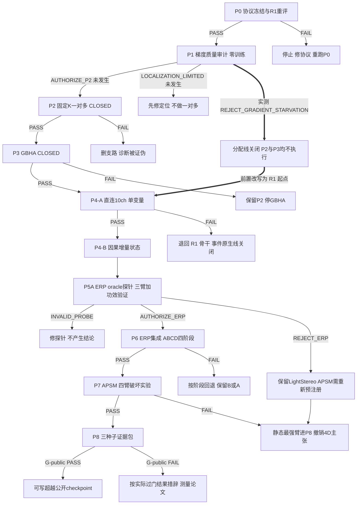
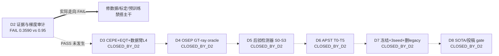

# StereoDETR / REP4D / EPiSet4D 实验与踩坑总档案

状态（2026-08-27 更新）：**EPiSet4D 路线冻结于 2026-08-23，在 Gate D1 停止；EPST-4D 于 2026-08-24 在其第一个门 D2 停止，主干从未实现，D3–D8 记 `CLOSED_BY_D2`。2026-08-24/25 的 R1' 零训练审计推翻了 D2 探针的真值判据（C76），D2 判定降级为 `SUSPECT_RIG_ARTIFACT`，路由 `FIX_DATA_CALIBRATION_PRETRAIN` 的"标定/数据修复"子项记 `CLOSED_CLEAN`，直接事件特征路线解禁。2026-08-25/26 的 A 系列三个训练臂（A1 hybrid matching、A2 SEIT、A3 联合）全部未过门，A3 触发 `KILL`（Vehicle strict 相对 R1 −36.8%，C82）。当前活跃路线是 EpiTube4D，其 Phase 0（继承仓库合同）于 2026-08-26 判 PASS，第一个 kill 点是 Phase 2 的聚合 AUC ≥0.95；除此之外没有任何训练授权。** 本文是面向复盘、交接与复现的单一入口，汇总已经执行的实验、决定性数字、失败路由、实现事故和长期约束。原始预注册、机器收据和专项文档仍是逐字段的权威来源；如本文与机器 JSON 冲突，以机器 JSON 为准。

2026-08-24 起，`docs/` 目录单文件化：全部其余文档逐字并入本文后删除（Git 历史保留原件）。任何旧文档、收据或源码注释中出现的下列路径，一律读对应附录：

| 旧路径 | 现位置 |
|---|---|
| `docs/PROJECT_HISTORY.md` | 附录 A（第 8 节） |
| `docs/FAILURE_LEDGER.md` | 附录 B（第 9 节） |
| `docs/RECIPE_DIFFERENTIAL_EVSTEREO3D.md` | 附录 C（第 10 节） |
| `docs/ARCHITECTURE_AND_RESEARCH.md` | 附录 D（第 11 节） |
| `docs/DATA_CONTRACT.md` | 附录 E（第 12 节） |
| `docs/REPRODUCIBILITY.md` | 附录 F（第 13 节） |
| `docs/episet4d/EPISET4D_MASTER_PLAN.md` | 附录 G（第 14 节） |
| `docs/episet4d/P0_PROTOCOL_FREEZE.md` | 附录 H（第 15 节） |
| `docs/episet4d/P1_GRADIENT_AUDIT.md` | 附录 I（第 16 节） |
| `docs/episet4d/T1_TRANSFER_DIAGNOSIS_PREREG.md` | 附录 J（第 17 节） |
| `docs/episet4d/D1_DENSE_INDUCTIVE_BIAS_PREREG.md` | 附录 K（第 18 节） |
| `docs/episet4d/CLAIM_WHITELIST.md` | 附录 L（第 19 节） |
| `docs/epst4d/D2_EVIDENCE_AND_GRADIENT_AUDIT_PREREG.md` | 附录 M（第 20 节） |
| `docs/epst4d/R1_PREREG.md` | 附录 N（第 21 节） |

附录 B–N 均为逐字并入：仅移除原文件顶部标题、其余标题整体降一级（代码块内容不动），并入时逐份做过逆变换字节校验。预注册类附录（G–N）在原文件中即为不可变文档，并入后同样只读；它们内部的互相引用与指向 `reports/` 的路径按原样保留。

2026-08-27 合入三个 debug session（`b2baf3` R1' 审计、`522f14` A 系列、`5fd9ba` EpiTube4D Phase 0）的产出：**踩坑条目 C76–C82 逐条进附录 B（第 9 节），实验读数与路由进第 2–3 节。** 与 2026-08-24 那批不同，这次**不删除**原件：`docs/proposals/` 下的会话文档保留为逐字原件（事实优先级高于本汇总，见第 7 节），因为当前活跃路线的主控文档正在引用它们——按 C75 的教训，合并文档时制造死链的代价比多留一个入口更高。对应关系：

| `docs/proposals/` 会话文档 | 内容 | 本文位置 |
|---|---|---|
| `C76_C77_LEDGER_ENTRIES_DRAFT.md` | 探针判据缺陷、三个修复靶点的零训练确认、D2 结论修订案 | §3.6、附录 B C76/C77 |
| `P2B_HYBRID_MATCHING_PREREG_DRAFT.md` | A1 臂预注册（一对多混合匹配） | §3.7 |
| `SEIT_PREREG_DRAFT.md` | A2 臂预注册（立体一致事件实例移植） | §3.7 |
| `A1_A2_RESULTS_AND_DEBUG_CONCLUSIONS.md` | A1/A2 读数、5 条被否决假设、6 个实现缺陷、H4 未决 | §3.7 |
| `A3_RESULTS_AND_DEBUG_CONCLUSIONS.md` | A3 的 KILL 判定与 oracle 归因 | §3.7、附录 B C82 |
| `C78_C82_LEDGER_ENTRIES_DRAFT.md` | C78–C82 条目全文与 runId 索引 | 附录 B C78–C82 |
| `EPITUBE4D_EXECUTION_PLAN_V2_DRAFT.md`、`EPITUBE4D_CODEX_PROMPTS_V2_DRAFT.md` | 当前活跃路线的主控 runbook 与逐阶段提示词（**活文档，不并入本文**） | §3.8 |

## 1. 当前结论

项目已经完成 Phase A–C、REP4D C0–C7、Phase R、EPiSet4D P0/P1/T1/D1，以及 EPST-4D 的 D2。P2/P3 被 Gate P1 合法关闭；Q1 的动机在预注册前被测量删除；D1 完成 4 卡、12 epoch、7,884 step 训练后判定 **FAIL**，路由为 `STOP_VEHICLE_REGRESSION`；D2 是零训练诊断阶段，判定 **FAIL**，路由为 `FIX_DATA_CALIBRATION_PRETRAIN`。因此 P4–P8 与 D3–D8 都没有获得执行授权，不能继续训练，也不能通过调权重、改阈值或同 seed 重跑绕过门。

当前最可靠的因果链是：

1. 行人失败不是原始事件稀少，也不是每个 GT 获得的正梯度不足。
2. 训练集三类都已饱和，问题发生在 train→val 迁移；行人比车辆严重得多。
3. T1 用实例身份解释了这种类别差异：train 只有约 134 个行人和 13 个骑行者，而车辆有 562 个。
4. D1 检验“稠密共享权重归纳偏置是否更能利用少量身份”。它显著提高了 Ped 3D/2D，但同时伤害 Vehicle 3D、Ped proposal recall 和 Vehicle oracle ceiling，联合门失败。
5. D2 检验后继路线赌的那一件事——事件直连特征能否让逐点立体对应可用。当时的读数是"不能"：带正控制（合成 AUC `1.0000`，C3 当年缺的正是这一环）的真实数据探针在 `K=9` 只到 `0.3590`，比 C3 自己的 `73.1%` 还低 `0.372`，离 C52 的 `0.95` 与让步后的 `0.90` 都不接近。同时排除了"证据不够"这个解释：60.8% 的支持点落在非空 voxel 上。
6. **这个结论在 2026-08-24/25 被推翻在判据上，不是在数字上（C76）。** 立体匹配发生在物体可见表面，而 D2 与初版探针拿 box 几何中心的 `fB/Z` 当真值视差，偏差约 `fB·(l/2)/Z²`（569×0.599 的标定下，10 m 处车差 8 px 以上）。独立重写的审计装置换成 8 角点表面带判据后，同一批数据上 train 带命中 `0.414→0.631`、0–10 m 桶 `0.000→0.778`，深度趋势从"近处更差"反转为物理正常，车的隐含表面偏移中值 2.18 m ≈ 真实车半长（机制指纹）。D2 判定因此降级为 `SUSPECT_RIG_ARTIFACT`，标定/数据子项记 `CLOSED_CLEAN`，直连事件路线解禁。**但 `0.3590` 本身既没有被复现也没有被反驳：D2 装置从未进入 git、现已不在磁盘（R0 §7.1），它只能作为文字记录引用。** C52/C69 的聚合后 ~0.95 复活线不变。
7. 三个修复靶点随即在零训练下被确认（C77、C79）：oracle 重排序把 Vehicle strict 从 6.26 抬到 11.39，**已经高于 EvStereo3D 公开 checkpoint 的 8.02**，说明车的缺口整个落在打分/排序内；立体一致的事件实例移植（SEIT）物理可行，移植后表面带命中 0.75–1.00，不低于真实行人基准 0.667/0.778；10–20 m 行人的物体级事件视差用朴素 ZNCC 即达 0.203 px，逐框容差 0.489 px，即行人 strict 需要的亚像素精度在这一段物理可达——而 20–30 m 需要 0.13 px、实测 0.55 px，物理接近不可达。
8. A 系列三个训练臂把这些证据变成了三次门失败，但每次都缩小了根因（§3.7）。决定性的分解口径是 **strict AP = oracle 天花板 × 排序效率**（oracle = 同一批框把置信度换成真实 3D IoU 重排，效率 = 模型 AP ÷ oracle AP）：A1 砍掉天花板（Veh oracle −32.7%）而效率分毫未动，A2 守住天花板（−2.6%）而效率 −17.9%，A3 联合后 Vehicle strict 相对 R1 −36.8% 触发 KILL。同一个 AP 损失可以是两种病，只看 AP 必然误诊。
9. A3 的 oracle 读数是目前最有价值的一条定位：**同一批预测框、把置信度换成官方 3D IoU 重排，行人 strict 是 3.653，与 EvStereo3D 公开 checkpoint 的 3.6448 同量级**；车辆 oracle 7.818 也贴着 8.022。框集合里已经存在竞品量级的检出，被模型分数压到了 0.943 / 3.954（紧覆盖车辆框的中位分数 `0.547→0.129`）。行人与车辆的第一瓶颈现在都指向打分，不是框。
10. 当前活跃路线是 EpiTube4D（§3.8），Phase 0 判 PASS，第一个 kill 点是 Phase 2 的聚合 AUC ≥0.95。**项目仍然没有任何三 seed 结果，没有越过 `G-public`/`G-paper`/`G-SOTA` 中的任何一门，不得声称 SOTA 或对 EvStereo3D 的优势。**

一条方法论上的收获值得单列：**D2 是本项目第一个先建正控制再读真实数字的阶段**，而它立刻付了成本——正控制通过、真实数据不通过，于是结论是可信的负结果而不是"可能是仪器坏了"。C3 当年缺这一步，代价是 73.1% 这个数字五个月里既不能用来否定机制也不能用来支持它。

C76 随后给这条收获加了一个必须记住的补丁：**正控制通过不代表判据正确。** D2 的合成正控制之所以能打到 1.0000，是因为合成位移相对的是同一个（错位的）真值定义——判据错位对正控制不可见，正控制只能证明"装置能检出它自己定义的信号"。因此正负控制之外还需要一条独立的**机制指纹**：C76 能定案，靠的是"车的隐含表面偏移中值 2.18 m ≈ 车半长 2.2 m"这个与判据无关的物理量出现在它该出现的位置。

一个重要的历史更正：早期文档曾因 train/val 共享 21 个 base drive 而称 val 不是跨场景测试。T1 证明该推断错误：train 140 个 chunk、val 38 个 chunk，二者没有共享 chunk；val chunk 到同 drive 最近 train chunk 的最小时间间隔为 **8.600341 s**。同 drive 不等于同场景，50 ms 窗口的 80% 相邻样本重叠也从不跨 split 边界。

## 2. 冻结协议与主记分板

主指标统一使用 moderate R40。AP11 只保留为论文历史对照，因为零有效 recall 也可能出现 `100/11 = 9.0909` 的离散地板。官方视图为约 11,400 query，主类为 Vehicle/Pedestrian；严格/宽松、2D/BEV/3D 和 R40/AP11 必须分字段保存。

| arm | Veh 3D strict | Ped 3D strict | Veh 3D loose | Ped 3D loose | Veh 2D | Ped 2D | 结论 |
|---|---:|---:|---:|---:|---:|---:|---|
| control p1b，12 ep | 3.7376 | 0.0705 | 20.4269 | 0.6548 | 12.6270 | 7.3043 | 冻结早期对照 |
| A0+，60 ep | 4.7426 | 0.0291 | 20.4942 | 0.7017 | 5.0391 | 0.0295 | 长训练未修复行人 |
| C2-A1，query birth 重分预算 | 1.8380 | 0.1720 | 12.3531 | 1.2998 | 7.8598 | 6.2332 | Gate FAIL |
| C2-A2，query birth 增量预算 | 1.4134 | 0.1383 | 13.1090 | 1.1607 | 10.8136 | 8.2578 | Gate FAIL |
| C2-A3，A2 关闭 decoupled ray | 1.8505 | 0.0792 | 13.6876 | 1.2478 | 11.1825 | 7.7448 | Gate FAIL |
| R1，control + stereo mirror | **6.2552** | **0.1896** | **25.2045** | **1.5205** | **16.1715** | 5.7552 | 最强内部基线，联合 Gate FAIL |
| D1，dense training-only head | **5.4986** | **0.7787** | — | — | — | **9.0035** | `STOP_VEHICLE_REGRESSION` |
| A1，hybrid matching（2026-08-25） | 4.2104 | 0.7218 | — | — | — | — | Gate FAIL，砍掉天花板 |
| A2，SEIT 事件实例移植（2026-08-25） | 5.0090 | 0.6686 | — | — | — | — | Gate FAIL，砍掉排序效率 |
| A3，A1+A2 联合（2026-08-26） | 3.9536 | **0.9430** | **25.6640** | **4.5480** | **19.5130** | **11.1030** | **KILL**，Veh 相对 R1 −36.8% |
| EvStereo3D public checkpoint | 8.0215 | 3.6448 | 42.0074 | 12.9412 | — | — | 外部参考，不是已越过的门 |

命名冲突提醒：上表的 `A1/A2/A3` 是 2026-08-25/26 的 A 系列训练臂，与 REP4D 时期的 `C2-A1/A2/A3`（query birth 三臂）**不是同一组实验**，引用时必须带前缀。A1/A2 只落了 strict 3D 与诊断字段，未跑 loose/2D 全套，故留 `—`；这是"未测量"，不是零。

EvStereo3D 论文数字与公开产物必须分开报告：公开 checkpoint 是 epoch 22，而论文称 60 epoch；公开权重缺 35 个 `dense_head_2d.*` 张量，私有 voxel 产物也不可得。固定评测器下，公开 checkpoint 的 strict R40 为 8.0215/3.6448，不能把论文数字冒充可复现的公开 checkpoint 数字。

自 A 系列起，任何臂的读数必须同时给 **oracle 天花板**与**排序效率**两列（C62 的比值纪律在 AP 上的应用）：oracle 用真实 3D IoU 替换置信度对同一批框重排，因此天花板衡量提案质量、效率衡量排序能力，两者相乘才是 AP。

| arm | Veh 模型 | Veh oracle | Veh 效率 | Ped 模型 | Ped oracle | Ped 效率 |
|---|---:|---:|---:|---:|---:|---:|
| R1（基线） | 6.2552 | 11.3907 | 0.549 | 0.1896 | 1.8659 | 0.102 |
| A1（hybrid matching） | 4.2104 | 7.6704 | 0.549 | 0.7218 | 2.5632 | 0.282 |
| A2（SEIT） | 5.0090 | 11.0994 | 0.451 | 0.6686 | 3.3273 | 0.201 |
| A3（联合，KILL） | 3.9536 | 7.8180 | ≈0.506 | 0.9430 | 3.6530 | ≈0.258 |
| EvStereo3D public checkpoint | 8.0215 | 未测 | 未测 | 3.6448 | 未测 | 未测 |

这张表直接给出 SOTA 缺口的算术：**Vehicle** 侧 R1 = 11.3907 × 0.549，守住天花板时只需把效率抬到 0.705（+28%）就越过 8.0215，且该预算已由 C77 的 oracle 重排证明存在，是纯排序/打分问题。**Pedestrian** 侧 R1 = 1.8659 × 0.102，历史最好效率 0.282（A1）乘历史最好天花板 3.653（A3）≈ 0.94，正好等于 A3 实测值——**配方级组合的数学上限就在 1 附近，永远够不到 3.6448**；按效率 0.5 计需要天花板 ≈7.3，只能来自新的深度精度机制。

三项 SOTA 门 `G-public`、`G-paper`、`G-SOTA` 全部 FAIL。项目没有任何三 seed 结果，因此不存在可用于 SOTA 声明的置信区间。

## 3. 完整实验时间线

### 3.1 协议、数据与基线阶段

| 实验/阶段 | 问题与单变量 | 结果 | 留下的结论 |
|---|---|---|---|
| G0/G1/G2 与协议清理 | 固定数据 manifest、因果窗口、类别、解码与评测身份；建立 tiny/scout/gate 流程 | 暴露 AP11 地板、类别过滤、top-k/threshold、dims/yaw/lrtb 等合同问题 | 先证明刻度、数据和 adapter 一致，才允许读 AP |
| A0+ | 在冻结旧架构上长训到 60 epoch | Vehicle 3D 4.7426，Ped 3D 0.0291；长训练不能修复少数类 | “多训一些”不是结构问题的答案 |
| P1/P2D | 修监督、正则化和少数类训练配方 | P2D 使 Ped loose R40 `1.501→0.514`，near-Ped recall `71.5%→约30%` | event dropout 0.5 会按多数类校准并擦掉小目标；train 好、val 塌的迁移问题开始显现 |
| P4A depth diagnosis | 分解稠密 depth map 误差与 query sampling 误差 | Ped 10–20 m map 误差约为 sampling 误差 4 倍，判 `MAP_LIMITED` | 授权研究新的深度表示；sample-point repair 永久关闭 |
| PV-V1 | 以时间核做零参数深度候选识别 | 绝对定位 0.4086 未过 0.55；相对 margin +0.1588 通过 | 只能声称时间戳提供边际证据，不能称独立深度估计器 |
| PV-V2 | 以陈旧关键帧深度测试 BEV 对齐/累积 | 伪 ego 平移误差中位 0.748 m，测量代理无效 | 跨窗几何证据必须与被测时刻同步 |
| PV-V3 / CERR | hard-depth 二选一和破坏臂 | 主臂 0.7062，但左目伪流 0.5522 超过 0.55 门，FAIL | far-side 信号可由左流伪影复现；分支取消 |
| S8 / G3 fixed & learnable / TSSE / RBEP | 固定/可学习连续事件窗、时间切片、残差双目等旧机制 | 未越过预注册门，部分读数钉在 AP11 地板；TSSE destruction 与原臂 Vehicle 2D R40 同为 4.4518 | 固定多窗不是 streaming state；pseudo-RGB 与 legacy dense depth 瓶颈未被触及 |

### 3.2 REP4D C0–C7 与 Phase R

| 阶段 | 实验内容 | 门结果 | 对后续的约束 |
|---|---|---|---|
| C0 | 工作树清理、协议冻结、评测器 parity、双确认删除 | PASS | 产物和代码身份由 hash/fingerprint 绑定 |
| C1 | caller-owned `StreamState`，显式 init/reset/detach/step，trainer/tester 接线 | PASS，合同测试通过 | 禁止 module-global sequence state；wrapper 必须保持 state_dict/参数名透明 |
| C2-A1 | 12 learned + 38 evidence query；IoU quality head；decoupled ray | FAIL | quality 融合关闭后两类所有指标反而改善，quality head 被自己的 kill 条件证伪 |
| C2-A2 | 保留 50 learned，另加 38 evidence | FAIL | 提案召回各距离桶改善，但 Veh 3D 1.4134、oracle 4.8642；“找得更多、框得更差” |
| C2-A3 | 相对 A2 仅关闭 decoupled ray | FAIL | AP 小幅恢复来自重排序，不来自几何；oracle 进一步降到 4.4804，Spearman 升到 0.4331 |
| C3 SCEP | oracle 2D ray 下稀疏 cuboid epipolar posterior | FAIL | Ped 10–20 m median depth error 2.09 m > 0.49 m；strict 命中 12.4% < 35%；8/8 cell 未胜 dense |
| C4 | predicted-ray SCEP | withdrawn | 输入机制 C3 已被证伪，不集成 |
| C5 PC-CES | 精确半群、分包不变 event state | withdrawn | 新颖性审计判核心性质 likely duplicative；只保留正确性合同价值 |
| C6 IPSF | 无 ID 的 set-OT temporal filtering | withdrawn | 区分它的方法接口依赖已失效的 posterior，不扩展实验面 |
| C7 | evidence package、claim whitelist、三项 SOTA gate | complete | 不合成不存在的 A4，不越权声称显著性或 SOTA |
| R1 | 唯一变量为左右 stereo mirror，12 ep | 联合 Gate FAIL，但 Veh 3D `3.7376→6.2552` | 零参数几何增广是最强内部 arm；同时 Ped 2D 降到 5.7552、Ped tight score 下降 |

C2 的关键故障分解：A1 在同一 checkpoint 上把 `gamma=0.5` 改为 `gamma=0`，Vehicle 3D 从 1.8380 升到 2.0922、Ped 3D 从 0.1720 升到 0.3864、Ped 2D 从 6.2332 升到 7.5618，说明 learned quality 没有贡献。A3 虽将 Vehicle matched 2D/3D IoU 提高约 3.3/3.5 倍并覆盖更多 GT，但 tightly-covered Vehicle 的分数中位从 control 的 0.2718 塌到 0.0093，AP 仍减半。几何与评分必须分开测。

C3 的关键结论不是“网格没调好”。把假设网格直接以真值为中心后，真值附近峰值仍只有 23.4%，真值分数高于错误深度仅 73.1%。这是证据信噪问题，不是搜索问题；在无模型 probe 把后者提高到约 95% 前不得复活 SCEP。

### 3.3 EPiSet4D P0–D1

| 阶段 | 测量/训练 | 决定性结果 | 路由 |
|---|---|---|---|
| P0 | 冻结 R1 协议，评测器侧 84 字段 parity，模型侧跨采样重评 | 初次 FAIL：400 query 中 113 个对象集合不同；修复 C63 后 0 个不同 | PASS；固定上报分数上的 threshold/sort/top-k |
| P1 | R1 train/val 各 1,200 跨采样样本的 focal 正梯度审计 | Ped/Veh 每 GT 正梯度质量 val=1.4487、train=1.6847，方向与“行人正梯度饥饿”相反 | `REJECT_GRADIENT_STARVATION`；P2/P3 关闭 |
| P1 Appendix C | 在真正上报分数 `sigmoid(cls)*exp(-sigma)` 上测 score-IoU ranking | Ped/Veh rho 比 val=0.25、train=0.91 | Q1 动机在预注册前被删除 |
| T1 | 仅读 manifest/标签/obj_ids，不训练 | train identities：Vehicle 562、Ped 134、Cyclist 13；迁移塌缩 9.7x/128.6x/188.2x；无共享 chunk，最小间隔 8.600341 s | `INSTANCE_DIVERSITY_LIMITED` |
| D1 calibration | 分解共享主干梯度并冻结 dense loss 权重 | “对总目标等幅”得到 c=110 并触发 guard；发现 `loss_depth` 占约 79%；改为与复制的 2D 监督等幅，冻结 c=14.0 | 规则在看任何 val/AP 前修订；不是调参 |
| D1 training | R1 + stride-4/8 共享权重、仅训练期 dense 2D 辅助头；4 rank、batch 64、AMP off、12 ep | Ped 3D `0.1896→0.7787`，Ped 2D `5.7552→9.0035`；Veh 3D `6.2552→5.4986` | FAIL，`STOP_VEHICLE_REGRESSION` |
| D1 guards | proposal/oracle/inference 合同 | Ped recall `0.7095→0.6688`；Veh oracle `11.3907→10.0444`；Ped oracle 升到 2.9589；14 项 inference contract PASS | 决定性 FAIL 后 diversity ordering、train-side audit 标 `NOT_RUN_AFTER_DECISIVE_FAIL` |
| P4–P8 | 原计划中的事件原生骨干、ERP/APSM、统计验证等 | 未运行 | `NOT_AUTHORIZED`，不得把“计划存在”写成“实验做过” |

P1 还解释了为什么“多给每个 GT 正样本”不是行人专属解：`group_num=11` 使每个 GT 的匹配 query 数恒为 11；train 上每 GT 未奖励的 tight-cover query，Ped 9.4741、Veh 9.2077，比值仅 1.0289。稀缺存在于类别总量与实例多样性，不存在于每实例正样本质量。

D1 的通过/失败逐项如下，机器收据见 `reports/episet4d/d1_dense/GATE_D1.json`：

| 判据 | 门 | D1 | 状态 |
|---|---:|---:|---|
| Ped 3D strict R40 | ≥0.3792 | 0.7787439 | PASS |
| Ped 2D R40 | ≥7.4818 | 9.0034561 | PASS |
| Vehicle 3D strict R40 | ≥5.9424 | 5.4986301 | **FAIL** |
| Ped proposal recall@0.25 | ≥0.7095 | 0.6688300 | **FAIL** |
| Vehicle oracle ceiling | ≥11.3907316 | 10.0444454 | **FAIL** |

### 3.4 EPST-4D D2（零训练诊断，2026-08-24）

预注册与逐条结果：[epst4d/D2_EVIDENCE_AND_GRADIENT_AUDIT_PREREG.md](epst4d/D2_EVIDENCE_AND_GRADIENT_AUDIT_PREREG.md)（结果为其 Appendix A）。唯一产物 `reports/episet4d/d2_audit/D2_AUDIT.json`，门 `tools/epst4d/d2_gate.py`，76 项测试在 `tests/epst4d/`。

| 判据 | 门 | D2 | 状态 |
|---|---|---:|---|
| 1 合成正控制 AUC | ≥0.95 | 1.0000（两臂各 144/144） | PASS |
| 2 真实 truth-vs-wrong（direct-event，最佳 K） | `C52_ALIGNMENT` 判定 | 0.3590（676/1883），对照 C3 的 0.731，差 −0.372 | **FAIL（`NOT_MET`）** |
| 3 Ped val 探针优势 **或** 可复现共享梯度冲突 | 任一 | 两者都成立：Ped Δ+0.1327，CI [0.0791, 0.1862]；`set_loss` 与 `d1_dense_cls` 在 11 个共享块中 5 个为负 | PASS |
| 4 Vehicle 探针不退化 | direct ≥ pseudo − 0.02 | 0.3238 对 0.2559，Δ+0.0678 | PASS |
| 5 全部时间合同 | 全 PASS | 8/8 PASS | PASS |
| 6 K 单调性 | 不下降 | 0.1328 → 0.1816 → 0.3590 | PASS |

结论与后续：判据 2 决定性失败，路由 `FIX_DATA_CALIBRATION_PRETRAIN`，**禁止搭建 EPST-4D 主干**，D3–D8 记 `CLOSED_BY_D2`，OSEP 按 C52 继续关闭（阈值不变，仍为聚合后 ~0.95）。三项次级结果全部指向"不要往主干方向走"：

1. direct-event 确实优于 pseudo-RGB，但增益全在多支持点聚合上（`K=9` 总体 +0.079，`K=1` 时 CI 跨零），且天花板只有 0.36。
2. 不是证据可得性问题：左目 60.8%、右目 58.2% 的支持点落在非空原始 voxel 上，1883 个目标里只有 25 个左侧完全无证据。
3. D1 的稠密辅助头**置换**而非分享主干梯度预算：占共享块梯度范数 0.47–0.58，set loss 只有 0.30–0.44。这约束未来所有辅助监督设计，但不解释 D1 的失败——移除冲突从未被测。

一项留作未解的观测：探针精度随距离上升、随成像尺寸下降（0–10 m 0.229 对 30 m 以上 0.421；<25 px 0.481 对 >50 px 0.252），方向与对应信号相反。唯一候选伪影（相对反深度带在远处被 1/80 截断后单侧化）已用逐目标分类器排除，1883/1883 全为 `bracketing`，val 真值最远 49.6 m，未到截断生效的 ~55 m。不给原因。

### 3.5 D2 的测量装置本身撞到的四个坑（C71–C74）

D2 是纯诊断阶段，没有训练，因此这一阶段的全部风险都在**装置**上。四个坑里有两个
在修好之前会让 D2 判 PASS，值得单独记住：

| 坑 | 症状 | 为什么它会伪造结论 |
|---|---|---|
| C71 计数单位未冻结 | "共享干路冲突层数 < 3"没定义"层" | 参数级必然 FAIL、整 backbone 级几乎不可能 FAIL；粒度即裁决。最终固定 stage 级 80 层，实测 80/80 冲突 |
| C72 负对照在训练集上评分 | 匹配头给**纯噪声**打出 AUC 1.0000 | 装置看起来"能检出信号"，实际检出的是记忆。改成留出集评分后回到约 0.5 |
| C73 测试断言概率巧合 | `band_symmetry` 在 60 m 恰好落 `one_sided`（约 9% 尾部事件），换种子即红 | 测的是种子不是代码。改为按有效深度范围构造确定性输入 |
| C74 合成 fixture 只对齐形状 | 极性写 `0/1`（合同要求 `-1/+1`）；query rate 实现成细分同一窗口，三个速率读同一份证据 | 判据 5 的 8/8 合同 PASS 在修好前是空的 |

C72 与历史 F16/F18 是同一个病的两半：那两条是 null 太弱（破坏臂不更差 → 假通过），
这条是 null 太强（负对照记住噪声 → 假通过）。**正负对照必须同时给数字，且都在留出集上评。**
D2 的三个数字之所以可信，正是因为这条链完整：合成正对照 1.0000、噪声负对照约 0.5、
真实数据 0.3590。

一个反直觉的收获：为一个**不存在**的伪影（单侧假设带）加插桩不算浪费。1883/1883 全为
`bracketing` 这个结果，把"0.3590 只是假设采样偏心"这个辩解提前关掉了，否则它会在下一次
复活申请里出现。

### 3.6 R0 仓库合同与 R1' 零训练审计（2026-08-24/25）

D2 之后先做的不是新机制，而是回答一个更基础的问题：**到底是哪一份代码产生了本文里的
R1/D1/D2 数字，那些产物今天还在不在。** 收据是 `reports/repo_contract.md`，全部条目给
实际路径与 SHA256 或写 `MISSING`，没有一条按文档猜路径。

| # | R0 判据 | 结果 | 判定 |
|---|---|---|---|
| 1 | 找到产生事件实验的真实源码与配置 | 事件代码全在 detached commit `9446413`（93 个提交，84 个不在 `main`）；103 个 `lib` 模块全部可导入；16 个 yaml 在拒绝重复键的严格 loader 下全部解析 | PASS |
| 2 | 找到或明确恢复 checkpoint | R1 的 epoch 001–011 逐 hash 与归档清单一致、strict 加载 674/674 键、参数 18,405,547；**`epoch_012.pth`（`9e21d6c8…`，208,212,110 字节）确认丢失** | PARTIAL，已裁决接受 |
| 3 | evaluator 与历史身份一致 | 5/5 fingerprint 覆盖文件 hash 精确一致，另 4 个评测路径文件一并登记；官方 val infos hash 一致 | PASS |
| 4 | 能复现 R1 关键数字 | 用固定评测器重评已验身份的预测 pickle：`fields_compared: 84`、`field_differences: []`，六个门字段最大 \|Δ\| 4.62e-05 | PASS |
| 5 | 文档/源码/配置/checkpoint 四方 hash 锁定 | §2 全表登记，含两棵树 HEAD、两份文档、manifest、四份归档清单、bundle | PASS |

三条由此产生的硬约束，后续阶段必须遵守：**不得声称任何权重与 R1 的原 artifact 同一**
（需要"从 R1 权重出发"时改用 `epoch_011.pth` 并显式标注是第 11 而非第 12 个 epoch）；
**R1 只能作为数字基线引用**，引用时指向复现表而不是指向一个 checkpoint 文件；
`tests/episet4d/test_p0_receipt_contract.py` 的 13 项 error 在缺口补上前是**已知且已归因**
的状态，不得被读作新的回归。被放弃的路线是 12 epoch 重训——它代价高且产物不会
bit-identical，换不来 identity。远端恢复路线也已逐条关闭：`epoch_012.pth` 从未进入 git
（全历史 `--diff-filter=A -- '*.pth'` 输出为空），远端只有一条 `refs/heads/main`、无 tag
因而无 Release 附件，而恢复已删除分支只能恢复源码。

同期还发现 D2 的全部装置（`tools/epst4d/*`、`tests/epst4d/`、`reports/episet4d/d2_audit/`）
**在整个 git 历史里提交数为 0**，且已不在磁盘上。D2 的数字因此永久失去可复核性，只能作为
文字记录引用；它留下的真正资产是 C71–C74 四条装置纪律，新探针必须逐条继承。

R1' 审计（session `b2baf3`，收据 `reports/r1_audit/R1_AUDIT_RECEIPT.md`，装置
`tools/r1_audit/audit_stereo_geometry.py` 与 `audit_fix_targets.py` 已登记 SHA256）
用四轮只读运行回答"底座有没有罪"：

| run | split | 内容 | 关键读数 |
|---|---|---|---|
| run1 | train | 中心视差判据 + H-A~H-G 排除清单 | 带命中 0.414；标定 ty/tz≈1e-15、cx/cy 差=0；方向正确率 96.8%；左右窗口时间一致 |
| run2 | train | 同样本换 8 角点表面带判据 | 带命中 **0.631**，0–10 m 桶 `0.000→0.778`；车隐含表面偏移中值 2.18 m |
| run3-val | val | 表面带判据泛化检查 | 0.649；行人 train 0.667 / val 0.778 |
| run4-fix | train | SEIT 移植原型 + 跨窗运动先验 | 移植命中 T0 4/4、T1 10/10、T2 远 12/12、T2 近 9/12；50 ms 窗间运动中值车 2.95 px / 行人 3.42 px，P90 ≈10 px |

结论就是第 1 节的第 6–7 条：**判据缺陷（C76）而非机制失败**，加上三个修复靶点的零训练
确认（C77）。这一步同时把"标定/数据修复"从路由里合法划掉——底座无罪，剩下的缺口在打分、
框质量与实例多样性上。

### 3.7 A 系列训练臂：A1 / A2 / A3（2026-08-25/26）

三个臂都在未提交的工作树 `/data1/lyq/code/.epst4d_v3`（branch `epst4d/v3`）上跑，基线是
R1 冻结配方，单变量纪律：除目标机制外其余配方与 R1 逐字节一致。预注册在
`docs/proposals/P2B_HYBRID_MATCHING_PREREG_DRAFT.md`（A1）与 `SEIT_PREREG_DRAFT.md`（A2），
都在看到任何数字前写定。

| 臂 | 唯一变量 | 门 | 结果 |
|---|---|---|---|
| A1 | 训练期一对多混合匹配（1 主组 + K=5 辅助组、行人定位代价 ×0.5）+ IoU-aware 软分类目标；不加新头、不改推理路径 | Veh ≥8.02 或（Ped ≥1.0 且 Veh ≥6.0） | FAIL：Veh 6.2552→4.2104，Ped 0.1896→0.7218 |
| A2 | SEIT 立体一致事件实例移植（供体池离线索引、视差/尺寸重缩放、跨场景粘贴），default-off | Ped >1.0 且 Veh ≥5.95 | FAIL：Veh →5.0090，Ped →0.6686 |
| A3 | A1+A2 联合，但 IoU-aware 只对行人开、不粘车、加 `max_coverage_of_existing: 0.15` 覆盖守卫、行人剂量 ≤6/样本 | 双类同过竞品线，Veh 跌幅 ≤20% | **KILL**：Veh →3.9536（−36.8%），Ped →0.9430 |

**A1 与 A2 掉的是不同的东西，这是本轮最重要的一条。** A1 把 Vehicle oracle 从 11.3907
砍到 7.6704（−32.7%）而排序效率 0.549 分毫未动——全局 IoU-aware 分类拿 2D IoU 当目标，
奖励"大致对"的框，而 strict 3D AP 只认深度上钉死的框，对占绝对多数的车是净损失。
A2 守住天花板（−2.6%）而效率从 0.549 掉到 0.451，主导解释（推断，非直接测量）是当时的
放置规则只查中心距离，允许移植物完全压住宿主场景已标注的目标、擦掉标注框下的真实事件，
从而制造标签噪声。行人两侧都赢且赢法正交：A1 把行人效率 0.102→0.282（C77 预测的"打分
修复"），A2 把行人天花板 1.8659→3.3273（+78%，C77 里"必须来自框质量/泛化"的那部分）。
A3 的全部依据就是这个正交性。

**一个必须记住的反直觉事实：A1 的框质量三臂最好，AP 三臂最差。** `mean_matched_iou_3d`
0.04388 与 recall@2D 0.70 = 0.3415 都是最高，strict 3D AP 却最低。"框做准了 AP 自然会涨"
在这个数据集上不成立，判断机制有害与否必须用 oracle 分解，不能用框质量指标。

五条假设被运行时数字否决，列在此处防止重复排查：

| 假设 | 测量 | 结果 | 裁决 |
|---|---|---|---|
| H1 分数被 0.1 解码阈值截断 | A1 阈值降到 0.0 重跑 | Veh 4.2104→4.2402（噪声级），Ped 0.7218→0.6254 **下降** | 否决：被丢的框排在假正例后面 |
| H3 3D 几何质量退化 | 比 `mean_matched_iou_3d` | 0.03443→0.04388，反升 27% | 否决 |
| H5 缺 3D NMS 导致重复框计假正例 | 对 A2 预测施加竞品同款 3D NMS（IoU 0.25）后重跑冻结评测器 | Veh +0.029、Ped +0.007 | 否决：一对一匹配让抑制多余 |
| H7 行人挤占车辆输出预算 | 按类统计检出数与分数分布 | 两类 `min_score` 都精确停在 0.1 | 否决：限制来自分数阈值不是 top-k |
| H8 分数分布变尖锐把正确检出切掉 | A2 阈值降到 0.0 | Veh 5.0090→4.7199、Ped 0.6686→0.5993，两类**更差** | 否决 |

H1 与 H8 从两个方向撞上同一堵墙，合并成一条规则：**本流水线的 AP 缺口不在解码阈值上，
不要再动它。** 仍然未决的是 H4（"均值 3D IoU 上升掩盖尾部变薄，而 strict AP 完全活在
尾部"）：只有 A2 落了 `recall_by_iou_3d_threshold`（Veh ≥0.70 = 11.1%（2607/23412）、
Ped ≥0.70 = 0.26%（15/5701）），R1 与 A1 的补测在叫停时只跑到 2000 query，**没有可比基线，
H4 不能裁决**。行人在 0.70 档只有 15 个真值被覆盖这一点本身已经说明：行人 strict 的上限
几乎完全由深度精度决定。

排查中修掉六个实现缺陷，其中第一个值得单独记账：

| # | 缺陷 | 影响面 |
|---|---|---|
| 1 | `_tiny_overfit` 读 `config["experiment"]["output_dir"]`，而所有 config 把它定义在 `training` 下 | **所有臂（含 R1）** 的 tiny-overfit 预检一律抛 `KeyError`，C40 的修复因此从未生效 |
| 2 | SEIT 移植未重新锚定时间戳 | `CausalEventVoxelizer` 报 "future event"，破坏因果性 |
| 3 | SEIT 在 GPU 张量上直接调 `numpy()` | 训练期崩溃 |
| 4 | SEIT 假定 target 一定有 `supervision_contract`，实际下发 `official_unfiltered` | 字段集不同，崩溃 |
| 5 | SEIT 放置只查中心距离 | 移植物可完全压住已标注目标；改为 `max_coverage_of_existing` 覆盖率守卫 |
| 6 | 供体池顺序扫 manifest（manifest 按序列排序） | v1 池 400 个行人供体只来自 12 个 `sequence_id`；改为按序列分层采样后 v2 为 841 个供体 / 43 个 `sequence_id` |

缺陷 1 是一个**测量装置缺陷**：它让四个臂的冒烟预检静默失效，不体现在任何 AP 上，只在
需要它拦住问题的那天暴露。移植这个修复是 EpiTube4D Phase 0.5 的第一步。

A3 的正式判定（session `522f14`，诊断收据 `reports/epst4d_v3/a3_joint/diagnostic/`）：
训练 12/12 epoch 机械完整（loss 11.09→3.04 单调、0 次 5× 中位数 spike），
checkpoint `epoch_012.pth`（`570012434b30…`），诊断 ~2h37m。门判定 **KILL** 双条同触：
pass 未达（3.9536 < 8.0215 且 0.9430 < 3.6448）、kill 触发（Veh −36.8% > 20% 限额）。
机制归因分五条：行人轴真实移动（strict 5×、框质量 0.234→0.364、0–10 m 证据覆盖
0.715→0.927，与 C79 一致）；车辆 strict 崩塌是**打分崩塌**（2D/loose 不掉反升，紧覆盖
中位分 0.547→0.129 即 −76%，Spearman 反升 0.332→0.452）；oracle 把行人瓶颈也钉在打分
（行人 oracle 3.653 ≈ 竞品 3.6448）；行人证据边界被剂量挤向近距（0–10 m +0.21，但
10–20 m −0.05、20–30 m −0.08、30 m+ −0.05）；远距行人可证伪线仍未过（val/train 远行人比
0.0052→0.0280 < 0.05 门）。对下一臂的约束：A3 不得作为联合胜出配方复投；下一刀打**车辆
strict 的分数校准/深度精度**，不是加行人剂量（C78：竞品每样本粘 8 行人，A3 的 6 不激进，
且剂量不解释车辆掉点）；>20–25 m 行人不设主张（C79 的物理边界）。

### 3.8 EpiTube4D 路线与 Phase 0（2026-08-26）

当前活跃路线。主控文档是 `docs/proposals/EPITUBE4D_EXECUTION_PLAN_V2_DRAFT.md`（逐阶段
提示词在同目录 `EPITUBE4D_CODEX_PROMPTS_V2_DRAFT.md`，逐阶段结果落开发树的
`EPITUBE4D_EXECUTION_LOG.md`），它们是活文档，不并入本文。路线选择的依据就是 §2 的
oracle×效率算术：物理预算仍然存在的杠杆只剩三个，全部在主链上——**预训练匹配描述子**
（P2，D2 路由授权的方向，C76 修正装置后零训练带命中已 0.63–0.78）、**对象级深度后验**
（P5，C79 证明 10–20 m 行人亚像素物理可达，是行人天花板翻倍的唯一已知机制）、
**posterior 原生 strict-risk 分数**（P7，攻效率缺口 0.549→0.705，替代被 C41 杀死的自由
quality head 并带同款自动删除条款）。

| 阶段 | 内容 | 状态 |
|---|---|---|
| P0 | 核验并继承仓库合同（不重做审计） | **DONE / PASS**（2026-08-26） |
| P0.5 | 零训练证据补全：H4 尾部裁决 + oracle×效率基线总表 + 装置修复移植 | READY |
| P1 | 标定复核（非重做）+ intensity 正控制 | READY，可与 P0.5 并行 |
| P2 | event-only descriptor 预训练，**授权门 = 聚合 AUC ≥0.95** | 待 P1 |
| P3–P5 | Causal Event State Pyramid → 解耦对象 tokenizer → EpiTube posterior oracle（A→D 不许跳级） | 待 P2 |
| P6–P7 | 静态 3D Set Detector 首门 → strict-risk 三臂打分 | 待 P5 |
| P8–P9 | Anonymous Posterior Transport → 三 seed / SOTA / 消融 / 清理 | 最后 |

Phase 0 的实跑内容与唯一 git 写操作：`git worktree add -b epitube4d-dev
/data1/lyq/code/.epitube4d 9446413`，从只读归档恢复 R1 预测 pickle（工具用前自验
SHA256），补上 manifest symlink（首跑 3 failed / 16 skipped 的唯一根因），冻结重评
**PASS，84/84 字段 0 差异、六门字段最大 \|Δ\| 4.62e-05**，合同测试 `tests/dsec3dod`
84 passed（38.81 s）。评测器/config/manifest/infos/预测共 9 项 hash 全部 OK，R1
6.255211 / 0.189565、D1 5.498630 / 0.778744、EvStereo3D 8.021549 / 3.644764 全部可追溯。

耗时锚点（实测，供后续估 ETA）：R1 冻结重评 CPU 27.9 s；`tests/dsec3dod` 84 项 38.8 s；
12 epoch 四卡 L20 训练约 10 h（51 min/epoch）；完整诊断（val 11400 query + train 2000
query）约 2 h 37 m，其中 train-split 2000 query @ ~0.31 q/s ≈1.8 h 是大头。

诚实声明照抄计划 §15：第一 kill 点是 P2 的 0.95，现有最好证据是修正装置后的零训练带命中
0.63–0.78，**距 0.95 仍有大缺口**，预训练+运动补偿+tube 聚合能否补上没有先例担保；不过门
即停主线、删除未授权 detector 文件，descriptor 与负结果走组件科学出口
（`COMPONENT_SCIENCE_VALID_BUT_NOT_SOTA`）。行人需要天花板（P5）与效率（P7）两个杠杆
同时起效，是主风险。P6 的三 seed 静态目标（8.2 / 3.8）高于 `G-public`（8.0215 / 3.6448）
是刻意留的余量；若落在两者之间，按 `G-public` 原文裁决，不得移门。

### 3.9 A 系列与审计阶段撞到的坑（C76–C82 概览）

这一轮的坑分三类，其中两类会**伪造结论**而不是让运行失败，逐条全文在附录 B：

| 坑 | 类型 | 为什么它危险 |
|---|---|---|
| C76 探针真值用 box 中心视差而非表面带 | 判据缺陷 | 直接产出一个"below chance"的负结果并关闭了一整条路线；正控制对它不可见 |
| C78 竞品配方差分漏掉 DB-sampler 阶段 | 审计缺陷 | 让"竞品唯一增广就是我们的 R1 镜像"成为独立支持句，而竞品每样本粘 8 行人 + 4 车 |
| C80 单卡工具传非 0 `cuda:N`；本机 CUDA 枚举序 ≠ nvidia-smi 序 | 环境陷阱 | 崩在自定义算子后的第一个 cublas 调用，长得像模型 bug；挑卡还会挑错物理卡 |
| C81.1 宿主机级 GPU 驱动退化 | 外因 | 无 traceback 的跨用户团灭，极易误判为自己代码 |
| C81.2 代理沙箱强制 cwd 到工作区根并禁写区外 | 环境陷阱 | watcher 相对路径永不触发、mkdir 越界被拒，全部表现为"静默失效" |
| C81.3 同一 arm 重复排队 launcher 共享 `train.log` | 运维陷阱 | 完成的 12 epoch 训练看起来"失败"，差点白重训 12 小时 |

C76 与 C72 是同一族但更深一层：C72 是负对照太强（记住噪声）造成假通过，C76 是**真值定义
错位**造成假失败，而且它躲过了正负控制。可复用的对策只有一条：正负控制之外还要有一条与
判据无关的**机制指纹**（C76 的指纹是"车的隐含表面偏移 ≈ 车半长"）。

C81.3 给出的判据值得升级为通用规则：**训练成败判据 = `training_log.jsonl` 的
`epoch_summary`（epoch == max_epochs）且对应 checkpoint 落盘**；`train.log` 尾部只是
"最后一个写入者的遗言"，退出码同理。

## 4. C01–C82 踩坑索引

本节确保每个合并后编号都有入口。完整根因、证据数字、修复与复活条件在本文附录 B（第 9 节，原 `FAILURE_LEDGER.md`）；源码/receipt 中的历史 `F##` 必须先查附录 B §0 的 F→C 交叉表，不能按本文编号猜测。

### 4.1 协议、数据、几何与旧机制（C01–C25）

| ID | 坑 | 永久规则/处置 |
|---|---|---|
| C01 | AP11 的 9.0909 地板 | 内部决策用 R40；AP11 仅作历史对照 |
| C02 | official decode 与协议不一致 | 类别过滤必须发生在 global top-k 前，入口由 fingerprint 测试绑定 |
| C03 | strict/loose、R40/AP11 混报 | 每个口径独立机器字段，禁止只留文字摘要 |
| C04 | 3D dimension convention | 内部固定 `[h,w,l]`，adapter 显式转换并做 corner round-trip |
| C05 | yaw 与 rectification | rectified camera yaw；边界减 `pi/2`；`sin/cos` 连续性测试 |
| C06 | 2D `l/r/t/b` 与 center-ray 混用 | 固定 `(l,r,t,b)`，分离 `box2d_ref` 与 `ray_ref` |
| C07 | class mean size 为零或 denominator 取 residual | 有效 class prior；`mean*exp(residual)`；分母不用近零 residual |
| C08 | foreground 判断把 class 0 当背景 | sigmoid 多标签不能用 `label>0` 判前景 |
| C09 | fixed G3 continuous event state | 固定多窗不是跨 query state；旧实现不作为主线 |
| C10 | TSSE | destruction 无差异，禁止改名复活 |
| C11 | RBEP | 旧 residual binocular path 未形成校准观测模型，分支取消 |
| C12 | 旧 CESE/窗口多尺度堆叠 | 真 streaming 必须过 split/rate/timestamp destruction 合同 |
| C13 | LightStereo dense map 是主瓶颈 | P4A 判 `MAP_LIMITED`；legacy 只作基线 |
| C14 | sample-point repair | perfect point 几乎无收益，永久停止 offset/grid-sample 主路线 |
| C15 | center-only disparity | 截断/遮挡/低纹理目标需 center/edge/corner support |
| C16 | 过早 soft-argmin | 多峰 posterior 不得第一层压成一个均值 |
| C17 | 只调 score/top-k/threshold | score-free ceiling 仍低；禁止把阈值搜索包装成方法 |
| C18 | 全局 query budget 吞噬小行人 | proposal recall 按 Q/尺寸/距离桶报告；预留预算不能凭空增召回 |
| C19 | class-unaware Hungarian cost | target column 读取真实类别概率，不得先 class max 再广播 |
| C20 | posterior matching 过早加入 | posterior 校准前不进 matcher；避免重复关联 |
| C21 | confidence 不等于 3D quality | quality/entropy 只有经校准并证明有效才参与排序 |
| C22 | observation 不可靠前加入 memory | 先单帧观测，后时序；reset/shuffle destruction 必须证明状态贡献 |
| C23 | 直接复制 StreamPETR/track-query | 无稳定 ID 监督时保持 permutation-equivariant，不偷换成 MOT |
| C24 | 完整 Scene Flow 主线 | 无 dense GT 且实验面过大，parked |
| C25 | 完整 VO/SLAM 主线 | 外部 pose 改任务合同，仅允许 identity/oracle 上限对照 |

### 4.2 训练、运行、测量与 C2/C3（C26–C52）

| ID | 坑 | 永久规则/处置 |
|---|---|---|
| C26 | event dropout + weight decay 不能修结构问题 | 增广按最小类校准，不能用正则化代替正确监督和召回 |
| C27 | 直接长训练再看 AP | RED contract→GREEN minimal→tiny/scout Gate，失败即停 |
| C28 | 隐式 module-global sequence state | state caller-owned；显式生命周期；sequence 按 rank 分片 |
| C29 | dimension loss 用 residual 作分母 | 用 class mean size 作分母，并保留 NaN/倍率合同测试 |
| C30 | 合规 decode adapter 存在但从未调用 | “实现存在”不等于生产入口使用；做端到端 protocol test |
| C31 | 训练分布正确但验证归零 | 始终并列 train/val 指标，不用 val AP 单独归因 |
| C32 | PV V1/V2/V3 测量单元先失败 | 时间戳仅 margin evidence；陈旧 GT/null 伪影使原机制不可判 |
| C33 | 陈旧深度 GT 不能证明时间机制 | 跨窗证据必须与当时刻同步 |
| C34 | clip 模式没有窗口摊销收益 | 吞吐实测，不能从瞬时利用率或错误配方外推 |
| C35 | 共享初始化 fixture 的并发写读竞态 | 同 launch 各 rank 同名、不同 launch 唯一；成功同步后 rank0 删除 |
| C36 | wrapper 静默改名并自我递归 | 委托 state_dict/named_parameters；键名集合与逐位输出合同 |
| C37 | numba/CUDA 路径令全测 segfault | evaluator 放隔离子进程；Gate 只承认整个测试目录退出码 |
| C38 | 端到端 AMP 在自定义 CUDA 算子上不可用 | MSDeformAttn 仅 FP32；AMP off，不写不可执行的容差门 |
| C39 | `--device cuda:N` 避不开坏卡且序号错位 | 用 GPU UUID、真正分配显存验活；只清自己的 PID |
| C40 | tiny-overfit 覆写冻结 receipt | 易失产物独立目录/.gitignore；每次跑后检查工作树 |
| C41 | learned quality head 被 kill 条件否决 | gamma=0 全面更好；删除机制，不扫 gamma |
| C42 | proposal recall 与 AP 使用不同 IoU | 宽阈值召回必须并列 matched-IoU 分布 |
| C43 | gap 门允许天花板一起塌 | 所有“距上限”门同时约束上限不得下降 |
| C44 | 固定预算的预留只搬运召回 | 保留 learned 预算再增 evidence；先做预算算术 |
| C45 | group attention 把 50 写死 | query 周期从 config 传入；搜索所有 split/repeat 字面量 |
| C46 | val 开头空帧让短跑安静测到 0 | 诊断跨采样；`queries==0` 是未测量，不是零结果 |
| C47 | 细化窗口经验值违反像素物理 | 先由 `f*b` 和 tolerance 推导离散网格，再实现 |
| C48 | `nohup` 挡不住 agent shell 的 SIGHUP | 长训练用 `setsid ... nohup ... </dev/null` 并二次验活 |
| C49 | 诊断重复跑 backbone/voxelizer | 从共享中间接口取量，避免第二次完整 forward |
| C50 | Gate 写了仪器不测的字段 | 每条门绑定工具字段；字段不存在先修仪器 |
| C51 | A1 事后诊断被 A2 证伪 | 事后解释须由单变量实验验证后才能成为新臂前提 |
| C52 | 稀疏逐点光度匹配信噪不足 | 真值居中仍弱；新 evidence probe 达约 95% 前不得复活 |

### 4.3 数据解释、预注册与 EPiSet4D/EPST-4D（C53–C75）

| ID | 坑 | 永久规则/处置 |
|---|---|---|
| C53 | 有效样本量按记录数算错 | 报不同 annotation、chunk、drive 和 identity；后续 T1 更正场景解释 |
| C54 | 50 ms 历史窗未消融且唯一增广杀少数类 | 数据配方必须以最小类不下降为门，且不冒充新颖贡献 |
| C55 | 把线性递归自动性质当创新 | 写代码前做定向新颖性检索；定理只算合同，不算贡献 |
| C56 | 行人失败不是事件证据不足 | 匹配面积下 Ped 每像素事件为 Veh 的 1.08–1.34 倍，零事件率 0% |
| C57 | posterior 期望销毁多峰 | Ped 上 MAP 优于均值但仍不够 strict；不要把诊断收益当主杠杆 |
| C58 | 预注册数值带可指错机制方向 | AP 回升与 oracle 下跌冲突时，以机制判据为准 |
| C59 | C2 是打分塌缩而非几何塌缩 | 框与分数分开测；well-covered score 是必要诊断 |
| C60 | 对手不是 DETR，标签分配提供第二个解释 | 逐行做 recipe differential，避免错误的架构同类比较 |
| C61 | 单臂不能证伪只部分检验的强假设 | claims 精确限制在被操纵变量与观测范围内 |
| C62 | mirror 对两类自信度方向相反 | 比值门必须同时报告分子与分母；记忆化不是充分解释 |
| C63 | 冻结产物中存在三把 decode 尺子 | threshold/sort/top-k 必须作用在最终上报分数，并由生产路径测试 |
| C64 | 每实例正梯度饥饿方向相反 | group assignment 令每 GT 正数为常数；P2/P3 关闭 |
| C65 | ranking 缺口只在 val，train 已接近饱和 | 对齐/重打分类预注册必须先证明 train 侧目标未饱和 |
| C66 | 框数掩盖实例身份稀缺 | 数据量以 obj identity 报告；同 drive 不能推出同场景 |
| C67 | `loss_depth` 占主干梯度约 79% | “与总目标等幅”前按 loss 分解；辅助项只对齐其复制的监督 |
| C68 | D1 行人提升但车辆/召回/oracle 回退 | 联合 Gate FAIL 即停；不做决定性失败后的补跑与阈值调整 |
| C69 | 事件直连特征的逐点立体对应仍失败：带正控制只到 0.3590 | 匹配机制的复活线不变（聚合后 ~0.95）；下次申请必须先推翻 0.3590，不得重新解释它 |
| C70 | 训练期稠密辅助头置换而非分享主干梯度预算 | 任何新增辅助监督提交前必须先量逐块 cosine 与 norm 占比，并说明是分享还是置换 |
| C71 | 判据的计数单位未与阈值一起冻结（"冲突层数 < 3"未定义"层"） | 任何计数类判据必须在预注册写明计数单位与该单位下的总数；梯度向量按层完整参数清单重建，缺失梯度填零 |
| C72 | 探针负对照在自己的训练数据上给纯噪声打出 AUC 1.0 | 每个对照臂与主臂共用同一 train/val 切分与评分路径；对照臂训练集分数不得作为功效证据 |
| C73 | 边界臂测试断言了一次概率巧合 | 断言真假若取决于随机种子则该测试无效；改为构造确定性输入 |
| C74 | 合成 fixture 只对齐 shape/dtype 而非合同语义（极性、query rate、device） | 写 fixture 前先把被测合同的取值域与语义抄进注释；设备取自 config 声明而非自选 |
| C75 | 被哈希锁定的 config 连注释都不可改：修一处死链即让 P0 冻结收据失配 | 编辑任何 config 前先查它是否出现在某份 `source_sha256` 里；锁定文件里的死链只记录不修改，绝不为过测试重生成冻结收据 |

### 4.4 探针判据、竞品配方、A 系列与运行环境（C76–C82）

| ID | 坑 | 永久规则/处置 |
|---|---|---|
| C76 | 立体对应探针拿 box 几何中心视差当真值，制造出"近处更差、大 patch 更差"的假负结果 | 真值一律取 8 角点投影视差区间 `[fB/z_far, fB/z_near]`±容差；必须附合成正控制并报控制通过率；必须分深度桶报告；控制失败的 patch 子集不计入结论 |
| C77 | 三个修复靶点的零训练确认（打分塌缩可修且预算明确、SEIT 物理有效、跨窗传播先验强） | oracle 重排把 Veh 抬到 11.39 是"车的缺口全在打分内"的锚点；行人打分修复上限 ~1.87，其余必须来自框质量/泛化 |
| C78 | 对竞品做配方差分时漏掉 DB-sampler 阶段：竞品每样本粘 ≤8 行人 + ≤4 车 | 数据管线的每个 stage 列表（augmentor chain、sampler、resample）必须逐项列举后才能下"没有 X"的结论，且该结论必须附 stage 清单证据 |
| C79 | 物体级事件视差的亚像素精度有物理边界：10–20 m 行人可达（0.203 px vs 容差 0.489 px），20–30 m 不可达（需 0.13 px、实测 0.55 px） | 行人主张与剂量集中在 ≲20–25 m；>25 m 行人不设主张。本条只证明精度可行域，**不替代** C52/C69 的 ~0.95 判别性复活线 |
| C80 | 单进程 GPU 工具传非 0 `cuda:N` 会在自定义算子后的第一个 cublas 调用崩；本机 CUDA 默认枚举序 ≠ nvidia-smi 序 | 一律 `CUDA_DEVICE_ORDER=PCI_BUS_ID CUDA_VISIBLE_DEVICES=<smi编号> … --device cuda:0`；按 nvidia-smi 挑卡必须带 `PCI_BUS_ID`，否则挑错物理卡 |
| C81 | 三个环境/运维坑连环：宿主机驱动退化团灭、代理沙箱强制 cwd 并禁写区外、同一 arm 重复排队 launcher 共享日志 | 长任务按"可被随机杀"设计（receipt 幂等 + 流式进度）；工作区外的树一律非沙箱启动 + 命令内嵌 `cd`，watcher 只用绝对路径；训练成败只认 `epoch_summary` + checkpoint 落盘，且重投前 `pgrep -f wait_and_train` 查存量队列 |
| C82 | A3 联合臂：行人 strict 5× 但车辆 strict −36.8% 触发 KILL；oracle 证明两类瓶颈都在打分不在框 | A3 不得作为联合胜出配方复投；下一刀打车辆分数校准/深度精度，不是加行人剂量；行人 oracle 已达竞品量级，score head/质量估计/排序校准是第一优先级 |

## 5. 反复出现的共性教训

1. **先证明仪器，再解释模型。** 协议、adapter、输出分数、IoU、空样本和 query 计数任一不对，AP 都不能承载科学结论。仪器的"功效"要双向证明：null 太弱会让破坏臂假通过（F16/F18），null 太强会让负对照假通过（C72），两者都要给留出集数字。判据的计数单位也算仪器的一部分（C71）。
2. **预注册必须绑定机器字段和路由。** 数字出现前冻结 threshold；出现决定性 FAIL 后立即停止未决测量，避免事后挑指标。
3. **比值、gap 和平均值必须拆开。** 同时报分子/分母、天花板、分布与分桶；否则两个退化量可以伪装成稳定比值或“gap 改善”。
4. **proposal、geometry、ranking 是三个瓶颈。** 宽 IoU recall 上升不保证 tight AP；更准的框若分数塌缩也不会贡献 AP。
5. **train 侧对照不可省。** 如果训练侧已饱和，继续加梯度、quality 或 matching 约束通常不可能修复 val-only 缺口。
6. **记录数不是样本多样性。** 本数据 42,140/11,438 条 train/val record 背后仅 8,540/2,318 个不同标注记录，89.7% 为插值；行人 20,629 个训练框只来自约 134 个身份。
7. **物理可行性在训练前算。** 视差格、stride、像素容差、同步性与证据信噪在设计阶段就能杀掉不可能的实验。
8. **默认关闭和单变量。** 研究模块保持 default-off；只有目标 arm 开启；配置扁平 diff 和 inference parity 共同证明变量唯一。
9. **运行环境也是实验协议。** GPU 用 UUID 而非序号，真实分配显存验活；四卡训练固定 `torchrun --nproc_per_node=4`、每卡 16、全局 batch 64、AMP off；长任务用 `setsid` 并验活。
10. **负结果要可恢复。** 代码、预注册、机器收据和 SHA256 清单保留；大 checkpoint/pickle/log 归档而非留在 Git，也不删除到无法复核。
11. **AP 是两个量的乘积，必须分开报。** strict AP = oracle 天花板 × 排序效率。A1 与 A2 掉了同一量级的 AP，病因却相反（一个砍天花板、一个砍效率），修法也因此相反；A1 更是三臂里框质量最好、AP 最差的那个。任何臂的读数不给这两列，等于没给诊断。
12. **审计必须核到调用点，"没有 X"是最贵的结论。** C78 的漏检来自只读了竞品 `stereo_data_augmentor.py` 的 crop/flip 段就断言"没有 copy-paste"，而真正的重剂量粘贴在 DB-sampler 阶段。同一个病在自家仓库的形态是 C30（合规适配器存在但生产路径从未调用）。凡是"没有 X"类结论，必须附被逐项枚举过的 stage/调用点清单。
13. **正控制之外还需要机制指纹。** 判据错位时正控制会跟着一起错（C76）：它只能证明装置能检出它自己定义的信号。可信诊断的第三条腿是一个与判据无关的物理量落在它该落的位置——C76 靠的是"车的隐含表面偏移中值 ≈ 车半长"。
14. **先证明运行环境没在骗你，再怀疑代码。** C80/C81 一个上午吃掉两次诊断 GPU 时：设备索引、CUDA 枚举顺序、沙箱 cwd、宿主机驱动复位、日志归属，五件事没有一件属于模型代码，但每一件都能伪装成模型 bug。排查顺序是先看跨用户症状与 `nvidia-smi` 的 `ERR!` 卡，再看调用约定，最后才读自己的栈。
15. **产物不进 git 就等于随时可能消失。** R1 的最终门 checkpoint 从未被跟踪，丢失后不存在任何远端恢复路线；D2 的整套装置同样从未提交，它的数字永久失去可复核性。门产物要么进归档并登记 SHA256，要么提前接受"只能作为文字记录引用"。

## 6. 当前代码、产物与复现状态

2026-08-24 的 post-D1 清理把已判死的机制从源码里删掉了，判决与证据逐行记在 `reports/episet4d/post_d1_cleanup/CLEANUP_DECISIONS.tsv`：C2 的 query birth / decoupled ray（含它在 StereoDETR 里的接线与三个 arm config）、C3 的 SCEP 与其 posterior loss 集、E1 的 ray-likelihood 观测模型、E1b 的稀疏跨视对应与其 bootstrap 辅助、QDP 的 posterior probe。删除后 R1 checkpoint 仍以 0 missing / 0 unexpected 载入同一模型，参数量 18,405,547 不变，`lib/models/event4d/build_voxel_event.py` 的新 hash 按漂移守卫的既有机制登记为 authorised change。留下来的是 D1 的 default-off 实现（账本要求负结果可从源码复现）、C1 的 caller-owned StreamState、`NoDenseVolume` 守卫（F32 要求"不建稠密体"这类架构主张必须在代码里可检验，EPST-4D 的 OSEP 继承该主张）、几何/数据合同与全部被 gate CLI 读取的工具。

生成产物按"记 SHA 后物理删除、不归档"处理，清单在 `reports/episet4d/post_d1_cleanup/ARTIFACT_INVENTORY.tsv`（64 个文件、2.91 MiB，加 23 个字节码缓存目录），四个冻结大文件与数据 manifest 在 keep-list 里逐条列明原因。

D1 实现和配置保留为 default-off，用于负结果复现；公共推理接口未改变。Gate CLI 读取冻结基线与 D1 JSON，验证 config/checkpoint/log hash，并返回 `0=PASS`、`2=科学门失败`、`3=协议或输入无效`。

关键入口：

- D1 机器收据：`reports/episet4d/d1_dense/GATE_D1.json`
- D1 预注册与结果：本文附录 K
- EPiSet4D 主路线：本文附录 G
- P1 梯度审计：本文附录 I
- T1 实例审计：本文附录 J
- claim 边界：本文附录 L
- 全历史与坑的详细证据：本文附录 B（第 9 节）

截至本档冻结时，全量测试结果为 **611 passed, 2 xfailed**，无新增失败。D1 的 46 个大产物（共约 4.73 GiB）已移到可恢复归档 `/data1/lyq/rep4d_archive/episet4d_d1_20260823`，清单中 46/46 个 SHA256 已复核。仓库只保留 JSON/JSONL/Markdown/Gate receipt，以及 Gate 直接依赖且经 P0 批准的四个大文件：

- `reports/a0plus/full60/epoch_060.pth`
- `reports/a0plus/full60/eval_epoch060/predictions_official_order.pkl`
- `reports/p0/parity/protocol/predictions_official_order.pkl`
- `reports/r/r1_stereo_flip/epoch_012.pth`

未来如有**重新预注册且获得授权**的新四卡训练臂，GPU 身份固定为：

```text
GPU-2855c9b4-edb8-af6a-360f-133dccf77098
GPU-92570675-c4a6-28a3-47ae-7ea10f075256
GPU-103d5a46-a798-138e-41da-bdd5d6e338d0
GPU-d68247d7-80ed-9904-fa62-8f6dea8862b5
```

这些 UUID 是未来协议，不是继续执行 P4–P8 的授权。D1 收尾本身不需要 GPU。

2026-08-24 的 R0' tracked 清理删除了 17 个已关闭阶段的一次性诊断/清理脚本和 4 个只服务于它们的测试（`tools/g3_depth_diagnostic/` 与 `tests/g3_depth_diagnostic/` 整目录、C2/P1/P2/DDP 诊断探针、REP4D 代清理三件套、`d1_calibrate_loss_weight.py`、`p0_reeval_r1.py` 等）。删除前逐一记录 SHA256，收据在 `reports/epst4d/r0_cleanup/TRACKED_CLEANUP_20260824.tsv`，恢复途径是 Git 历史。判定标准：被 gate CLI、测试合同、byte-pinned 配置注释或负结果复现需求引用的工具一律保留（如 `p1_gradient_audit.py`、`p4a_depth_error_decomposition.py`、`p1b_class_mean_size.py`、`p0_cyclist_slot_census.py`）；只在冻结收据里被历史性提及的一次性脚本删除。两份决策 TSV（`tools/rep4d_cleanup_decisions.tsv`、`tools/episet4d/p0_cleanup_decisions.tsv`）作为审计痕迹保留，其中对已删脚本的旧 KEEP 决策被本次清理有记录地推翻。

### 6.1 2026-08-27 的树、分支与产物分布

R0 之后的一个关键事实：**`main` 上没有任何事件实验代码。** 交接时必须先看清四棵树的分工，
否则会在 `main` 上找一个从来不在那里的文件。

| 位置 | 身份 | 内容与注意事项 |
|---|---|---|
| `/data1/lyq/code/StereoDETR`@`main` | 主树 | 本档、`docs/proposals/` 会话文档、`reports/repo_contract.md`、`reports/r1_audit/`、`tools/r1_audit/` 三个审计探针、`tests/test_strict_yaml_loader.py`，加 RGB/KITTI 版 StereoDETR 主干 |
| `9446413`，分支 `epst4d-archive` 保护，工作树 `/data1/lyq/code/.epst4d_r1a_frozen` | 93 个提交，其中 84 个不在 `main` | **全部事件实验代码**：`lib/datasets/dsec3dod/`、`lib/models/{event4d,rep4d,episet4d,monodetr}/`、16 个 yaml、四套合同测试、31 个 `reports/` 子目录。该 commit 原先只由 detached HEAD 保活，R0 建保护分支是当时唯一的 git 写操作 |
| `/data1/lyq/code/.epst4d_v3`，branch `epst4d/v3`，**未提交** | A 系列工作树 | A1/A2/A3 的配置、SEIT 与 hybrid matching 实现、三份诊断收据。**清理该树前必须先归档 A 系列收据**，否则 H4 的证据不可复核 |
| `/data1/lyq/code/.epitube4d`，branch `epitube4d-dev`（从 `9446413` 建） | EpiTube4D 开发树 | 当前活跃路线的落点，Phase 0 已在此 PASS |

两个易踩的产物事实：`lib/datasets/dsec3dod/manifest/records.jsonl`（`b2afa842…`，
135,886,083 字节，53,578 query）是唯一数据入口，事件树与开发树都按 symlink 指向主树这一份，
但它 **135 MB、不进 git**（`.gitignore` 已登记），换机器或清理主树前必须先从
`/data1/lyq/stereodetr_docs_backup_20260824/` 恢复，否则所有 dataset 测试会以"链接失效"
形态失败；`reports/r/r1_stereo_flip/epoch_012.pth`（`9e21d6c8…`）**已丢失且远端恢复路线
已关闭**，R1 只能作为数字基线引用（§3.6）。

`tools/r1_audit/` 的三个探针（`audit_stereo_geometry.py`、`audit_fix_targets.py`、
`probe_subpixel_disparity.py`）按惯例留档并已登记 SHA256，它们是 C76/C77/C79 的复核入口，
可直接复跑；一次性审计脚本按约定留在 `mktemp -d` 中不提交，身份登记在
`reports/repo_contract.md` §9。

## 7. 阅读顺序与事实优先级

建议按以下顺序复核：

1. 本文第 1–7 节：快速掌握所有实验、终态和坑索引。若只有十分钟，读第 1 节与第 2 节的两张记分板——SOTA 缺口的算术全在那里。
2. 本文第 3.6–3.9 节：2026-08-24 之后的四件事（仓库合同、判据更正、A 系列三臂、当前路线），也是理解"为什么现在打的是打分而不是框"的入口。
3. 本文附录 A（第 8 节）：REP4D 阶段的逐实验因果链和决定性数字。
4. 本文附录 B（第 9 节）：C01–C82 的完整证据、修复和复活条件。
5. 本文附录 F（第 13 节）：protocol fingerprint、seed/CI/bootstrap 和 claim 纪律。
6. 本文附录 E（第 12 节）：数据、时间、几何与 split 合同。
7. 本文附录 C（第 10 节）：与竞品 EvStereo3D 实现的逐行差分（**读时先看 §2.1 的 C78 批注**）。
8. 本文附录 G–N：P0/P1/T1/D1/D2/R1 的预注册、修订披露和阶段路由（原为不可变文档，并入后同样只读）。
9. `reports/repo_contract.md` 与 `reports/r1_audit/R1_AUDIT_RECEIPT.md`：交接与复现的实际路径、SHA256 与缺口清单。要动代码或换机器，从这两份开始。
10. `docs/proposals/`：A 系列的两份预注册、三份结果文档、C76–C82 条目草稿（逐字原件），以及当前活跃路线的 runbook 与提示词（活文档）。

事实优先级从高到低为：机器 receipt/JSON → 在数字出现前提交的预注册 → 专项结果文档（含 `docs/proposals/` 会话文档与 `reports/` 收据）→ 本汇总。历史论断被后续测量更正时，以更晚且更直接的测量为准，但原论断和更正都保留在时间线中——附录 C §2.1 与附录 A 的 C78 批注、第 1 节第 5–6 条的 D2 更正都是这个规则的实例。

## 8. 附录 A：REP4D 逐实验因果链

本附录原为独立的 `PROJECT_HISTORY.md`，2026-08-24 合并进本文以减少入口数量。它把十份阶段文档（REP4D 执行摘要、Phase R 计划与失败报告、三份 C2 臂报告、C3 失败报告、架构重估、60 席对抗评审、C7 证据包）压成一份逐实验因果链；每个决定性数字都逐字来自原件并带 receipt 路径。小节编号与标题保持原样，因此外部文档里指向 `#3-c2-...`、`#61-gate-r1`、`#7-the-60-seat-adversarial-review` 之类的锚点仍然有效。

一处例外要说明：`configs/dsec3dod/r1_stereo_flip.yaml` 与 `configs/dsec3dod/episet4d_d1_dense.yaml` 的注释里仍写着合并前的文件名。这两个文件的 sha256 被 `reports/episet4d/d1_dense/GATE_D1.json` 的身份字段锁定（D1 config 为 `6bfbac1e...`），改一个字符就会让 D1 的 gate 拒绝复核自己的负结果，所以宁可留下这两处陈旧路径——它们指的是本节。

### 3. C2: query birth, the decoupled ray, and the learned quality head

Three full-budget arms against the frozen control `p1b_repair_recon12`, same
seed, schedule, batch and evaluator. Thresholds fixed before each arm finished
training (`reports/c2/C2_BASELINE_AND_GATE.md`, `C2_GATE_V2.md`,
`C2_GATE_A3.md`).

#### 3.1 The quality head was refuted by its own kill condition

Re-scoring one checkpoint at `gamma = 0` switches the fusion off and ranks by
classification probability alone. Weights, boxes and query set are identical.

| metric | control | A1, gamma=0.5 | A1, gamma=0 |
|---|---|---|---|
| Vehicle 3D moderate R40 | 3.7376 | 1.8380 | 2.0922 |
| Pedestrian 3D moderate R40 | 0.0705 | 0.1720 | 0.3864 |
| Pedestrian image moderate R40 | 7.3043 | 6.2332 | 7.5618 |
| Vehicle score-IoU Spearman | 0.3891 | 0.3146 | 0.3948 |
| Pedestrian score-IoU Spearman | 0.0973 | 0.2108 | 0.2154 |

Turning the head off improves **every** metric on both classes, and the
pedestrian Spearman barely moves (0.2108 against 0.2154), so the ranking gain
that did occur came from the query set and the decoupled ray rather than from
learned quality. Ledger C41. The mechanism was removed rather than re-tuned:
sweeping gamma to find a helpful value is exactly the threshold search the route
forbids as a primary method.

#### 3.2 A1's post-mortem was falsified by A2

C2's first report attributed A1's vehicle collapse to the birth budget being
*re-split* — 50 learned queries cut to 12, with 38 given to evidence proposals —
and predicted that keeping all 50 and adding 38 on top would restore vehicles.

| arm | learned queries | Veh 3D moderate R40 |
|---|---|---|
| control | 50 | **3.7376** |
| A1 (re-split) | 12 | 1.8380 |
| A2 (additive) | 50 | **1.4134** |

Restoring the learned queries made vehicles *worse*. The oracle ceiling fell
with it, 7.3186 to 4.8642, so the boxes themselves degraded in 3D rather than
merely being mis-ordered. Ledger C51.

A2's one unambiguous success: proposal recall improved or held in **every**
distance bin for both classes, with pedestrians at 20-30 m going 0.6410 to
0.7672 and 30 m+ going 0.4585 to 0.5802, and the anti-cannibalisation companion
confirming the near bins were not robbed to pay for the far ones. The additive
budget did exactly what it was designed to do.

#### 3.3 A3 exonerated the ray and found the real mechanism

A3 differs from A2 in exactly one semantic key, `rep4d_decouple_ray: true ->
false`, verified by flattening and diffing both YAMLs. The pre-registered band
rule keyed on vehicle 3D moderate R40 and returned RAY PARTIAL at V = 1.8505,
whose literal next step was a 50 to 60 budget ablation.

**That step was not taken, because the gate's own mechanism criterion answered
the opposite way.**

| quantity | control | A2 | A3 |
|---|---:|---:|---:|
| Vehicle 3D moderate R40 | 3.7376 | 1.4134 | 1.8505 |
| same, **oracle ceiling** | 7.3186 | 4.8642 | **4.4804** |
| Vehicle score-IoU Spearman | 0.3891 | 0.3045 | **0.4331** |

The ceiling fell further while the ranking correlation rose above the control's,
so the entire 18.8% "recovery" is re-ordering and none of it is geometry. Ledger
C58: a pre-registered numeric band must be paired with a mechanism criterion, and
when the two conflict the mechanism criterion wins.

Then the repaired 2D instrument (ledger C50) became available on both arms for
the first time, and it showed A3 better than the control at **every** geometric
quantity, both classes, every threshold:

| quantity | control | A3 | |
|---|---:|---:|---|
| Vehicle mean matched 2D IoU | 0.0549 | **0.1793** | 3.3x |
| Vehicle mean matched 3D IoU | 0.0287 | **0.0991** | 3.5x |
| Vehicle recall @ 2D IoU 0.50 | 0.5196 | **0.6527** | |
| Vehicle recall @ 2D IoU 0.70 | 0.2472 | **0.3687** | |
| Pedestrian mean matched 2D IoU | 0.0199 | **0.0626** | 3.1x |
| Pedestrian recall @ 2D IoU 0.50 | 0.2361 | **0.2842** | |

And vehicle 3D AP still halved. One number reconciles it:

| | control | A3 |
|---|---:|---:|
| Vehicle ground truth tightly covered (2D IoU >= 0.5) | 12,165 | **15,282** |
| Vehicle median best 2D IoU per ground truth | 0.5144 | **0.6076** |
| **Vehicle median score when tightly covered** | 0.2718 | **0.0093** |
| Pedestrian median score when tightly covered | 0.0193 | 0.0097 |

A3 finds 3,117 more vehicles than the control, draws tighter boxes around them,
and assigns the typical well-covered vehicle a score of **0.0093** where the
control assigned **0.2718**. AP is an ordering metric, so a tightly boxed object
scored at 0.01 contributes nothing. Ledger C59.

This is the turning point of the project: **"did not find it" and "found it and
does not believe it" require completely different research programmes**, and only
the second one is happening here. The mean of this score quantity exceeds 1 in
both arms, so it is not a normalised probability and only the median is quoted —
see §7 attack 4 for why the ceiling argument should lead instead.

---

### 4. C3: SCEP falsified by removing the search

Oracle conditions throughout: SCEP receives the ground-truth 2D centre, size and
yaw, so depth is the only unknown. Full validation split, 26,829 objects.
Pre-registration in `reports/c3/C3_GATE.md`.

Gate criterion 1 required pedestrian 10-20 m median depth error <= **0.49 m**;
the best SCEP configuration gives **2.09 m**, off by 4.3x. Criterion 2 required
>= 35% inside the 0.243 m strict tolerance; SCEP gives 12.4%. Criterion 6 (beat
the dense map it replaces) fails in **all eight** cells.

Two intermediate findings are worth keeping because both are reusable:

**The pyramid was too coarse to sample, and arithmetic said so without an
experiment.** The refinement round separates hypotheses by 0.44 image pixels;
the level used was stride 8, where that is 0.055 pixels. Two bilinear samples a
twentieth of a pixel apart return nearly the same descriptor, so all 24 refined
hypotheses scored the same. A stride-1 matching stem (~7k parameters) fixed the
resolution and helped exactly where predicted — pedestrian 10-20 m strict rate
6.8% to 12.4% — and did not come close to closing the gap. Fixing the sampling
revealed that sampling was not the binding constraint.

**The decisive experiment removed the search entirely.** Centre a narrow grid on
the ground truth and ask whether the evidence peaks there; with the search
removed, any remaining failure belongs to the evidence. 809 objects, +-8 px
window, 0.70 px spacing, trained stem:

| quantity | measured | chance |
|---|---|---|
| peak lands within one bin of the truth | **23.4%** | 12.5% |
| evidence at truth beats evidence at a wrong depth | **73.1%** | 50% |
| mean logit at truth vs at a wrong depth | 1.30 vs 1.01 | — |

A signal that ranks the true depth above a wrong one only 73% of the time cannot
produce sub-pixel disparity under any search strategy, because there is nothing
sharp to find. More rounds, wider windows and multi-mode refinement all search
the same flat landscape. This is what converts C3 from "needs more work" into a
kill.

**Root cause.** Left and right event streams fire on largely independent noise.
Two reconstructed views are not two photographs of the same scene, so per-point
photometric agreement is weak — and per-point photometric agreement is exactly
what SCEP's evidence is. A dense matcher does better on the same input because a
cost volume plus deep aggregation does not rely on any single point agreeing; it
regularises a weak per-point signal across a neighbourhood and across disparity.
SCEP's sparsity is precisely what removes that mechanism.

**Reopening condition (ledger C52).** A matching mechanism must raise
truth-beats-wrong above ~95% on a model-free probe, demonstrated *before* any
integration work. The original probe `tools/c3_evidence_probe.py` was deleted with
the rest of the C3 source; the successor is EPST-4D D2's
`tools/epst4d/probe_event_representation.py`, and this clause is what the whole
EPST-4D route's first gate is written against. It is also why that probe must run
a synthetic positive control — see §7 attack 2.

**Survives from C3 and should be kept:** `cuboid_geometry.py` and its 12
contract tests (reprojection of the ground-truth centre agrees with the dataset's
projected centre to 0.000 px), `tensor_guards.py`,
`StereoDETR.stereo_feature_pyramid` (a pure refactor that removed a duplicated
backbone pass, ledger C49), and the physics derivation of the refinement width
(ledger C47), which caught a configuration that would have failed C3 by
construction. `posterior_losses.py` was on this list and has since been deleted:
D4 rewrites proper scoring against a preregistered calibration gate rather than
inheriting a loss set built for a falsified mechanism.

---

### 5. Architecture reassessment: the pillars do not survive their own audit

Written after C2 failed twice and C3 once, at the point where the next step would
have been to spend compute on C4.

**SCEP** — dead by measurement, above.

**PC-CES** — its advertised novelty was *exactness*: a state whose value at query
time does not depend on how the stream was packetised. But any linear
time-invariant recurrence with exponential kernels forms a semigroup, and a
semigroup is packetisation-invariant by construction. This is a theorem about the
mechanism, not a property that had to be invented. A targeted search on
2026-08-21 found three independent overlaps immediately:

| work | overlap |
|---|---|
| Zubić et al., *State Space Models for Event Cameras*, CVPR 2024 | SSMs as continuous-time systems for events; inference at arbitrary frequencies |
| Schöne et al., *Scalable Event-by-Event Processing with Deep State-Space Models*, 2024 | explicitly disentangles the step size so an event's normalisation does not depend on other events' relative timing — packetisation invariance as the stated design goal |
| *Maximizing Asynchronicity in Event-based Neural Networks*, ICLR 2026 | hidden state updated recurrently on each individual event's arrival |

Novelty label for the exactness claim: **likely duplicative** (ledger C55). What
survives — a *spatial* state bank scattered to pyramid strides with a query-time
adaptive readout rather than a token-sequence SSM — is **differentiated** but is
an encoder variant, not a headline contribution.

**IPSF** — its distinctive claim was never "track without IDs" on its own; it was
*posterior as interface*, propagating a calibrated multimodal depth posterior
between query times with SCEP producing it. SCEP's death removes the producer,
and what remains propagates a scalar and a variance, which a reviewer compresses
into "Kalman + Sinkhorn". Viable as one mechanism inside a paper; not a pillar,
and not worth building before the thing it would improve is worth improving.

#### 5.1 And the pillars were aimed at the wrong target anyway

Two model-free probes were commissioned for this reassessment. Neither trains
anything, and together they close off an entire research direction.

**The sensor delivers pedestrians** (`tools/evidence_density_probe.py`,
`reports/evidence/{train,val}.json`). Counting raw rectified events inside
ground-truth 2D boxes, compared at **matched pixel area** in the 500-1500 px²
band that straddles the ~59 px box height where the 103x hit-rate gap was
measured:

| split | window | Veh median events | Ped median events | Ped/Veh per px² |
|---|---|---:|---:|---:|
| val | 10 ms | 418 | 425 | **1.08** |
| val | 25 ms | 1,049 | 1,058 | **1.15** |
| val | 50 ms | 2,049 | 2,105 | **1.10** |
| train | 50 ms | 2,278 | 2,583 | **1.34** |

At equal pixel area a pedestrian receives **more** events per pixel than a
vehicle, in both splits and at every window length, and the fraction of objects
with **zero** events is **0.0%** in every class, distance bin and window —
including pedestrians at 30-60 m, which still collect a median of 542 events
inside a 371 px² box. So a pedestrian the detector hits 0.59% of the time is
sitting under roughly 2,100 events. `EVIDENCE_LIMITED` is excluded by direct
measurement (ledger C56). §7 attack 3 constrains how this may be worded.

**The depth posterior is multimodal, and it is not the lever either**
(`tools/qdp_posterior_probe.py`, 8,635 oracle-placed queries). The dense matcher
computes an 81-bin depth distribution per pixel and destroys it by taking the
expectation before any query reads it. The control is exact: sampling the
probabilities and taking their expectation reproduces the scalar the model uses
today to 1.7e-5 m.

| class | bin | expectation (used today) | MAP | best mode (oracle) |
|---|---|---:|---:|---:|
| Pedestrian | 10-20 m | 1.26 m | **0.73 m** | 0.63 m |
| Pedestrian | 20-30 m | 2.33 m | **1.30 m** | 1.13 m |
| Vehicle | 10-20 m | **0.47 m** | 0.56 m | 0.51 m |
| Vehicle | 20-30 m | **1.05 m** | 1.38 m | 1.16 m |

The class reversal is what boundary contamination predicts: a small object's
stride-4 cell is mostly background, so averaging drags the estimate into the
valley between the object and what is behind it, while a large object's cell is
mostly object and averaging denoises. Switching pedestrians to the mode is a 42%
median depth-error reduction at 10-20 m for zero training cost — and it is still
not a lever, because the strict tolerance barely moves (15.30% for the
expectation against 14.88% for the oracle mode) and beyond 30 m the probability
mass within tolerance of the truth is **0.0000**. Recorded as a cheap optional
ablation (ledger C57), not a phase.

#### 5.2 Effective sample size

Read directly from the frozen manifest, not quoted from an earlier document:

| quantity | train | val |
|---|---|---|
| records | 42,140 | 11,438 |
| distinct annotation records behind them | **8,540** | 2,318 |
| labels that are manual | 10.3% | 10.3% |
| labels interpolated between manual keyframes | **89.7%** | 89.7% |
| manual keyframe spacing | 100 ms | 100 ms |
| distinct base drives | **34** | 21 |
| history window duration | 50 ms, every single record | 50 ms |

Consecutive queries are 10 ms apart while the history window is 50 ms, so
neighbouring samples share 80% of their events; treating 42,140 as independent
would simultaneously overstate the budget, understate overfitting and
misinterpret what an epoch means. And **all 21 validation drives also appear in
training**, so validation is close to the easiest generalisation test one could
construct, which makes the observed collapse worse rather than better. Ledger
C53 corrects an earlier figure of 1,054 to 8,540 without changing that argument's
direction.

---

### 6. Phase R: the mirror, and the separation it produced

Pre-registered before R1 produced a number. One variable: `stereo_flip.probability
0.0 -> 0.5` on top of the frozen control, everything else byte-identical. R1
deliberately does **not** build on A3, because A3's query-birth machinery is
unvalidated and is the proximate cause of the C59 score collapse.

**Why a mirror is exact here rather than approximate.** Both DSEC-3DOD
calibrations have `K_left == K_right` exactly and a rotation-free, pure-x
baseline, so mirroring the world about the plane midway between the camera
centres maps the left camera onto the right camera: the mirrored left view *is*
the old right view, flipped. One rigid transform produces all four changes.

```
events        x -> (W-1) - x, and the two streams swap
intrinsics    cx -> (W-1) - cx
box centre    x -> b - x
heading       yaw -> -yaw            since S.R_y(t).S = R_y(-t)
```

Dense depth is warped rather than masked: the baseline is rotation-free, so a
point keeps its z and moves only by the disparity `f.b/z`, making the right-view
map an exact horizontal scatter with a z-buffer. Masking would have halved the
dense-depth supervision and given any vehicle regression two explanations.

Verification before training: 20 contract tests pass; a double flip through the
real adapter on real data returns every tensor to within **4.8e-7**; the
projected 3D centre matches the mirrored right-view projection to **6.1e-5 px**;
camera z is exactly invariant; the implementation that forgets `cx` was caught,
off by 34.668 px; 92.6% of depth pixels are preserved by the warp.

#### 6.1 Gate R1

| # | quantity | control | R1 | threshold | verdict |
|---|---|---:|---:|---|---|
| 1 | 15-20 m Ped train/val true-class probability ratio | 0.006203 | **0.005196** | >= 0.05 | **FAIL** |
| 2 | Pedestrian 2D moderate R40 | 7.3043 | **5.7552** | strictly greater | **FAIL** |
| 3 | Vehicle 3D moderate R40 | 3.7376 | **6.2552** | >= 3.5507 | **PASS** (+67.4%) |
| 4 | Ped proposal recall @ 2D IoU 0.25 | 0.6218 | **0.7095** | >= 0.6218 | **PASS** |
| 5 | Ped median score when tightly covered | 0.0193 | **0.0126** | strictly greater | **FAIL** |

Criteria 1 and 2 are the gate; both fail, so **Gate R1 FAIL**. Criteria 3-5 are
guards against passing it the wrong way, and their pattern is the informative
part.

**Amendment 1**, adopted at epoch 2 of 12 from the 60-seat review and recorded
with its timestamp because an amendment made after a result is worthless: the
original wording said a failed criterion 1 falsifies the diagnosis. That claims
more than one arm can deliver. One augmentation at one probability failing to
move a ratio by 8x falsifies only the narrow claim that *this mirror at p=0.5 is
sufficient*. The corrected rule routes a failure to the recipe differential
rather than to a general reopening, and states the symmetric constraint: a
passing R1 would not have licensed "we identified the cause". Ledger C61.

#### 6.2 The decisive separation

Same training run, same augmentation, same scoring tower:

| median score when tightly covered | control | R1 | change |
|---|---:|---:|---|
| **Vehicle** (positives abundant) | 0.2718 | **0.5471** | **+101%** |
| **Pedestrian** (positives scarce) | 0.0193 | **0.0126** | **-35%** |

And criterion 1 decomposed, which matters far more than the ratio itself:

| 15-20 m pedestrian true-class probability | control | R1 |
|---|---:|---:|
| train | 0.884771 | **0.689779** (-22%) |
| val | 0.005488 | **0.003584** (-35%) |
| ratio | 0.006203 | 0.005196 |

The mirror **did** weaken memorisation by design — train confidence fell 22%,
which is what an augmentation is for — but val confidence fell in step, and
further. If memorisation were the constraint on distant-pedestrian confidence,
doubling effective data should have raised val confidence. It did not. Ledger
C62, and a rule: **whenever a criterion is a ratio, report the numerator and the
denominator**, because a ratio can compress two opposing pieces of evidence into
one uninformative number.

Pedestrian geometry improved across the board in the same run — proposal recall
0.6218 to 0.7095, recall @ IoU 0.10 0.8923 to 0.9433, 20-30 m 0.6410 to 0.7918,
30 m+ 0.4585 to 0.5805, 500 more pedestrians recalled — while 2D AP fell 21%.
That is the third instance of the same pattern. The one exception needing its own
investigation: 0-10 m pedestrian recall fell 0.9329 to 0.7149, 104 fewer near
pedestrians, which must not be merged with the scoring question.

**R1 is retained as the new baseline.** On the frozen protocol it beats the
previous best (A0+ at 60 epochs) in 12 epochs, with zero new modules and zero new
parameters, and it narrows the vehicle gap to the public checkpoint from 1.69x to
1.28x.

---

### 7. The 60-seat adversarial review

Six panels of ten — probability/calibration, stereo/geometry, event/asynchronous,
3D-4D set prediction, systems/statistics/reproducibility, and a CVPR/NeurIPS red
team. Votes justified by "the idea sounds new" were not counted.

**Verdict: unanimous 60/60, not submittable as a method paper.** No mechanism
passes any gate, no arm beats the reproducible baseline on either class, and the
arm that would have carried the claim was never built. **41/60 in favour of a
measurement paper**, rising to 60/60 after the one permitted experiment below.
Nobody argued for continuing C4/C5/C6.

The four attacks, each stated in its strongest form:

1. **"You diagnosed memorisation without diffing against the baseline that does
   not memorise."** The most dangerous, because R1 cannot settle it either way.
   Routed to the recipe differential (§8), which changed the conclusion.
2. **"Your SCEP falsification measures your SCEP, not sparse epipolar
   matching."** The 73.1% is the strongest negative result in the package and it
   has **no positive control**. Unresolved at the time; until a control exists
   the claim must read "our sparse cuboid epipolar implementation failed". This
   is why EPiSet4D P5A runs the identical probe on LightStereo features and on
   synthetic rectified pairs before it is allowed to conclude anything.
3. **"Counting events is not measuring evidence."** A pedestrian box also
   contains background, and under ego-motion background generates events
   abundantly, so the count could look identical while object-specific evidence
   was absent. The measurement still excludes the extreme case, and 0.0%
   zero-event objects is a real fact, but the wording must stay at "pedestrian
   boxes are not event-empty and are not event-poor at matched area".
4. **"The scoring-collapse number compares raw scores across models with
   different score scales."** Correct: the mean of that quantity exceeds 1, so it
   is not a normalised probability, and AP depends only on ranking. The available
   evidence supports the conclusion from a different direction, and reports should
   lead with that: A3's oracle ceiling (4.4804) sits far above its achieved AP
   (1.8505), which is a pure ranking statement needing no score scale.

Fatal issues to fix before any submission: no positive control on the SCEP probe;
no significance interval anywhere (single seed on every arm, so differences like
A1 1.8380 vs A3 1.8505 must not be discussed as effects); the A0+/control
comparison is triply confounded; and several ledger entries state interpretations
in causal language.

**The A0+/control confound, recorded so it is never read as a result.** It is
tempting to read A0+ against the control and conclude that training 5x longer
destroys pedestrian generalization: 60 vs 12 epochs and 248x worse pedestrian 2D
R40. The arms differ in **three** ways at once — epochs, zero vs real class mean
sizes, and A0+ predates the F28 `lrtb` column-order repair. F28 squared up every
anisotropic box and pedestrians are the most anisotropic class, so F28 is the
leading explanation and the epoch count is not separable from it.

#### 7.1 Wording that must not appear

| current phrasing | why | replacement |
|---|---|---|
| "SCEP is falsified" | over-generalises from one implementation | "our SCEP implementation failed its pre-registered gate" |
| "the sensor delivered the object" | not established by a box-level event count | "pedestrian boxes are not event-empty and are not event-poor at matched area" |
| "the model localises and fails to believe" | a mechanism claim from correlational evidence | keep as a summary, label as interpretation |
| "the diagnosis is falsified" (Gate R1) | one arm cannot falsify the hypothesis | "the mirror alone is insufficient" |
| "posterior as interface" | describes a mechanism that was never built | delete |

Locked by failed gates: any comparative superiority claim over EvStereo3D, any
unqualified "state of the art", any statistically supported improvement, any 4D
or temporal contribution, and "exact packetization-invariant event state" as a
novelty.

---

### 8. The recipe differential: read the competitor's code

The single experiment the review permitted. Zero GPU time, run alongside R1, and
it produced a mechanism-level answer that no phase of C0-C7 contained. Full
detail in Appendix C of this document (§10, formerly the standalone
`RECIPE_DIFFERENTIAL_EVSTEREO3D.md`); the three load-bearing findings:

1. **EvStereo3D is not a DETR.** It is a LIGA-Stereo fork: plane-sweep cost
   volume, height-compressed into BEV, **dense anchor head trained by focal
   loss**, plus a second-stage ROI refinement. There is no Hungarian matcher
   anywhere in the repository. The comparison the panel asked for is therefore an
   architecture-family comparison, not a recipe comparison.
2. **Their label assignment supplies orders of magnitude more positive gradient
   per pedestrian.** Anchors at `feature_map_stride: 1` on a 0.2 m BEV grid
   spanning x in [-30.4, 30.4] and z in [2.0, 56.9] — order 300 x 270 positions,
   two rotations each — with pedestrians given an explicitly *easier* positive
   criterion than vehicles: matched/unmatched 0.5/0.35 against 0.6/0.45.
3. **Their sole geometric augmentation is exactly the R1 arm.**
   `stereo_dsec_dataset.py:368` mirrors each view **and** swaps left/right at
   p=0.5, with `calib.fliplr()` and `boxes3d_fliplr()`. `random_crop` is a no-op
   and every world rotation, scaling and translation entry is commented out. No
   photometric augmentation, no event dropout, no copy-paste. R1 was chosen
   before this differential ran, on our own generalization evidence; that it
   lands on the published baseline's only augmentation is independent support.

> **2026-08-26 更正（C78）：第 3 条的"no copy-paste"是错的。** 当时只核到
> `stereo_data_augmentor.py` 的 crop/flip 段，漏掉了 DB-sampler 阶段：竞品训练配置的
> `stereo_event_gt_sampling` 每个训练样本粘贴至多 8 个行人 + 4 辆车（行人最低点数门槛
> 仅 1），实现在 `liga/datasets/augmentor/stereo_event_database_sampler.py`。镜像仍是
> 竞品唯一的**几何变换**增广，但不是唯一增广，因此"R1 恰好落在竞品唯一增广上"这句
> 独立支持必须按此收窄。竞品的行人 3.6448 是在稠密分配 + 放宽判据 + 8 行人/样本
> copy-paste + 60 epoch 的**联合**配方下取得的。

Finding 2 supplies a **second sufficient explanation** for the C59 evidence that
requires no memorisation at all, and it is the one that fits the R1 separation
exactly. Vehicles get roughly 10 ground truths per image times 11 groups, so
positives are abundant and doubling data diversity converts directly into
doubled confidence — the normal response of a healthy classifier. Pedestrians get
zero to two ground truths per image; times 11 groups that is still single digits
of positive gradient against 550 queries' worth of negatives, so more diverse
data merely spreads the *same scarce positives* over more scenes, which
de-memorises the training set without buying any new positive gradient on
validation. **The competitor never needed to solve memorisation, because it never
starved pedestrians to this degree.**

**The honest weakening, which must be stated in this form rather than the
cleaner one.** We already use Group-DETR-style `group_num=11`, which *is* a
one-to-many variant and does multiply positives by 11. So the gap is not "one
positive versus hundreds" but "**eleven** versus hundreds". That weakens the
argument's magnitude without changing its direction. Ledger C60.

---

### 9. What carries forward

**Retained assets.** R1 as the new baseline; `stereo_flip.py` and its 20 contract
tests; C1's streaming state protocol; C0's protocol freeze and evaluator parity;
the reusable instruments (`c2_bottleneck_diagnostic.py`,
`diag_detection_bottleneck.py`, `evidence_density_probe.py`,
`audit_supervision_assignment.py`); and six falsifications each with a decisive
number, which is the evidentially strongest part of the project. The
mechanism-specific probes listed here originally (`c3_evidence_probe.py`,
`c3_scep_oracle_eval.py`, `qdp_posterior_probe.py`) turned out not to be reusable
instruments but parts of the mechanisms they measured, and were deleted with them
in the post-D1 cleanup.

**Closed directions.** All three pillars. "Data diversity or regularisation will
rescue pedestrians", closed by the C62 separation, which also cancelled the
planned R2 history-window jitter arm. Decode-side tuning, sample-point repair,
TSSE, RBEP, CERR, the learned quality head, event dropout, and the P2D
supervision repair — each with its own decisive number in the ledger's §10 table.

**The candidate the evidence points at**, and the one the EPiSet4D plan is built
on: a **one-to-many auxiliary supervision branch** — H-DETR-style hybrid
matching, or a focal/centerness head on shared backbone features at stride 4 —
kept as an auxiliary loss so the DETR decoding path and the frozen evaluation
protocol are untouched. It is the only candidate directly indicated by the
evidence whose magnitude could plausibly carry a two-order-of-magnitude gap, and
it requires the same pre-registration discipline as Phase R, including the
statement of what a pass would *not* authorise.

**Separately docketed.** R1's 0-10 m pedestrian recall regression, 0.9329 to
0.7149, not to be merged with the scoring investigation.

---

### 10. What this project actually produced

Stripped of framing: **on DSEC-3DOD a stereo-event detector can find pedestrians
and still score near zero on them**, and the field's standard responses — better
depth, better event representation, better temporal filtering — are all aimed at
the half that already works. Six mechanisms were killed on pre-registered numbers
rather than quietly dropped.

That is a real contribution to a measurement paper and not one to a method paper.
The EPiSet4D plan exists because the recipe differential named a seventh
mechanism that the six falsifications had never tested, and it is the first one
whose magnitude matches the gap.

---

## 9. 附录 B:REP4D 失败台账(C01–C82 全量条目)

本附录原为独立的 `docs/FAILURE_LEDGER.md`,2026-08-24 应"实验、坑与根因单文件化"要求
合并进本文,原文自此删除(Git 历史保留)。内容逐字保留,仅做三处机械调整:标题各降一级、
指向本文的引用改为文内引用、顶部标题移除。外部文档与源码注释中的 `FAILURE_LEDGER.md §N`
或 `C##` 一律读本附录的 §N 与 `C##` 条目;历史 `F##` 先查 §0 的 F→C 交叉表。

**作用：** 把已证伪方向、实现缺陷、评测缺陷和仍未定论的实验统一记录，避免删除旧代码后重复踩坑。  
**原则：** Git 历史保存原始报告；开源主树只保留可复用结论、最小复现身份和 kill decision。

### 0. 两套编号：历史 `F##` 与合并后 `C##`

本仓库存在两套 pitfall 标识，必须分清，否则会读错条目：

- **历史 `F##`** 是唯一被外部引用的标识。约 30 处源码注释、若干 config 头注释和 `reports/` 下的
  receipts 都写着 `pitfall F27`、`(F25)` 这样的字样。这套编号按发现时间递增，本身还带有历史遗留的
  重号（旧文档里 F13–F18 出现过两次）。**它是冻结的，不得重排。**
- **合并后 `C##`** 是本文档按主题重组后的条目号。它只在本文档内有效。

下表是权威交叉表。看到代码或 receipt 里的 `F##` 时，用这张表跳到对应的 `C##` 条目。

| 历史 F## | 内容 | 合并后条目 |
|---|---|---|
| F00–F07 | EpiFlow4D 提案、旧五参数 continuous-event A0/A1/A2、G3-R 确定性链、G3-S/G3-S2 两臂、"只换事件时间表示" | C09、C12 |
| F08–F09 | projected-cuboid-edge E1 算子与未缩放 twist pilot | C32 |
| F10–F12 | E1b-v1 协议污染、E1b-v2、E1b-v3 收尾 | C32 |
| F13 | EvStereo3D comparator 身份未闭合 | 第 2.3 节记分板（`docs/ARCHITECTURE_AND_RESEARCH.md`） |
| F14 | 稀疏深度 GT 的整框中位数一致性伪失败 | C33 |
| F15 | PV-V0 官方训练目标含 `z <= 0` | C32 |
| F16 | PV-V1 单像素锚点测量单元失效，终态 `MECHANISM_MARGIN_ONLY` | C32 |
| F17 | PV-V2 陈旧关键帧深度使 BEV 变换诊断结构性失效 | C33 |
| F18 | E1b-v4 / PV-V3 左流伪影门失败，CERR 取消 | C32 |
| F19–F23 | 侦察改期、dataloader worker 队列、单卡放不下全局批 64、LR 缩放 √律、b8 配方不可四卡 DDP | C34 |
| F24 | 评测适配器 dims 列序错位（KITTI `hwl` vs 评测器 `lhw`） | C04 |
| F25 | 输出边界漏减 `π/2`，内部 yaw 约定直接当 KITTI `rotation_y` 写出 | C05 |
| F26 | AP11 的 recall-0 采样点造成 `9.0909` 硬地板 | C01 |
| F27 | 合规的两类官方解码器存在但评测工具从未接线 | C30 |
| F28 | 目标适配器把 `lrtb` 写成 `(l,t,r,b)`，消费者按 `(l,r,t,b)` 读 | C06 |
| F29 | 侦察尺度上单个 epoch 的读数不足以过门 | C27 |
| F30 | 行人 2D 检出在 15 m 处的类条件悬崖 | C31 |
| F31 | 训练集完美、验证集塌两个数量级 | C31 |
| F32 | "无稠密代价体"主张在代码里是假的；per-query 深度只是稠密图的一次采样 | C13、C14 |
| F33 | 共享初始化 fixture 在并行评测下变成写-读竞态 | C35 |
| F34 | 按多数类校准的增广强度抹掉少数类（事件 dropout 0.5） | C26 |
| F35 | wrapper 加接口时静默改 `state_dict` 键名，且 `__getattr__` 自我递归 | C36 |
| F36 | 边界臂测试断言了一次概率巧合（`band_symmetry` 在 60 m 恰好落 `one_sided`），换种子即红 | C73 |
| F37 | 梯度审计只拼接"有梯度"的参数，导致不同来源的余弦向量长度不同而报 size 错 | C71 |
| F38 | 把 query rate 实现成"细分同一个窗口"，于是三个声明的速率测出同一份证据 | C74 |
| F39 | 匹配头在自己的训练数据上给纯噪声打出 AUC 1.0，负对照假通过 | C72 |
| F40 | 合成事件流用 `0/1` 写极性，voxelizer 合同要求 `-1/+1` | C74 |

新增 pitfall 一律继续用历史命名空间递增（下一个是 `F41`），并在本文档补一条 `C##` 与交叉表行。

### 1. 失败分类

每条记录使用以下类型之一：

- `mechanism_falsified`：实现和协议可信，但机制没有产生预注册效应；不得换名字复活。
- `implementation_defect`：机制尚未被公平检验，失败来自接线、数值或张量合同错误。
- `metric_defect`：评测口径或汇总方式制造了虚假结论。
- `data_contract_defect`：坐标、类别、可见性、时间戳、尺寸或标签合同错误。
- `inconclusive`：证据不足，只允许在先补齐诊断后重新测试。

**优先级规则（原 `INVALID_IMPLEMENTATION` 纪律）：** 实现或协议失败的判定优先于科学 FAIL。
当一次 FAIL 被查出源于接线、解码协议或张量合同错误，原 FAIL receipt 必须逐字保留，
修正后的重评另立一份 amend receipt，两份并存且时间线全披露；不得用重评结果覆盖或删除原 FAIL。

### 2. 当前总裁决

旧实验中只有少数真正证伪了研究机制；更多失败来自协议、监督、几何或接线缺陷。因此清理时不能简单把所有失败都解释为“模型不行”。

当前可信结论：

1. 主失败不是阈值问题；Pedestrian 的 proposal、2D localization、depth 和 ranking 都不足。
2. 当前 dense depth path 是 `MAP_LIMITED`，sample point 不是主要瓶颈。
3. 固定窗口衰减通道不等于真正 streaming state。
4. 在单时刻 observation 不可信前加入时序 memory，只会传播错误。
5. SCEP 的复活授权已被 Gate D2 收回：带正负对照的真实数据探针 `K=9` 只到
   `0.3590`（C69），低于 SCEP 自己的 0.731，远低于 C52 要求的 ~0.95。
   Scene Flow、完整 VO/SLAM、dense BEV 仍不进入主线。
6. 在 D1 checkpoint 上再加监督之前必须先解决梯度冲突：共享干路 80/80 层
   源间 `cos < 0`，且 D1 dense cls 已占共享块梯度范数的 0.47–0.58（C70）。

### 3. 协议与评测失败

#### C01 — AP11 的 9.0909 地板

- **类型：** `metric_defect`
- **现象：** 零有效 recall 的类别仍可能显示约 `100/11 = 9.0909` 的 AP11。
- **根因：** 11-point interpolation 的离散采样地板被误读为真实检测能力。
- **规则：** 内部决策一律使用 R40；AP11 只作为论文历史对照列。
- **保留：** AP11 floor contract test。
- **删除：** 任何把 AP11 9.09 当作 Pedestrian 学会检测的结论。

#### C02 — official decode 与协议不一致

- **类型：** `metric_defect / implementation_defect`
- **历史现象：** Cyclist/no-object、score threshold、global top-k 的处理曾与冻结协议不一致；ignored class 会消耗评测槽位。
- **规则：** `evaluate_classes` 必须在 global top-k 前过滤；Vehicle/Pedestrian 主表不得被 Cyclist 占槽。
- **保留：** official/local/independent adapter parity tests、protocol fingerprint。
- **删除：** 与旧违规 decode 绑定的派生 predictions/eval directories。

#### C03 — strict/loose、R40/AP11 混报

- **类型：** `metric_defect`
- **规则：** 每次 receipt 同时保存 strict/loose 与 2D/BEV/3D；R40 与 AP11 独立字段，不允许只写文本摘要。

### 4. 数据与几何合同失败

#### C04 — 3D dimension convention

- **类型：** `data_contract_defect`
- **风险：** `[h,w,l]`、`[l,h,w]` 或 residual/absolute size 混用会破坏投影、corner、IoU 和 loss denominator。
- **规则：** 内部 canonical convention 固定为 `[h,w,l]`；所有 adapter 边界做显式转换；8-corner round-trip 必须测试。
- **保留：** dims/yaw/corner contract tests。

#### C05 — yaw 与 rectification

- **类型：** `data_contract_defect`
- **规则：** yaw 统一在 rectified camera coordinate 中定义；使用 `sin/cos` 表示并加 unit-norm 约束；`+pi/-pi` 必须连续。

#### C06 — 2D l/r/t/b 与 center-ray 混用

- **类型：** `data_contract_defect / implementation_defect`
- **现象：** 视觉 2D box center 与 3D center projection 被当作同一 reference，导致小目标和截断目标的 ray 偏置。
- **决策：** 新路径必须分离 `box2d_ref` 与 `ray_ref`。

#### C07 — class mean size 为零或 denominator 取 residual

- **类型：** `data_contract_defect`
- **风险：** 近零 residual 作分母会放大 dimension loss；零 class prior 破坏尺寸解码。
- **决策：** 使用有效 class mean size，预测 `log-residual`，解码为 `mean * exp(residual)`。

#### C08 — foreground 判断把 class 0 当背景

- **类型：** `implementation_defect`
- **规则：** sigmoid multi-label 下不能使用 `label > 0` 识别 foreground，因为 Vehicle 可为 class 0。cardinality、aux supervision 与 empty-target 分支均需合同测试。

### 5. 旧事件表示与时序路径

#### C09 — fixed G3 continuous event state

- **类型：** `mechanism_falsified` 对旧实现；不等于否定所有 recurrent event state。
- **实现身份：** 固定 1/3/7/16/40 ms half-life，每个 query 从历史窗重新累积 10 通道，再经 `10 -> 32 -> 3` adapter。
- **根因：** 没有显式跨 query latent state；仍保留 pseudo-RGB bottleneck 和 legacy dense depth；单独改善事件表示不能解决 geometry/recall。
- **决策：** 不作为 REP4D 主线；PC-CES 必须是 caller-owned state、direct feature path 和 packetization-consistent update。
- **删除候选：** `continuous_event_state.py`、adapter/wrapper/build/migration 及 fixed/learnable G3 configs；删除前先完成引用审计与 legacy isolation。

#### C10 — TSSE

- **类型：** `mechanism_falsified`
- **现象：** 时间切片增强未产生可测的目标机制影响。
- **根因：** 时间信息进入后仍被压回 legacy pseudo-image/dense path；无法独立修复 depth/proposal。
- **决策：** 不改名复活；只保留 timestamp-destruction 作为 PC-CES 必要性测试。

#### C11 — RBEP

- **类型：** `inconclusive / implementation path cancelled`
- **问题：** 旧 residual binocular path 没有形成经过 posterior proper scoring 和 calibration 的可训练观测模型。
- **决策：** 不进入主线；可复用的左右投影与稀疏几何迁移到 SCEP 后删除 wrapper。

#### C12 — 旧 CESE/窗口多尺度堆叠

- **类型：** `mechanism_falsified` 对“固定多窗即连续状态”的假设。
- **规则：** 新 PC-CES 必须通过 random packet split、zero-event propagation、query-rate shift 和 timestamp destruction；否则删除。

### 6. 深度与 stereo 路径

#### C13 — LightStereo dense map 是主瓶颈

- **类型：** `mechanism_falsified` 对当前任务中的 legacy 主线。
- **P4A 证据：** Pedestrian 10–20 m 的 map median error 约为 sampling median error 的 4 倍；不同 checkpoint 结论一致。
- **根因：** 全图 disparity objective 与少量 object-query 的严格 3D localization 不对齐；远小行人的像素级视差容差极严。
- **决策：** REP4D 主线以 SCEP 替换 LightStereo；legacy 仅保留基线。
- **预注册读数规则（P4A，数字出现前冻结）：** 判决只在**米制误差**上取，不看 R40（Pedestrian strict R40
  仅 `0.081`，噪声大于任何机制效应）。二分：`MAP_LIMITED` = map error 显著大于 sampling error，
  修法是换深度表示（授权 SCEP）；`SAMPLING_LIMITED` = 两者相当，修法只能是采样/监督，
  且由于 sample point 本身已被监督，该判决不等于"再加一个 loss"，而等于"深度分支无可改进空间"。
  实测落在 `MAP_LIMITED` 且跨 checkpoint 一致，这是 C3/C4 的**唯一**授权来源；
  若当初落在 `SAMPLING_LIMITED`，SCEP 不得立项。

#### C14 — sample-point repair

- **类型：** `mechanism_falsified`
- **证据：** perfect sample point 只把 strict tolerance hit 从 18.9% 提到 19.3%。
- **决策：** 永久停止把 sample point offset/更多 grid sample 当主方向；oracle-ray 只用于诊断 SCEP estimator。

#### C15 — center-only disparity

- **类型：** `inconclusive`，但高风险。
- **问题：** 小、截断、遮挡目标中心可能无事件或落在无纹理区域。
- **决策：** SCEP 使用 cuboid-conditioned center/edge/corner supports，并报告 support validity、coverage 和 center-only 消融。

#### C16 — 过早 soft-argmin

- **类型：** `mechanism risk`
- **问题：** 遮挡、重复边缘和事件稀疏会形成多峰 posterior，均值可能落在无物理解的位置。
- **决策：** decoder 每层保留 top modes、entropy、variance；使用 NLL+CRPS，不允许第一层就压成单深度。

### 7. Proposal、matching 与 ranking

#### C17 — 只调 score/top-k/threshold

- **类型：** `mechanism_falsified`
- **证据：** score-free recall ceiling 仍低；说明不是单纯 ranking threshold。
- **决策：** query birth、有效监督和 2D/ray localization 必须先修；禁止用网格搜索包装成方法贡献。

#### C18 — 全局 query budget 吞噬小行人

- **类型：** `implementation/design defect`
- **决策：** learned + evidence-born hybrid queries；stride-8 与 Pedestrian reserved budget；报告 proposal recall@Q 与目标尺寸/距离桶。

#### C19 — class-unaware Hungarian cost

- **类型：** 历史 `implementation_defect`，当前代码已修为 target-class pairwise probability。
- **规则：** 不得回退到先对类别 `max` 再广播；每个 target column 必须读取其真实类别概率。
- **注意：** matcher 修复是卫生合同，不是 REP4D 论文创新。

#### C20 — posterior matching 过早加入

- **类型：** `design risk`
- **决策：** SCEP oracle/predicted Gate 通过前，不把 posterior distance 加入单帧 Hungarian；temporal OT 也不进入单帧 matcher，避免双重关联。

#### C21 — confidence 不等于 3D quality

- **类型：** `design defect`
- **决策：** quality head 以 stop-gradient 3D IoU 为 target；最终 score 融合 class probability 与 quality；posterior entropy 只有校准通过后才能参与 ranking。

### 8. 时序、Scene Flow 与 ego motion

#### C22 — 在 observation 不可靠前加入 memory

- **类型：** `design sequencing defect`
- **决策：** 必须按 query/quality -> SCEP oracle -> SCEP predicted -> PC-CES -> IPSF 的顺序。任何 temporal gain 都要通过 reset/shuffle destruction 证明来自状态。

#### C23 — 直接复制 StreamPETR/track-query

- **类型：** `method identity risk`
- **问题：** DSEC-3DOD 没有稳定 ID 监督；persistent identity embedding 会把任务偷换为 MOT。
- **决策：** IPSF 使用 permutation-equivariant soft transport、birth/death dustbin 和 set-OT；不输出 ID。

#### C24 — 完整 Scene Flow 主线

- **类型：** `parked`
- **原因：** 缺少 dense scene-flow GT；全图 flow 与 object set detection 目标不对齐；显著扩大显存和实验面。
- **允许：** object-level motion consistency auxiliary 或 ARES-style posterior 作为对照。

#### C25 — 完整 VO/SLAM 主线

- **类型：** `parked`
- **原因：** 外部 pose 会改变任务合同并引入额外系统依赖。
- **允许：** identity pose / oracle pose 仅作为附录上限；IPSF 用不确定性 gate 吸收 ego+object 合成运动。

### 9. 训练与运行失败

#### C26 — event dropout + weight decay 不能修结构问题

- **类型：** `mechanism_falsified`
- **结论：** 正则化不能替代正确的 supervision geometry、proposal recall 和 stereo posterior。

#### C27 — 直接长训练再看 AP

- **类型：** `process defect`
- **根因：** 机制是否接线、是否有梯度、是否使用时间戳、是否创建 dense volume，往往到训练后才发现。
- **规则：** 每阶段先 RED contract test，再 GREEN minimal implementation，再 tiny/scout Gate；Gate 失败立即停止。

#### C28 — 隐式 module-global sequence state

- **类型：** `framework defect`
- **风险：** DDP、batch permutation、sequence interleave 和 resume 会串状态。
- **决策：** state 必须 caller-owned，显式 `init/reset/detach/step`；sequence 按 rank 分片。

#### C29 — dimension loss 用 residual 作分母

- **类型：** `implementation_defect`
- **现象：** `loss_dim` 以预测 residual 作分母时，近零 residual 把梯度放大约 50 倍，极端样本产生 NaN。
- **规则：** 分母固定为 class mean size（`[h,w,l]`），预测量是 log-residual，解码为 `mean * exp(residual)`。
- **保留：** `tests/event4d/test_dim_loss_denominator_contract.py`。

#### C30 — 协议合规的 decode adapter 存在但从未被调用

- **类型：** `process defect / metric_defect`
- **现象：** 冻结协议写明 `object_classes_before_topk: [Vehicle, Pedestrian]`、`score_threshold: 0.1`、`topk: 100`，
  而实际评测入口用的是三类参与 top-k、`score_threshold = 0.0`、`topk = 50`；三处全部偏离。
- **量：** Cyclist 占掉 `82878 / 570000 = 14.54%` 的 top-k 槽位（Pedestrian 42.93%、Vehicle 42.53%），
  这些槽位永远不可能得分。把门限对齐到协议的 0.1 是免费的：Vehicle R40 `+0.37`，Pedestrian R40 `x4.4`；
  `topk 100` 经验证为中性。
- **规则：** 协议与入口必须由 fingerprint 合同测试绑定；“代码里有合规实现”不等于“评测走了合规路径”。
- **保留：** `test_protocol_fingerprint_contract.py`、`test_official_decode_protocol_contract.py`。

#### C31 — 泛化塌缩：训练分布正确但验证分布归零

- **类型：** `mechanism_falsified`（对 P2D 的修复方案），伴随量必须长期监控
- **量：** 15–20 m 行人的 train/val 真类概率比为 `0.0059`（此前一轮为 `0.0048`）。P2D 的修复把
  Pedestrian loose R40 从 `1.501 ± 0.409` 打到 `0.514 ± 0.294`（含标准差，退化超出噪声），
  near-Ped recall 从 `71.5%` 掉到约 `30%`，Vehicle 基本不变，train/val gap 未按假设缩小，
  即修复本身被证伪。
- **根因：** 监督在训练分布上到位，但学到的表征在验证分布上不迁移；解码侧类别配额无效（`+0.6%`）
  已独立否掉“行人被车挤掉”的解释。
- **规则：** C2/C4/C5 报告必须把该比值作为零成本伴随量逐阶段登记；比值不改善时，任何“行人已修好”的
  结论都不成立。

#### C32 — PV V1/V2/V3：机制只剩边际，且测量单元先于机制结论失败

- **类型：** `inconclusive`（V1/V2）、`FAIL`（V3，分支取消）
- **V1 零参数时间戳识别性**（150 query / 26,520 patch 锚点，5 候选，随机 20%）：
  时间核 `0.4086`、计数核 `0.2498`、极性打乱 `0.2770`、时间戳块打乱 `0.2563`。
  G1 绝对定位 `0.409 < 0.55` 失败；G2 margin `+0.1588`（bootstrap CI95 `[0.1457, 0.1725]`，B=2000）通过；
  G3 破坏移除 `95.9%` 通过；G4 低可见 `0.304 < 0.45` 失败。终态 `MECHANISM_MARGIN_ONLY`：
  时间戳只能作为“与特征融合的边际证据”，禁止表述为独立零参数深度估计器。
- **V2 BEV 对齐/累积**（60 clips）：单窗 in-box 质量 `0.10037`、恒等累积 `0.10215`、ego 对齐累积 `0.09148`、
  decay 恒等累积 `0.09996`；伪 ego 平移误差中位 `0.748 m`（门 0.2 m）→ 代理无效。
  终态 `ALIGNMENT_UNVALIDATED_DECAY_OK`。可写进论文的定量结论：100 Hz 查询率下伪 ego 每步仅
  `0.02–0.04 m`，约 `0.1–0.2` 个 0.2 m BEV 格，显式逐步补偿是被插值模糊主导的亚格问题。
- **V3 CERR 排序**（116 对，hard-depth 二选一，随机 50%）：main `0.7062`、极性打乱 `0.6027`、
  时间戳破坏 `0.4981`、左目伪流 `0.5522`。G1/G2/G3 通过，G4 左目伪流 `0.5522 > 0.55` 差 0.22pp 失败。
  根因：块打乱 null 保留块内同流相关，对小偏移过度扣减，产生尺度方向偏置；far 侧信号可被左流伪影完全复现。
  终态 `FAIL`，CERR 分支取消。
- **禁止复活方式：** 不得原地放宽平局门或改 null 重跑；`n = 116` 的点门本身有 ±4.6pp 二项噪声。
  任何 v5 必须新预注册 offset-matched null 并预先功效化伪影门，且不得读旧数值调 null。
- **可复用：** patch 锚点测量法、块打乱破坏臂、自归一 null、bootstrap 骨架、in-box 质量集中度、
  鲁棒刚体拟合。极性门有真实贡献（27.7% vs 40.9%）。

#### C33 — 陈旧深度 GT 不能作为时间机制的证据源

- **类型：** `implementation_defect`（决定性测量坑）
- **现象：** 所有窗口都经 interval 关键帧的深度图反投影，用当前事件像素查陈旧深度会复现关键帧几何，
  BEV 证据被锚定成准静态。CMax 在含 `0.74 m / 1.22 m` ego 位移的 clip 上恢复出恰好恒等，
  “误差”数值等于 ego 位移本身。
- **规则：** 任何跨窗变换或时间对齐的可辨识性声明，证据必须来自与该时刻同步的量（新鲜预测深度或事件本身）。

#### C34 — clip 模式没有窗口摊销收益

- **类型：** `implementation_defect`（性能推演错误）
- **量：** `train_clip_step` 实为十次独立单查询前向，`0.167 clip/s = 1.67 query/s`，慢于单查询 batch-1 的
  `2.89 query/s`；A0+ 无时间状态，clip 无摊销收益。单卡实测 `0.727 s/step`、`11.0 query/s`、峰值 15.03 GiB
  → 12ep 约 23.3 h、60ep 约 117 h。
- **规则：** 吞吐必须实测；瞬时 GPU 利用率外推会低估约 2 倍。C1 的 TBPTT clip 训练必须重新实测摊销比。

#### C35 — 共享初始化 fixture 在并行评测下变成写-读竞态（历史 F33）

- **类型：** `implementation_defect`
- **现象：** 训练期把 legacy 初始化 fixture 写到一个硬编码相对路径，再由同一段代码读回。
  单次训练启动只有 rank 0 写，是安全的；但八个并行评测是八个独立单进程启动，每个都自认
  `is_main_process()`，于是八个进程写同一个路径，其中两个读到半写状态的归档。
- **规则：** fixture 名必须在一次启动的各 rank 之间相同、在并发启动之间不同。torchrun 下所有 rank 共享
  rendezvous id 与 master port，任一都能标识该次启动；单进程运行没有需要协商的同伴，可用自己的 pid。

#### C36 — 用 wrapper 加接口会静默改名并自我递归（历史 F35）

- **类型：** `implementation_defect`（C1 接线期发现，已修）
- **现象一（静默改名）：** 把 legacy 模型包进 `nn.Module` wrapper 以补上 streaming 接口后，
  `state_dict()` 的每个键都多出 `wrapped.` 前缀，`named_parameters()` 同理。前者让冻结的 A0+ checkpoint
  无法 `strict=True` 加载，后者让 trainer 按名字做的 adapter/backbone/head 梯度分组全部落到 head 桶。
  两者都不会报错，只会让数字悄悄变样。
- **现象二（自我递归）：** wrapper 用 `__getattr__` 把未知属性透传给被包装模型时，
  `nn.Module` 把子模块存在 `_modules` 而不是 `__dict__`，所以连 `self.wrapped` 自己都会走进 `__getattr__`，
  于是变成 `getattr(wrapped, "wrapped")` 并抛 `AttributeError`。
- **修法：** wrapper 必须显式委托 `state_dict` / `load_state_dict` / `named_parameters` / `named_buffers`，
  并在 `__getattr__` 里对 `"wrapped"` 直接返回。
- **规则：** 任何为了「加接口」而引入的 wrapper，都必须有一条断言键名与参数名集合不变的合同测试。
  parity 的正确写法是逐位比较输出，而不是相信包装是透明的。
- **保留：** `tests/event4d/test_initialization_fixture_isolation_contract.py`。

#### C37 — 全量测试目录从未被完整跑过，因为一条 numba 路径必然 segfault

- **类型：** `implementation_defect`（C1 收尾期发现，已修）
- **现象：** `python -m pytest tests/event4d` 在 `test_dsec_kitti_eval_adapter.py::test_perfect_prediction_calls_original_evaluator`
  处 Fatal Python error: Segmentation fault，栈顶是 `numba/cuda/cudadrv/driver.py` 的 `safe_cuda_api_call`。
  单独跑这一个文件同样崩。stash 掉全部 C1 改动后在干净 HEAD 上复现，确认与 C1 无关。
- **根因：** 本机 numba 0.58.1 + CUDA Toolkit 11.1（numba 最低要 11.2）下，
  `rotate_iou.py` 的显式签名 kernel 只要在「已经存在另一个 CUDA context 的进程」里编译就崩。
  两个方向都崩：先 `torch.zeros(device='cuda')` 后建 numba context 崩；先建 numba context 后用 torch CUDA 再发 kernel 也崩。
  单独用 torch CUDA、或单独用 numba CUDA，都正常。
- **为什么一直没被发现：** `tools/p0_gate.py` 只跑白名单套件，官方评测走
  `evaluate_kitti_directories_isolated`（CUDASIM 子进程），生产路径从不碰进程内 GPU numba。
  只有这 4 个测试直接调 `evaluate_kitti_directories`，于是「全量绿」这个前提从未被验证过。
- **修法：** 测试改走 `evaluate_kitti_directories_isolated`。子进程 worker 调用的是同一个
  `evaluate_kitti_directories`，`backend` 字符串与全部断言都不变，覆盖面没有缩小。
- **规则：** gate 只承认「整个测试目录」的退出码。白名单套件通过不等于套件全绿；
  一条 segfault 会让它后面所有测试根本没有被执行，而 `tail` 里看不出来。

#### C38 — AMP 在本仓库结构上不可用，凡引用 AMP 容差的条款都是空条款

- **类型：** `structural_constraint`（C1 收尾期确认，不可修，只能划范围）
- **现象：** 把任一 config 的 `training.amp` 置 `true` 后，第一步 forward 就在
  `lib/models/monodetr/ops/functions/ms_deform_attn_func.py:25` 抛
  `RuntimeError: "ms_deform_attn_forward_cuda" not implemented for 'Half'`。
- **根因：** MSDeformAttn 是自定义 CUDA 扩展，只编了 float32 kernel。这不是配置口味问题，
  仓库里所有 config 的 `amp: false` 是被迫的。
- **后果：** 任何写成「端到端 AMP 下 X 的容差为 …」的验收条款都无法被执行，
  因为那条路径根本跑不起来。C5 的「AMP median ≤1e-3」分包不变容差属于此类。
- **划范围：** AMP 容差只对**不经过 MSDeformAttn 的局部 autocast 区域**有意义。
  PC-CES 状态库（scatter + 指数核 + moment/count 更新）满足这个条件，可以合法地局部开 autocast 并验收；
  端到端 AMP 明确记为 out of scope，不得作为 Gate 项。
- **规则：** 提示词里出现新的数值容差时，先确认承载它的代码路径今天能跑通，再写进 Gate。

#### C39 — `--device cuda:N` 不足以避开坏卡，因为 config 里写死了 `device: cuda`

- **类型：** `environment_trap`（C2 期首次触发）
- **现象：** 两个诊断进程分别以 `--device cuda:0` 和 `--device cuda:1` 启动，
  在不同代码位置（`extract_dets_from_outputs` 的 `topk`、
  `stereodetr_voxel_event.voxelize` 的 `.to(device)`）**同时**抛
  `RuntimeError: CUDA error: unspecified launch failure`。
- **根因：** 两层叠加。其一，物理 GPU 0 处于硬件故障态，
  `nvidia-smi -i 0 -q -d ECC` 报 `Channel Repair Pending: GPU requires reset`；
  其二，`event_voxel.device` 与 `model.legacy_overrides.device` 在所有 config 里都写死
  `cuda`（无序号），于是命令行 `--device cuda:1` 只搬走了一部分张量，
  体素化和 legacy 分支仍然落在 cuda:0 上，被坏卡一起带崩。
- **诊断口径：** `unspecified launch failure` 在不同调用点同时出现，
  是卡级故障的签名，不是核函数越界；先查
  `for i in $(seq 0 7); do nvidia-smi -i $i -q -d ECC | grep -c "GPU requires reset"; done`
  再怀疑代码。
- **规则：** 一切多卡调度用 `CUDA_VISIBLE_DEVICES=<UUID>` 固定（见下条 **更正**），
  进程内部一律 `cuda:0`；不要依赖 `--device cuda:N`。坏卡在恢复前从可见集合里剔除。

##### C39 更正（2026-08-21）：坏卡是物理 GPU 0，不是 GPU 7；序号映射整体错位

上面"GPU 7 也是坏卡"的结论**是错的**，并且它错的方式正是本条目最值得记住的部分。

- **实测：** 用 UUID 选卡时，物理 4/5/6/7 **全部正常**，各 43.8GB 可用；
  物理 0 抛 `RuntimeError: No CUDA GPUs are available`。
  用序号选卡时结论正好相反（`CUDA_VISIBLE_DEVICES=7` 失败、`=0` 成功）。
- **根因：** 本机 CUDA 的设备枚举相对 `nvidia-smi` 的序号**整体旋转了一位**
  （CUDA index `i` → 物理 `i+1`，index 7 → 物理 0），
  且 `CUDA_DEVICE_ORDER=PCI_BUS_ID` **并不能**纠正它——两种排序下都错位。
  推测与坏卡（物理 0）被驱动排到枚举末尾有关。
- **由此产生的连锁误判：**
  - "GPU 7 是坏卡" → 实际是 CUDA index 7 指向物理 0。
  - A2 首次启动用 `CUDA_VISIBLE_DEVICES=4,5,6,2`，进程实际落在物理 5/6/7/3；
    物理 3 上有别人 12.75GB 的作业，于是 rank 3 OOM。
    日志里的 `GPU 3 has a total capacty of 44.39 GiB` 指的是 **逻辑** cuda:3，
    而它恰好又是物理 3，纯属巧合，极易让人以为映射是对的。
- **规则（取代上面的序号体检）：** 选卡一律用 UUID，序号只用于读 `nvidia-smi`。
  ```
  nvidia-smi --query-gpu=index,uuid,memory.used --format=csv
  CUDA_VISIBLE_DEVICES=GPU-2855c9b4-...  # 逐个 UUID 真分配一次显存再判活
  ```
  `device_count()` 与 `is_available()` 都不足以判活，必须真的分配一次显存。
- **另一条独立教训：** 抢卡前先看 `--query-compute-apps` 的 pid 属主。
  本次差点 `kill -9` 掉别的用户（lmx）的 3DGS 训练进程，
  仅因为它占着一块我想用的卡。清理只允许针对自己的 pid。

#### C40 — tiny-overfit 冒烟会就地覆写别的 arm 的冻结 receipt

- **类型：** `hygiene_trap`
- **现象：** C2 跑 `--tiny` 冒烟后，`reports/g2/tiny_overfit_{curve.json,summary.json,summary.md}`
  被改写成 C2 的数字（`loss_ce 0.0166 → 0.0114` 等），
  而这三份是 G2 arm 的冻结 receipt。
- **根因：** tiny-overfit 的输出路径写死在 `reports/g2/` 下，与 config 无关，
  任何 arm 跑冒烟都会落到同一处。C0 已经把
  `run_manifest.json`/`checkpoint_migration.*`/`model_smoke_test.json`/`run/`
  加进 .gitignore，但这三份漏网。
- **规则：** 冒烟产物一律视为易失；跑完 `git status` 必看，
  被覆写的 receipt 用 `git checkout --` 还原。已补进 .gitignore。

#### C41 — learned quality head 被自己的 kill 条件否决（Gate C2）

- **类型：** `mechanism_falsified`
- **机制：** 预测 `stopgrad(IoU3D)` 作为质量，报告分改成
  `p_cls^(1-γ) · q_iou^γ`，γ=0.5。
- **决定性数字：** 同一 ckpt 把 γ 改成 0（等价于关掉融合）后，
  **两个类的每一项指标都变好**：Veh 3D mod R40 `1.8380 → 2.0922`，
  Ped 3D mod R40 `0.1720 → 0.3864`，Ped image R40 `6.2332 → 7.5618`，
  Veh Spearman `0.3146 → 0.3948`。
  且 Ped Spearman 开/关几乎不变（`0.2108` vs `0.2154`），
  说明排序改善来自 query birth 与解耦 ray，与质量头无关。
- **为什么不许调 γ：** γ 是阈值。路线明令不得以阈值搜索作为主方法；
  上面那一个 γ=0 点是**故障分解**（区分“框变差”与“分变差”），不是选点。
- **规则：** 删除质量头及其 loss、config 键与融合 wrapper。
  若将来重开，必须先解释 IoU3D 在本数据上均值仅 `0.0287`（Veh）/ `0.0013`（Ped）
  时，回归目标为何不是退化的常数。

#### C42 — “提案召回”与 AP 用的不是同一个 IoU，可以同时反向

- **类型：** `measurement_trap`
- **现象：** A1 相对 control 同时做到：proposal recall 更高（Veh `0.8035 → 0.8230`，
  每个距离桶都涨）、top-1/3/10/100 精度更高（`0.6172 → 0.6803`）、
  matched IoU3D 高 4 倍（`0.0287 → 0.1167`），
  **但 Veh image R40 掉 38%**（`12.6270 → 7.8598`）。
- **根因：** proposal recall 记在 IoU2D `0.25`，AP 积分的是紧配对。
  按“每个 GT 拿到的最好 2D IoU”重算，A1 反而更松：
  mean `0.3851 → 0.3509`，`≥0.5` 占比 `0.4351 → 0.4003`。
  覆盖变多、定位变松，AP 于是下降。
- **规则：** 任何以 recall 立论的机制，必须同时报 matched IoU 的分布，
  不能只报某个宽阈值下的命中率；两者反向是常态而非异常。

#### C43 — 门限写法允许“天花板一起塌”冒充通过

- **类型：** `gate_design_flaw`
- **现象：** Gate C2 第 5 条要求 “oracle ranking gap 缩小 ≥30%”。
  A1 的 Veh gap 从 `+3.5810` 降到 `+2.0660`，判 PASS；
  但 oracle 本身从 `7.3186` 塌到 `3.9040`——gap 缩小是因为上限跟着模型一起崩了。
- **规则：** 凡以“与上限的差”为门的条款，必须并列约束上限不得下降，
  否则回归可以合法地满足它。C2 重做时按此改写第 4、5 条。

#### C44 — 固定预算下的“预留”只能搬运召回，不能创造召回

- **类型：** `design_arithmetic`
- **现象：** 把 `num_queries=50` 从 50 个 learned 重新切成 12 learned + 38 evidence，
  Ped 30m+ 召回 `0.4585 → 0.5430`（+8.4 绝对，机制方向正确），
  但 0–10/10–20/20–30m 各让出 2–3 点，总召回只 `0.6218 → 0.6494`（+2.8），
  远达不到门限的 +10。
- **附带损伤：** learned query 从 50 降到 12，Veh 的框由成熟 query 换成
  12 epoch 内从零学起的 evidence query，是 C41 中框变松最可能的原因。
- **规则：** 预留预算要在**增加**总预算的前提下做（learned 保持 50，evidence 另加），
  不要在固定总数里对切；门限也不要假设固定预算能产生绝对召回增益。

#### C45 — group self-attention 把 `50` 写死，超出部分被当成 denoising 查询

- **类型：** `silent_corruption`
- **位置：** `lib/models/monodetr/detr_transformer.py::DecoderLayer.forward`
  ```
  num_noise  = num_queries - self.group_num * 50   # 50 是字面量
  num_queries = self.group_num * 50
  ```
- **现象：** A2 把 `num_queries` 从 50 提到 88（训练 968），
  该层算出 `num_noise = 968 - 550 = 418`，
  于是 418 个正常查询被当作 denoising 查询**广播到每个组**（不参与分组切分），
  得到 `418*11 + 550 = 5148`，最后在 `tgt = tgt + self.dropout2(tgt2)` 处
  报 `size of tensor a (968) must match tensor b (5148)`。
- **为什么危险：** 这次是因为后面一步加法形状对不上才炸。
  若预算取值让形状恰好对得上，它会**安静地**用被打乱的分组训练下去，
  没有任何报错，而 group DETR 的分组假设已经被破坏。
- **修复：** `DecoderLayer` 增加 `num_queries_per_group`，
  由 `two_stage_num_proposals`（即 `cfg['num_queries']`）传入；
  在 50 时逐位等价，A0+ parity 不受影响（已由合同测试锁定两侧）。
- **规则：** 改 `num_queries` 前先搜 legacy 解码器里的 `50` 字面量。
  任何以查询数为周期做 `split`/`repeat` 的代码都必须从 config 取值。

#### C46 — 验证集开头有数百帧空帧，`--limit-batches` 冒烟会安静地量到 0

- **类型：** `measurement_invalid`
- **数字：** 官方 val 视图共 `12540` 帧、`11125` 帧非空、`32995` 个框；
  但**前 200 帧一个框都没有**。
- **现象：** C3 工具用 `--limit-batches 60`（batch 4 = 240 帧）冒烟，
  跑完输出 `queries: 0`、`count: 0`、各项统计全空，
  **退出码为 0、无任何警告**，看上去像"跑通了但没数据"，
  实际上是采样落在了数据集开头的空白段。
- **为什么危险：** 这类失败没有异常，只有空表。
  若当时把它当成"SCEP 输出全零"去调模型，会往完全错误的方向排查。
- **修复：** `tools/c3_scep_oracle_eval.py` 增加 `--stride`，
  短跑必须跨采样；`--limit-batches` 在 eval 模式下计的是**非空 batch** 数。
- **规则：** 任何在 DSEC-3DOD 上截断的诊断，都必须跨采样而不是取前 N 个 batch；
  报告里必须带 `queries` 计数，`queries == 0` 一律视为"未测量"而非"结果为零"。

#### C47 — 细化窗口宽度若按经验取值，Gate C3 在架构上就不可能通过

- **类型：** `physics_violation`
- **数字：** `M=24` 在 `[2, 56.9] m` 上跨 `168.6 px` 视差，
  第一轮网格间距 `7.33 px`；行人 10–20 m 进 strict 档需优于 `0.5 px`（§2.1 物理表）。
- **现象：** 计划里 SCEP 写的是 `S=9 / M=24 / R=2`，未规定 `refine_fraction`；
  实现时按经验取 `0.15`，则第二轮间距 `1.10 px`，**仍比需求粗一倍以上**。
  即使训练完全收敛，行人 strict 档也不可能达标。
- **两侧夹逼：** 覆盖要求 `frac ≥ 0.044`（窗口须装下第一轮最坏误差 3.67 px），
  分辨率要求 `frac ≤ 0.068`。取 `0.06`。
- **反向越界更隐蔽：** `frac` 过小（如 `0.02`）时窗口装不下第一轮误差，
  第二轮会围绕**错误的粗 bin** 自信细化，**误差变大而熵变小**，
  表现为"过度自信"而非"网格太粗"，极易误诊为校准问题。
- **修复：** `refine_fraction` 默认改为 `0.06`，
  并把三条不等式写成合同测试（见 `tests/event4d/test_rep4d_scep_contract.py`
  中 `disparity_resolution` 相关三项）。
- **规则：** 任何离散假设网格（深度、视差、角度）在写代码前，
  必须先用 `f·b` 反解出"每格等于多少像素"，与 §2.1 物理表对齐后才允许训练。

#### C48 — `nohup` 挡不住 agent shell 结束时的 SIGHUP

- **类型：** `infrastructure`
- **现象：** A2 的 12ep scout 用 `nohup ... &` 启动，训练正常跑到 epoch 1 step 100+
  （loss 有限、显存 32.1 GB/rank），随后进程收到 `signal: 1` 被 torchrun agent 终止，
  日志尾部是 `SignalException: Process 863150 got signal: 1`。
- **原因：** 命令是在会被回收的 shell 会话里启动的，
  会话结束时 SIGHUP 发给整个进程组；`nohup` 只改当前进程的处置，
  torchrun 的 elastic agent 自己装了 SIGHUP handler，照样退出。
- **修复：** 用 `setsid env ... nohup torchrun ... < /dev/null &` 另起会话组，
  启动后 `pgrep -f` 确认进程仍在。
- **规则：** 本仓库所有长训练一律用 `setsid` 启动，
  并在启动后 20 秒与 3 分钟各确认一次进程存活，否则等于没启动。

#### C49 — 诊断脚本重复跑 backbone 与 voxelizer，代价翻倍

- **类型：** `efficiency`
- **现象：** C3 工具最初为拿 legacy 稠密深度而调 `model(batch)`，
  同时又调 `stereo_feature_pyramid(images)` 取特征，
  于是每个 batch 跑**两次事件体素化 + 两次 backbone**。
  25 个非空 batch 用了 `569 s`；改为单次前向后同样规模 `110 s`（约 5×）。
- **修复：** 抽出 `StereoDETR._stereo_feature_pyramid`，
  同时喂 SCEP 与 `depth_predictor`，一次前向出两路结果。
  该抽取是纯重构，515 项测试逐项通过。
- **规则：** 需要模型中间量的诊断工具，一律从抽取出的中间接口取，
  不要"再跑一次完整 forward"；事件体素化在本仓库是最贵的一步。

#### C50 — 门里写了一个仪器根本不测的指标

- **类型：** `measurement_missing`
- **现象：** `reports/c2/C2_GATE_V2.md` 第 7 条要求
  "Veh matched 2D IoU mean 相对下降 ≤2%"，
  而 `tools/c2_bottleneck_diagnostic.py` 只记录 `mean_matched_iou_3d`，
  从来没有 2D 对应量。A2 跑完才发现该条**无法判定**。
- **为什么危险：** 第 7 条恰恰是为了检验 A1 事后诊断而专门加的，
  是本臂最关键的一个判据，结果它是唯一没有数据的一条。
- **规则：** 预注册门条目时，每一条必须同时写明
  "由哪个工具的哪个字段给出"；字段不存在就先改工具，再写门。

#### C51 — A1 的事后诊断被 A2 证伪：恢复 learned query 反而更差

- **类型：** `hypothesis_falsified`
- **原诊断：** C2 首份报告（现合并进 本文附录 A §3.2）认为 A1 车辆塌陷源于
  learned query 由 50 被切到 12。
- **A2 的检验：** 保留 50 learned、另加 38 evidence（`num_queries = 88`）。
- **数字：** Veh 3D moderate R40 —— control `3.7376`、A1（12 learned）`1.8380`、
  A2（50 learned）`1.4134`。**恢复后更差**。
  oracle 天花板同时从 `7.3186` 掉到 `4.8642`（−34%），
  说明是框本身在 3D 上变差，而不只是排序变差。
- **同时成立的正面结果：** 提案召回全面上升
  （Ped 20–30 m `0.641→0.767`、30 m+ `0.459→0.580`，近距离未被牺牲）。
  即"找得更多、框得更差"。
- **规则：** 事后诊断在被单变量实验证实之前，不得作为下一臂的设计前提。
  A2 一次改了三件事（删 quality head、加预算、保留解耦 ray），
  所以它证伪了旧假设却无法定位新原因 —— 下一步必须是单变量消融。

#### C52 — 稀疏逐点光度匹配在事件重建图上信噪不足（Gate C3 kill）

- **类型：** `mechanism_falsified`
- **决定性数字：** 把假设网格**直接以真值为中心**（±8 px、间距 0.70 px），
  即完全去掉搜索之后，
  证据峰值落在真值 ±1 格内只有 **23.4%**（随机 12.5%），
  真值分数高于错误深度的比例只有 **73.1%**（随机 50%）。
- **含义：** 这是"证据问题"而非"搜索问题"。
  任何网格策略（更多轮、更宽窗口、多峰细化）都在同一片平坦地形上搜索。
- **根因：** 左右事件流各自在独立噪声上触发，
  两张重建视图不是同一场景的两张照片；
  逐点光度一致性本身就弱。稠密匹配器之所以更好，
  正是因为 cost volume + 深聚合网络**不依赖任何单点**，
  它把弱的逐点信号在邻域与视差维度上正则化 —— 而 SCEP 的稀疏性恰好去掉了这个机制。
- **同时排除的解释：** 几何无误（真值中心重投影误差 `0.000 px`）；
  分辨率问题已单独修复（stride-1 匹配 stem，行人 10–20 m strict `6.8%→12.4%`），
  修完仍差 4.3 倍。
- **重开条件：** 必须先用一个无模型 evidence probe 证明某种匹配机制能把"真值胜过
  错误深度"的比例提到 ~95% 以上，才允许重新立项，不得先做集成再解释。
  原探针 `tools/c3_evidence_probe.py` 已随 C3 源码一并删除（决策见
  `reports/episet4d/post_d1_cleanup/CLEANUP_DECISIONS.tsv`）；承接它的是 EPST-4D
  D2 的 `tools/epst4d/probe_event_representation.py`，该探针**必须以 73.1% 为对照
  基线报告**，并在预注册中显式调和 D4 拟用阈值与本条 95% 的差值。
- **重开条件已执行一次，未通过（2026-08-24，Gate D2）：** 见 C69。承接探针带上了
  C3 缺的正控制（合成 AUC `1.0000`），真实数据 `K=9` 只到 `0.3590`，比本条的
  `73.1%` 还低 `0.372`。**本条继续关闭，阈值不变：聚合后 ~0.95。** D2 §2 曾预先
  声明"若精度随 K 单调上升则 D4 可用 0.90"，K 单调性确实通过
  （`0.1328 -> 0.1816 -> 0.3590`），但绝对值离 0.90 仍差 0.54，让步条款用不上。
  另外 C33/C69 两把不同仪器都表明这不是证据可得性问题：60.8% 的支持点落在非空
  voxel 上。下一次重开申请必须先推翻 `0.3590`，而不是重新解释它。

#### C53 — 有效样本量按"记录数"算错了，验证集也不是跨场景

- **类型：** `measurement_apparatus`
- **实测（直接读冻结 manifest，非引用）：**

  | 量 | train | val |
  |---|---|---|
  | 记录数 | 42140 | 11438 |
  | 背后的**不同标注记录**数 | **8540** | 2318 |
  | 人工标注占比 | 10.3% | 10.3% |
  | 关键帧间隔 | 100 ms | 100 ms |
  | 不同 base drive | **34** | 21 |
  | 历史窗长 | 50 ms（无一例外） | 50 ms |

- **两处更正与加强：** F31 写"1054 个标注区间"，正确数字是 **8540**；
  但 F31 的论证方向不受影响，反而被下面一条加强。
  **val 的 21 个 base drive 全部也出现在 train 里** —— 划分是同一批车次内部按时间切的，
  所以验证集几乎是能构造出的最容易的泛化测试，而模型在它上面依然塌掉。
  这让 F31 的 180 倍**更严重**，不是更轻。
- **为何危险：** 相邻 query 间隔 10 ms 而历史窗 50 ms，相邻样本共享 80% 的事件；
  把 42140 当独立样本会同时高估预算、低估过拟合、误解 epoch 语义。
- **新规则：** 凡按"区间 × 子帧"展开的数据集，
  报告有效样本量必须用不同标注记录数与不同 base drive 数，不得用记录数；
  并且必须显式说明 train/val 是否共享 base drive。

#### C54 — 固定 50 ms 历史窗从未被消融，而唯一试过的增广恰好杀掉少数类

- **类型：** `unexplored_axis`
- **事实：** manifest 中 42140/42140 条记录的 `history_duration` 都是 0.05 s。
  这个数字从未针对"它要曝光的目标"做过论证。
- **与 F34 的关系：** 项目试过的唯一增广是事件 dropout 0.5，
  它对 236 px 的车是无害噪声，对 14×42 px 的行人等于把目标本身删掉，
  因此被 kill。F34 自己的结论是**改用保证据类增广**，而这条结论至今没有被执行。
- **注意（新增，防止踩坑）：** "把累积窗口变长/变短"落在竞品
  EvStereo3D（ICCV 2025）已有的 *motion scale* / *time slice* 实验词汇里，
  所以它可以作为工程修复，但**不能**作为论文贡献叙述。
- **新规则：** 任何"数据配方"改动都要同时报告最小类的召回，
  通过判据是"最小类没掉"，不是"总指标没掉"。

#### C55 — 把线性递归的数学性质当成机制创新

- **类型：** `novelty_audit`
- **事实：** PC-CES 的头号主张是"精确分包不变"——
  状态在 query time 的取值与事件流如何分包无关。
  但任何带指数核的线性时不变递归都构成半群，
  而半群按构造就是分包不变的。这是机制的定理，不是被发明出来的性质。
- **检索到的重叠（2026-08-21，定向检索，非穷尽）：**
  Zubić 等《State Space Models for Event Cameras》CVPR 2024（连续时间系统、任意频率推理）；
  Schöne 等《Scalable Event-by-Event Processing with Deep State-Space Models》2024
  （显式解耦步长，使单个事件的归一化不依赖其它事件的相对时刻 —— 就是分包不变）；
  《Maximizing Asynchronicity in Event-based Neural Networks》ICLR 2026（逐事件递归更新隐状态）。
- **判定：** 该主张标 `likely duplicative`。
  剩下可辩护的差异（空间状态库 + query-time 自适应读出，而非 token 序列 SSM）标 `differentiated`，
  但那是编码器变体，撑不起头号贡献。
- **新规则（与 F32 同族）：** 凡以"精确/不变/保证"为卖点的主张，
  立项前必须先问"这是不是所选数学结构的自动性质"。
  如果是，它就不是贡献，而是正确性检查；
  并且必须在写第一行代码前做定向新颖性检索，把结论按
  `unsearched / not found in searched scope / differentiated / likely duplicative` 记录在案。

#### C56 — 行人失败不是证据不足：同像素面积下行人事件比车还多

- **类型：** `diagnostic_finding`（决定性，改变路线）
- **工具：** `tools/evidence_density_probe.py`（无模型、无 GPU，只数 GT 框内的原始整流事件）
- **决定性数字（val 4981 个目标 / train 17901 个目标，按**匹配像素面积**比较）：

  | split | 窗口 | 车 中位事件 | 人 中位事件 | 人/车 每 px² 事件比 |
  |---|---|---:|---:|---:|
  | val | 10 ms | 418 | 425 | **1.08** |
  | val | 25 ms | 1049 | 1058 | **1.15** |
  | val | 50 ms | 2049 | 2105 | **1.10** |
  | train | 50 ms | 2278 | 2583 | **1.34** |

  面积带取 500–1500 px²，正是 F30 记录 103 倍命中率差距的那个 ~59 px 框高处。
  **零事件目标占比在所有类别、所有距离桶、所有窗长上都是 0.0%**，
  包括 30–60 m 的行人（371 px² 的框里中位仍有 542 个事件）。
- **结论：** 一个只被命中 0.59% 的行人，身下压着约 2100 个事件。
  F30 判读树的第一支 `EVIDENCE_LIMITED` **被直接测量排除**。
  第二支 `MATCHER_GEOMETRY` 由 F31 从另一侧排除
  （训练集上匹配 IoU 全深度平坦 0.88–0.90、真类概率 0.86–0.92，监督显然到达了）。
  按排除法定为 **`IMBALANCE_COLLAPSE` / `GENERALIZATION_COLLAPSE`**。
- **为何是路线级结论：** 这条用测量而非论证说明，
  **任何事件表示、任何立体几何机制、任何时序机制都修不了行人**，
  因为它们都不针对坏掉的那一环。
  同时它解释了 C2 两次失败却给出互相矛盾的事后诊断：
  在 train/val 真类概率比 0.0059 的条件下，
  每一道验证集门测的都是记忆差距而不是被测机制，机制工作近乎不可证伪。
- **横向对照（最重要的一句）：** EvStereo3D 用**同样 8540 个标注时刻、同样 34 条车次**
  拿到行人 2D AP 14.63，我们是 0.0291。**对手没有这个塌缩。**
  所以塌缩不是数据集性质，是我们配方的性质。
- **新规则：** "某类指标低"在归因到物理极限之前，
  必须先做**无模型的证据计数**并按匹配尺寸分组；
  这条测量成本近乎为零，却能一次排除整条研究路线。

#### C57 — 稠密深度后验被期望值销毁：小目标上众数比均值好 42%，但仍不是杠杆

- **类型：** `diagnostic_finding`
- **背景：** `depth_classifier` 产出 `[B,81,H/4,W/4]` 的深度分布，
  softmax 后立刻被 `weighted_depth = Σ p_d·v_d` 压成标量，
  之后每个 query 只 `grid_sample` 这个标量。分布被算出来、用于稠密辅助损失、然后丢掉。
- **工具：** `tools/qdp_posterior_probe.py`（8635 个 oracle 放置的 query）。
  对照严格：对采样后的概率取期望，与直接双线性采样 `weighted_depth` 相差 **1.7e-5 m**，
  所以"均值 vs 众数"是同一条分布上的干净比较（工具内断言此事）。
- **决定性数字：**

  | 类别 | 距离 | 期望（现用） | MAP | 最佳众数（oracle） |
  |---|---|---:|---:|---:|
  | 行人 | 10–20 m | 1.26 m | **0.73 m** | 0.63 m |
  | 行人 | 20–30 m | 2.33 m | **1.30 m** | 1.13 m |
  | 车辆 | 10–20 m | **0.47 m** | 0.56 m | 0.51 m |
  | 车辆 | 20–30 m | **1.05 m** | 1.38 m | 1.16 m |

  分布确实高度多峰（51%–100% 的 query 有 ≥2 个峰）。
- **机制解释（且被上表的类别反转证实）：** 边界污染。
  小目标在 stride-4 的一个格子里大部分是背景，
  取期望会把估计拖进"目标与其身后物体之间的山谷"；
  大目标的格子基本都是目标，取期望反而去噪。
- **为何仍不是杠杆（必须与收益一起讲）：** strict 容差几乎不动
  （期望 15.30% vs oracle 众数 14.88%）——收益在"米"上，不在跨过 0.243 m 上；
  且 30 m 以外真值附近的概率质量是 **0.0000**，MAP 退化到 14.8 m。
- **处置：** 记为一个便宜的可选消融（行人走众数、车辆走均值），不单独立项。
- **新规则：** 凡"稠密分布 → 标量 → 逐 query 采样"的路径，
  都要先测一次"如果不塌缩会怎样"；这类测量零训练成本，
  并且能顺带证伪或证实"信息在不在里面"。

#### C58 — 预注册的判据本身可以指错方向：A3 的 AP 回升全是重排序，天花板反而更低

- **类型：** `methodology_trap`
- **背景：** `reports/c2/C2_GATE_A3.md` 冻结了一条单变量决策规则，
  以车辆 3D moderate R40（记为 `V`）落在哪个区间来判定解耦 ray 是否是元凶。
  A3 实测 `V = 1.8505`，落在 RAY PARTIAL 区间（`1.6961 ≤ V < 2.5755`），
  按字面应当"再做 50 → 60 预算消融"。
- **为何字面结论是错的：** 同一份门控文档里写了正确的判别依据——
  oracle 天花板下降意味着框在 3D 上变差，而不是仅仅排错序。该判据的答案与 AP 相反：

  | 量 | control | A2 | A3 |
  |---|---:|---:|---:|
  | Veh 3D moderate R40 | 3.7376 | 1.4134 | 1.8505 |
  | 同项 **oracle 天花板** | 7.3186 | 4.8642 | **4.4804** |
  | Veh score-IoU Spearman | 0.3891 | 0.3045 | **0.4331** |

  天花板没有回升、反而继续掉，而排序相关性升到高于 control。
  于是那 18.8% 的"恢复"**全部来自重排序**，可供排序的框一点没变好。
- **处置：** ray 在"破坏 3D 几何"这条指控上被洗清（它损害的是排序），保持关闭；
  预注册的 50 → 60 预算臂**取消**，理由见 C59。
- **新规则：** 预注册数值门必须同时注册**一个机制判据**（此处是 oracle 天花板），
  并写明"当 AP 与机制判据冲突时以机制判据为准"。
  只锁 AP 区间的门，在 AP 由排序而非几何驱动时会把人导向错误的下一个实验。

#### C59 — C2 的退化是"打分塌缩"而非"几何塌缩"：框更准了 3 倍，分数低了 29 倍

- **类型：** `diagnostic_finding`（推翻 A2 报告列出的全部三个嫌疑人，见 本文附录 A §3.2）
- **背景：** C50 修好 2D 仪器后，control 与 A3 第一次可以在同一把尺子上比较
  （`reports/c2/baseline_p1b_recon12/C2_BOTTLENECK_V2/` 与 `reports/c2/a3_diagnostic/`）。
- **决定性数字：** A3 在**所有**几何量上都优于 control，双类、全阈值，无一例外：

  | 量 | control | A3 |
  |---|---:|---:|
  | Veh mean matched 2D IoU | 0.0549 | **0.1793** |
  | Veh mean matched 3D IoU | 0.0287 | **0.0991** |
  | Veh recall @ 2D IoU 0.50 | 0.5196 | **0.6527** |
  | Veh recall @ 2D IoU 0.70 | 0.2472 | **0.3687** |
  | Ped mean matched 2D IoU | 0.0199 | **0.0626** |
  | Ped recall @ 2D IoU 0.50 | 0.2361 | **0.2842** |

  而 AP 腰斩。两件事由一个数字调和：

  | 量 | control | A3 |
  |---|---:|---:|
  | 被紧密覆盖（IoU ≥ 0.5）的车辆真值数 | 12,165 | **15,282** |
  | 每个真值的最佳 2D IoU 中位数 | 0.5144 | **0.6076** |
  | **被紧密覆盖时的分数中位数** | 0.2718 | **0.0093** |

  A3 比 control 多找到 3,117 辆车、框得更紧，然后给这些车打 **0.0093** 分。
  AP 是排序指标，一个框准但打 0.01 分的目标贡献为零。
  （该分数的均值 > 1，不是归一化概率，故只引用中位数。）
- **与 F31/C53 的合流：** 同一次运行里的泛化伴随量是
  15–20 m 行人 train/val 真类概率比 `0.007304`（train 0.3596，val 0.0026）。
  "紧密覆盖却只打 0.0093 分"就是同一个塌缩的逐目标版本。
- **处置：** C2 线关闭，不做第四臂。A3 的几何增益是真的、应当保留为后续起点。
  真正的瓶颈是泛化塌缩下的**打分校准**。
- **新规则：** 任何以 AP 为门的阶段，必须同时报告
  "被紧密覆盖的真值所获分数的中位数"。
  召回、IoU、AP 三者可以同向改善却被这一个量单独抵消，
  而只看 AP 无法把"没找到"和"找到了但不敢信"区分开——
  这两者需要完全不同的研究方向。

#### C60 — 对手根本不是 DETR：打分塌缩有第二个充分解释，且它来自标签分配

- **类型：** `diagnostic_finding`（不推翻 C53–C59，但为同一批证据补上第二个充分原因）
- **背景：** 60 席复审的第一攻击是"你诊断了记忆化，却从未和那个不塌缩的基线做过对照"。
  EvStereo3D 用**同一批** 8540 个标注时刻、同一组 drive、同一个 train/val 重叠，
  Ped strict 3D R40 拿到 `3.6448`，我们是 `0.0291`。数据解释不了 125 倍。
  遂执行复审批准的唯一补充实验：公开实现的配方差分（零 GPU，与 R1 并行）。
- **决定性发现（已由本人核对原始文件，非二手转述）：**

  1. **对手不是集合预测。** `MODEL.NAME: stereo_LIGA_image_separate_volume_...` —— LIGA-Stereo
     血统：plane-sweep 代价体 → 高度压缩成 BEV → **稠密 anchor 头 + focal loss**，
     外加第二级 ROI 精修。全仓库没有任何匈牙利匹配。
  2. **稠密多正样本分配。** `evstereo.yaml` 第 256–276 行，anchor 生成在
     **`feature_map_stride: 1`** 的 0.2 m BEV 栅格上（x∈[−30.4,30.4]、z∈[2.0,56.9]，
     约 300×270 个位置 × 2 个朝向），且**行人的正样本判据被显式放宽**：

     | 类别 | matched | unmatched |
     |---|---:|---:|
     | Vehicle | 0.6 | 0.45 |
     | **Pedestrian** | **0.5** | **0.35** |

  3. **对手唯一的几何增广，就是我们此刻在跑的 R1。**
     `stereo_dsec_dataset.py` 第 368 行：
     `right_img, left_img = [左目镜像], [右目镜像]` —— 镜像**并交换左右**，
     配 `calib.fliplr()`（336 行）与 `boxes3d_fliplr()`（452 行），p=0.5。
     `random_crop` 是空操作（裁剪边界等于整幅 480×640），世界旋转/缩放/平移全部注释掉。
     无光度增广、无事件 dropout、无 copy-paste。
     （**2026-08-26 更正，C78：** "无 copy-paste"是漏检。竞品在 DB-sampler 阶段
     每样本粘贴至多 8 行人 + 4 车；镜像只是它唯一的**几何变换**增广。）
- **为什么这解释 C59 的症状：** 一对一匹配下，一个行人每张图只产生**一个**正梯度，
  对抗上千个负样本；稠密分配下同一个行人每张图产生数百个正梯度。
  在 12 epoch 侦察预算下，前者必然先学会定位、后学会自信——
  这正是 C59 测到的"框紧了 3 倍、分数低了 29 倍、天花板 4.4804 vs 实得 1.8505"。
- **诚实的削弱（必须一并记录）：** 我们已经在用 Group-DETR 式的 `group_num=11`，
  它**本身就是**一对多变体，正样本已乘 11。所以差距不是"1 vs 数百"而是"11 vs 数百"。
  这削弱了论证的量级、但不改变方向，必须按后者措辞而非更漂亮的前者。
- **处置：** 不改变 R1 的判据（Amendment 1 已在 R1 第 2 epoch 时落盘）。
  记录 R2 候选：**稠密一对多辅助检测分支**（H-DETR 式混合匹配，或 stride 4 上的
  focal/centerness 头），作为辅助损失，不动 DETR 解码路径与冻结评测协议。
- **新规则：** **在把失败归因于数据或表示之前，必须先读对手的公开实现。**
  本次差分零 GPU、耗时不到一小时，却给出了 C0–C7 七个阶段都不包含的机制级候选，
  并同时为 R1 提供了独立支持（我们凭自己的泛化证据选中的增广，正是对手唯一的增广）。

#### C61 — 预注册也会写得过强：单臂不能证伪它只部分检验的假设

- **类型：** `methodology_trap`（第四次同型；前三次是 C51、C58 与 A1 事后诊断）
- **决定性事实：** Phase R 预注册原文写"若判据 1 不达标，则诊断被证伪"（原文在 git 历史，
  摘要见 本文附录 A §6.1）。
  60 席里 17 席反对，且反对成立：一个增广、一个概率、一次没把比值抬高 8 倍，
  只能证伪"**这面镜子在 p=0.5 下足够**"，不能证伪"记忆化是约束"——镜子可能只是太弱。
- **为什么是同型错误：** C51（A1 事后诊断）、C58（A3 的 AP 回升）与本条，
  都是把单臂结果读成对"它只部分检验的机制"的判决。
  这个错误在失败时（过度关闭）和成功时（过度声称）对称发生。
- **处置：** Amendment 1 于 R1 第 2 epoch 落盘并标注时间戳——
  **结果出来之后再改判据等于没有判据**。修正后的规则同时约束好坏两侧：
  R1 失败 → 记忆化假设从"约束"降级为"单独不足"，转入配方差分；
  R1 成功 → 假设"被支持但未被确立为唯一原因"，因为 R1 只改变了数据多样性。
- **新规则：** 预注册的 kill 条件必须写成"本臂改变的那个变量"的判决，
  不得写成对整个假设的判决；且**必须同时写下通过时不被授权的说法**。

#### C62 — 镜像增广对两类的自信度作用方向相反：记忆化不是行人瓶颈

- **类型：** `diagnostic_finding` + `mechanism_falsified`（关闭"行人靠数据多样性可救"这条支路）
- **背景：** Gate R1（本文附录 A §6）判据 1、2 FAIL，判据 3、4 PASS。
  失败方式比通过更有信息量。
- **决定性数字（同一次训练、同一个增广、同一个打分塔）：**

  | 被紧密覆盖时分数中位数 | control | R1 | 变化 |
  |---|---:|---:|---|
  | **Vehicle**（正样本充足） | 0.2718 | **0.5471** | **+101%** |
  | **Pedestrian**（正样本稀缺） | 0.0193 | **0.0126** | **−35%** |

- **判据 1 的分解比比值本身更关键：**

  | 15–20 m 行人真类概率 | control | R1 |
  |---|---:|---:|
  | train | 0.884771 | **0.689779**（−22%） |
  | val | 0.005488 | **0.003584**（−35%） |
  | 比值 | 0.006203 | 0.005196 |

  **镜像按设计削弱了记忆化**（train 自信度降 22%），但 val 自信度同步下降且降得更多。
  若记忆化是远处行人自信度的约束，把有效数据翻倍后 val 应当上升。它没有。
- **机制读法（与 C60 闭合）：** 车辆每图约 10 个真值 × 11 个 group，正梯度充足，
  数据多样性翻倍直接转化为自信度翻倍——健康分类器的正常反应；
  行人每图 0–2 个真值，乘 11 仍是个位数正梯度对抗 550 个 query 的负样本，
  更多样的数据只是把**同样稀少的正梯度**摊到更多场景上，
  于是去记忆化生效而 val 端拿不到任何新正梯度。
  对手不需要解决记忆化，因为它们从未把行人饿到这个程度（C60 的稠密分配）。
- **同时记录：R1 是本项目冻结协议上最强的臂**，12 epoch 超过 A0+ 的 60 epoch：
  Veh 3D R40 `3.7376 -> 6.2552`（+67.4%），Veh 3D loose `20.4269 -> 25.2045`，
  Ped 3D loose `0.6548 -> 1.5205`。对公开 ckpt 的车辆差距从 1.69× 缩到 1.28×。
  一个增广、零新模块、零新参数。
- **第三次同型（承 C58/C59）：** 行人几何量全面变好——proposal recall
  `0.6218 -> 0.7095`、召回数 `3545 -> 4045`、20–30 m recall `0.6410 -> 0.7918`——
  而 2D AP 从 7.3043 降到 5.7552。多召回 500 个、框更准、AP 降 21%。
- **处置：** 关闭"数据多样性/正则化"方向对行人的后续投入（R2 history-window jitter 取消）。
  保留 R1 为新基线。下一候选是 C60 的稠密一对多辅助分支。
  0–10 m 行人 recall `0.9329 -> 0.7149` 单独立案，不与打分问题合并。
- **新规则：** **凡以"比值"为门的判据，必须同时报告分子与分母。**
  本次比值几乎没动（0.0062 → 0.0052），看起来是"无事发生"；
  而分解出的"train 降 22%、val 降 35%"直接回答了机制问题。
  比值把两个反向证据压成了一个无信息的数。

#### C63 — 三把不同的解码尺子同时存在于冻结产物里：阈值作用在被丢弃的分数上

- **类型：** `protocol_defect`（F27 的第二次实例，由 Gate P0 捕获）
- **发现方式：** EPiSet4D P0 的 R1 重评。评测器侧 84 个字段逐字段一致（PASS），
  但模型侧用生产工具重跑 400 个跨采样 query，**113 个（28%）选出的对象集合不同**，
  而同一 checkpoint 两次前向逐位一致，所以不是不确定性。
- **机制：** `lib/helpers/decode_helper.py` 的 `decode_detections` 在第 24 行
  用 `threshold` 过滤**原始类别概率**，然后在第 60 行
  `score = score * dets[i, j, -1]`（即 `exp(-sigma)`）才得出上报分数。
  于是：
  1. 上报分数可以低于协议阈值（实测最低 `0.017994`，阈值 `0.1`）；
  2. 上报分数可以大于 1（实测最高 `8.573338`）；
  3. `extract_dets_from_outputs` 先按**原始概率**截断 top-k，
     把上报分数很高的候选提前丢掉 —— 合成用例里预算 3 保留了
     `[0.41, 0.25, 0.85]`，而上报分数最高的三个是 `[3.88, 3.42, 3.15]`。
- **决定性事实：三把尺子的签名（同一个 val 视图）：**

  | 冻结产物 | 每 query 上限 | 最低上报分数 | 是否按分数排序 | 尺子 |
  |---|---:|---:|---|---|
  | `reports/a0plus/full60/eval_epoch060/` | 50（全部 570000） | `0.000017` | 否 | legacy topk=50 / 无阈值 |
  | `reports/p0/parity/protocol/` | 7 | `0.008283` | 否 | 适配器，阈值作用在原始分数 |
  | `reports/r/r1_stereo_flip/diagnostic/` | 10 | `0.100001` | **是** | 诊断路径，阈值作用在上报分数 |

  **EPiSet4D 的每一条门都写在 R1 这把尺子上，而生产评测工具用的是第二把。**
  若不修，P2–P8 的每次对照都会在两把尺子之间比较。
- **为什么长期没被发现：** 已有的 `test_official_decode_protocol_contract.py`
  钉住了"类别在 top-k 之前过滤"和"工具不得自带常数"，
  但没有任何测试钉住**阈值与 top-k 作用在哪个分数上**。
  合规函数存在且被正确调用，语义仍然是错的。
- **处置（先写失败测试再最小修复）：** 新增
  `tests/episet4d/test_official_decode_score_contract.py`（4 条：不得低于阈值、
  按上报分数降序、top-k 按上报分数截断、阈值单调），先复现失败；
  再改 `decode_stereodetr_official_predictions`：解码整个 query×class 池、
  `decode_detections` 内阈值置 0、随后在**上报分数**上做阈值 + 降序 + top-k。
  修复后同一 400 query 子集 **0 个不一致**，生产路径逐位复现 R1 冻结预测。
- **遗留缺口（必须在 P8 前处置）：** A0+ `full60` 的冻结预测仍是 legacy 尺子
  （50/query、无阈值）。记分板上的 legacy 基线行与 R1 行**不可直接比较**，
  P8 必须用修复后的适配器重新评测 A0+，或明确标注其尺子差异。
- **新规则：** 凡协议里写了阈值或预算的量，必须有测试断言它作用在**被评测的那个量**上。
  "常数来自配置"只防住了取值漂移，防不住语义漂移。

#### C64 — “行人正梯度饥饿”在每实例尺度上是反的：Group-DETR 把正样本数写成了常数

- **类型：** `hypothesis_falsified`（推翻本台账 C59/C60/C62 的**每实例质量**表述，
  保留其**总量**表述），由 Gate P1 捕获，零训练
- **测量：** `tools/episet4d/p1_gradient_audit.py`，解析 focal `|dL/dz|`
  （对 autograd 逐元素 <1e-6，且与真实 criterion 的 `pred_logits.grad` 端到端一致），
  R1 `epoch_012`，train/val 各 1200 跨采样样本。
  自检全绿：550 query 席位、**每个 GT 恰好 11 个匹配 query**、两次前向逐位一致、
  166 个 running-statistic buffer 全部未动。
- **决定性事实：**

  | 量 | val | train |
  |---|---:|---:|
  | Ped/Veh 每 GT 正梯度质量 | **1.4487** | **1.6847** |
  | Ped/Veh 列**总**正梯度质量 | 0.3691 | 0.4720 |
  | Ped tight-cover@IoU0.5 | 0.3889 | **1.0000** |
  | Ped 被覆盖真类分数中位 | 0.00639 | **0.82147** |
  | Veh 被覆盖真类分数中位 | 0.09153 | 0.89193 |
  | Ped 每 GT 无奖励覆盖 query | 1.3459 | 9.4741 |
  | Veh 每 GT 无奖励覆盖 query | 4.5429 | 9.2077 |

- **机制（可先验推出，不需要数据）：** `group_num=11` 下 Hungarian 逐组独立匹配，
  **任何类别的每个 GT 都恰好拿到 11 个匹配 query**，正样本个数是分配的常数而非类别属性；
  焦点调制 `(1-p_t)^gamma` 又让"预测很差的行人"的匹配 query 比"自信的车"
  拿到**更大**的逐元素导数。所以低自信会**抬高**每实例正梯度质量，不可能由它的短缺解释。
- **C59/C60 中存活的部分：** 稀缺是**总量**上的。行人 logit 列的总正梯度质量只有车列的
  0.369x（val），而负样本population 完全相同——550 个 query 席位在两列上都是负样本。
  这是类别稀有性，不是分配方式。
- **同时暴露的更大约束：** train 上三类 tight-cover 全为 `1.0000`、真类分数 0.82–0.92，
  每 GT 正梯度质量比 val **小 10–12 倍**（已收敛）。
  train→val 被覆盖自信度塌缩 **129x（Ped）/ 9.7x（Veh）**；
  30–60 m 行人 train 覆盖 100% 打 0.755，val 覆盖 23.1% 打 0.0050（151x）。
  **监督在训练分布上是完备的，那里几乎没有梯度可加。**
  该数字与本项目既有的 15–20 m train/val 真类概率比（`0.0059` / `0.005196`）
  由**两把互不相干的仪器**互相印证（全类别口径 `0.00777`）。
- **为什么一对多不是行人专属解：** train 上行人每 GT 有 9.47 个 IoU≥0.5 却零正梯度的 query
  （打 0.021，匹配兄弟打 0.821）——这是真实的一对一压制；
  但车是 **9.21**，比值 **1.0289**。两类被同等地供给，而车好 30 倍。
- **处置：** Gate P1 = `REJECT_GRADIENT_STARVATION`（revision p1b）。
  **分配线关闭：不做 P2，不做 P3。** 详见 `docs/episet4d/P1_GRADIENT_AUDIT.md` 附录 A/B。
- **仪器侧同时踩到的两个坑（已修）：**
  1. `lib/models/monodetr/ops/modules/ms_deform_attn.py` 自带 `MultiheadAttention`，
     把 `training=self.training` 直接传给函数式 dropout。按类名过滤 dropout 的写法
     漏掉它，两次前向 logits 差 ~0.9。改为按属性过滤（含 float `dropout` 率），
     并用"550 席位 / 每 GT 11 匹配 / 逐位可重复 / buffer 未动"四条断言兜底。
  2. 第一版断言在 val 上记录到空列表就不再检查——val 首批无 GT（C46 家族）。
     改为直到出现非空观测才落定。
- **新规则：** 凡"某类样本不足"的判据，必须先确认该数量不是分配方式的常数。
  `group_num` 下每 GT 正样本数恒等于 `group_num`，任何写在"每实例正样本"上的门都测不到类别差异。
- **新规则（预注册）：** 事后修改判据只允许朝**更难通过**的方向，
  且必须在同一文档披露看到了哪些数字。本次两处修改：放开 parity 上界（单调、不可能翻转结论）
  与新增类别专属性要求（严格变难，并正是它把结论从 authorize 变成 reject）。

#### C65 — “行人打分排序失准”同样只存在于 val：quality 对齐臂的动机在预注册前被自己的测量删掉

- **类型：** `hypothesis_falsified`（推翻"行人 score-IoU 排序失准是类别专属训练目标缺陷"这一
  待预注册动机），由 P1 附录 C 捕获，零训练
- **起因：** Gate P1 关闭 P2/P3 后，选定的下一臂是"quality/ranking 对齐"，
  动机是 Ped score-IoU Spearman `0.153` vs Veh `0.649`。
  为把门写在**评测器真正排序的那个量**上（C63 家族的教训），先补测再预注册。
- **先修正的口径错误：** 附录 A 的 Spearman 算在 `sigmoid(cls_logit)` 上，
  而 `lib/helpers/decode_helper.py` 上报的是
  `sigmoid(cls_logit) * exp(-sigma)`，`sigma = pred_depth[:, :, 1]`。
- **决定性事实（R1 `epoch_012`，300 batch/split，Ped val 6138 对、train 6589 对）：**

  | 量 | Veh val | Ped val | Veh train | Ped train |
  |---|---:|---:|---:|---:|
  | 上报分数 rho（`cls * exp(-sigma)`） | 0.6642 | **0.1688** | 0.4628 | **0.4205** |
  | 仅 cls 概率 rho | 0.6485 | 0.1528 | 0.3083 | 0.3422 |
  | 仅 `exp(-sigma)` rho | 0.6493 | 0.1721 | 0.4388 | 0.3735 |
  | `exp(-sigma)` 中位 | 1.3351 | 0.5484 | 2.7449 | 2.0331 |
  | best 2D IoU 中位 | 0.6931 | 0.4379 | 0.9354 | 0.8919 |

  **Ped/Veh 上报分数 rho 比：val `0.25`，train `0.91`。**
- **为什么这删掉了动机：** 类别专属的排序缺口只在 val 存在，在 train 上行人排序已经到车的 91%。
  quality head 的梯度施加在 train 分布上，而那里几乎没有类别专属残差可消耗；
  它要消除的缺口整个位于 train 与 val 之间。这是 C41 陷阱换了坐标：
  **目标在施加梯度的那一侧已接近饱和。**
- **跨 split 比 rho 不可用：** train 的 IoU 中位 0.89–0.94（对 val 的 0.41–0.69）压缩了取值域。
  但类别间比较取自**同一 split**，压缩对被比较的两类同时生效，
  造不出 `0.91` 与 `0.25` 的差别。
- **顺带落盘的两条协议事实：** `exp(-sigma)` 在 train 全类别与 val 的 Veh 上 **大于 1**，
  所以上报分数不是概率、不以 1 为界，是对类概率的无界正缩放；
  且该乘子在每个类每个 split 上都**改善**了与 2D IoU 的秩一致性，
  单独用它的 rho 与整个乘积几乎相同——**既有的深度不确定项已经在充当事实上的 quality 项。**
- **与既有关闭条目一致：** 第 10 节 `learned quality head（C2）` 行已用另一把仪器关闭该分支
  （关掉融合后两项指标都变好，Ped Spearman 开关几乎不变 `0.2108` vs `0.2154`）。
  本条给出它为何无法奏效的分布层面原因。
- **处置：** 该臂**不以此动机预注册**。这是 C31/F31（train 完美、val 塌缩）
  在排序维度上的第二次独立观测；C64 是它在自信度维度上的第一次。
- **新规则：** 任何"对齐/重加权/重打分"类臂的预注册，必须并列一条 **train 侧对照**，
  证明目标在施加梯度的分布上尚未饱和。否则该臂在结构上不可能收益。
- **新规则：** 任何写在"分数"上的门，必须先确认算的是评测器上报的那个分数表达式，
  而不是它的一个因子。

#### C66 — 迁移塌缩的原因是实例身份稀缺：train 只有约 134 个行人、13 个骑行者

- **类型：** `cause_identified`（T1，零训练、零 GPU，仅读标签与 manifest），
  同时**更正**本仓库长期沿用的一句错误论断
- **起因：** P1 与附录 C 两把仪器都把失败定位到 train→val 迁移，
  但 CLAIM_WHITELIST 第 18 条禁止为它命名原因。T1 为拿到命名权而设。
- **先被自己推翻的前提：** T1 主测量 M1 按"到最近训练样本的时间距离"分桶，
  首桶 `[0,100 ms)`。该桶**结构上为空**。
  标注不连续，是 **178 个恰好 3.000 s 的 chunk**（train 140 / val 38，无共享 chunk）；
  每个 val chunk 到同 drive 最近 train chunk **最小间隔 8.60 s**，
  **0 个**在 1 s 内。M1/M2/M3 全部撤回。
- **被更正的论断：** `DATA_CONTRACT.md` §8.3 原写"全部 21 个 val drive 也在 train 里，
  所以这不是跨场景泛化测试"。**后半句错**：drive 重叠 ≠ 场景重叠，
  8.6 s 已是完全不同的场景，**val 是场景不相交的**。
  80% 事件共享只在 chunk 内部成立，从不跨 train/val 边界。
  于是"近重复输入上塌缩 129x"这一悖论消失。
- **决定性事实（标注带 `obj_ids`，精确计数；全部标注共 534 s，train 420 s）：**

  | 类别 | train 轨迹 | train 身份/drive | train box | 每身份重复 | 含该类 chunk | train→val 塌缩 | val tight-cover |
  |---|---:|---:|---:|---:|---:|---:|---:|
  | Vehicle | 562 | 276 | 74,505 | 132.6 | 117/140 | 9.7x | 0.8123 |
  | Pedestrian | **134** | **100** | 20,629 | 153.9 | 54/140 | **128.6x** | 0.3889 |
  | Cyclist | **13** | **13** | 1,644 | 126.5 | 12/140 | **188.2x** | 0.2872 |

  **20,629 个行人框 ≈ 134 个行人各看约 153.9 次。**
- **三点剂量-反应：** 塌缩随身份数**单调**排序，横跨 43 倍多样性；
  而**训练侧三类完全一致**（tight-cover 全 1.0000、自信度 0.82–0.92）。
  差异全部在验证侧。
- **两把无关仪器的定量吻合：** P1 测得行人 logit 列总正梯度质量为车列的 **0.3691x**（val），
  行人/车**身份数**比为 **0.3623**；骑行者对应 **0.0710** 与 **0.0471**。
  **C64 记为"类别稀有性"的那个量，就是实例多样性本身。**
- **对既往结论的影响：** C64/C65 的路由不变且被强化——
  P2/P3/Q1 都作用在训练分布上，而训练分布上三类都已饱和。
- **不被授权：** "该数据集上行人无法提升"**不成立**——
  EvStereo3D 在同样这 134 个行人上拿到 Ped strict `3.6448`。
  稀缺限制的是**本架构**能榨出多少，不是可榨出多少。
- **新规则：** 数据量一律以**实例身份数**报告，不得以框数报告。
  框数在本数据集上高估行人数据量约两个数量级。
- **新规则：** "同 drive / 同序列"不得作为"分布内"的依据，必须核对**时间不相交程度**。

#### C67 — 主干梯度的 79% 来自 `loss_depth` 一项：任何"与总目标对齐"的权重规则都等价于"与深度项对齐"

- **类型：** `implementation_pitfall`（不是失败机制，是一条会让**权重校准规则**失效的结构事实），
  由 D1 §3.1 自己的护栏在预注册阶段捕获，零训练、未看任何 AP
- **起因：** D1 §3.1 把辅助头的系数定义为"让辅助路径与**现有总目标**在共享主干上梯度等幅"，
  理由是"这是唯一无标度的点"。跑出来 `c = 110`，落在预注册的 `[0.01, 100]` 合理带之外，
  按规则停机待解释。
- **测量：** `tools/episet4d/d1_calibrate_loss_weight.py`，初始化状态、train 侧确定性跨采样、
  共享主干（`backbone.` + `input_proj.`，38 个张量）上按 loss 项分解 `torch.autograd.grad` 的 L2 范数，
  5 批平均：

  | 项 | 主干梯度范数 | 占比 |
  |---|---:|---:|
  | `loss_depth` | `128.78` | **~79%** |
  | `loss_ce`(+aux) 三项合计 | `18.94` | ~12% |
  | 其余 12 项合计 | `~15.8` | ~9% |

- **结论：** `loss_depth` 单项是最大检测项的约 18 倍。"与总目标等幅"在本模型里
  **实际等价于"与度量深度回归等幅"**，而后者比任何 2D 检测监督都响一个数量级。
  按该规则得到的 `c` 会让"辅助"头成为主干上最响的信号，与"辅助"二字矛盾。
- **不是缺陷的一侧：** 同一张表也证明稠密头本身没有接错——系数 1.0 时它的两项
  （`0.76` / `0.14`）已落在既有检测项带内（`loss_giou` `0.81`、`loss_dense_depth_map` `0.47`）。
- **修正：** D1 §3.2 把参考量从"全部监督"改成"该头所复制的那部分监督"
  （`loss_ce` / `loss_bbox` / `loss_giou` 含 aux 副本），重测得 `c = 14.0`，逐批比值中位 `15.9`，
  落在带内。改的是**校准规则**，不是 §4 的任何判据；改动时尚未观测任何 val 数字。
- **新规则：** 涉及"与现有目标等幅/按比例"的任何权重规则，**必须先按项分解**再落笔。
  在一个存在数量级主导项的目标上，"总目标"不是一个有意义的参考标量。

#### C68 — D1 稠密共享权重辅助头提高行人 AP，但以车辆、proposal recall 与 oracle ceiling 回退为代价

- **类型：** `pre_registered_gate_fail`；机器收据
  `reports/episet4d/d1_dense/GATE_D1.json`
- **单变量：** 相对 R1，仅在训练图的 stride-4/8 左目 FPN 上增加共享权重的
  dense 2D 辅助头；推理图合同 14 项通过。
- **通过项：** Ped strict 3D R40 `0.1896 -> 0.7787`，Ped 2D R40
  `5.7552 -> 9.0035`。
- **决定性失败：** Vehicle strict 3D R40 `6.2552 -> 5.4986`，低于
  `5.9424` 守线；预注册写明 abundant class 回退即停。
- **独立失败：** Ped proposal recall@0.25 `0.7095 -> 0.6688`；Vehicle
  oracle ceiling `11.3907 -> 10.0444`。Ped oracle ceiling虽上升到 `2.9589`，
  不能抵消任一联合门失败。
- **路由：** `STOP_VEHICLE_REGRESSION`。Diversity ordering 与 train-side
  null 在决定性失败后记 `NOT_RUN_AFTER_DECISIVE_FAIL`；不调权重、不放宽门、
  不以同 seed 重跑，P4–P8 本轮不获授权。
- **允许表述：** 只允许报告该单臂的方向性结果与联合门失败；不允许声称
  dense inductive bias 获支持或实例稀缺已解决。

#### C69 — 事件直连特征的逐点立体对应在有证据的点上仍然失败：0.3590 远低于 SCEP 自己的 0.731

- **类型：** `pre_registered_gate_fail`；机器收据
  `reports/episet4d/d2_audit/D2_AUDIT.json`，预注册
  `docs/epst4d/D2_EVIDENCE_AND_GRADIENT_AUDIT_PREREG.md` Appendix A
- **单变量：** 冻结 stem、同 seed、同参数预算下，`10 -> 32 -> 3` pseudo-RGB
  对 `10 -> 32 -> 32` direct-event；假设网格按 C3 的做法以真值为中心。
- **仪器有效性（C3 缺的那一环）：** 合成正控制两臂 AUC 均为 `1.0000`
  （144/144）。这是 C52/C3 的 `73.1%` 从未附带的正控制，因此真实数据上的
  近随机读数不再能归因于仪器无功效。
- **决定性失败：** direct-event 在 val 上 `K=9` 只有
  `0.3590`（676/1883），比 C3 oracle 的 `0.731` 低 `0.372`，离 C52 的
  `0.95` 与 §2 让步后的 `0.90` 都不接近。`C52_ALIGNMENT = NOT_MET`。
- **次级为真但不足：** direct-event 确实优于 pseudo-RGB，且增益全在聚合上
  —— `K=9` 时总体 `+0.079`、Ped `+0.133`、Veh `+0.068`，paired bootstrap
  95% CI 均不跨零；但 `K=1` 时两臂无法区分（`+0.004`，CI 跨零）。
- **不是数据可得性问题：** 左目 60.8%、右目（真视差处）58.2% 的支持点落在
  非空原始 voxel 上，1883 个目标中只有 25 个左侧完全无证据。证据在，逐点
  对应不在。C33“行人不是 event-empty”的结论在这里被第二把仪器复现。
- **留作未解：** 精度随距离上升、随成像尺寸下降（0–10 m `0.229` 对
  30 m 以上 `0.421`；<25 px `0.481` 对 >50 px `0.252`），方向与对应信号相反。
  唯一候选伪影（相对反深度带在远处被 `1/80` 截断后单侧化）已被逐目标分类器
  排除：1883/1883 全为 `bracketing`，val 真值最远 49.6 m，未到截断生效的
  ~55 m。不给原因。
- **路由：** `FIX_DATA_CALIBRATION_PRETRAIN`。EPST-4D 主干、CEPE、EQT、
  D3 本轮不获授权；OSEP 继续按 C52 关闭，复活线仍是聚合后 ~0.95。
- **允许表述：** 只允许"带正控制的逐点稀疏对应探针在冻结事件特征上达到
  0.3590，低于我们自己 SCEP oracle 的 0.731"；不允许说该路线被证伪
  （D2 测的是冻结特征加逐点头，不是训练完的匹配机制）。

#### C70 — 训练期稠密辅助头是在挤占而不是分享主干梯度预算：D1 dense cls 占共享块梯度范数的一半

- **类型：** `measurement`；机器收据
  `reports/episet4d/d2_audit/D2_AUDIT.json` 的 `gradient_audit`
- **测法：** D1 checkpoint 从归档只读恢复（先核对 `GATE_D1.json` 的
  sha256 `fc0ae366…` 再打开），一次前向、四路各自 backward 到独立缓冲，
  24 个 batch、422 个真值、11 个共享块，不构造 optimizer、不写参数。
  Vehicle-only 与 Pedestrian-only 各跑一遍——按类掩掉 loss 是错的，因为
  Hungarian 分配会随目标集合改变，而被审计的正是那个分配的梯度。
- **冲突确实存在：** `set_loss | d1_dense_cls` 在 11 个共享块中有 5 个为负，
  全部落在 event input adapter；分类分开跑分别是 3/11 与 3/11。
- **更大的发现：** D1 的 dense 分类损失占共享块梯度范数的
  `0.47–0.58`，而 set loss 只有 `0.30–0.44`，legacy dense depth 仅
  `0.013–0.022`。C67 记录 R1 构型下 `loss_depth` 占主干质量约 79%；加入 D1
  头之后主干梯度预算是被置换而非被分享。
- **不允许的推论：** 这不解释 D1 的失败。移除冲突从未被测，相关不是因果
  （D2 §3、§7 明文禁止）。
- **可复用规则：** 任何新增辅助监督在提交前必须先量这两个数（逐块 cosine
  与 norm 占比），并说明它是分享还是置换主干预算。

#### C71 — 判据的分辨率就是判据本身：同一份梯度在三种粒度下给出三种裁决

- **类型：** `metric_defect`（测量装置）；踩坑 F37
- **怎么撞上的：** D2 判据 2 写的是"共享干路上 `cos < 0` 的层数 < 3"。
  实现时才发现"层"没有定义。按参数张量数，ResNet 干路上有数百个条目，
  3 这个数字必然被突破；按"整个 backbone 算一层"，则最多只能数出个位数层，
  判据几乎不可能失败。最终固定在 stage 级
  （如 `legacy_model.backbone.0.body.layer2`），共 80 层，冲突 80/80。
- **结论不因粒度改变，但可能因粒度改变。** 这次三种粒度都会判 FAIL，纯属运气：
  80/80 全冲突。如果冲突比例是 20%，粒度就直接决定裁决。
- **同时踩到的实现事故（F37）：** `summarise` 原本只拼接 `grad is not None`
  的参数，于是不同来源（set loss / dense cls / dense box / legacy depth）
  reach 到的参数集合不同，余弦向量长度不同，`RuntimeError: inconsistent
  tensor size`。修法是按层的完整参数清单重建向量，缺失梯度填零——填零是有语义的：
  该来源确实没给这个参数梯度。
- **可复用规则：** 任何"计数类"判据（层数、cell 数、样本数）必须在预注册里
  写明计数单位与该单位下的总数，否则判据是空的。已写入
  `ARCHITECTURE_AND_RESEARCH.md` §10。

#### C72 — 探针的负对照必须在留出集上评分，否则它会给纯噪声打出 AUC 1.0

- **类型：** `metric_defect`（测量装置）；踩坑 F39
- **怎么撞上的：** `test_d2_representation_probe.py` 的负对照喂纯噪声特征，
  期望 AUC 约 0.5，实测 **1.0000**。匹配头（一个小 MLP）在自己的训练数据上
  把噪声背了下来。同一个头改成在留出 split 上评分，立刻回到 0.5 附近。
- **为什么这条值得单列：** 如果只跑正对照，这个装置会显得"能检出信号"，
  而它检出的是记忆。D2 全线结论（真实数据 0.3590）之所以可信，正是因为
  正负对照都在留出集上评：合成正对照 1.0000、噪声负对照约 0.5、真实数据 0.3590。
- **与 F16/F18 的关系：** 那两条是"破坏臂不更差 → null 没功效 → 假通过"。
  这条是同一个病的另一半：**null 功效过强 → 假通过**。两半都要堵。
- **可复用规则：** 探针类诊断的每个对照臂必须与主臂共用同一套 train/val
  切分与同一套评分代码路径；对照臂在训练集上的分数不得作为其功效证据。

#### C73 — 测试不得断言一次概率巧合

- **类型：** `implementation_defect`；踩坑 F36
- **怎么撞上的：** 为查"单侧假设带"伪影，探针加了 `band_symmetry` 元数据。
  测试写成断言某个 60 m 样本落 `one_sided`，在当时的种子下通过。但那是一个
  约 9% 的尾部事件，换种子即红。
- **修法不是放宽断言，而是构造确定性输入：** 深度落在 DSEC-3DOD 有效范围内
  必然 `bracketing`，深度超过自然裁剪点必然 `one_sided`，两者都不依赖随机性。
- **顺带的正面结论：** 这轮插桩证明了 DSEC-3DOD 在 D2 所用设置下**没有**
  单侧带伪影，因此 0.3590 不能用"假设采样偏心"来解释。为一个不存在的伪影
  加插桩不算浪费——它把一个可能的辩解提前关掉了。
- **可复用规则：** 若一个断言的真假取决于随机种子，它测的是种子不是代码。

#### C74 — 合成 fixture 必须复刻真实合同的语义，不只是它的张量形状

- **类型：** `data_contract_defect`；踩坑 F38、F40
- **极性（F40）：** `audit_event_packets.py` 的合成事件流按惯例写 `0/1` 极性，
  而 voxelizer 合同要求恰好 `-1/+1`，直接 `ValueError`。形状全对，语义不对。
- **query rate（F38）：** 初版把"10/20/100 Hz"实现成对同一个窗口做更细的
  切分，于是三个速率读到的是同一份事件证据，合同测试恒过。速率的语义是
  **相邻查询时刻的间距**，必须在一条流上放多个查询点才能测出因果窗口行为。
  改完之后 `mass_matches_count` 这类不变量才真正有约束力。
- **设备（同类）：** 工具默认 CPU 而 config 声明 `event_voxel.device: cuda`，
  报 `CUDA voxelizer requested while model is not on CUDA`。合同审计必须
  读 config 声明的设备，而不是自选一个。
- **可复用规则：** 写合成 fixture 时，先把被测合同的**取值域与语义**抄进
  fixture 的注释，再写生成代码；只对齐 shape 与 dtype 不足以让合同测试有效。
  这也是 D2 判据 3 唯一 PASS（8/8 合同）能被信任的前提。

#### C75 — 被哈希锁定的 config 连注释都不能改：修一处死链会让 P0 冻结收据失配

- **类型：** `process_defect`；踩坑于 R0' 文档统一（2026-08-24），由
  `tests/episet4d/test_p0_receipt_contract.py::test_frozen_receipt_matches_live_protocol`
  当场捕获
- **发生了什么：** `docs/PROJECT_HISTORY.md` 于 2026-08-24 合并进
  `docs/EXPERIMENTS_AND_PITFALLS.md`，`configs/dsec3dod/r1_stereo_flip.yaml`
  与 `configs/dsec3dod/episet4d_d1_dense.yaml` 的注释里各留下两处死链。R0'
  把两个文件的注释都改了，全量测试立刻红：
  `reports/episet4d/p0/RECEIPT.json` 的 `source_sha256` 按**整文件字节**锁定
  `r1_stereo_flip.yaml`（冻结 `0579d583…`，改后 `6a2c940c…`）。
- **为什么不能"重新生成收据"：** P0 收据是冻结门产物，为的就是"改了 config
  不重生成会被抓住"。为了让测试变绿而重生成它，等于把漂移探测器关掉去迁就一次
  文档编辑——这正是 C40/C50 记的那类动作。
- **处置：** 回退 `r1_stereo_flip.yaml`（保留死链），只保留未被任何冻结收据
  锁定的 `episet4d_d1_dense.yaml` 的修正。锁定文件里的死链改为在
  `reports/epst4d/r0_cleanup/REFERENCE_AUDIT_PATHS.tsv` 记为
  `FROZEN_BYTES_CANNOT_FIX`，由读者从本行获知指向何处。
- **可复用规则：** 把 config 按整文件字节 hash 进冻结收据，会让它的**注释**
  一并变成不可变内容。因此 (a) 编辑任何 config 前先查它是否出现在某份
  `source_sha256` 里；(b) 需要长期可维护的解释性文字不要写在被锁定的 config
  注释里，写进文档并从 config 只引一个稳定锚点；(c) 死链不总是可修的，遇到
  锁定文件时正确动作是记录而不是修改。

#### C76 — 立体对应探针的真值必须用角点视差带，不得用中心视差：一个判据缺陷关掉了整条路线

- **类型：** `metric_defect`；踩坑于 D2（2026-08-24），由 R1' 审计 session
  `b2baf3` 独立重写的装置捕获。收据 `reports/r1_audit/R1_AUDIT_RECEIPT.md`，
  装置 `tools/r1_audit/audit_stereo_geometry.py`（`fbc23cac…`）
- **发生了什么：** D2 记录 truth-beats-wrong `0.3590`（below chance），并伴随
  三个反直觉相关：近处更差（0–10 m `0.229` 对 >30 m `0.421`）、大成像尺寸更差
  （>50 px `0.252` 对 <25 px `0.481`）。D2 据此判 `MECHANISM_FALSIFIED`，
  关闭了直连事件立体对应这条路线，并把项目路由改成
  `FIX_DATA_CALIBRATION_PRETRAIN`
- **根因：** 立体匹配发生在物体**可见表面**，而探针以 box **几何中心**的
  `fB/Z` 作为真值视差。两者相差约 `fB·(l/2)/Z²`：569×0.599 的标定下，10 m 处
  车差 8 px 以上、25 m 处差 1.4 px。这一个偏差恰好同时制造上面三个反直觉模式
  （近处 `1/Z²` 最大、大 patch 即近处大目标）
- **决定性证据：** 换 8 角点表面带判据后，同一批样本上 train 带命中
  `0.414→0.631`、0–10 m 桶 `0.000→0.778`、val `0.649`；深度趋势反转为物理正常
  的单调；行人 train `0.667` / val `0.778`；车的**隐含表面偏移中值 2.18 m ≈
  真实车半长 2.2 m**，这是与判据无关的机制指纹。逐条排除清单同时留档：H-A 标定
  `ty/tz≈1e-15` 且 `cx/cy` 差 = 0；H-B 方向正确率 96.8%；H-C 左右窗口时间范围
  一致；H-D 无 `cx` 修正项可缺；H-E 事件密度在对错组无区分；H-F 10 ms 短窗更差
  （`0.360 < 0.414`）；H-G 环带背景一致率仅 `0.123`
- **处置：** D2 的 `MECHANISM_FALSIFIED(direct-event stereo correspondence)`
  降级为 **`SUSPECT_RIG_ARTIFACT`** —— D2 装置从未提交且已丢失，无法重放，但它
  全部反直觉模式都由本条机制复现并消除；`FIX_DATA_CALIBRATION_PRETRAIN` 的
  "标定/数据修复"子项记 `CLOSED_CLEAN`（底座无罪）；直连事件特征路线解禁，
  计数图 + 朴素 ZNCC 即达全局 `0.63` / 近处 `0.78` / 行人 `0.67–0.78` 的对应命中。
  **C52/C69 冻结的聚合后 ~0.95 判别性复活线不变**，本条不是复活许可
- **可复用规则：** 任何立体对应性探针 (1) 真值一律取 8 角点投影视差区间
  `[fB/z_far_corner, fB/z_near_corner]` ± 容差；(2) 必须附合成正控制（自体平移，
  C73）并报告控制通过率；(3) 必须分深度桶报告；(4) 控制失败的 patch 子集不得
  计入结论（本次先例：val `zurich_city_08_a_02` 图像左缘截断 patch，其合成正控制
  同步失败）。还有一条更贵的教训：**正控制无法发现真值定义错位**——合成位移是
  相对同一个错的真值注入的，所以它照样打到 1.0000。判据类缺陷只能靠独立重写 +
  机制指纹抓出来

#### C77 — 三个修复靶点的零训练验证：车辆的全部缺口在打分内，行人打分修复上限只有 1.87

- **类型：** `mechanism_confirmed`；session `b2baf3`（2026-08-24/25）
- **L2 打分塌缩可修且预算明确**（引 R1 归档 `C2_BOTTLENECK.json`，全量 11,400
  query）：行人查询覆盖不缺，2D IoU≥0.10 召回 94.3%、≥0.25 召回 71.0%；分数失灵，
  score-IoU Spearman **0.098**（车 0.332）；被紧覆盖行人 GT 的最佳预测中位分
  **0.0126 < 解码阈值 0.1**；15–20 m 行人分类概率 train `0.690` → val `0.0036`
  （**192 倍崩塌**）；oracle 重打分 **Veh 6.26 → 11.39（高于 EvStereo3D 公开
  checkpoint 的 8.02）**、Ped 0.19 → 1.87。行人框质量另有瓶颈：3D IoU≥0.5 召回
  仅 0.234（车 0.572）
- **L1 修复工具 SEIT 物理可行**（run4-fix，双次运行逐字节一致）：T0 恒等移植
  控制 4/4；T1 换位置 ±120 px 跨场景 10/10；T2 变远 `z×1.5` 12/12；T2 变近
  `z×0.75` 9/12（放大稀疏化所致，生产版需密度补偿）。均不低于真实行人基准
  train 0.667 / val 0.778
- **跨窗查询传播先验强**（3,359 相邻帧对，`obj_ids` 仅审计用）：50 ms 窗口间
  运动中值车 2.95 px / 行人 3.42 px，P90 车 11.10 / 行人 9.26（最大 28 px）；
  查询传播以 ~15 px 局部半径即可覆盖 P90
- **遗留的已知小项（发现但不阻塞）：** 行人 30 m+ 召回 0.58、车 0–10 m 召回
  0.41（近处大目标出画/截断，与 moderate 指标弱相关）、rectify 丢弃 8–13% 事件
  （畸变边缘出界，正常行为，登记备查）
- **可复用规则：** oracle 重排序给出的是"框存在性上界"，可以在训练前把一个臂的
  收益预算算清楚（这是 A 系列三个臂全部按 oracle×效率两列诊断的起点）；但它**不是
  可达值**，任何拿它当承诺的预注册必须写明这一点

#### C78 — 配方差分漏掉 DB-sampler 阶段：竞品训练配方含重剂量事件 copy-paste

- **类型：** `audit_defect`（`recipe_differential_correction`）；踩坑于附录 C
  （2026-08-22），由 session `522f14` 直接读竞品源码核实（2026-08-26）
- **发生了什么：** 附录 C §2.1 写 "Their sole geometric augmentation is exactly
  our R1 arm … no copy-paste"，并把"R1 镜像恰是竞品唯一增广"当作对 R1 选择的
  **独立支持**
- **事实：** `configs/stereo/dataset_configs/dsec_dataset_fused_event_4_train_val200.yaml`
  第 42–49 行有 `stereo_event_gt_sampling`，`SAMPLE_GROUPS:
  ['Vehicle:4', 'Pedestrian:8']`、`filter_by_min_points: ['Vehicle:5',
  'Pedestrian:1']`，实现在
  `liga/datasets/augmentor/stereo_event_database_sampler.py`。即**竞品每个训练
  样本粘贴至多 8 个行人 + 4 辆车的事件实例**，行人最低点数门槛仅 1。当时只检查了
  `stereo_data_augmentor.py` 的 crop/flip 段，漏掉整个 DB-sampler 阶段
- **影响：** (1) 配方差分表新增一行数据侧差异，与标签分配同级——竞品行人 3.6448
  是在"稠密分配 + 放宽判据 + 8 行人/样本 copy-paste + 60 epoch"的联合配方下取得；
  (2) SEIT 的定位从"我们独有的新增广"修正为"补齐配方缺口的更强形态"（立体一致、
  深度重缩放、密度补偿、遮挡语义、覆盖率守卫是相对竞品 sampler 的增量）；
  (3) A3 的 `max_pedestrians_per_sample: 6` 与竞品的 8 同量级，**剂量不属激进**，
  因此不能用"剂量太大"解释 A3 的车辆掉点；(4) 附录 A 与附录 C 的对应段落已加批注
- **可复用规则：** 对竞品做配方差分时，数据管线的每个 stage 列表（augmentor
  chain、sampler、resample）都必须逐项列举后再下"没有 X"的结论，且该结论必须附
  stage 清单证据。这是 F27/C30"审计必须核到调用点"在竞品代码上的复发

#### C79 — 物体级事件视差的亚像素精度有物理边界：10–20 m 行人可达，20–30 m 不可达

- **类型：** `mechanism_confirmed`（含**物理不可达边界**）；session `522f14`，
  装置 `tools/r1_audit/probe_subpixel_disparity.py`（留档可复跑）
- **方法：** 全窗（50 ms）计数图 ZNCC 峰 + 三点抛物线亚像素细化；以两个不相交
  25 ms 半窗的独立估计之差 `|d_A − d_B|` 作为精度上界（含真实物体运动与半量事件
  噪声，双重保守）；逐 box 容差 `tol_d = f·B·l·(1−t)/(1+t)/Z²`，`l` 用逐框实际
  长度。继承 C76 的 8 角点表面带判据与 C71–C74 的装置纪律
- **控制臂（全过）：** 合成分数位移正控制（0.30/0.70 px 线性插值注入）恢复中位
  误差 train 0.129 px / val 0.141 px ≤ 0.25 px 门；错行负控制（`dy=+40`）带命中率
  9.2% / 9.4%，对照主臂 57–80%，证明测的是极线对应；装置健康检查与 C76 收据同
  量级（train 0.65–0.80 主桶）
- **读数**（中位 `|d_A−d_B|` px / 中位 `tol_d` px / ≤tol 比例）：

| 类 | 深度 | train | val |
|---|---|---|---|
| Pedestrian | 10–20 m | **0.203 / 0.489 / 70%**（n=10） | 0.076 / 0.610 / 100%（n=2） |
| Pedestrian | 20–30 m | 0.549 / 0.130 / 14%（n=7） | 2.913 / 0.141 / 0%（n=2） |
| Vehicle | 10–20 m | 0.312 / 1.487 / 81%（n=31） | 0.337 / 1.318 / 89%（n=28） |
| Vehicle | 20–30 m | 0.267 / 0.408 / 64%（n=28） | 0.208 / 0.472 / 77%（n=30） |
| Vehicle | 30–45 m | 0.238 / 0.219 / 53%（n=34） | 0.118 / 0.231 / 66%（n=29） |

- **推论：** (1) 行人 strict 所需的亚 0.5 px 物体级视差在 10–20 m **物理可达**
  （朴素 ZNCC 即达 0.2 px），车辆到 45 m 大体可达——P4A 判 `MAP_LIMITED` 的稠密图
  确实把物理可达精度留在了桌上，"对象条件稀疏对应"方向有精度预算；(2) 行人
  20–30 m 需 0.13 px、实测 0.55 px，**物理接近不可达**，主张与剂量应集中在
  ≲20–25 m 行人与全距离车辆；(3) 本条只证明**精度可行域**，不是 C52/C69 冻结的
  ~0.95 判别性复活线，不得替代那道门
- **限制：** n 小（train 120 / val 106 box）；重复性含真实运动（保守上界）；
  表面→中心偏移需学习头或多峰后验解决，本装置未测该项
- **可复用规则：** 精度类主张必须与逐样本容差公式一起报（`tol_d` 随 `1/Z²` 变化，
  一个"0.5 px 很准"的说法在 15 m 是通过、在 25 m 是失败）；发现不可达区间时，
  正确动作是**在主张里写明边界**，而不是继续加剂量去攻它

#### C80 — 单卡工具禁传非 0 设备索引；本机 CUDA 枚举顺序与 nvidia-smi 不一致

- **类型：** `env_trap`；session `522f14` runB-smoke（A3 epoch-1 诊断冒烟）
- **现象：** `diagnose_arm.py --device cuda:1` 在 c2 val 前向 161 秒处崩
  `CUBLAS_STATUS_EXECUTION_FAILED`，栈顶是 `ms_deform_attn.py:164 output_proj`
  ——自定义 MSDeformAttn kernel 之后的第一个 cublas 调用，也就是异步错误的冒泡点，
  看起来像模型 bug
- **裁决实验（单变量，同一块物理卡）：** 尝试 1，8 卡可见 + `--device cuda:1` →
  崩（PID 1415644，物理总线 `56:00.0`）；尝试 2，`CUDA_VISIBLE_DEVICES=1` +
  `--device cuda:0` → **同一物理总线、同一邻居负载**，干净跑过崩溃点（13.9 GB
  已分配，>12 min 无错）。硬件与共卡争抢假设被排除，根因是自定义算子在**进程内
  非 0 设备索引**上的当前设备上下文错配（工具未调 `torch.cuda.set_device`）
- **同时暴露的第二个陷阱：** `/proc/<pid>/environ` 证实 `CUDA_VISIBLE_DEVICES=1`
  生效，但落到的物理卡是总线 `56:00.0` = **nvidia-smi GPU 2**（当时与他人 7.2 GB
  任务共卡），而不是预期的 nvidia-smi GPU 1（总线 `52:00.0`，空闲）。即本机
  **CUDA 默认枚举顺序 ≠ PCI/nvidia-smi 顺序**（索引 1/2 互换）
- **可复用规则：** (1) 本仓所有单进程 GPU 工具（`diagnose_arm`、c2 诊断、eval、
  探针）一律以 `CUDA_DEVICE_ORDER=PCI_BUS_ID CUDA_VISIBLE_DEVICES=<smi编号> …
  --device cuda:0` 调起，**禁止把非 0 的 `cuda:N` 传进冻结工具**（工具 hash 被
  仓库合同 pin，不改代码，靠调用约定守住）；(2) 按 nvidia-smi 挑空闲卡时必须带
  `CUDA_DEVICE_ORDER=PCI_BUS_ID`，否则挑错卡；(3) 与 C39 同族——那条是"`--device
  cuda:N` 避不开坏卡"，这条是"传了非 0 索引会直接崩"，两条合起来意味着**卡的选择
  只能靠环境变量，不能靠命令行参数**
- **后续确认：** A3 正式诊断以该约定在 nvidia-smi GPU 7 上端到端跑完 ~2h37m
  无错，约定在生产路径上成立

#### C81 — 一个上午连环三个环境/运维坑：宿主机复位链、代理沙箱 cwd、重复排队 launcher 的"假失败"

- **类型：** `env_trap` ×2 + `ops_trap` ×1；session `522f14`，2026-08-26 上午。
  代价约 2 次 × ~20 min 诊断 GPU 时，以及一次差点白重训 12 小时的误判

**坑 1：宿主机级 GPU 驱动退化 → 全机 CUDA 进程团灭（外因，非本仓代码）**

- 时间链：07:29:46 一个新起的 torchrun 在 CUDA lazy init 即崩
  （`device >= 0 && device < num_gpus INTERNAL ASSERT FAILED … device=3`，
  `CVD=4,5,6,7` 却枚举不足 4 卡 → 驱动已开始丢卡）→ 09:53 nvidia-smi 显示
  GPU 0 整卡 `ERR!`（温度/功率/利用率全 ERR）→ 10:23:22 **全机所有 CUDA 进程
  同时消失**（我们的诊断与其他用户的两个训练一起死，无任何 Python traceback，
  RAM 余 481 G 排除 OOM）→ ~10:30 宿主机重启（Xorg PID 变化、
  Persistence-M Off→On），GPU 0 恢复
- 影响：正式诊断 attempt1（GPU4，val 6800/11400 @6.7 q/s）与 attempt2（val 1200）
  都是被它杀掉的，两次都不是本仓代码问题
- **识别特征（下次先查这四条再怀疑自己）：** 死亡无 traceback、无 exit 日志；
  **跨用户**全机 CUDA 进程同时消失；nvidia-smi 出现 `ERR!` 卡（复位前的化石证据）；
  重启后 Xorg/persistenced PID 变化、Persistence-M 状态翻转
- **规则：** 长任务（>1 h）按"可被随机杀"设计。`diagnose_arm.py` 的 receipt
  幂等（`if not receipt.is_file()` 跳过已完成阶段）加流式进度日志是正确纪律，保留；
  重投前先 `nvidia-smi` 确认无 `ERR!` 卡，再确认目标卡空闲

**坑 2：代理沙箱把 cwd 强制到工作区根 + 禁写工作区外**

- 现象：通过沙箱化 bash 启的 3 个 watcher 循环轮询**相对路径**永不触发（全部
  空转到超时）；diagnose 启动时 `PermissionError: Errno13
  reports/epst4d_v3/a3_joint/diagnostic`
- 根因：沙箱强制 cwd = 工作区根 `/data1/lyq/code/StereoDETR`，而训练树
  `/data1/lyq/code/.epst4d_v3` 在工作区**外**：相对路径解析错位 + mkdir 越界被拒
- **规则：** 凡要在工作区外的树（`.epst4d_v3`、`.epst4d_r1a_frozen`、
  `.epitube4d`）里跑的命令，一律非沙箱启动 + 命令内嵌 `cd <绝对路径>`；
  watcher/轮询只用绝对路径。这类失败的共同形态是"静默失效"而不是报错，
  所以 watcher 必须自带"到点无命中就报告"的兜底

**坑 3：同一 arm 重复排队 launcher + 共享 `train.log` → 完成的训练看起来"失败"**

- 现象：用户 shell 报 `[2] 退出 1`，`train.log` 尾部是 torchrun
  `ChildFailedError`（4 个 rank 全 exitcode 1）——表面上"A3 训练失败了"
- 事实：`training_log.jsonl` 末行是 `{"epoch": 12, "epoch_summary": true}`，
  `epoch_012.pth` 07:29 落盘，`max_epochs: 12` → **job[1] 训练完整完成**。崩的是
  job[2]：同配置**重复排队**的第二个 `wait_and_train.sh`，07:29:40 在 job[1] 释放
  显卡的瞬间抢到卡启动，撞上已退化的驱动（坑 1 时间链第 1 条），CUDA init 即崩，
  traceback **append 到同一个 `train.log`**，把成功信号盖住
- 根因：(a) 同一 config 排两份 `wait_and_train` 无互斥；(b) 用 `train.log` 尾部
  或退出码判断训练成败
- **规则：** (1) 训练成败判据 = `training_log.jsonl` 的 `epoch_summary`
  （`epoch == max_epochs`）**且**对应 checkpoint 落盘；`train.log` 尾部只是
  "最后一个写入者的遗言"；(2) 同一 arm/config 不排双份 launcher，重投前
  `pgrep -f wait_and_train` 查存量队列

#### C82 — A3 联合臂 12 epoch 正式门：行人 strict 5×，车辆 strict −36.8% 触发 KILL；oracle 证明瓶颈在打分不在框

- **类型：** `gate_verdict_kill`；session `522f14`，2026-08-26
- **实验身份：** 训练 `configs/dsec3dod/a3_joint.yaml` 12/12 epoch（GPU 4–7 四卡，
  657 batch/epoch，world_size 4），loss 11.09 → 3.04 单调下降、0 次 5× 中位数
  spike，机械上完整无发散（epoch_001 22:10 → epoch_012 次日 07:29 落盘，
  ~51 min/epoch）；判定 checkpoint `epoch_012.pth`（`570012434b30…ff79237`）；
  诊断 `diagnose_arm.py` 按 C80 约定在 nvidia-smi GPU 7 上 10:47 → 13:24
  （~2h37m）；收据 `reports/epst4d_v3/a3_joint/diagnostic/`
  `{DASHBOARD, C2_BOTTLENECK, official_model, official_oracle}.json`，
  epoch-1 冒烟收据另存并带 `SMOKE_ONLY_NOT_A_GATE.md` 防误读
- **门判定：KILL（双条同触）** —— pass 未达：`veh_strict 3.9536 < 8.0215` 且
  `ped_strict 0.943 < 3.6448`（门要求双类同过竞品公开 checkpoint 线）；
  kill 触发：`veh_strict` 相对 R1 **−36.8%**（6.2552 → 3.9536，限额 20%）
- **读数**（官方 moderate R40）：

| 指标 | A3 | R1 基线 | 竞品公开 ckpt | A3 oracle（同框、3D-IoU 当分数） |
|---|---:|---:|---:|---:|
| 行人 3D strict | **0.943** | 0.190 | 3.645 | **3.653** |
| 车辆 3D strict | **3.954** | 6.255 | 8.022 | **7.818** |
| 行人 3D loose | 4.548 | 1.521 | — | 7.873 |
| 车辆 3D loose | 25.664 | 25.205 | — | 22.739 |
| 行人 2D | 11.103 | 5.755 | — | 10.143 |
| 车辆 2D | 19.513 | 16.172 | — | 13.093 |

- **机制解读（按缺陷面）：** (1) **行人轴真实移动**：strict 0.190→0.943（5×）、
  loose 1.52→4.55、2D 5.76→11.10，框质量 0.234→0.364，0–10 m 证据覆盖
  0.715→0.927，与 C79 的"10–20 m 行人亚像素物理可达"一致——SEIT/实例多样性这条轴
  有效；(2) **车辆 strict 崩塌 = 打分崩塌，是 KILL 的直接原因**：2D/loose 不掉
  反升（19.5 / 25.7）而 strict 6.26→3.95，定位还在、IoU 0.7 级精度的**分数**没了，
  紧覆盖框中位分数 **0.547→0.129（−76%）**，Spearman 反而 0.332→0.452（排序略好、
  绝对分数塌，好框被阈值滤掉）；(3) **oracle 把责任钉在打分而不是框**：行人
  oracle strict **3.653 ≈ 竞品 3.6448**，即当前框集合里已经有竞品量级的行人
  strict，被模型分数压到 0.943（oracle gap 2.71，比 R1 时代的 1.68 更大），车辆
  oracle 7.82 ≈ 竞品 8.02；车辆 oracle 在 2D/loose 上反而低于模型分数（负 gap），
  说明分数在宽判据上过拟合、在 strict 3D 上欠校准；(4) **行人证据边界向近距集中**：
  0–10 m +0.21，但 10–20 m −0.05、20–30 m −0.08、30 m+ −0.05 全段回退——copy-paste
  剂量把覆盖挪到了近处；(5) **远距行人可证伪线仍未过**：val/train 远行人比
  0.0052→0.0280，仍 < 0.05 门（train_mean 0.680 对 val_mean 0.019），与 C79 推论
  一致；(6) 梯度冲突与合成伪影两面本轮 `samples=0`，训练日志未记录，无读数
- **对后续臂的约束：** (1) A3 不能作为联合胜出配方复投，车辆 −37% 是硬 KILL；
  (2) 下一刀应打**车辆 strict 的分数校准/深度精度**，不是加行人剂量（C78：竞品
  8 行人/样本，A3 的 6 不激进，且剂量不解释车辆掉点）；(3) 行人 strict 的主瓶颈
  已被 oracle 定位为**打分**，score head / 质量估计 / 排序校准是下一臂第一优先级；
  (4) >20–25 m 行人不设主张（C79 的物理边界）
- **限制：** 单臂单 seed；两个缺陷面缺观测；oracle 用官方 3D-IoU 重排序，是
  "框存在性"上界，不含 NMS 交互的反事实

### 10. 永久关闭分支的定量依据

以下数字来自 receipts，是“不得重开”的判据。任何重开申请必须先用新数字推翻对应行。

| 分支 | 决定性数字 | 关闭类型 |
|---|---|---|
| 解码侧调参（threshold / top-k / 类别配额 / softmax） | 六格重推理最好一格 `+0.0035` R40；类别平衡 `+0.6%`；穷尽候选池 topk 150 与 topk 50 完全一致 | `mechanism_falsified` |
| sample-point 修复 | perfect sample point 只把 strict tolerance 命中率从 `18.9%` 提到 `19.3%` | `mechanism_falsified` |
| TSSE | `tsse_seed0` 与 `tsse_seed0_destroy` 的 Veh 2D R40 逐位相同（`4.4518`） | `mechanism_falsified` |
| RBEP / 显式 ego 对齐 | 伪 ego 平移误差中位 `0.748 m`（门 0.2 m），代理无效；对齐子问题记 `PROXY_INVALID_UNANSWERABLE` | `cancelled` |
| CERR / E1b-v4 | 左目伪流 `0.5522 > 0.55`，far 侧信号可被左流伪影完全复现 | `FAIL` |
| learned quality head（C2） | 同 ckpt 关掉融合（γ=0）后两类每项指标都变好；Ped Spearman 开关几乎不变（`0.2108` vs `0.2154`） | `mechanism_falsified` |
| event dropout + weight decay | proposal recall `71.5% -> 30.0%`；Veh loose 从 `20.0–21.4` 降到 `18.9–20.1` | `mechanism_falsified` |
| P2D 监督修复 | Ped loose R40 `1.501 -> 0.514`；train/val 真类概率比仍为 `0.0059` | `mechanism_falsified` |
| S8 全预算多种子 | AP11 `9.27 / 9.09` 全部钉在 `100/11` 地板，相对论文标称 `19.62 / 12.93` 无信息增益 | `NO_INFORMATION_GAIN` |
| G3 continuous event（fixed 与 learnable 两臂） | 两臂均未过门；`10 -> 32 -> 3` pseudo-RGB bottleneck 与 legacy dense depth 未被触及 | `mechanism_falsified` |
| D1 dense weight-shared 2D auxiliary head | Ped 3D/2D 提升到 `0.7787/9.0035`，但 Vehicle 3D `5.4986 < 5.9424`、Ped recall `0.6688 < 0.7095`、Vehicle oracle `10.0444 < 11.3907` | `pre_registered_gate_fail` |
| OSEP / EPST-4D 主干（D2 复活门） | 带正控制（合成 AUC `1.0000`）的真实数据探针 `K=9` 只到 `0.3590`，低于 C3 oracle 的 `0.731`，远低于 C52 的 `0.95` | `pre_registered_gate_fail` |

### 11. 反复出现的踩坑模式

这九条是失败的共同结构，比单条机制结论更有复用价值。

1. **指标地板伪装成能力。** AP11 的 `100/11 = 9.0909` 让零 recall 的类别看起来在工作；六个臂里五个的
   Vehicle AP11 都钉在地板上，而同期 R40 从 `2.80` 涨到 `4.38`（+56%）是真实进步。先修刻度再读结论。
2. **测量单元失败先于机制失败。** V1 的单像素锚点、V2 的陈旧深度反投影、V3 的 null 方向性偏置，
   三次“机制看起来失败”都是测量失败。修订必须在看到正式分数前完成并留档，且不得动阈值。
3. **代码里有合规实现不等于评测走了合规路径。** C30 的三处协议偏离全部发生在“适配器已存在”的前提下。
4. **协议偏差会同时污染训练与评测宇宙。** 训练侧过滤与评测侧宇宙必须分开实现、分开审计。
5. **性能靠推演一定错。** clip 摊销、DDP 语义、显存峰值都必须实测。
6. **单一杠杆不存在。** 框回归在深度、横向、竖直、尺寸、朝向每个维度上都差约 2 倍；
   BEV `16.52%` 到 3D `9.71%` 的落差说明竖直方向又吃掉 41%。
7. **先长训练再看 AP 会把接线错误藏到最后。** 机制是否有梯度、是否用到时间戳、是否创建 dense volume，
   必须在 tiny/scout 之前由合同测试回答。
8. **null 的功效有两个方向都会造成假通过。** 第 2 条讲的是 null 太弱（破坏臂不更差，
   F16/F18）；D2 撞到的是 null 太强（负对照在训练集上给噪声打出 AUC 1.0，C72）。
   一个诊断要可信，正对照与负对照必须同时给出数字，且都在留出集上评。
9. **判据的计数单位必须与判据一起冻结。** "冲突层数 < 3"在参数级、stage 级、
   整 backbone 级是三个不同的门，其中两个是空门（C71）。预注册里只写阈值不写单位，
   等于把裁决权留给实现者。

### 12. 清理决策

#### 已在 `rep4d/c0-clean-protocol-20260819` 安全删除

- `lib/.DS_Store`
- `lib/models/.DS_Store`
- `reports/REP4D_HANDOFF.zip`

并已将 `.gitignore` 从过宽的 config/script 规则改为精确的 cache、artifact、dataset 和 secret 规则。

#### 已被取代的重复分支

`gpt/codex/rep4d-c0-cleanup-20260819` 是 C0 的第二次并行尝试，只写了同名的三份主文档（817 行）而未做任何删除
或协议测试。其独有内容已在 2026-08-20 全量比对后吸收：环境基线块（进 `REPRODUCIBILITY.md` §1.1）、
P2D 退化的标准差与 near-Ped recall 数字（进本文件 C31）。除此之外无独有结论。该分支标记为 **superseded**，
不再合并、不再基于其开发。

#### 完成引用审计后可删除

- 旧 G3 fixed/learnable event state、adapter、wrapper、migration 和专用 runner；
- TSSE、RBEP、PV、S8 的失效 wrapper/config/test；
- 重复 watcher/report writer；
- 重复长报告、predictions、eval directories、checkpoint copies 和中间可视化。

#### 必须保留或迁移

- DSEC-3DOD timestamp/data/calibration contracts；
- evaluator parity、AP11 floor、R40 strict/loose、dims/yaw/corners tests；
- deterministic scatter/grid sample/position encoding 中仍被新路径使用的实现；
- `cuboid_geometry.py` / `iou3d.py` / `tensor_guards.py` 中经过测试的投影、
  ray-box intersection 与 no-dense-volume 守卫（`cross_view_correspondence.py` 与
  `ray_likelihood/` 曾列在此处，已随 E1/E1b 的关闭删除，见
  `reports/episet4d/post_d1_cleanup/CLEANUP_DECISIONS.tsv`）；
- P4A depth decomposition 的最小复现脚本和 compact summary；
- A0+ 与 EvStereo3D public checkpoint 的冻结评测入口。

### 13. 防复活规则

任何想重新引入失败机制的 PR，必须同时写清：

1. 原失败条目；
2. 新实现改变了哪个被证伪假设；
3. 新证据为何不是同一机制换名；
4. 可证伪 kill Gate；
5. 若 Gate 失败，删除哪些文件。

缺一项不得合并。

---

## 10. 附录 C:与 EvStereo3D 的配方差分(The recipe differential)

本附录原为独立的 `docs/RECIPE_DIFFERENTIAL_EVSTEREO3D.md`,2026-08-24 与附录 B 同批
合并进本文,原文自此删除(Git 历史保留)。它是 60 席评审唯一批准的补充实验(零 GPU),
其三条载荷结论的摘要在附录 A §8;本附录是逐行差分的完整原文。

The one experiment permitted by the 60-seat review (本文附录 A §7),
run against the public implementation. No GPU time; it ran alongside R1.

Sources, both public and readable:
[mickeykang16/Ev-Stereo3D](https://github.com/mickeykang16/Ev-Stereo3D) (`master`),
[mickeykang16/Ev3DOD](https://github.com/mickeykang16/Ev3DOD) (`main`),
paper [arXiv 2508.02288](https://arxiv.org/html/2508.02288v1).

I verified the two load-bearing findings against the raw files myself rather
than accepting them second-hand; those two are marked **VERIFIED HERE**.

### 0. Why this was the experiment worth running

Attack 1 of the review was that we diagnosed memorisation without ever comparing
against the baseline that does not memorise. EvStereo3D trains on the same 8,540
annotated moments, the same drives, the same train/val overlap, and gets
pedestrian strict 3D R40 of 3.6448 against our 0.0291. Whatever causes our
collapse cannot be a property of the data. This differential asks what else
differs.

The answer is larger than a recipe difference, and it reframes the project for
the second time.

### 1. The headline: they are not a DETR

**EvStereo3D is a fork of LIGA-Stereo**: a plane-sweep stereo cost volume,
height-compressed into a BEV feature map, with a **dense anchor head trained by
focal loss**, plus a second-stage ROI refinement head. There is no Hungarian
matcher anywhere in the repository.

This matters because our entire failure signature is a property of one-to-one
set prediction, and they do not use it.

### 2. The two findings I verified by hand

#### 2.1 Their only geometric augmentation is exactly our R1 arm — **VERIFIED HERE**

`liga/datasets/dsec/stereo_dsec_dataset.py`, line 368:

```python
if flip_this_image:
    right_img, left_img = [left_im[:, ::-1] for left_im in left_img], \
                          [right_im[:, ::-1] for right_im in right_img]
```

Each view is mirrored **and** left/right are swapped, with `calib.fliplr()` at
line 336 and `boxes3d_fliplr()` at line 452. That is, line for line, the
mechanism we implemented in `lib/datasets/dsec3dod/stereo_flip.py` for R1,
applied at the same p=0.5.

Everything else is off: `random_crop` is a no-op (crop bounds equal the full
480×640 frame), and every world rotation, scaling and translation entry is
commented out. No photometric augmentation, no event dropout, no copy-paste.

**So the strongest published baseline on this dataset has exactly one geometric
augmentation, and it is the one we are training right now.** R1 was chosen
before this differential was run, on our own generalization evidence. That it
lands on the published baseline's sole augmentation is independent support for
the choice.

> **2026-08-26 更正（C78，本附录唯一的事后批注）：** 上面这段的作用域必须收窄为
> "唯一的**几何变换**增广"。本节当时只枚举了 `stereo_data_augmentor.py` 的 crop/flip 段，
> 漏掉 DB-sampler 阶段——`dsec_dataset_fused_event_4_train_val200.yaml` 第 42–49 行的
> `stereo_event_gt_sampling` 以 `SAMPLE_GROUPS: ['Vehicle:4', 'Pedestrian:8']`
> 每样本粘贴至多 8 个行人事件实例（`filter_by_min_points` 行人门槛仅 1），实现在
> `liga/datasets/augmentor/stereo_event_database_sampler.py`。因此配方差分表要多一行
> **数据侧差异**（与标签分配同级），而 SEIT 的定位从"我们独有的新增广"改为"补齐配方
> 缺口的更强形态"（立体一致、深度重缩放、密度补偿、遮挡语义、覆盖率守卫是相对竞品
> sampler 的增量）。规则见 C78：对竞品做配方差分时，数据管线的每个 stage 列表都必须
> 逐项枚举后才能下"没有 X"的结论。

#### 2.2 Dense multi-positive focal assignment — **VERIFIED HERE**

`configs/stereo/dsec_models/evstereo.yaml`, lines 256–276: anchors are generated
at **`feature_map_stride: 1`** on a 0.2 m BEV grid spanning x ∈ [−30.4, 30.4],
z ∈ [2.0, 56.9] — on the order of 300 × 270 anchor positions, two rotations
each, with per-class IoU thresholds:

| class | anchor LWH | matched | unmatched |
|---|---|---|---|
| Vehicle | 4.28, 1.86, 1.79 | 0.6 | 0.45 |
| Pedestrian | 0.8, 0.6, 1.73 | **0.5** | **0.35** |

Classification is `SigmoidFocalClassificationLoss(alpha=0.25, gamma=2.0)`
normalised by the positive count. Pedestrians get an explicitly *easier* positive
criterion than vehicles, which our class-agnostic matcher has no way to express.

### 3. The differential

Ranked by how much of a two-order-of-magnitude pedestrian gap each could carry.

| # | difference | theirs | ours | verdict |
|---|---|---|---|---|
| 1 | **label assignment** | dense anchors every 0.2 m, BEV-IoU, **many positives per GT** | one-to-one Hungarian, 50 queries × 11 groups | **explains the pedestrian gap** |
| 2 | **stereo flip** | p=0.5 with L/R swap | none until R1 | **explains part of the pedestrian gap** |
| 3 | **auxiliary dense 2D head** | ATSS topk=9, focal + GIoU, FPN strides 4–64 | none; 2D loss only on matched queries | **explains the pedestrian gap** |
| 4 | class-specific thresholds | Ped 0.5/0.35 vs Veh 0.6/0.45 | class-agnostic matcher cost | pedestrian gap |
| 5 | empty-frame resampling | samples with an objectless sub-frame are redrawn | all records trained | pedestrian gap, modest |
| 6 | output stride | BEV stride 1 = 0.2 m cells | image-space queries | pedestrian gap: a 0.6 m pedestrian is resolvable at 0.2 m, sub-cell at stride 8 |
| 7 | explicit cost volume | plane sweep, maxdisp 288, CE over 72 disparity hypotheses | dense depth aux + regression | vehicle gap |
| 8 | second-stage ROI refine | 3×3 BEV ROI pooling + IoU3d | single shot | vehicle gap |
| 9 | temporal recurrence | 10 slices chained, loss on all 10 | single instant | neutral for AP |
| 10 | event representation | 5 bins, signed polarity in one grid | 5 bins × 2 polarity channels | neutral (ours carries more) |
| 11 | class set | 2 classes | 3, Cyclist trained but unevaluated | mildly adverse |
| 12 | optimizer | lr 1e-3, batch 2 | lr 5.66e-4, batch 64 | neutral; their lr/batch ratio is ~30× ours |
| 13 | backbone | tiny, from scratch (48ch depth-1) | ResNet-34 | neutral — they win with far less capacity |
| 14 | decode | thresh 0.1, multi-class NMS | thresh 0.2, top-k 50 | mildly adverse, cannot be 100× |

### 4. The mechanism that fits our symptom exactly

Difference 1 predicts our observed failure, in detail and without extra
assumptions.

Under one-to-one Hungarian matching, a pedestrian produces **one** positive
gradient per image against thousands of negatives. Under their dense assignment,
the same pedestrian produces many positives per image. A classifier trained with
one positive per rare object per image, at a 12-epoch scout budget, learns to
localise long before it learns to be confident — which is precisely the
measured signature in C59: **a tightly covered vehicle receives a median score
of 0.0093, and the oracle ceiling sits at 4.4804 against an achieved 1.8505.**
The model finds the object and does not believe it.

One qualification that keeps this honest. We already use Group-DETR-style query
groups with `group_num=11`, which *is* a one-to-many variant and does multiply
positives by 11. So the gap is not "one positive versus many" but "eleven versus
several hundred". That weakens the argument's magnitude without changing its
direction, and it should be stated that way rather than as the cleaner story.

### 5. What this does to the memorisation diagnosis

It does not refute it, and it does not confirm it. It adds a second sufficient
explanation for the same evidence, which is exactly what the review warned
about.

* The generalization evidence (train/val true-class probability ratio 0.0059 at
  15–20 m) remains a real measurement.
* But positive-gradient starvation under one-to-one matching would produce a low
  val confidence too, without any memorisation.
* The two are separable by experiment: R1 changes data diversity only, and a
  one-to-many auxiliary branch changes positive density only.

R1 is therefore still the right arm to have running, and its amended kill
condition (Phase R Amendment 1,本文附录 A §6.1) is now clearly the correct one: a
failed R1 means the mirror was insufficient, and this differential names the
next thing to try rather than leaving the question open.

### 6. Consequence for the plan

The review's §5 experiment has been run and it produced an actionable,
mechanism-level candidate that no phase of C0–C7 contained. The natural next arm
after R1 is **R2: a dense one-to-many auxiliary detection branch** — hybrid
matching in the H-DETR sense, or a plain focal/centerness head on backbone
features at stride 4 — kept as an auxiliary loss so the DETR decoding path and
the frozen evaluation protocol are untouched.

That is a proposal, not a decision. It requires the same pre-registration
discipline as Phase R, and it should not start before R1 reports, because R1 is
the clean single-variable test of the diagnosis that motivated it.

---

## 11. 附录 D:架构与研究路线(原 ARCHITECTURE_AND_RESEARCH.md)

本附录原为独立文档,原始英文标题“EPST-4D：双目事件流匿名后验集合 4D 目标检测”。2026-08-24 应单文件化要求逐字并入本文
(仅标题整体降一级、顶部标题移除),原文件已删除,Git 历史保留原件。

**项目名：** EPST-4D — Epipolar Posterior **S**et **T**ransport for continuous-time
stereo-event **4D** detection
**任务：** 输入 DSEC-3DOD 双目事件流，在任意因果查询时刻输出无序 3D 对象集合。
**当前状态：** 前身路线 EPiSet4D 在 Gate D1 判 FAIL（`STOP_VEHICLE_REGRESSION`）；
EPST-4D 从纯诊断阶段 D2 重启，**并在 D2 就地停止**：2026-08-24 判 FAIL，路由
`FIX_DATA_CALIBRATION_PRETRAIN`，`C52_ALIGNMENT = NOT_MET`。
**§4 的六项候选贡献一项都没有实现**，D3–D8 记 `CLOSED_BY_D2`。
活跃路线是 §3.5 的 **v2.1（R0'–R7'）**：D2 路由授权的两条数据/预训练臂与一次根因
审计并行先行，架构链严格门控在后。除这两条臂外仍无训练授权，也没有 SOTA 主张；
允许的说法只以 `docs/episet4d/CLAIM_WHITELIST.md` 为准。

本文件因此有三个身份，读的时候必须分清：§1、§2、§3、§6、§7、§10 是**仍然有效的
测量与约束**；**§3.5 是唯一的活跃路线与待办清单**（v2.1，2026-08-24 立）；§4、§5、§8
是**被 D2 关闭之前的设计**，逐字保留是因为它们记录了判据在数字出现之前的样子，不是
待办清单。每个已关闭小节都在标题上标了 `CLOSED_BY_D2`。

已被证伪的旧设计见 §3 的撤销记录与
[EXPERIMENTS_AND_PITFALLS.md](EXPERIMENTS_AND_PITFALLS.md)。逐阶段的判据、预注册与
路由见 [docs/episet4d/EPISET4D_MASTER_PLAN.md](episet4d/EPISET4D_MASTER_PLAN.md)
（P0–D1 与 D2–D8 均为不可变历史，后继方向的约束在其 §15.10）。D2 的预注册与逐条
结果：
[docs/epst4d/D2_EVIDENCE_AND_GRADIENT_AUDIT_PREREG.md](epst4d/D2_EVIDENCE_AND_GRADIENT_AUDIT_PREREG.md)
（结果为其 Appendix A）。

---

### 1. 不可协商的任务合同

- 只读取查询时刻 `tau` 之前的事件；未来事件必须报错而非静默丢弃。
- 不输出 `track_id`，不使用 ReID 或身份对比损失。
- 推理不依赖外部 ego pose；pose 只允许作为上限消融。
- 主线禁止全局 `[B,D,H,W]` disparity search、`[B,C,D,H,W]` cost volume、
  3D voxel、dense BEV 和 ROIAlign。这条约束现在由 runtime tensor guard 与
  `tests/event4d/test_rep4d_no_dense_volume_contract.py` 强制。
- 不把 top-k、score threshold、NMS sweep 当作论文方法。
- 旧 StereoDETR、A0+ 与 EvStereo3D public checkpoint 必须保持可复现。
- 内部决策指标一律 R40 strict/loose；AP11 只作论文对照列。

---

### 2. 瓶颈的当前认定

#### 2.1 主路径与结构性矛盾

```text
left/right events in a fixed 50 ms history window
  -> 5 temporal bins x 2 polarities = 10 channels/camera
  -> shared 10 -> 32 -> 3 pseudo-RGB adapter
  -> legacy StereoDETR RGB backbone
  -> LightStereo dense disparity/depth map
  -> one depth sample per object query
  -> independent DETR prediction at every query time
```

四条矛盾仍然成立，并分别对应 EPST-4D 的 D3 / D4 / D6 阶段：

1. 事件的时间结构先被压成伪 RGB，再要求 RGB backbone 把时间信息恢复出来（D3 的 CEPE）。
2. 只需要少量 object-query 的深度，却先算全图稠密 disparity/depth（D4 的 OSEP）。
3. 每次从历史窗重新编码，没有跨 query 的显式递归状态，
   所以"连续检测"实质是多次独立检测（D6 的 APST）。
4. 行人的 proposal、2D 定位、ranking 与深度同时不足，不能只修 depth sample point。

#### 2.2 首要瓶颈是实例多样性，不是每实例的正梯度

这一节曾经写着"首要瓶颈是监督：一对一匹配给稀有类的正梯度太少"。**P1 直接测量
推翻了它**，本节保留原论断与更正，因为这是本项目最贵的一次误诊。

P1 在 R1 的 train/val 各 1,200 个跨采样样本上解析计算 focal 正梯度质量：每个 GT
的正梯度质量 Ped/Veh 比值 val 为 **1.4487**、train 为 **1.6847** —— 行人拿到的是
**更多**而不是更少。原因也是结构性的：`group_num = 11` 让每个 GT 的匹配 query 数恒
为 11，train 侧每 GT 未被奖励的 tight-cover query 数 Ped 9.4741、Veh 9.2077，比值
1.0289。稀缺不在每实例正样本质量上（C64）。P2/P3 两个一对多分配臂因此在预注册前被
关闭，Q1 的重打分动机同样被 P1 附录 C 删除（上报分数 `sigmoid(cls)*exp(-sigma)` 上
的 score-IoU rho 比 train 已达 0.91，train 侧接近饱和，C65）。

T1 给出了真正的类别差异来源：train 里只有约 **134 个行人身份**、13 个骑行者，而车辆
有 562 个；三类 train→val 的塌缩倍率为 9.7x / 128.6x / 188.2x（C66）。同时 T1 更正
了另一条早期论断——train 140 个 chunk 与 val 38 个 chunk **没有共享 chunk**，val
chunk 到同 drive 最近 train chunk 的最小时间间隔是 **8.600341 s**，所以"同 drive 即
同场景、val 不算跨场景"是错的。

D1 检验了"稠密共享权重归纳偏置能否更好地利用这少量身份"，答案是不能：Ped 3D
`0.1896→0.7787`、Ped 2D `5.7552→9.0035` 都显著改善，但 Veh 3D `6.2552→5.4986`、
Ped proposal recall `0.7095→0.6688`、Veh oracle ceiling `11.3907→10.0444` 三项同时
退化，联合门 FAIL（C68）。**架构不创造实例多样性**——这是 EPST-4D 把数据臂升格为
D3 的正式 arm（L4）而不是基础设施的原因。

以下两条仍然成立，并且仍然是"分数塌缩比几何更致命"的证据：

- 被紧密覆盖（2D IoU ≥ 0.5）的车辆中位分数 0.2718 → A3 的 0.0093，几何全面变好而 AP 减半（C59）。
- 同一个镜像增广让车辆自信度 **+101%**，让行人 **−35%**（C62）。第二条的解释不再是
  "正样本稀缺"，而是实例多样性：镜像对 562 个身份的类别制造了新几何，对 134 个身份
  的类别只是把同一批人翻了个面。
- 竞品 EvStereo3D 不是 DETR，而是 LIGA-Stereo 分支：0.2 m BEV 栅格上
  `feature_map_stride: 1` 稠密布锚 + focal loss，并给行人**更宽松**的正样本判据
  （0.5/0.35 对车辆的 0.6/0.45）。这仍然是一条真实的配方差异（C60），但 P1 之后它不
  再被当作行人失败的成因。

#### 2.3 物理容差权威表（预注册硬数字，任何阶段不得放宽）

纯纵向偏移 `δz` 作用在长度 `l` 的框上，最好情况的 3D IoU 是 `(l − δz)/(l + δz)`，
因此 `IoU >= t` 要求

```math
|\delta z|\le l\cdot\frac{1-t}{1+t}.
```

代入 GT 平均尺寸与官方阈值（匹配对 `n = 20947`，深度误差 mean `1.253 m`、
median `0.906 m`、p75 `2.032 m`）：

| 类别 | l | 目标 IoU | 需要 \|δz\| ≤ | 匹配对中达标比例 |
|---|---|---|---|---|
| Vehicle | 4.52 m | 0.70 | **0.798 m** | 46.8% |
| Vehicle | 4.52 m | 0.50 | 1.507 m | 64.8% |
| Pedestrian | 0.73 m | 0.50 | **0.243 m** | 18.4% |
| Pedestrian | 0.73 m | 0.25 | 0.438 m | 31.1% |

标定常数 `f_x = 583.308`、`b = 0.5992`，故 `f·b = 349.54`。反解给出"给定视差
精度能支撑的最大深度"：

```math
\delta z=\frac{z^2}{f\cdot b}\,\delta d
\;\Longrightarrow\;
z_{\max}=\sqrt{\frac{f\cdot b\cdot|\delta z|}{\delta d}}.
```

| 视差精度 δd | Pedestrian 需 δz ≤ 0.243 m | Vehicle 需 δz ≤ 0.798 m |
|---|---|---|
| 0.25 px | 18.4 m | 33.4 m |
| 0.50 px | 13.0 m | 23.6 m |
| 1.00 px | 9.2 m | 16.7 m |

**行人要在 10–20 m 进 strict 档，必须达到亚 0.5 px 的视差精度。**
这不是训练时长问题，它直接决定 D4 的逆深度假设必须细到什么程度，
以及为什么多峰后验比单点回归更重要。C3 的实现期教训（台账 C47）是这张表的推论：
`M=24` 在 `[2, 56.9] m` 上第一轮网格间距 7.33 px，比需求粗 15 倍，
而细化窗口宽度被"覆盖"与"分辨率"两个不等式夹在 `[0.044, 0.068]` 之内 ——
凭经验写的 `0.15` 会让行人 strict 档在架构上不可能达到，且失败表现为
"后验很尖但误差不降"，极易误诊为训练问题。

#### 2.4 天花板：不是调参能到的地方

忽略分数的 recall 上界（任何重排序或门限都无法超越）是 Vehicle 3D@0.7 约 **9.71%**、
Pedestrian 3D@0.5 约 **1.46%**，而论文标称目标是 19.62 / 12.93。
2D@IoU 0.25 的天花板是 Vehicle 75.66%、Pedestrian 60.38%，
所以模型确实找到了目标。BEV 16.52% 掉到 3D 9.71% 说明竖直方向又吃掉 41%。
同时有 14% 的车落在 BEV IoU 0.5–0.7 的可回收带里。

因此每一条 AP 门都必须并列 oracle 天花板守卫：**天花板下降则 PASS 无效**（C58）。

---

### 3. 撤销记录

每项都由一个实测数字关闭，不是改主意。源码已按
`reports/episet4d/post_d1_cleanup/CLEANUP_DECISIONS.tsv` 删除，收据全部保留。

| 旧贡献 | 关闭它的数字 | 台账 | 复活条件 |
|---|---|---|---|
| **SCEP** 稀疏 cuboid 极线后验 | 把假设网格直接以真值为中心后，真值深度仍只有 **73.1%** 的时间胜过错误假设；Ped 10–20 m 深度误差中位 2.09 m（需 0.49 m）；strict 命中 12.4%（需 35%）；8/8 cell 未胜 dense | C52 | **复活条件已执行一次并失败（Gate D2）**：探针建好了，正对照也补上了（合成 AUC **1.0000**，这正是 60 席评审攻击 2 指出的缺口），真实数据 `K=9` 只到 **0.3590**，比 73.1% 还低 0.372。阈值不变，仍是聚合后 ~0.95；下次申请必须先推翻 0.3590 而不是重新解释它。见 C69 |
| **OSEP** 对象条件稀疏极线后验（SCEP 的复活形态） | 从未实现。它赌的三件事里 D2 单独测了第一件（direct-event 特征）：确实优于 pseudo-RGB，但增益全在多支持点聚合上（`K=9` 总体 +0.079，`K=1` 时 CI 跨零），天花板只有 0.36 | C69 | 与 SCEP 同条。判据 3 通过只保住了 CEPE 的**动机**，没有授权任何实现 |
| **PC-CES** 精确分包不变事件状态 | 分包不变性是任何线性时不变递归的**定理**，不是发明；事件 SSM 已发表任意频率推理 | C55 | 无。空间状态库变体（scatter 到金字塔 stride + query 时自适应读出）仍算 differentiated，但只能作为编码器变体（CEPE），不作头号贡献 |
| **IPSF** 无 ID 投影集合滤波 | 其区别性主张是"后验作为接口"，而生产该后验的 SCEP 已死；剩下的传播标量与方差会被压缩为"Kalman + Sinkhorn" | — | 需要先有一个真正被验证的对象级后验（即 D4 通过），才能重新预注册。EPST-4D 的 APST 是这条的后继，且继承同一前置条件 |
| **C2 query birth + decoupled ray** | 三臂全 FAIL：A1 Veh 3D 1.8380、A2 1.4134、A3 1.8505，全部低于 control 的 3.7376；提案召回各桶都改善而 oracle 从 5.94 降到 4.4804 —— "找得更多、框得更差" | C18/C44/C59 | 根因是 C59 的打分塌缩而非几何。任何 query 生成机制必须落盘 well-covered score median（R1 基线 Ped 0.0126 / Veh 0.5471）并证明它不塌 |
| **C2 learned quality head** | 在同一 checkpoint 上把 `gamma=0.5` 改成 `gamma=0`，**两类每个指标都变好**（Veh 3D 1.8380→2.0922、Ped 3D 0.1720→0.3864、Ped 2D 6.2332→7.5618）—— 被自己的 kill 条件否决 | C41 | 只允许以 quality **对齐**形式重开（EPST-4D 的 MPDQ 的 S3 臂），且必须带同款 kill 条件：关闭臂全面更好则删机制 |
| **E1** 投影 cuboid 边观测模型 | 宏平均准确率 47.7%；时间戳破坏只移除 7.9% 的 margin —— 标注线框不是产生事件的物理表面 | — | 无 |
| **E1b** 稀疏跨视点对应 | 四轮都没到可判定状态：v1 无效，v2/v3 控制覆盖率 33.3% 天花板（需 80%）判 inconclusive，v4 被伪流伪影击穿 | C32 | 只允许以学习式匹配头（而非逐点光度相关）重开，即 OSEP 的赌注 |
| **D1** 稠密共享权重归纳偏置 | Ped 双升但 Veh 3D 5.4986 < 5.9424、Ped recall 0.6688 < 0.7095、Veh oracle 10.0444 < 11.3907，联合门 FAIL | C68 | 无。default-off 实现与测试保留仅为让负结果可复现 |

同时被排除的两个**方向性**结论，比机制本身更有价值：

- **`EVIDENCE_LIMITED` 被直接测量排除**：等像素面积下行人每像素拿到的事件是车辆的
  **1.08–1.34 倍**，且零事件对象占比在每个类别、距离桶和窗口长度下都是 **0.0%**（C56）。
  措辞上限：只能说"行人框不是事件空的，等面积下也不是事件稀疏的"。
- **"正则化或事件 dropout 能救行人"被排除**：P2D 使 Ped loose R40 `1.501→0.514`、
  near-Ped recall 从 71.5% 掉到约 30%，因为 dropout 按多数类校准并擦掉小目标（C26）。
  但"数据多样性无效"这条结论**不成立**：R1 的镜像已经证明零参数几何增广是至今最强
  的单一干预（Veh 3D `3.7376→6.2552`），T1 之后数据方向重新打开，见 §4.4。

---

### 3.5 v2.1 活跃路线：R0'–R7'（2026-08-24 立，本节是唯一的待办清单）

D2 判 FAIL 之后本仓库有过一份纯架构的续作提示词（CEPE → CT-OSEP → posterior
detector → APST → 三 seed → SOTA 门，记作 v2）。它按本仓库自己的测量被审计过一遍，
**结论是不能照原样执行**：它的事实基线停在 D1，没有 D2，因此第一个 Gate 的阈值与
C52 冻结的复活线冲突，而它的整条链与 T1/D1 的结论（架构不创造实例多样性）方向相反。
下面是修订后的 v2.1，**§4、§5、§8 仍然是历史存档，本节才是活跃路线**。

#### 3.5.1 对 v2 的八项修正（每项都由本仓库已落盘的数字驱动）

| # | v2 原文 | 与哪条实测冲突 | v2.1 的修正 |
|---|---|---|---|
| 1 | R1 门写 "direct-event real AUC ≥0.85" | C52/C69 把复活线冻结在聚合 ~0.95；D2 实测 0.3590 | **授权门仍是聚合 ≥0.95**。0.85 只能作分层诊断里程碑，不授权任何实现。按 EXPERIMENTS_AND_PITFALLS.md 附录 B §13 写明新估计量与 D2 的差别：D2 证伪的是"**冻结随机** direct-event stem 自带立体证据"，R1' 检验的是"**经预训练/蒸馏的匹配描述子**"，后者正是 D2 路由授权的方向 |
| 2 | 全链只有架构臂 | T1（约 134 个行人身份）、D1（架构不创造多样性）、r1_stereo_flip（零参数镜像是迄今最强单一干预，Veh 3.7376→6.2552）、MASTER_PLAN §15.10（剩余互斥单变量臂 = 保证据增广 + event-only 预训练） | 新增 **R-DATA 阶段**，与 R1' 并行，是当前**唯一被 D2 路由授权可立即训练**的方向 |
| 3 | R1-A 要求 exact reproduce 旧 SCEP | `lib/models/rep4d/scep.py` 已按 C52 kill 条件 `git rm` | 从冻结历史提交开**只读 worktree** 复现，或以 `reports/c3/` 收据为对照；取舍写进预注册 |
| 4 | R2-G 动态 query 臂只看 proposal recall 与 AP | C59：A3 把 matched IoU 提高 3.3–3.5 倍而 AP 减半，根因是打分塌缩 | 必须落盘 **well-covered score median**（R1 基线 Ped 0.0126 / Veh 0.5471），塌缩即 FAIL，不看 AP |
| 5 | R5 在 R4 门 Ped ≥1.50 之后直接开 APST | C51 已记录两次："在一个不相信自己检测的检测器上叠时序融合，只会把两个效应混在一起测" | R5' 增加硬前置：**两类 oracle ceiling 不降且 Ped strict ≥1.5**。Ped 的主要缺口（0.7787 → 3.6448）责任归 R-DATA 与 R3' 后验，不归 APST |
| 6 | R3 门写 0.90，与 C52 的 0.95 并存而未解释 | §4.3 明文要求这个差值必须在预注册里写明理由并冻结，不许事后解释 | R1' 证据门 ≥0.95（纯证据探针，授权建设）；R3' 后验门 ≥0.90（含 branching 的后验，估计量不同）。理由与两个估计量的定义一并冻结在预注册里 |
| 7 | R6 指标表无插值标签分层 | DATA_CONTRACT：89.7% 的标签是 100 ms manual keyframe 之间的线性插值 | R6' 增加 **manual-keyframe 子集 vs 插值子集**分层报告 |
| 8 | 阶段名 "R1" 与 Phase R 的 R1 臂撞名；"R1 内部最佳 6.2552/0.1896"未注 D1 | D1 的 Ped 0.7787 是本项目该类最佳，但联合门 FAIL（C68） | 文档一律写 `r1_stereo_flip 臂`；引用内部最佳时必须并列"Ped 单类最佳 0.7787 来自 D1，其联合门 FAIL" |

#### 3.5.2 门控图

```text
R0'  清理 + 文档统一 + 预注册（无 GPU）
      ├─> R-DATA  保证据增广臂 / event-only 预训练臂（互斥单变量，D2 已授权）
      └─> R1'     同步与标定审计 + intensity 正对照 + 预训练描述子探针
                   ├─ intensity < 0.95            -> CALIBRATION_BUG：先修数据/标定，单变量重测
                   ├─ intensity >= 0.95, event < 0.95 -> STOP 架构线：只剩数据臂 + 组件科学论文出口
                   └─ event 聚合 >= 0.95          -> R2'  CEPE 合同 + tokenizer（带 C59 守卫）
                                                      -> R3'  CT-OSEP GT-ray oracle（后验门 0.90）
                                                          -> R4'  后验 token 检测器 + MPDQ（并入 R-DATA 已过门的臂）
                                                              -> [C51 前置] R5'  APST 无 ID 时序传输（八臂破坏）
                                                                  -> R6'  冻结 + 三 seed + 统计 + 插值分层
                                                                      -> R7'  SOTA 门 + 60 席评审 + claim 审计
```

**第一个 kill 点仍在 R1'，不在 R3'。** 这一句与 §4 开头那句同构，而 §4 那句是本项目
唯一被兑现的预测（探针没过，链条止在那里）。它在 v2.1 里的含义没有放松：R1' 不过
0.95，R2'–R5' 一行代码都不许写。

#### 3.5.3 六面板对抗评审的浓缩结论

完整 60 席收据按纪律在 R7' 产出；上一轮 60 席的已解决攻击面见附录 A §7，不重复。
每面板只取最强攻击与当前可用的防守：

| 面板 | 最强攻击 | 现有防守 / 处置 |
|---|---|---|
| 协议与数据 | 论文 19.62/12.93 不可复现（checkpoint epoch 22 vs 论文 60，35 个 `dense_head_2d.*` tensor 缺失，voxel 私有） | 三列永久分报；SOTA 门只对 public checkpoint 的 8.0215/3.6448 写。插值标签 → 修正 7。train/val 同 drive → 实测无共享 chunk，最小时间间隔 8.600341 s |
| 事件表示 | direct-event 的优势只有聚合 +0.0791、天花板 0.36；RVT/SAST/事件 SSM 在先 | CEPE 永远只作**动机**不作贡献；分包不变性只作正确性测试（C55） |
| 立体几何 | ARES 已发表 temporal disparity posterior fusion；行人 strict 需亚 0.5 px 视差 | 禁止任何"首次 posterior"措辞；R3' 的网格与细化宽度从 §2.3 物理表反推，不调参（C47 是这条的先例） |
| 检测器与 query | C59 打分塌缩会重演；MPDQ 与 VarifocalNet/Align-DETR 近似，且 C41 有前科 | 修正 4 的守卫；MPDQ 带 C41 同款 kill（关闭臂全面更好则删机制，不扫超参） |
| 时序与无 ID | "4D 只是重复的独立 3D 推理"；StreamPETR 在先 | 八臂破坏实验是这项贡献的全部说服力；差异 = 无 ID 后验集合 + UOT 传输，且必须由 runtime trace 证明 |
| 系统与审稿 | "first stereo-event continuous-time 3D detector" 已被 EvStereo3D（ICCV 2025）占据 | 该措辞永久禁止；同硬件延迟与显存对比进 R6' |

#### 3.5.4 创新性与达标概率的诚实判定

**创新性。** 反向检索台账（截止 2026-08-11，覆盖 EvStereo3D、Ev-3DOD、Temporal Event
Stereo、Ray Density Fusion、SparseBEV、StreamPETR、DetAny4D、DSERT-RoLL 等 13 项最近
工作）未找到"对象条件稀疏极线后验 + 无 ID 后验集合传输"这一交叉点的操作等价方法。
标注只能写 **not found in searched scope**，不是 "no one has studied this"。若 R1'→R5'
全部过门且 R6' 统计完备，贡献组合（CT-OSEP + APST + MPDQ + 完整证伪链）构成 **CVPR
系统论文**强度；NeurIPS 版本只能以 R3'/R6' 的**测量性质**（proper scoring、多峰校准、
query-rate shift、破坏性消融的统计）立论，理论主张不可用（C55 判 likely duplicative）。

**达标概率。** v2 原版不是最大概率路线：它与"架构不创造多样性"冲突，而它的第一个
kill 点在现有证据下（0.3590 冻结随机 / 0.731 已训光度 / dense control 中位 1.5238 m
对需要的 0.243 m）风险很高。v2.1 的结构是把两条腿并行：**R-DATA 与 R1' 先行，架构链
严格门控在后**。Vehicle 缺口 6.2552 → 8.0215（+28%）经数据臂与检测器改良可达性较高；
Pedestrian 0.7787 → 3.6448（4.7 倍）是主风险，需要数据臂与深度后验同时起效。
预注册**显式接受** `COMPONENT_SCIENCE_VALID_BUT_NOT_SOTA` 作为合法出口——这是纪律，
不是悲观：本项目至今的产出正是这一类，而它是可发表的。

#### 3.5.5 计算资源

可用卡为 **GPU 4–7，共 4 卡**，与冻结的 b64 配方形状一致（4 rank × local 16，
global batch 64，AMP off）。启动前必须先 `nvidia-smi -L` 把序号映射为 **UUID** 再写入
命令：本集群的序号寻址已经两次选错物理卡（C39/C48），README 里的旧 UUID 列表不得沿用。
R0' 不需要 GPU；GPU 从 R-DATA 与 R1' 的探针开始使用，UUID 映射落在
[epst4d/R1_PREREG.md](epst4d/R1_PREREG.md) 的环境固定段。

---

### 4. EPST-4D 的候选贡献（`CLOSED_BY_D2`，历史存档）

> **本节整体已关闭。** D2 判 FAIL 之后，4.1–4.6 六项**全部没有实现**，对应的
> D3–D8 在 MASTER_PLAN 里记 `CLOSED_BY_D2`。保留原文的唯一理由是它写在数字出现
> 之前：D2 的三条判据（truth-beats-wrong ~0.95、梯度冲突 <3 层、分包合同 100%）
> 是照着这套设计定的，删掉就看不出判据为什么长这样。**不要**把下面任何一段当作
> 待办。哪一项要重开，先满足 §3 撤销记录里对应行的复活条件，并另写预注册。
>
> D2 对本节的直接判决：4.3（OSEP）被 0.3590 的探针数字否决，它是全链第一个 kill 点，
> 因此 4.4–4.6 连测都没测；4.1（CEPE）的**动机**被判据 3 支持（direct-event 优于
> pseudo-RGB），但那只是动机，不是授权。

按证据强度排序，每一项都挂在一个预注册 Gate 上，未过门不得进摘要。诚实定位是
**测量驱动的系统论文 + 完整证伪链**（CVPR），而不是理论贡献：C55/C5 已判 packetization
semigroup "likely duplicative"，entropic OT 的置换等变性是标准性质，两者都只作正确性
测试，不作定理贡献。

**整条链的第一个 kill 点在 D4 之前，而不在 D4：** OSEP 是 SCEP 的复活，C52 冻结规则
要求证据探针达约 95% 才允许复活。D2 的 real-data truth-vs-wrong 探针就是那道门。
探针不过，后面所有机制一律不许搭。**这一句是本节唯一被兑现的预测：探针没过，
链条止在这里。**

#### 4.1 CEPE — 因果事件金字塔编码器（D3）

**问题。** 事件的时间结构先被压成 10→32→3 的伪 RGB，再要求 RGB backbone 把它恢复出来。

**做法。** direct-event 编码（10→32→C，不经 3 通道瓶颈）+ 逐 sequence 的因果时间状态，
scatter 到金字塔 stride，query 时刻自适应读出。timestamp 置乱与 state reset 两个破坏臂
必须显著更差。

**破坏门必须配合成正对照。** F16（TSSE 破坏臂与原臂 Vehicle 2D R40 同为 4.4518）与
F18（null 伪影反超门槛）证明"破坏臂不更差"可能只是 null 没有功效，于是假通过。每个
破坏门配一个合成正对照，先证明这个 null 能检出已知效应。

#### 4.2 EQT — 等变对象 tokenizer（D3）

**问题。** 固定 query 预算在小行人上被大目标吃掉（C18），而 C2 三次尝试动态生成
query 全部失败。

**做法。** 类无关、置换等变的动态 token 生成，预算算术先做（C44：固定预算的预留只搬运
召回）。

**必须防打分塌缩。** C2 的根因是 C59 的打分塌缩而不是几何：A3 把 Vehicle matched
2D/3D IoU 提高约 3.3/3.5 倍、覆盖更多 GT，而 tightly-covered Vehicle 分数中位从 0.2718
塌到 0.0093，AP 仍减半。因此 D3/D5 的门必须落盘 **well-covered score median**
（R1 基线 Ped 0.0126 / Veh 0.5471），塌缩即判 FAIL，不看 AP。

#### 4.3 OSEP — 对象条件稀疏极线后验（D4）

**问题。** §2.3 要求亚 0.5 px 视差精度，而全图 LightStereo 是为了拿到几十个
object query 的深度而算的整幅代价体。

**做法。** query 预测少量支持点，沿受约束的极线偏移做 coarse-to-fine 的逆深度
**多峰后验**（而不是回归一个标量），带 visibility 权重与 L→R/R→L 对称损失。
计算量从 `O(B·H·W·D·C)` 变为 `O(B·Q·M·K·C)`，并且必须实测延迟与显存优于原路径
（C34：不接受推演）。runtime tensor guard 与
`tests/event4d/test_rep4d_no_dense_volume_contract.py` 强制"不建稠密体"。

**与 SCEP 的唯一变量必须写明。** SCEP 的证据是 9 个支持点上、伪 RGB stem 特征的逐点
余弦相似度；稠密匹配在同样输入上更好，正是因为代价体 + 深层聚合**不依赖任何单点成立**
（C3 根因）。OSEP 赌的是三件事一起换：**direct-event 特征 + 学习式匹配头 + 多支持点
聚合**。这不是"网格调好一点"，C3 已经把假设网格以真值为中心测过，仍然只有 73.1%。

**D2 与 D4 的阈值差异必须在预注册里显式调和。** C52 写的是约 95%，D4 real gate 拟用
0.90。这个差值要在预注册中写明理由并冻结，**不许事后解释**。D4 分四阶推进：合成 →
GT center → GT ray → predicted proposal，任一阶失败即回 CEPE/stereo 证据，不加 decoder。

#### 4.4 数据臂 L4（D3）——升格为正式 arm

**问题。** T1 的根因是 134 个行人身份，而 D1 已经证明架构不创造多样性。

**做法。** 两条互斥单变量候选：保证据增广（R1 镜像已验证有效，沿此方向扩展）与
event-only 预训练。它有自己的 gate，与 CEPE/EQT 臂平行而不是给它们做基础设施。
这是把 SSL 从"工具"提到"贡献候选"的唯一理由：Ped 的 19.2 倍差距不可能只靠一条腿。

#### 4.5 APST — 匿名后验集合传输（D6）

**问题。** 当前"连续检测"是多次独立检测；100 FPS 的 blind time 里没有任何状态。

**做法。** 逐 sequence 独立 state，slot 置换等变，memory age 用真实 `delta_t`，
后验随 `delta_t` 扩散衰减并与当前 OSEP likelihood 在 log space 融合，每时刻独立
Hungarian，无 `track_id` / `reid` 字段。

**六臂破坏实验（T0–T5）是这项贡献的全部说服力所在。** shuffle 与 reset 臂必须**失去**
增益，否则增益来自参数量而不是时序状态；T5 验证置换等价。Gate D6 判"无差别"则删除
APST、保留 FAIL receipt，任何 4D 主张从 CLAIM_WHITELIST 移除。

**前置条件是硬的：静态检测仍弱时禁止启动 D6。** 在一个不相信自己检测的检测器上叠
时序融合，只会把两个效应混在一起测（C51 已记录两次）。

#### 4.6 MPDQ — 度量对齐的后验决策与质量（D5，收尾贡献）

**明确降级为边际贡献。** C57 已实测：Ped 上 MAP 优于后验均值，但对 strict 档仍然不够，
决策规则不是主杠杆。C41 还有 learned quality head 被自己 kill 条件否决的前科。因此
D5 的 S3 臂必须带同款 kill 条件：**quality 关闭臂全面更好则删除机制**，不扫超参。
strict-IoU 的贝叶斯决策只作为 analysis 写，不作定理贡献。

---

### 5. 研究机会图：借原理，不搬架构（`CLOSED_BY_D2`，历史存档）

> "EPST-4D 中的转化"这一列描述的是**没有发生的实现**。这张表仍然有用的地方是
> 第二列和第四列：借什么原理、明确不复制什么，这两条与 D2 的结论无关。

| 方向 | 借用的原理 | EPST-4D 中的转化（未实现） | 明确不复制 |
|---|---|---|---|
| VarifocalNet / Align-DETR | 分类分数应与定位质量对齐 | MPDQ 的 quality target 只用 detached 3D IoU；带 C41 kill 条件 | 不做后处理拟合 |
| IGEV / Selective Stereo | 局部迭代读取几何证据 | OSEP 的 query-conditioned 逆深度 coarse-to-fine | 不构造全图 volume |
| Parameterized Cost Volume / 多峰 stereo loss | 歧义深度应保留多峰分布 | object-level 多峰后验 | 不做全图逐像素分布 |
| RVT / SAST / 事件 SSM 系 | 跨时刻递归聚合；按事件证据分配稀疏计算 | CEPE：因果事件金字塔与状态分离的左右编码 | 不复制 detector；分包不变性不作创新（C55） |
| StreamPETR / Sparse4D-v3 / PF-Track | 历史通过 object query 传播 | APST：无 ID 的后验集合传播 | 不保存稳定身份 embedding |
| ARES | disparity posterior 可跨时间融合 | 作为相邻工作边界：ARES 融合 RGB-event scene flow posterior，OSEP 是对象条件的当前观测 | 不声称首次 posterior fusion |
| DetAny4D | 4D detection 必须建模时序一致性 | arbitrary-time set prediction | 不用 RGB foundation-model 多阶段堆叠 |
| SSL / 自监督预训练系 | 表征可以从无标注事件流学 | D3 的 L4 数据臂之一（event-only 预训练） | 不把预训练当作绕过实例多样性瓶颈的证明 |
| H-DETR / Co-DETR / Group-DETR / EQLv2 / Seesaw | 一对一匹配的正样本可被辅助分支补充；类别不均衡应闭环重加权 | **不转化。** P1 测得行人每 GT 正梯度反而更高（比值 val 1.4487），这条方向已被自家数据关闭（C64） | 整条一对多分配路线 |

---

### 6. 与 EvStereo3D 的方法身份边界

审稿人最可能的攻击是"这就是事件版 EvStereo3D"。可防守的边界如下，
**每一行都必须由 runtime trace 或契约测试证明，不能只写在表里**：

| 维度 | EvStereo3D（LIGA-Stereo 分支） | EPST-4D |
|---|---|---|
| 检测范式 | 稠密 BEV 锚 + focal loss + 二阶段 ROI 精修 | 稀疏集合预测，Hungarian，无 ROI |
| 标签分配 | 0.2 m BEV 栅格稠密布锚，行人更宽松判据 | 一对一（`group_num=11`），**不做**一对多补充（C64 已关闭该方向） |
| 事件表示 | 当前窗口 volume | CEPE：direct-event 金字塔 + 因果状态 |
| stereo 推断单位 | 全图像素 / dense plane sweep | OSEP：object query / 极线支持点 |
| 深度结构 | `H x W x D` | `Q x M x K` |
| 3D 表示 | 3D voxel / BEV | 无 voxel、无 dense BEV（由 runtime guard 强制） |
| uncertainty | scene/pixel confidence | object-level 多峰后验 |
| 时间 | 窗口式重复预测 | APST：后验集合传播与更新 |

同时要挡住另外三个"这不就是 X"：SIDE 用 RoI 标量深度而不是多峰后验；StreamPETR 传的是
普通 query memory 而不是校准后验；ARES 已提出 temporal disparity posterior fusion，
所以论文**不能**声称"首次使用 event stereo posterior"。上表每一行都必须由 runtime trace
或契约测试证明，不能只写在表里。

可防守的联合主张是：

> 双事件、object-query、极线条件的稀疏多峰后验深度，
> 与置换等变、无 ID 的后验集合传输，组合成的连续时间 4D 检测器。

而且这句话只有在 D4 与 D6 都过门后才允许写。**D4 与 D6 从未开始：D2 的探针数字
0.3590 在 D4 之前就把 OSEP 关掉了，所以这句联合主张现在是禁止措辞**，见
`CLAIM_WHITELIST.md`。上表中除"事件表示"一行的 direct-event 动机外，EPST-4D 侧的
每一格都只是设计意图，没有 runtime trace 支持。

---

### 7. 必要性三元组（每个新机制 PR 必填）

任何新增机制在写代码之前必须在 PR 描述里填满三格，缺一格不予实现：

| 格 | 要求 |
|---|---|
| 借用思想及来源 | 具体论文与被借用的**思想**（非模块），并说明为何本任务需要它 |
| 自测瓶颈证据 | 本仓库内实测的瓶颈文件与数字（不接受"文献说有用"） |
| 可证伪 kill 条件 | 预注册阈值，数字出现前冻结；kill 触发时**删机制而非调参**，并写明删哪些文件 |

P4A 是这条纪律为什么存在的先例：dense cost volume 已在 legacy 框架里存在，
若不先分离 `MAP_LIMITED` 与 `SAMPLING_LIMITED`，
新的深度模块就会变成"在已有稠密体上再加一层"的无授权堆叠。

---

### 8. 发表标准（`CLOSED_BY_D2`，历史存档）

> D2 之后**没有任何投稿计划**。这一节保留的价值在于它是当时自己写下的验收线，
> 而 D2 的结果与它的距离本身就是一条结论：清单里的每一项都还是零。

#### CVPR 证据

- 方法身份清楚，与 EvStereo3D dense family 有结构差异，且差异由 runtime trace 证明。
- DSEC-3DOD public checkpoint 在同 evaluator、同 classes、同 split 下被超越。
- small/far Pedestrian、blind-time、10/20/50/100 Hz、效率与不确定性校准完整报告。
- runtime trace 公开证明没有隐藏的 dense volume、3D voxel 或 ROIAlign。

#### NeurIPS 证据（理论主张已按 C55 降级）

主投方向是 CVPR 系统论文。NeurIPS 版本不再以"分包半群"或"置换等变性"作为定理贡献
——C55/C5 的定向新颖性审计判它们 likely duplicative，只算合同不算贡献。若仍要投，必须
额外证明的是**测量性质**而不是定理：

1. OSEP 后验的 proper scoring（NLL/CRPS/Brier）、多峰校准与 coverage，且 entropy 与
   误差正相关；
2. APST 的 sequence 隔离与 shuffle/reset 破坏臂确实失去增益，置换等价只作正确性测试；
3. query-rate shift（10/20/100 Hz）、事件稀疏度与运动强度下的行为；
4. 独立随机种子、paired sequence-block bootstrap 与破坏性消融。

**目前没有任何一条完成，且 D7 已随 D2 关闭。** 唯一的进展是显著性纪律：D2 的探针
是本项目第一个自带 paired bootstrap CI 的诊断（`K=9` 的 direct-vs-pseudo delta
`+0.0790`，CI `[+0.0447, +0.1122]`），说明"每个臂只有一个种子"这条债是可以在诊断层面
先还的，不必等到 D7。在这些性质与 SOTA 数值都未完成前，不得宣称达到接收标准。

---

### 9. 被否决的替代路线与 parking lot

| 路线 | 为什么不进主线 | 复活条件 |
|---|---|---|
| 事件版 dense plane-sweep / 3D voxel | 与 EvStereo3D 方法身份过近，且继承 `O(BHWDC)` 成本结构 | 无（方法身份冲突） |
| pseudo-RGB + query memory | 不触碰事件表示与对象深度这两个实测瓶颈；G3 两臂已证伪 | 无 |
| 事件重建 RGB 后接 foundation stereo | 只适合作 teacher/oracle，推理侧引入重建误差与巨大依赖 | 仅作 D8 附录上限臂 |
| Scene Flow + VO/SLAM + BEV 全堆叠 | 缺 dense scene-flow GT；外部 pose 改变任务合同；失败面成倍扩大 | identity/oracle pose 仅作附录消融 |
| 显式逐步 ego 补偿 | 伪 ego 平移误差中位 `0.748 m`（门 0.2 m）；100 Hz 下每步位移仅 `0.02–0.04 m`，是亚格问题 | 需要与查询时刻同步的姿态量 |
| 零参数时间戳深度估计器 | V1 绝对定位 `0.409 < 0.55`，只剩 `+0.1588` 边际 | 只允许作为与特征融合的边际证据 |
| CERR / 稀疏对应排序 | V3 左目伪流 `0.5522 > 0.55`，far 侧信号可被左流伪影复现 | 新预注册 offset-matched null + 预先功效化的伪影门 |
| 学习式 quality 头（旧 C2 形式） | `gamma=0` 关掉它使**两类每个指标都变好** | 只允许以 D5 的 quality **对齐**形式重开（MPDQ S3 臂），必须独立 commit 并带同款 kill 条件 |
| 事件 dropout 增广 | 移除了远处行人依赖的密度线索，杀掉少数类 | 无 |
| 一对多标签分配（GBHA / P2 / P3） | P1 实测每 GT 正梯度质量 Ped/Veh 比值 val 1.4487、train 1.6847，方向与假设相反 | 无（C64） |
| 上报分数重打分 / ranking 对齐（Q1） | P1 附录 C 测得 train 侧 score-IoU rho 比已达 0.91，train 已接近饱和 | 需先证明 train 侧目标未饱和（C65） |
| 稠密共享权重归纳偏置（D1） | Veh 3D、Ped recall、Veh oracle 三项同时退化 | 无 |
| 第二数据集（M3ED / EventHub） | 属于论文强度选项，不是 SOTA 前置 | D8 阶段按预注册 fallback 决策（D8 已 `CLOSED_BY_D2`，此条现无归属阶段） |
| 对象条件极线后验（OSEP，SCEP 的复活形态） | D2 探针 truth-beats-wrong `K=9` 仅 **0.3590**，远低于 C52 要求的 ~0.95，且低于 SCEP 原有的 73.1% | 与 §3 SCEP 行同条：先推翻 0.3590 |
| 在 D1 checkpoint 上继续加机制 | D2 梯度审计在共享干路 **80/80 层**测到 `cos < 0` 的源间冲突（判据只允许 <3 层），任何新增损失都会进入这场冲突 | 先按 `FIX_DATA_CALIBRATION_PRETRAIN` 处理数据/标定/预训练，再重测冲突 |

---

### 10. 全局门纪律

以下每条都由一次真实事故产生，适用于 P0–D1 与 D2–D8 的每一条 Gate。新增 gate 不得
声称"本阶段不适用"而豁免其中任何一条。

- 内部决策指标一律 R40 strict/loose，AP11 仅作论文对照列（C01）。
- 凡 AP 门必须并列 oracle 天花板守卫：天花板下降则 PASS 无效（C58）。
- 凡比值门必须同时落盘分子与分母（C62）。
- 每条判据必须写明"由哪个工具的哪个字段给出"；字段不存在先改工具再写门（C50）。
- 每臂只改一个变量；事后诊断未经单变量证实不得作为下一臂前提（C51）。
- 每阶段预注册文档必须包含"通过时**不**被授权的说法"，与 CLAIM_WHITELIST 绑定（C61）。
- 判据在训练/评测开始前落盘并带时间戳；结果出来后修改判据 = 无判据。
- Gate FAIL 立即停止该线，按预注册路由处置，不得原地放宽阈值重跑。
- 训练启动一律 `setsid` + `CUDA_VISIBLE_DEVICES=<UUID>`（C48/C39）；
  诊断截断必须跨采样并报告 queries 计数，`queries == 0` 视为未测量（C46）。
- AMP 容差条款只对不经 MSDeformAttn 的局部 autocast 区域有效（C38）。
- **每个判据的分辨率必须与判据一起冻结（D2 新增，C71）。** D2 的"梯度冲突 <3 层"
  在参数级、stage 级、整 backbone 级会得到三个不同的答案，其中一个让判据不可能失败、
  另一个让它必然失败。粒度是判据的一部分，不是实现细节。
- **诊断探针必须在留出集上评分，并配一个只有噪声的负对照（D2 新增，C72）。**
  D2 的匹配头在自己的训练数据上给纯噪声打出 AUC 1.0；同一个头在留出集上立刻回到
  0.5。任何"探针测到信号"的结论，先给出负对照的留出分数。
- **破坏臂/边界臂的测试不得断言一次巧合（D2 新增，C73）。** 见 F36。

---

## 12. 附录 E:数据合同(原 DATA_CONTRACT.md)

本附录原为独立文档,原始英文标题“DSEC-3DOD 数据契约”。2026-08-24 应单文件化要求逐字并入本文
(仅标题整体降一级、顶部标题移除),原文件已删除,Git 历史保留原件。

本文件合并原 `DSEC3DOD_DATA_SUMMARY.md`（数据分布与命名坑）与
`G1_dsec3dod_data_contract.md`（G1 阶段的运行时数据契约归档）。原文保存在 git 历史里。

这是数据层的**单一事实源**：任何读取 DSEC-3DOD、构造监督目标或写评测输出的代码
都必须与本文一致。踩坑模式与复现条件见 [EXPERIMENTS_AND_PITFALLS.md](EXPERIMENTS_AND_PITFALLS.md) 附录 B，
协议冻结的机器可读版本见 `reports/episet4d/p0/RECEIPT.json`。

---

### 1. 数据根与目录结构

```text
/data1/lyq/data/EV_3DOD/DSEC
├── train.txt                         # 140 个 3DOD chunk sequence
├── val.txt                           # 38 个 3DOD chunk sequence
├── <base_sequence>/                  # 34 个 DSEC base sequence
│   ├── events/{left,right}/events.h5
│   ├── events/{left,right}/rectify_map.h5
│   ├── images/timestamps.txt
│   └── calibration/{cam_to_cam,cam_to_lidar}.yaml
└── <chunk_sequence>/                 # 178 个标注 chunk
    ├── *_fov_bbox_lidar_check.pkl
    └── *_interpolate_fov_bbox_lidar_check.pkl
```

本机只有 train/val，**没有 DSEC-3DOD test split**。train 与 val 无重叠，
合起来覆盖全部 178 个标注 chunk。

事件 HDF5 的权威字段：

| 字段 | dtype | 语义 |
|---|---|---|
| `events/x` | `uint16` | raw event 横坐标（**未矫正**） |
| `events/y` | `uint16` | raw event 纵坐标（**未矫正**） |
| `events/t` | `uint32` | 相对该相机 `t_offset` 的微秒 |
| `events/p` | `uint8` | 0/1 极性 |
| `t_offset` | `int64` | 该相机事件的绝对微秒原点 |
| `ms_to_idx` | `uint64` | 毫秒到事件 index 的稀疏索引 |

HDF5 用 Blosc filter，由 `hdf5plugin` 注册。`rectify_map[y,x]` 给出 raw pixel
到 rectified pixel 的映射。旧的 `raw_events/*.npy` 是已矫正但时间被重置为局部
零点的派生切片，**不得作为全局时间源**。

---

### 2. 时间戳与因果性

内部统一 float64 秒，同时保留绝对 int64 微秒：

```text
t_seconds = (t_raw_us - sequence_origin_raw_us) * 1e-6
```

每个 chunk 的 `sequence_origin_raw_us` 固定为第一个 manual annotation timestamp。
事件绝对时间由 `events/t + camera.t_offset` 恢复。左右事件共用同一绝对时钟但
offset 不等：34 个 base sequence 的 `left_offset - right_offset` 范围为
**−783 至 +701 µs**，因此左右不能共用一个 index。

manual timestamp 直接取自 `*_fov_bbox_lidar_check.pkl`。blind pkl 没有独立子
timestamp，协议固定为：

```text
t_blind(i,j) = t_manual(i) + floor((t_manual(i+1) - t_manual(i)) * j / 10),  j = 1..9
```

每条 blind record 保存来源标记 `derived_linear_between_manual_timestamps`。
manual target 始终来自 manual pkl，**不得**用 interpolate pkl 的第 0 项替代。

窗口边界：

```text
历史窗口    [tau - history, tau]
增量窗口    (previous_tau, tau]
clip 首项   [history_start, first_tau]
```

默认 history 为 **50 ms**。事件 index 先用 `ms_to_idx` 缩到单毫秒，再用精确
`searchsorted(left/right)`，单样本不扫描整个 sequence。左右分别断言
`event_time <= query_time + tolerance`；**未来事件必须报错，不得静默丢弃**，
契约测试见 `tests/dsec3dod/test_manifest_v2_identity.py` 与
`tests/event4d/test_event_voxelizer.py`。空事件包显式处理。

sequence 边界以 178 个 chunk 为单位。样本携带 sequence ID/index、query index、
start/end 与独立 reset 标志；worker 初次访问、sequence 更换或非连续跳转触发
reset。clip query 严格递增且不得跨 sequence。

---

### 3. 标定、矫正与坐标系

点用齐次列向量，变换统一命名 `T_target_from_source`：

```text
p_target = T_target_from_source @ p_source

T_right_from_left = H(R_rect3) @ T_32 @ T_21 @ T_10 @ inv(H(R_rect0))
T_left_from_right = inv(T_right_from_left)
```

左/右事件相机为 camRect0 / camRect3。34 个 calibration 文件归为 **4 个**内容
SHA256 身份，baseline 范围 **0.5987769085–0.5992920309 m**，rectified 分辨率
一律 **640×480**。协议冻结用的标定常数为 `f_x = 583.308`、`b = 0.5992`，
故 `f·b = 349.54`。

每次解析都检查 K `[3,3]`、transform `[4,4]`、逆一致性、旋转正交、`det(R)=1`、
finite、非零 baseline、左右分辨率一致。rectification 顺序为**先 map、再 round、
最后判断范围**；越界事件被统计后排除，不裁剪到边界。真实抽样的无效率约
8.4%–13.9%，边缘可接近 14%，需持续监控。

原始 3D box 在 LiDAR 坐标下为：

```text
[cx, cy, cz, length, width, height, yaw, vx, vy]
```

target 只暴露前 7 项。LiDAR 轴为 x 前、y 左、z 上，yaw 绕 +z。pkl 的
`image_0_extrinsic` 是 `T_lidar_from_left_rectified_camera`，到 KITTI 左相机
要用它的逆。相机系 box 保留几何中心与 `[length, width, height]` 顺序，中心坐标
为 x 右、y 下、z 前；`rotation_y` 由真实旋转矩阵变换 LiDAR heading 向量后用
`atan2(d_camera_x, d_camera_z)` 计算并归一化到 `[-pi, pi)`。KITTI 输出所需的
底面中心在 evaluator adapter 里另行转换。

---

### 4. 单位与约定：三类约定各出过一次事故

这一节是 F24 / F25 的直接产物，改任何一处之前必须先读完。

| 量 | 约定 |
|---|---|
| KITTI 文本行 `dimensions` | `[h, w, l]` |
| 评测器 / OpenPCDet 相机系 `dimensions` | **`[l, h, w]`** |
| 内部相机系朝向 | 长度轴 `[sin(yaw), 0, cos(yaw)]` |
| KITTI `rotation_y` | 长度轴 `[cos(ry), 0, −sin(ry)]`，即 `ry = yaw − π/2` |

摄入端 `official_annotation_store` 做 `yaw = wrap(ry + π/2)`；输出端必须走
`internal_heading_to_kitti` 减回去。契约测试为
`tests/event4d/test_eval_adapter_dims_contract.py`。

**F24 的列序错位曾在 BEV 上恰好补偿 F25 的 90° 朝向错**，所以只修其中一个会让
指标反常下跌 —— 那不是修错了，而是第二处错被暴露出来。

#### 4.1 类别命名：同一类别有三种拼法

| 场合 | Vehicle | Pedestrian |
|---|---|---|
| DSEC 官方 infos / 评测输出 | `Vehicle` | `Pedestrian` |
| KITTI 文本行 / 内部检测器标签 | `Car` | `Pedestrian` |
| 评测器内部（`alias_annotations_for_internal_evaluator` 之后） | `Car` | `Pedestrian` |

任何在 `alias_annotations_for_internal_evaluator` 之后按名字匹配的代码必须用
`Car`。显式类别映射为 `Vehicle -> 0 -> Car`、`Pedestrian -> 1 -> Pedestrian`、
`Cyclist -> 2 -> Cyclist`。

**Cyclist 不得在 global top-k 之前占用 Vehicle/Pedestrian 的槽位**：官方视图
只评前两类，过滤必须发生在 top-k 之前，契约测试为
`tests/dsec3dod/test_g0_official_protocol.py`。

---

### 5. 不可变 manifest

```text
manifest schema      dsec3dod-g1-v2
records SHA256       b2afa842ecff183bdb130d30b4203717e1cf38a1cea8348981e4d5b0fd9b4427
contract SHA256      9435f2f667dc3b17a1d4ff7bdeb15592862bee4efb2c01e3a6a7bd108cc2c124
records              53,578
sequences            178
train                140 sequences / 42,140 queries
val                  38 sequences / 11,438 queries
manual / blind       5,518 / 48,060
source boxes         138,236  (Vehicle 108,807 / Pedestrian 26,844 / Cyclist 2,585)
supervised boxes     123,712  (Vehicle 94,916 / Pedestrian 26,287 / Cyclist 2,509)
dropped boxes        14,524   (train 11,312 / val 3,212)
empty source GT      9,268
empty supervised GT  10,197
empty event windows  left 0 / right 0
calibration IDs      4
resolution           640x480
duplicate queries    0
```

保留的主 manifest 为 `lib/datasets/dsec3dod/manifest/` 下的 `records.jsonl`、
`summary.json`、`provenance.json`。`records.jsonl` 本体被 gitignore，
由 `tools/build_dsec3dod_manifest.py` 重建，身份由上面的 SHA256 锁定。

上一版身份 `dsec3dod-g1-v1` / records `8ad483b4…` 归档在
`reports/g1_visibility/<RUN_ID>/legacy_manifest/`。两版 53,578 条 query 的
`record_id` 与全部 query/event/calibration 身份字段逐条相等，v2 只增加 per-box
监督字段。

小型 pkl/YAML/rectify map 用完整 SHA256；巨型 event HDF5 用明确标注的
metadata hash `(relative_path, size, mtime_ns)`，**不是**完整内容 hash。
构建时间放在 provenance，不参与 deterministic records hash。

---

### 6. Camera-visible 监督合同（G1-V）

官方 DSEC-3DOD 标注在 **LiDAR 域**选框：FOV 过滤后的点云在框内有点即发布该框，
因此合法包含几何中心已越过左相机成像平面的框。这类框没有可表示的相机域 3D
监督目标。`configs/dsec3dod/g1_data_contract.yaml` 的 `visibility` 段一次性显式
定义哪些官方框属于左事件相机的监督域，单一实现在
[`lib/datasets/dsec3dod/visibility.py`](../lib/datasets/dsec3dod/visibility.py)。

判定按层序进行，每框得到 `supervision_status` 与 `supervision_reason`：

| 层 | status | reason | 含义 |
|---|---|---|---|
| 1 | `DROP_INVALID_GEOMETRY` | `NON_FINITE_SOURCE_BOX` / `NON_POSITIVE_DIMENSION` / `NON_FINITE_CAMERA_GEOMETRY` | 几何不可用 |
| 2 | `DROP_BEHIND_CAMERA` | `ALL_CORNERS_BEHIND_NEAR_PLANE` / `CENTER_BEHIND_NEAR_PLANE` | 完全在相机后，或几何中心在近平面后 |
| 3 | `DROP_OUTSIDE_CAMERA_FOV` | `PROJECTION_DISJOINT_FROM_IMAGE` / `CENTER_PROJECTION_OUTSIDE_IMAGE` | 近平面裁剪后投影与图像无交集，或 3D 中心投影在图像外 |
| 4 | `KEEP` | `CAMERA_SUPERVISABLE` | 其余全部，含跨图像边界与跨近平面（中心仍在前）的框 |

原始标注永不修改，选择只发生在 manifest 构建期。`KEEP` 框保留原始 3D
center/dims/yaw，**绝不重拟合**；2D 量对 12 条棱做 `z = near_plane` 几何裁剪后
再投影，不投影负深度点。运行期 `annotation_to_target`、
`adapt_g1_target_for_stereodetr` 与 `g1_target_to_kitti_rows` 重算同一合同并断言
与 manifest 一致，任何不一致直接 raise，因此 trainer 与 evaluator 消费同一份
监督集合。全 drop 的 query 保留为合法 empty-GT，criterion 必须 empty-GT safe。

---

### 7. Dataset 与 collate schema

single-query 核心字段：

| 字段 | shape / dtype |
|---|---|
| `events_left/right` | `[N,4] float64`，x, y, t_seconds, signed polarity |
| `event_t_raw_left/right` | `[N] int64`，绝对微秒 |
| `query_timestamp` | scalar float64 |
| `history_start_timestamp` | scalar float64 |
| `calibration` | `StereoCalibration` |
| `target` | 变长 target dict |
| sequence 字段 | id / index / query_index / reset / start / end |

target 核心 schema：

```text
labels              [N] int64
boxes_3d            [N,7] float32
dimensions          [N,3] float32, l, w, h
locations           [N,3] float32
yaw                 [N] float32
source_type         List[str]
label_confidence    [N] float32
annotation/query timestamps: raw int64 + seconds float64
```

causal-clip 额外提供 `query_timestamps [T]`、
`query_event_ranges_left/right [T,2]`、`incremental_event_ranges_left/right [T,2]`
与 `targets`（len = T）。

自定义 collate 分别 pack 左右变长事件，输出 `[B+1]` offsets、raw timestamps、
target/calibration list、sequence IDs 与逐样本 reset；clip 另有
`clip_query_offsets` 和调整到 batch packed 坐标的四种 ranges。空事件用相同起止
offset 表示。collate **不修改输入、不把 float64 时间降级、不初始化 CUDA**。

manual/blind 默认 confidence 均为 1.0。对象 ID 只用于源数据审计，不进入默认
target、训练目标或 collate。源数据没有稳定完整的 2D bbox、truncation、occlusion
和 difficulty，因此**不伪造** optional 字段。

---

### 8. 分布统计

统计自 `dsec_infos_{train,val}.pkl`，只统计每个 interval 的**前 10 个子帧**
（官方评测视图的定义，`frames_per_interval = 10`）。

| split | intervals | 每 interval 子帧数 | 评测用 queries |
|---|---|---|---|
| train | 4200 | 11（用前 10） | 42000 |
| val | 1140 | 11（用前 10） | **11400** |

val 的 11400 个 query 共含 **30013 个 GT 框**，与 G0 协议记录一致。

| split | 类别 | 框数 | 深度 p25/p50/p75 (m) | 2D 框高 p25/p50/p75 (px) | 平均 l, h, w (m) |
|---|---|---|---|---|---|
| train | Vehicle | 84897 | 14.5 / 22.7 / 31.9 | 34.3 / 49.2 / 83.9 | 4.60, 1.80, 1.97 |
| train | Pedestrian | 21051 | 15.7 / 23.8 / 32.5 | 30.6 / 42.3 / 65.0 | 0.69, 1.71, 0.63 |
| train | Cyclist | 1672 | 21.0 / 23.4 / 26.5 | 40.2 / 46.1 / 51.0 | 1.67, 1.76, 0.74 |
| val | Vehicle | 23412 | 14.3 / 23.4 / 32.3 | 33.8 / 46.9 / 77.7 | 4.90, 1.75, 1.96 |
| val | Pedestrian | 5701 | 19.7 / 28.9 / 37.2 | 27.0 / 35.2 / 52.5 | 0.81, 1.73, 0.71 |
| val | Cyclist | 900 | 10.7 / 25.0 / 35.3 | 30.3 / 41.4 / 113.6 | 1.98, 1.78, 0.73 |

#### 8.1 类别不均衡是 4:1，解释不了两个数量级的差距

train 的 Vehicle : Pedestrian : Cyclist ≈ **4.0 : 1 : 0.08**，而实测行人 R40 比
车辆差约两个数量级。4:1 的不均衡不足以解释这个量级，
真正的机制见 [EXPERIMENTS_AND_PITFALLS.md](EXPERIMENTS_AND_PITFALLS.md) §8（一对一匹配下的正梯度
饥饿）。

#### 8.2 val 的行人系统性更远更小

| | train Pedestrian | val Pedestrian | 差异 |
|---|---|---|---|
| 深度中位 | 23.8 m | **28.9 m** | val 远 21% |
| 2D 框高中位 | 42.3 px | **35.2 px** | val 小 17% |
| 深度 p25 | 15.7 m | 19.7 m | val 远 25% |

Vehicle 没有这个偏移（22.7 → 23.4 m，49.2 → 46.9 px）。行人的评测难度高于训练
分布，这是一个必须在报告里声明的混淆因素。

#### 8.3 有效样本量远小于 record 数

| 量 | train | val |
|---|---|---|
| records | 42,140 | 11,438 |
| 背后的 distinct annotation record | **8,540** | 2,318 |
| manual 标签占比 | 10.3% | 10.3% |
| manual keyframe 之间线性插值的标签 | **89.7%** | 89.7% |
| manual keyframe 间隔 | 100 ms | 100 ms |
| distinct base drive | **34** | 21 |

相邻 query 间隔 10 ms 而历史窗口 50 ms，所以相邻样本共享 80% 的事件。把 42,140
当独立样本会同时高估预算、低估过拟合并误解一个 epoch 的含义。
台账 C53 把早前的 1,054 修正为 8,540，论证方向不变。

**更正（T1，台账 C66）：** 本节此前写"全部 21 个 val drive 也出现在 train 里，
所以这不是跨场景泛化测试"。**后半句是错的**，它把 drive 身份当成了场景身份。

标注数据不连续，是 **178 个恰好 3.000 s 的 chunk**（train 140 / val 38），
train 与 val **没有任何共享 chunk**。每个 val chunk 到同 drive 最近 train chunk 的
时间间隔**最小 8.60 s**（p25 8.70，中位 8.70，最大 20.50），
**0 个** val chunk 落在 train chunk 的 1 s 以内。
8.6 s 在任何行驶速度下都是完全不同的场景，所以 **val 是场景不相交的**，
"drive 重叠"并不使它变成分布内测试。
80% 事件共享只发生在 **chunk 内部**，即 split 内部，从不跨越 train/val 边界。

#### 8.4 真正的有效样本量：实例身份数

标注带 `obj_ids`，可精确计数。全部标注材料共 **534 秒**（train **420 s**，val 114 s）。
按 3 s chunk 记一次身份，另按 drive 记一次（433 个 id 中 207 个在同 drive 的后续
chunk 中复现）：

| 类别 | train 轨迹（按 chunk） | train 身份（按 drive） | train box 实例 | 每身份重复 | 含该类的 chunk |
|---|---:|---:|---:|---:|---:|
| Vehicle | 562 | 276 | 74,505 | 132.6 | 117/140 |
| Pedestrian | **134** | **100** | 20,629 | 153.9 | 54/140 |
| Cyclist | **13** | **13** | 1,644 | 126.5 | 12/140 |

即 **20,629 个行人训练框 ≈ 134 个行人各看约 153.9 次**，分布在 140 个场景中的 54 个。
任何按"框数"估计的行人数据量都高估了两个数量级。
train→val 自信度塌缩随该身份数单调排序（9.7x / 128.6x / 188.2x），
而**训练侧三类完全一致**（tight-cover 全 1.0000，自信度 0.82–0.92）。
详见 [episet4d/T1_TRANSFER_DIAGNOSIS_PREREG.md](episet4d/T1_TRANSFER_DIAGNOSIS_PREREG.md) 附录 A。

---

### 9. 遗留风险

- blind 子标注没有原生子 timestamp，必须使用 manifest 已锁定的派生映射。
- 巨型 HDF5 用 metadata hash，无法防御同时保持 size/mtime 的内容替换。
- 全局事件单调性采用每文件 2,048 点抽样 + 全部 protocol 窗口边界复核，
  没有逐事件扫描数百亿事件。
- rectification 边缘无效率在抽样窗口可接近 14%。
- manual/blind confidence 当前均为 1.0，动态置信度属于后续工作。
- 数据根没有机器可读 upstream version，身份由本地 version label、配置 hash
  与源 metadata hash 锁定。
- G1 阶段的一次性 manifest 构建/验证 CLI 与阶段测试已在结果固化后清理；
  未来修改正式 DSEC 数据层时，应重新建立针对性回归测试。

---

## 13. 附录 F:复现性与评测纪律(原 REPRODUCIBILITY.md)

本附录原为独立文档,原始英文标题“Reproducibility Contract”。2026-08-24 应单文件化要求逐字并入本文
(仅标题整体降一级、顶部标题移除),原文件已删除,Git 历史保留原件。

本文档定义从 legacy StereoDETR/A0+ 到双目事件 4D detector 的唯一可比较实验协议。
第 1–7 节与第 9–13 节（身份、任务合同、评测协议、冻结基线、streaming 协议、
数据合同、tensor guard、消融、统计、artifact 策略、receipt 模板）**仍然有效且约束
所有阶段**，EPiSet4D 各阶段直接继承。

第 8 节（C0–C7 的阶段顺序与门）**已被取代**：三支柱 PC-CES / SCEP / IPSF 全部撤销，
C4/C5/C6 从未实现。该节保留为历史记录，当前的阶段顺序与门见
[episet4d/EPISET4D_MASTER_PLAN.md](episet4d/EPISET4D_MASTER_PLAN.md)，
撤销原因见 [EXPERIMENTS_AND_PITFALLS.md](EXPERIMENTS_AND_PITFALLS.md)。

### 1. 基本身份

每次训练、评测和 Gate receipt 必须保存：

```text
repository
branch
start_commit
end_commit
config_sha256
dataset_manifest_sha256
evaluator_sha256
checkpoint_sha256
seed
CUDA / PyTorch / Python / driver
command line
dirty_before
dirty_after
```

未记录以上身份的结果只能作为本地调试，不进入论文表格。

#### 1.1 环境基线（2026-08-20 实测）

```text
OS      Ubuntu 22.04.5 LTS
Python  3.8.20
PyTorch 2.1.2+cu118
CUDA    11.8
driver  580.173.02
GPU     8 x NVIDIA L20
```

已知环境陷阱：`numba.cuda` 在本机链接的是 CUDA Toolkit 11.1，低于 numba 声明的 11.2 最低版本。
`rotate_iou.py` 的显式签名 kernel 只要在已存在另一个 CUDA context 的进程里编译就必然段错误，
先后顺序无关（torch 先或 numba 先都崩），单独用其中一个则正常。因此进程内 GPU numba 评测路径
在本机不可用：官方评测与测试都必须走 `evaluate_kitti_directories_isolated`
（`NUMBA_ENABLE_CUDASIM=1` 子进程，执行同一份 `eval.py`）。详见 EXPERIMENTS_AND_PITFALLS.md 附录 B C37。

### 2. 冻结任务合同

- 数据集：DSEC-3DOD。
- 输入：左右目原始事件与标定；时间戳在因果裁剪前保持 float64。
- 类别：Vehicle、Pedestrian。Cyclist 可用于训练辅助，但不得占用官方主表 top-k 槽位。
- 输出：查询时刻的 3D boxes、class score；完整 REP4D 额外输出 velocity、state covariance、posterior diagnostics。
- 不输出 track ID，不使用 ReID。
- 推理不得读取 future events 或 future labels。
- 主线推理不使用外部 pose。

### 3. 冻结评测协议

#### 3.1 指标

- 主要决策量：R40。
- AP11：只作为与历史论文数字对照的附表。
- 必须同时保存 strict 与 loose。
- 必须同时保存 2D、BEV、3D。
- Vehicle 与 Pedestrian 分开。
- synchronized query 与 blind-time query 分开。
- 20/50/100 Hz 一律标注 `diagnostic-only`：它们是连续时间诊断，不得替代官方 11400-query view，
  也不得单独用来支撑任何 SOTA claim。

#### 3.2 Decode

1. 先过滤 `evaluate_classes`；
2. 再计算冻结的 class-quality score；
3. 再做 global top-k；
4. no-object 与 ignored class 不得占槽；
5. dims 固定 `[h,w,l]`；
6. yaw 在 rectified camera coordinate 中解释；
7. local evaluator、public-compatible evaluator 和独立 adapter 对同一 predictions 的最大差必须为 0。

#### 3.3 AP11 floor

任何 receipt writer 若把 AP11 作为内部 Gate 且门槛不高于 `100/11`，必须报错。Pedestrian AP11 约 9.0909 不能作为有效检测证据。

### 4. 冻结基线

最终结果必须分开报告：

| ID | 说明 |
|---|---|
| RGB-StereoDETR | 原仓库 KITTI/RGB legacy reproduction |
| A0+ | 当前 pseudo-RGB event + LightStereo 基线 |
| EvStereo3D-public | public checkpoint，在本仓库同 evaluator 下重算 |
| EvStereo3D-paper | 论文报告值，只做引用，不与本地重算混写 |
| A1 | query/quality fixed + legacy depth |
| A2 | query/quality + SCEP |
| A3 | A2 + PC-CES |
| A4 | 完整 REP4D：A3 + IPSF |

协议修复后的 A0+ 必须重新冻结；修复前后的数字不得直接比较。

### 5. 显式 Streaming Model 协议

C1 已落地的实际签名（`lib/helpers/event4d_model_protocol.py`）：

```python
class StatefulPackedEventModel(PackedEventModel, Protocol):
    stream_state_contract_version: str

    def init_stream_state(self, batch) -> Rep4DStreamState: ...
    def stream_step(self, batch, state, targets=None):
        # -> outputs, next_state
        ...
```

Reset 不是一个方法，而是「丢弃该 sequence 的 state 后重新 `init_stream_state`」；TBPTT 截断由
caller 调 `store.detach()`。这一点是刻意的：只要模型自己有 `detach_states()` 之类的接口，
截断边界就回到了模块内部，而 C1 的全部意义就是把它移到 caller 手上并且可被测试观察。

实现落点：

| 组件 | 文件 |
|---|---|
| 不可变 state 对象 | `lib/models/rep4d/state.py::Rep4DStreamState` |
| caller 持有的 state 仓库与受检步进 | `lib/helpers/rep4d_stream_state.py::CallerOwnedStateStore` / `checked_stream_step` |
| legacy 无状态模型的 parity 适配器 | `lib/helpers/rep4d_legacy_adapter.py::LegacyStatelessStreamAdapter` |
| 不切分 sequence 的 DDP 采样器 | `lib/helpers/rep4d_sequence_sampler.py::SequenceShardSampler` |
| trainer / tester 接线 | `Event4DTrainer._forward_with_state` / `Event4DTester._forward_with_state` |

约束：

- state 由 caller 持有，不得存于 module-global sequence dictionary；
- sequence 开始和 discontinuity 必须 reset；
- query timestamp 必须单调；
- DDP 按 sequence 分 rank，不把同一 sequence 切到多个 rank；
- legacy adapter 每个 query reset 时，输出必须与原 stateless forward 数值等价；
- checkpoint 默认不保存瞬时 inference state；若支持 clip 中间 resume，必须同时保存 sampler/state identity；
- adapter 不得改变 `state_dict` 键名或参数名——一旦出现 `wrapped.` 前缀，冻结的 A0+ checkpoint 就无法
  strict 加载，而这会被当成「重构」而不是一次静默改名。

**多序列批次的边界**：state 仓库一次只处理一个 sequence，因为批式递归 state 必须先有显式
gather/scatter 才可信。因此混合 sequence 的批次只对**真正无状态**的模型合法（没有 state 可以串
台）；任何有状态模型遇到它必须硬失败，而不是安静地跑出一个错误的流。这条规则同时体现在
trainer 和 tester 的 `_forward_with_state` 里。

`sequence_sharded` 默认为 `false`：冻结的 A0+ 配方就是 index 分片的 `DistributedSampler`，
改动它就等于改动基线。递归模型必须显式打开它。

### 6. 数据合同

每个 packed batch 至少包含：

```text
events_left / events_right
event_offsets_left / event_offsets_right
query_timestamps
packet_start_timestamps or history_start_timestamps
delta_t
calibrations
targets
sequence_ids
reset_state
```

合同测试：

- future event 出现时立即失败；
- event timestamp 早于 packet/history start 时失败；
- left/right calibration 与 crop/resize 一致；
- empty event packet 仍输出 finite tensor；
- query order 非单调时失败；
- sequence interleave 不串 state；
- batch permutation 对逐样本结果无影响。

### 7. Runtime tensor guards

REP4D 主线路径运行时禁止创建：

```text
[B,D,H,W]
[B,C,D,H,W]
[B,C,X,Y,Z]
dense BEV volume
ROIAlign feature tensor
```

SCEP 允许的主要 search tensor 为：

```text
rho_support      [B,Q,M]
support_points   [B,Q,S,M,3]
feature_samples  [B,Q,S,M,C]
posterior        [B,Q,M]
```

每次 scout/final run 保存 shape trace、peak VRAM、latency p50/p95 和实际 `Q,S,M,R`。

张量分配守卫必须以**训练形状** `Q = 550`（`group_num = 11`）为准，而不是推理形状 `Q = 50`；
按 `Q = 50` 设定的上限会让训练期的误分配逃过检查。

### 8. 阶段执行顺序（历史记录，已被 EPiSet4D 主计划取代）

本节记录 C0–C7 的原始门定义。C0/C1 通过，C2/C3 FAIL，C4/C5/C6 撤销，
C7 以不含 A4 的诚实版本收尾。保留原文是因为 C2/C3 的门文本是判定它们失败的依据，
删掉就无法复核"门是在数字出现之前写的"。**不要按本节规划新工作。**

#### C0 — cleanup and protocol freeze

禁止改模型数值行为，禁止重新训练。

PASS 条件：

- `git diff --check`；
- protocol contracts 全绿；
- evaluator parity 最大差 0；
- frozen A0+ control parity；
- `docs/ARCHITECTURE_AND_RESEARCH.md`、`docs/FAILURE_LEDGER.md`（2026-08-24 起并入 `docs/EXPERIMENTS_AND_PITFALLS.md` 附录 B）、`docs/REPRODUCIBILITY.md` 存在；
- source tree 无 tracked checkpoint、predictions、cache 或派生压缩包。

#### C1 — explicit StreamState

只改框架合同，不实现 PC-CES/SCEP/IPSF。

PASS 条件：

- legacy reset parity；
- future-append causality；
- sequence isolation；
- reset=fresh；
- arbitrary query time；
- DDP sequence sharding；
- full eval 不再默认只跑少量样本；
- 无 AP 变化。

#### C2 — query birth and quality

PASS 条件：

- Pedestrian proposal recall@Q, IoU2D 0.25 至少 +10 absolute；
- Vehicle proposal recall 不下降超过 5% relative；
- score-IoU Spearman > 0.35；
- oracle-ranking gap 缩小至少 30%；
- Vehicle strict 3D 不下降超过 5%。

C2、C4、C5 的报告都必须额外登记一行伴随量：15–20 m 行人的 train/val 真类概率比（当前 `0.0059`）。
它不是 Gate，但它是唯一能区分“行人真的修好了”和“只在训练分布上好看”的量，且零训练成本。

#### C3 — SCEP oracle-ray

只验证 stereo estimator；使用 GT box/ray/dims/yaw，禁止 predicted query 干扰结论。

PASS 条件：

- Pedestrian 10–20 m median depth error `<= 0.49 m`；
- strict `0.243 m` tolerance 内比例 `>= 35%`；
- peak VRAM 低于 legacy LightStereo；
- uncertainty 与真实 error 正相关；
- no-dense-volume guard 通过。

#### C4 — SCEP predicted-ray

PASS 条件：

- 主线完全不调用 LightStereo；
- Pedestrian depth 与至少一个 3D R40 指标提升；
- Vehicle strict 3D 不下降超过 5%；
- proposal recall 保持 C2 水平；
- oracle/predicted 差距可由 ray localization 解释。

#### C5 — PC-CES

前置条件：CESE 当年是因 `GENERALIZATION_COLLAPSE` 被取消的，不是 `EVIDENCE_LIMITED`。
按防复活规则，PC-CES 立项前必须先在 C4 checkpoint 上重跑双分布诊断（15–20 m 行人 train/val 真类概率比），
用新数字证明约束在输入表示而非泛化纪律。诊断未出具即动工，视为 Gate 失败。

PASS 条件：

- random packet split state drift median `<= 1e-3`；
- future causality 通过；
- timestamp shuffle/midpoint destruction 对 state/output 有可测影响；
- small/far Pedestrian 2D recall/AP 相对 C4 提升；
- Vehicle strict 不下降超过 5%；
- 无 pseudo-RGB tensor trace；
- 20/50/100 Hz 无频率崩溃。

#### C6 — IPSF

PASS 条件：

- 至少两个 query rate strict R40 提升；
- 第三个 rate 退化不超过 5%；
- center/depth temporal jitter 至少下降 15%；
- reset-every-query 移除至少 50% temporal gain；
- query permutation equivariance、birth/death、empty scene、no-ID、causality 全绿。

#### C7 — final evaluation

冻结模型，不再改结构。运行矩阵按 C0 修正案 1 压缩（原文在 git 历史；
EPiSet4D 的对应要求见主计划 P8，且 P8 把"至少 3 seeds"提为硬门）：

- A4（完整 REP4D）3 seeds；
- A0 复用 `reports/a0plus/full60` 现有产物，不重跑；
- A1/A2/A3 各 1 seed，显著性由 11400-query paired block bootstrap 95% CI 表达；
- EvStereo3D public checkpoint 在同一 evaluator 下重评；论文标称行单列并标 `paper-reported`。

### 9. 训练课程

不得一次性端到端打开全部 loss：

1. C2 只训练 query/quality；
2. C3 训练 SCEP oracle；
3. C4 先冻结 decoder 接 predicted ray，再小学习率 joint；
4. C5 先冻结 SCEP/decoder 训练 PC-CES，再 joint scout；
5. C6 先冻结 observation model 训练 short-clip IPSF，再 joint；
6. 任何阶段 Gate 未过，不启动下一阶段长训练。

所有 AMP 敏感运算使用 float32 guard：

- Sinkhorn normalization；
- covariance inverse / Cholesky；
- logsumexp posterior update；
- CRPS cumulative probability；
- Mahalanobis distance。

### 10. 必要消融

#### Observation

- pseudo-RGB vs direct PC-CES features；
- fixed window vs recurrent state；
- packet split consistency on/off；
- timestamp shuffle / midpoint destruction；
- dense legacy depth vs SCEP；
- center-only vs cuboid supports；
- mean-only vs multimodal posterior；
- visibility mask on/off；
- `S/M/R` budget；
- oracle ray vs predicted ray。

#### Temporal

- stateless；
- latent-only memory；
- posterior-only memory；
- full IPSF；
- reset every query；
- shuffled transport；
- birth/death dustbin off；
- identity pose vs oracle pose，仅附录。

### 11. 结果与统计

每个最终表由 JSON 脚本自动生成，不手抄。

必须报告：

- Vehicle/Pedestrian，strict/loose，2D/BEV/3D，R40/AP11；
- synchronized/blind-time，20/50/100 Hz；
- near/mid/far、box height、event density、motion、lighting、occlusion/truncation；
- posterior NLL、CRPS、ECE、coverage；
- depth median/p90；
- temporal jitter；
- latency p50/p95、throughput、peak VRAM；
- paired bootstrap confidence interval。

SOTA claim Gate：

- `G-public`：同 evaluator 下 Vehicle/Pedestrian strict R40 均超过 EvStereo3D public checkpoint；
- `G-paper`：AP11 moderate 超过论文报告行且 R40 不退化；
- `G-SOTA`：两类至少 +1.0 absolute，3 seeds paired CI 下界 > 0。

未过对应 Gate 时，不得使用 `surpasses`、`state of the art` 或无条件 SOTA 表述。

### 11.1 D2 零训练诊断的复现（2026-08-24）

D2 不训练、不写参数，因此它是本仓库**唯一可以在数小时内完整复现**的阶段结论。
预注册与逐条结果见
[episet4d 之后的 epst4d 预注册](epst4d/D2_EVIDENCE_AND_GRADIENT_AUDIT_PREREG.md)
（结果为其 Appendix A），唯一产物 `reports/episet4d/d2_audit/D2_AUDIT.json`。

复现步骤（顺序不可换，前两步是仪器验证）：

```bash
# 1) 装置测试先过，76 项。装置坑见 C71–C74，未过则任何数字都不可读
pytest tests/epst4d/ -q

# 2) 从归档只读恢复 D1 checkpoint，并核对 GATE_D1.json 里的 sha256（fc0ae366...）
#    仓库内不保留该 checkpoint；诊断结束后应删除恢复副本

# 3) 三个诊断工具，各自落一份 JSON；可并行，分别绑不同 GPU 的 UUID
python tools/epst4d/probe_event_representation.py   # 表征探针（判据 1/2/4/6）
python tools/epst4d/audit_post_d1_gradients.py      # 梯度审计（判据 3）
python tools/epst4d/audit_event_packets.py          # 时间合同（判据 5）

# 4) 门判定。它读上面三份 JSON，逐条套预注册阈值，输出唯一产物
python tools/epst4d/d2_gate.py
```

三份中间 JSON 已被逐字嵌入 `D2_AUDIT.json` 后删除（清单见当时的
`ARTIFACT_INVENTORY.tsv`），因此复核不需要它们；重跑会重新生成。
`d2_gate.py` 只做阈值套用，不含任何可调项——判据阈值在数字出现前冻结于预注册，
重跑时**不得**修改。

### 12. Artifact policy

源码仓库只保留：

```text
reports/frozen/baseline_scoreboard.json
reports/frozen/p4a_summary.json
reports/frozen/protocol_fingerprint.json
reports/frozen/final_reproducibility_manifest.json
```

加上一个显式例外：`reports/g0_official_protocol/20260811_g0_official_v1/official_query_index_val.jsonl`
定义官方 11400-query 评测宇宙，属于冻结协议数据而非运行产物，必须随仓库保留并记录 sha256；
丢掉它等于丢掉协议身份。

大 checkpoint、predictions、raw events、可视化和 tracker state 放在外部存储；仓库只保存 sha256、生成命令和 compact summary。
REP4D 代的删除当年由 `tools/rep4d_cleanup_apply.sh` 依据 `tools/rep4d_cleanup_decisions.tsv` 执行
（决策 TSV 仍在仓库作为审计痕迹；执行脚本已于 2026-08-24 随 R0' tracked 清理删除，可从 Git 历史恢复）。
现役清理工具是 `tools/epst4d/r0_cleanup_audit.sh`：先清点、哈希、写决策表，
只在 `APPLY=1 ACK=...` 时删除，且 tracked 文件永远不是自动删除候选。

### 13. 每阶段统一 receipt

```text
# Phase Result

## Identity
branch / start_commit / end_commit / dirty_before / dirty_after
config hashes / evaluator fingerprint / checkpoint hash / seed

## Evidence read
files / prior failure entries

## Changes
file:line -> purpose

## Formula-to-code
equation / function / tensor shapes

## Tests
command / passed / failed / root cause

## Runtime
latency / peak VRAM / tensor trace / causality / no-ID / no-dense-volume

## Metrics
control / treatment / Vehicle / Pedestrian / strict / loose / R40 / AP11

## Gate
each criterion / PASS or FAIL / authorized next phase

## Cleanup
generated artifacts removed / remaining dirty files
```

---

## 14. 附录 G:EPiSet4D 主计划与预注册(原 episet4d/EPISET4D_MASTER_PLAN.md)

本附录原为独立文档,原始英文标题“主计划：EPiSet4D P0–P8（已闭）与 EPST-4D D2–D8（当前）”。2026-08-24 应单文件化要求逐字并入本文
(仅标题整体降一级、顶部标题移除),原文件已删除,Git 历史保留原件。

本文件是**唯一**的阶段规划来源。写在任何代码之前，
每阶段的判据在该阶段运行之前落盘并提交，时间戳即证据。

**结构说明。** §0–§14 是 EPiSet4D 的原始 P0–P8 规划，其中 P0/P1/T1/D1 已执行完毕、
P2/P3 被 Gate P1 关闭、**P4–P8 由 Gate D1 关闭（`CLOSED_BY_D1`）**。这部分作为历史
逐字保留，因为它记录了判据在数字出现之前的样子。当前路线是 §15 的 EPST-4D D2–D8。
两者的阶段编号不连续是故意的：D2 不是 D1 的续集，而是在 D1 判死之后重新开的诊断阶段。

- 设计与方法身份边界：[../ARCHITECTURE_AND_RESEARCH.md](../ARCHITECTURE_AND_RESEARCH.md)
- 历史与已证伪机制：[../EXPERIMENTS_AND_PITFALLS.md](../EXPERIMENTS_AND_PITFALLS.md)
- 踩坑台账与复活条件：[../FAILURE_LEDGER.md](../FAILURE_LEDGER.md)
- 竞品差分：[../RECIPE_DIFFERENTIAL_EVSTEREO3D.md](../RECIPE_DIFFERENTIAL_EVSTEREO3D.md)

### 执行状态（2026-08-23）

| 阶段 | 状态 | 依据 |
|---|---|---|
| P0 协议冻结 | **PASS**（先 FAIL，修 C63 后 PASS） | [P0_PROTOCOL_FREEZE.md](P0_PROTOCOL_FREEZE.md) |
| P1 梯度质量审计 | **`REJECT_GRADIENT_STARVATION`** | [P1_GRADIENT_AUDIT.md](P1_GRADIENT_AUDIT.md) 附录 A/B，台账 C64 |
| P2 固定 K 一对多 | **CLOSED BY GATE P1，不执行** | §6 |
| P3 GBHA | **CLOSED BY GATE P1，不可达** | §7 |
| Q1 quality/ranking 对齐 | **动机在预注册前被证伪，未预注册** | 附录 C，台账 C65 |
| T1 迁移塌缩归因 | **完成：`INSTANCE_DIVERSITY_LIMITED`**（零训练、零 GPU） | [T1_TRANSFER_DIAGNOSIS_PREREG.md](T1_TRANSFER_DIAGNOSIS_PREREG.md) 附录 A，台账 C66 |
| D1 稠密共享权重归纳偏置 | **FAIL：`STOP_VEHICLE_REGRESSION`** | [D1_DENSE_INDUCTIVE_BIAS_PREREG.md](D1_DENSE_INDUCTIVE_BIAS_PREREG.md) Appendix A、台账 C68 |
| P4 事件原生骨干 | **`CLOSED_BY_D1`** | Gate D1、§8、§0.5 |
| P5A ERP oracle 探针 | **`CLOSED_BY_D1`**，动机移交 EPST-4D D4 | §9 |
| P6 ERP 集成 | **`CLOSED_BY_D1`**，动机移交 EPST-4D D4 | §10 |
| P7 APSM | **`CLOSED_BY_D1`**，动机移交 EPST-4D D6 | §11 |
| P8 最终证据包 | **`CLOSED_BY_D1`**，动机移交 EPST-4D D7/D8 | §12 |
| D2（EPST-4D 复活门） | **已跑完：`FAIL` / `FIX_DATA_CALIBRATION_PRETRAIN`** | §15.1、[../epst4d/D2_EVIDENCE_AND_GRADIENT_AUDIT_PREREG.md](../epst4d/D2_EVIDENCE_AND_GRADIENT_AUDIT_PREREG.md) Appendix A |
| D3–D8（EPST-4D） | **`CLOSED_BY_D2`**，主干不获授权 | §15.2–§15.6、台账 C69 |
| 数据 / 标定 / 预训练 | **D2 路由指定的唯一后继方向，预注册待写** | §15.10 |

`CLOSED_BY_D1` 的含义是明确的：这些阶段的**排期**关闭，不得按本文 §8–§12 的判据直接
执行。它们的**科学动机**部分转入 EPST-4D，但必须以 §15 的新判据重新预注册；旧判据不
可复用，因为它们是在 D1 的负结果出现之前写的。

D1 已完成 4-rank、12 epoch、7,884 step 的单变量训练。Ped 3D/2D R40
提高到 `0.7787 / 9.0035`，但 Vehicle 3D strict 降到 `5.4986 < 5.9424`，
Ped proposal recall 降到 `0.6688 < 0.7095`，Vehicle oracle ceiling 也从
`11.3907` 降到 `10.0444`。Gate D1 因此按预注册立即停止；P4–P8 不启动，
不得用调权重、放宽阈值或同 seed 重跑绕过这一结果。

P1 的净结论：**行人瓶颈不是每实例正梯度短缺**（实测 Ped/Veh 每 GT 质量
1.4487 / 1.6847，方向相反），而是 **train→val 迁移塌缩**
（被覆盖自信度 129x（Ped）/ 9.7x（Veh）），且训练分布上监督已饱和
（三类 tight-cover 全 1.0000、真类分数 0.82–0.92）。
分配线因此关闭，工作重心转向表示与迁移。

P1 关门后曾选定 quality/ranking 对齐为下一臂，动机是 Ped score-IoU Spearman
`0.153` vs Veh `0.649`。为把门写在**评测器真正排序的那个量**
（`sigmoid(cls) * exp(-sigma)`，而非只有 cls 因子）上，先补测再预注册——
补测直接删掉了动机：**train 上该比值是 0.91（Ped 0.4205 / Veh 0.4628），
只有 val 是 0.25**。目标在施加梯度的分布上已接近饱和，
这是 C31/F31 迁移塌缩在排序维度的第二次独立观测（附录 C、台账 C65）。
该臂因此**未预注册**；任何后续排序臂必须并列 train 侧未饱和对照。
现在有两把互不相干的仪器指向同一件事：**唯一被正面支持的方向是 train→val 迁移。**
而 CLAIM_WHITELIST 第 18 条禁止今天为它命名原因。
因此下一步不是 GPU 臂，而是**零训练归因** T1：
利用"**全部 21 个 val drive 也在 train 里**"这一事实，
按同 drive、同类、同深度/面积做时间近邻配对，
看自信度塌缩是否随"到最近训练样本的时间距离"恢复。
四条互斥假设与阈值见 T1 预注册文档。

**T1 已完成，判定 `INSTANCE_DIVERSITY_LIMITED`，且它先推翻了自己的主测量。**
标注不连续：178 个恰好 3.000 s 的 chunk，train 140 / val 38，**无共享 chunk**，
每个 val chunk 距同 drive 最近 train chunk **≥ 8.60 s**。
所以"val 与 train 是近重复输入"这个前提是错的，
`DATA_CONTRACT.md` §8.3 的对应论断已更正（C66）。

真正的量是**实例身份数**。全部标注 534 s（train 420 s），按 `obj_ids` 精确计数：

| 类别 | train 轨迹 | train box | train→val 塌缩 | val tight-cover |
|---|---:|---:|---:|---:|
| Vehicle | 562 | 74,505 | 9.7x | 0.8123 |
| Pedestrian | **134** | 20,629 | **128.6x** | 0.3889 |
| Cyclist | **13** | 1,644 | **188.2x** | 0.2872 |

**20,629 个行人训练框 ≈ 134 个行人各看约 153.9 次。**
塌缩随身份数单调排序（三点，43 倍多样性跨度），
而训练侧三类完全一致（tight-cover 全 1.0000）。
P1 的行人列梯度质量比 `0.3691` 与身份数比 `0.3623` 由两把无关仪器吻合：
**C64 记为"类别稀有性"的量，就是实例多样性本身。**

---

### 0.5 T1 之后的路线重估（本节优先级高于 §6–§11 的原始排期）

T1 把瓶颈从"优化/分配/打分"移到了**数据的实例多样性**。这对既有排期有三条硬后果。

**(1) P4–P7 一条都不创造实例多样性。**
事件原生骨干、ERP、APSM 改变的是表示与推理路径，
不改变"train 里只有 134 个行人"。它们仍可能对**车**有效（562 个身份，塌缩仅 9.7x），
但把它们当作行人差距的解法缺乏依据。P4 的前置因此从"T1 定因"改为
**"重新论证它为何能在 134 身份的量级上生效"**，否则只做车类主张。

**(2) 竞品在同样这 134 个行人上拿到 `3.6448`，所以稀缺不是终点。**
差分文档（`RECIPE_DIFFERENTIAL_EVSTEREO3D.md` §1/§3）已逐行确认：
EvStereo3D 是 LIGA-Stereo 分支，**稠密 anchor 头 + focal，无 Hungarian**，
另有 ATSS 稠密 2D 辅助头。
与本模型的差别不只是"每 GT 正样本数"，更是**归纳偏置**：
稠密 anchor 头在所有空间位置**共享卷积权重**、平移等变，
从少数实例即可泛化；而 550 个**可学习 query** 是位置无关的，
必须从数据里学出分配，**恰好在实例稀缺时最吃亏**。
这是一个可检验的机制假设，且它解释了长期存在的 19.2x 行人差距。

**(3) 因此下一臂的候选是"稠密共享权重监督路径"，但必须重新预注册。**
注意这与 §6 的 P2 **机制相同、动机完全不同**：
P2 的动机是"每实例正梯度短缺"，已被 C64 实测证伪且**保持证伪**；
新动机是"实例稀缺下的归纳偏置与权重共享"，**尚未被任何测量触及**。
按台账重开规则，重开需要新数字推翻原关闭行——
原关闭行讲的是梯度质量（T1 不推翻它，反而印证它），
新论证走的是另一条轴，故允许作为**新臂**预注册，
且预注册文档必须显式写明"C64 的证伪依然成立，本臂不继承其动机"。

与之并列、同样针对稀缺的低成本候选：加大几何/光度增广（R1 已证明镜像有效，
但 C26 警告过增广强度必须按少数类校准）、以及跨数据集预训练。
三者互斥，一次只上一个变量。**已选定第一条并预注册为 D1。**

**算力事实（实测，非推演，纠正 C34 的误用）：**
R1 本身就是 `world_size: 4`、全局批 64（每卡 16）、657 batch/epoch、7884 step、
每卡峰值 **29.51 GiB / 45 GiB**、**12 epoch 实际 4.43 小时**。
台账 C34 的"12ep 约 23.3 h"是**单卡 A0+** 的测量，不适用于本配方。
本机 8 张 L20，但 D1 **必须用 4 卡**：全局批 64 分到 8 卡是每卡 8，
BatchNorm 的每卡样本数减半即改变训练语义；
若为保住每卡 16 而把全局批提到 128，则改变优化器语义。两者都是第二变量。
**多余的卡用于并行跑不同的臂或种子，不用于把单个臂摊宽。**

---

### 0. 冻结基线数字

内部所有门都以这一组数字为参照，全部是 moderate R40。
来源 `reports/final/SCOREBOARD.json` 与 `reports/r/r1_stereo_flip/diagnostic/`。

| 量 | R1（新基线，12 ep） | EvStereo3D 公开 ckpt |
|---|---:|---:|
| Vehicle 3D strict | **6.2552** | 8.0215 |
| Pedestrian 3D strict | **0.1896** | 3.6448 |
| Vehicle 3D loose | 25.2045 | 42.0074 |
| Pedestrian 3D loose | 1.5205 | 12.9412 |
| Vehicle 2D | 16.1715 | — |
| Pedestrian 2D | 5.7552 | — |
| Ped proposal recall @ 2D IoU 0.25 | 0.7095 | — |
| Ped 紧密覆盖时分数中位 | 0.0126 | — |
| Veh 紧密覆盖时分数中位 | 0.5471 | — |

差距：车辆 1.28×，行人 19.2×。

---

### 1. 定向新颖性审计（C55 纪律，2026-08-22 检索）

**这一节的结论对本项目不利，而这正是它存在的理由。** C55 的规则是：
每项声称的贡献必须先做定向检索，按 `unsearched` / `not found` /
`differentiated` / `likely duplicative` 落档，然后才允许写进摘要。
PC-CES 就是因为跳过这一步，做到实现阶段才发现分包不变性是定理而不是发明。

#### 1.1 P2 固定 K 一对多 —— `likely duplicative`，且是**已知**重复

| 相关工作 | 重叠程度 |
|---|---|
| H-DETR: *DETRs with Hybrid Matching*, CVPR 2023 | **几乎完全重叠**。训练期加一条一对多辅助匹配分支，推理只用原一对一分支，因此保留端到端性质与推理开销不变；动机原文即"one-to-one set matching 使正样本训练效能显著降低"，也就是我们所说的正梯度饥饿 |
| Group-DETR / Co-DETR | 同族的其他一对多补充方案，我们**已经**在用 `group_num = 11` |

**结论：P2 不是贡献，是必要工程步骤。** 它在计划里的作用是**验证我们的诊断**
（多给正样本能否抬起行人），而不是产生新颖性。论文里 P2 只能作为
"我们在事件双目 3D 设定下复现了 H-DETR 式混合匹配"这一句话，并引用 H-DETR。
把它写成贡献会被一审直接击穿。

#### 1.2 P3 GBHA —— 原表述 `likely duplicative`，需重新定位

| 相关工作 | 重叠程度 |
|---|---|
| *Gradient-based Sampling for Class Imbalanced SSOD*, ICCV 2023（GbR 模块） | **核心思想重叠**。按类定义正/负梯度，用梯度矩阵的移动平均稳定估计，并**强制每类正负梯度相等**以消除多数类偏置。我们原计划的"实测每类梯度质量 + EMA controller 推向平衡"与之同型 |
| EQLv2 | 按正负梯度比逐类重加权（GbR 的前身之一） |
| Seesaw Loss | 按类别累积样本数动态调整正负项 |
| VarifocalNet / Align-DETR | 分类分数与定位质量对齐（对应 P3 的 quality alignment 部分） |
| FSS, CMC 2026 / ALA, TCSVT 2025 / VALA | 高斯先验决定每 GT 的软分配数量与权重，与 GBHA 的高斯软分配同型 |

**结论：不得声称"我们提出了按实测梯度质量平衡类别"这件事。** ICCV 2023 已经做了，
并且做在更一般的设定下。剩余可防守的差异只有一条，而且必须写成这个窄形式：

> 已有工作把梯度统计用于**损失系数**或**采样概率**；GBHA 把它用于一条辅助分支的
> **分配质量**，同时主分支保持一对一以维持端到端性质，且用解析 focal 梯度
> （无二阶 autograd）在 DDP 下逐 step 估计。

这是 `differentiated` 但 **incremental**。它可以作为论文的一个 component，
**不能作为头号贡献**，并且必须显式引用 GbR、EQLv2、Seesaw 并说明差别。

#### 1.3 P6 ERP —— `differentiated in combination`，单个成分均已发表

| 相关工作 | 重叠程度 |
|---|---|
| ImVoxelENet, CVM 2025；各类 epipolar transformer | 沿极线做注意力聚合以建立几何对应 —— 极线聚合本身不新 |
| StereoMV2D, 2025 | 把 stereo cost volume 限制在 2D RoI 内以避免全图代价体，并用置信门控 —— **"稀疏化代价体到对象区域"不新** |
| Parameterized Cost Volume / 多峰 stereo loss | 深度歧义应保留多峰分布 —— **"深度作为后验"不新** |
| IGEV / Selective Stereo | 局部迭代细化 |
| EvStereo3D dual-filter | 事件双目深度，但走稠密 plane sweep |

**结论：ERP 的成分组合是新的，单个成分都不新。** 唯一真正属于我们的东西是
**测量**：C3 已经证明事件重建视图上的逐点光度一致性只有 73.1% 的判别力，
而稠密匹配在同样输入上可行，因为它跨邻域聚合。ERP 的论点因此不是
"我们发明了极线后验"，而是：

> 在事件双目上，稀疏深度估计的成败不取决于搜索策略而取决于**聚合范围**；
> 逐点表决（73.1%）失败而极线带聚合成功，这条分界线是本文测量出来的。

这个论点只有在 P5A 三臂探针给出数字后才成立，而且**必须**包含正对照
（60 席评审攻击 2：73.1% 至今没有正对照，不能作为一般性结论）。

#### 1.4 P7 APSM —— `likely duplicative`，除非后验接口成立

| 相关工作 | 重叠程度 |
|---|---|
| StreamPETR, 2023 | 用 memory queue 递归传播 top-K object query 作为时序隐状态，**无 ReID、无稳定 ID** |
| Sparse4D-v3 / QTNet, NeurIPS 2023 / ForeSight, ICCV 2025 / MambaDETR | 同一范式的变体：稀疏 query 记忆队列 + 运动感知传播 |
| 事件 SSM 系（Zubić CVPR 2024 等） | 连续时间递归状态、任意频率推理 |

**结论："无 ID 的 query 时序传播"完全不新，不得作为主张。** 这与 IPSF 被撤销
的理由是同一条（见 EXPERIMENTS_AND_PITFALLS §5）。APSM 只有在下面这个窄形式下才有内容：

> 传播的不是特征向量而是**逆深度后验分布**，按真实 `delta_t` 扩散衰减，
> 并在 log space 与当前观测 likelihood 融合；且 shuffle / reset 两个破坏臂
> 证明增益来自时序状态而非参数量。

**前置条件是硬的：这个形式依赖 P6 通过。** P6 不通过则没有后验可传播，
APSM 退化为又一个 memory queue，此时必须整条撤销而不是降级重写。

#### 1.5 由本审计得出的定位修正

单独看，三项候选贡献没有一项能撑起 CVPR/NeurIPS 的方法主张。
诚实的定位是**测量驱动的系统论文**，其新颖性来自三处，按强度排序：

1. **一条完整的、预注册的证伪链**，把"事件双目 3D 检测为什么在稀有类上失败"
   从猜测变成测量：六个机制被实测数字关闭，包括两个模型无关探针
   （事件密度、深度后验）和一次竞品代码差分。这是本项目最强的东西，
   也是唯一目前就成立的东西。
2. **设定本身**：DSEC-3DOD 上的双目事件稀疏集合预测 4D 检测器，
   与稠密 BEV 锚族有可由 runtime trace 证明的结构差异。
3. **组合式方法贡献**：事件原生骨干 + 极线带后验 + 匿名后验记忆，
   每一项都必须引用其最近邻工作并说明窄差异。

**因此本计划的成功判据不是"三个新模块"，而是"P8 的 G-public 通过"。**
方法可以是已知成分的组合；只要在同一 evaluator 上超过公开 checkpoint
并给出显著性区间，加上上面第 1 条的证据链，就构成可投稿的工作。
如果 G-public 不通过，则按实际过门结果写成测量论文，
**不得**用"我们提出了 GBHA/ERP/APSM"来填补。

---

### 2. 全局门纪律

每条都由一次真实事故产生，适用于 P0–P8 的每一条 Gate。

- 内部决策指标一律 R40 strict/loose，AP11 仅作论文对照列（C01）。
- 凡 AP 门必须并列 **oracle 天花板守卫**：天花板下降则 PASS 无效（C58）。
- 凡比值门必须同时落盘**分子与分母**（C62）。
- 每条判据必须写明"由哪个工具的哪个字段给出"；字段不存在先改工具再写门（C50）。
- 每臂只改一个变量；事后诊断未经单变量证实不得作为下一臂前提（C51）。
- 每阶段预注册文档必须包含"**通过时不被授权的说法**"，与 CLAIM_WHITELIST 绑定（C61）。
- 判据在运行开始前落盘并带时间戳；**结果出来后修改判据 = 无判据**。
- Gate FAIL 立即停止该线，按预注册路由处置，不得原地放宽阈值重跑。
- 训练启动一律 `setsid` + `CUDA_VISIBLE_DEVICES=<UUID>`（C48/C39），
  启动后 20 s 与 3 min 各确认存活。
- 诊断截断必须跨采样并报告 queries 计数，`queries == 0` 视为**未测量**（C46）。
- AMP 容差条款只对不经 MSDeformAttn 的局部 autocast 区域有效（C38）。
- 延迟与显存声明必须实测，不接受推演（C34）。
- 凡写在"分数"上的门（阈值 / Spearman / 排序），必须先确认算的是
  **评测器上报的那个分数表达式**（本仓库为 `sigmoid(cls) * exp(-sigma)`），
  而不是它的一个因子（C63/C65）。
- 凡"对齐 / 重加权 / 重打分"类臂，预注册必须并列一条 **train 侧对照**，
  证明目标在**施加梯度的那个分布上尚未饱和**；已饱和则该臂结构上不可能收益（C65）。
- 类别专属性判据必须在**同一 split 内**做类间比较；跨 split 比相关系数
  会被取值域压缩混淆，不得作为判据（C65）。

---

### 3. 七处对原始 Prompt 0–8 的修正

原始的 Prompt 0–8 协议在下列七处需要修正后才能执行。每处都附理由。

1. **P2 从"贡献"降为"诊断验证 + 工程复现"。** 依据 §1.1：H-DETR 已发表同一机制。
   P2 的预注册文档必须写明"通过不授权任何新颖性主张"。
2. **P3 GBHA 的表述从"梯度质量平衡"改为"分配质量控制"，并强制引用 GbR/EQLv2/Seesaw。**
   依据 §1.2。同时 P3 必须落盘 clamp 命中率：controller 长期饱和即报告失效，
   不算通过 —— 一个永远贴着边界的控制器等于一个手调常数。
3. **P5A 必须有正对照与功效检查，且它们是判据而非附录。**
   依据 60 席评审攻击 2。三臂（事件原生 / LightStereo 内部特征 / 旧 SCEP scorer）
   加合成 rectified 特征的功效验证；正对照失败即 `INVALID_PROBE`，
   修探针而不是下结论。没有正对照的探针不产生任何可引用的结论。
4. **多种子从"最终锦上添花"提升为硬门。** 本项目至今**没有任何显著性区间**，
   每个臂都只有一个种子，所以 A1 的 1.8380 与 A3 的 1.8505 之间的差别
   在统计上不可讨论。P8 的 3 seeds + paired block bootstrap 是**准入条件**，
   不是可选项；任何"提升"措辞在没有区间之前都不得写出。
5. **措辞白名单前置绑定。** 60 席评审给出的五条禁用措辞
   （见 EXPERIMENTS_AND_PITFALLS §7.1）从 P0 起就写入 `CLAIM_WHITELIST.md` 并逐阶段更新，
   而不是在 P8 才建立。特别是"SCEP 被证伪"必须一律写成
   "我们的实现未通过其预注册门"，直到 P5A 的正对照存在为止。
6. **P8 第二数据集 fallback 预先注册。** 没有带官方 3D 标注的现成双目事件基准时，
   启用预注册 fallback：跨 drive 重划分重评（因为 21 个 val drive 全部出现在
   train 里，这本身就是一个必须报告的弱点），或 M3ED + LiDAR 映射并完整披露
   标签映射差异。**不允许在 P8 阶段临时挑一个好看的数据集。**
7. **R1 的 0–10 m 行人召回回退单独立案。** `0.9329 → 0.7149`，少召回 104 个近处
   行人。挂进 P1 的分桶报告单独追踪，不与打分问题合并 —— 它可能是镜像在图像
   边缘改变了近处大目标的可见性，与梯度饥饿无关。

---

### 4. P0 — 协议审计与可复现冻结

**边界：** 不改 loss / 结构 / 数据划分 / 评测阈值；不删历史失败文档；不训练。

**交付：**
- `docs/episet4d/P0_PROTOCOL_FREEZE.md` —— git 三元组、来源审计、复用测试清单、
  AP11/R40 口径声明、Gate P0 判定
- `tools/episet4d/p0_protocol_receipt.py` → `reports/episet4d/p0/RECEIPT.json`
- 五类合同测试全量运行结果

**RECEIPT.json 必须全部从配置与 manifest 实读，不手抄**：commit、branch、
config hash、manifest hash、evaluator hash、checkpoint hash（R1 epoch_012）、
class order、dimension order（内部 hwl / 评测器 lhw）、yaw 约定、top-k、
score threshold、image size、crop、focal、baseline、query 频率、history duration。

**五类合同测试（已存在，直接复用）：**

| 合同 | 测试 |
|---|---|
| 官方解码在 top-k 之前按类过滤 | `tests/dsec3dod/test_g0_official_protocol.py` |
| hwl/lhw 与 yaw 转换 | `tests/event4d/test_eval_adapter_dims_contract.py` |
| 未来事件必须报错 | `tests/dsec3dod/test_manifest_v2_identity.py`、`tests/event4d/test_event_voxelizer.py` |
| sequence reset | `tests/event4d/test_rep4d_stream_integration_contract.py` |
| 双路评测适配一致 | `tests/event4d/test_evaluator_parity_contract.py` |

**Gate P0：** 五类测试全绿 + R1 `epoch_012` 确定性子集重评与冻结 receipt 逐字段
一致 + RECEIPT.json 全字段非空。
**FAIL →** 停止，修协议后重跑 P0。协议不可信时后面每一个数字都不可信。

**通过时不被授权的说法：** 任何性能主张。P0 只证明协议自洽。

---

### 5. P1 — 正/负梯度质量审计（零训练）

**状态：已执行完毕。Gate P1 = `REJECT_GRADIENT_STARVATION`（revision p1b）。
分配线关闭：§6 的 P2 与 §7 的 P3 均不执行。**
完整结果、两个 revision 的判定与判据修改披露见
[docs/episet4d/P1_GRADIENT_AUDIT.md](P1_GRADIENT_AUDIT.md) 附录 A/B，
定量台账见 `docs/FAILURE_LEDGER.md` C64。

下表的原始三路判读**已被执行中发现的仪器缺陷推翻**：
`group_num=11` 下每个 GT 恰好拿到 11 个匹配 query，
所以"每 GT 正梯度质量"是分配的常数、测不到类别差异；
实测 Ped/Veh 每 GT 质量为 **1.4487（val）/ 1.6847（train）**，
方向与假设相反。存活的是**总量**表述：行人 logit 列总正梯度质量只有车列的 0.3691x，
而负样本 population 完全相同。

**前置：** Gate P0 PASS。

**交付：** `lib/models/episet4d/gradient_mass_monitor.py`、
`tools/episet4d/p1_gradient_audit.py`、
`tests/episet4d/test_focal_gradient_closed_form.py`（解析 `|dL/dz|` 对 autograd
逐元素 < 1e-6）、`tests/episet4d/test_gradient_monitor_no_objective_change.py`、
`docs/episet4d/P1_GRADIENT_AUDIT.md`、`reports/episet4d/p1/gradient_audit.json`。

**只 hook 旁路统计**，不改任何 loss tensor、归一化或 optimizer step；
DDP 下 all_reduce，并有单卡/多卡 parity 测试。

**逐 step 逐类记录：** matched GT 数、matched query 数、正/负 focal 梯度质量
及其比值（分子分母都落盘）、每 GT 正梯度质量、tight-cover（2D IoU ≥ 0.5 / 0.7）
真类分数、score-IoU Spearman。按深度 `[0,10) / [10,20) / [20,30) / [30,60]`
与 box area 分桶；train 与 val 都跑；**0–10 m 行人召回桶单独登记**（修正 7）。

**Gate P1（预注册三路判读）：**

| 读数 | 判定 | 路由 |
|---|---|---|
| Ped 每 GT 正梯度质量显著低于 Veh，且 tight-cover Ped 分数显著更低 | `AUTHORIZE_P2` | 进 P2 |
| 几何 tight-cover 本身极少 | `LOCALIZATION_LIMITED` | 先修定位，**不进**一对多 |
| 两类梯度质量接近 | `REJECT_GRADIENT_STARVATION` | 整条 GBHA 线关闭 |

**禁止：** 改 matcher、加 class weight、改 focal alpha/gamma、用 AP 反拟合门槛。

**通过时不被授权的说法：** "梯度饥饿是行人失败的原因"。P1 是相关性测量；
因果只能由 P2 的单变量干预建立。

---

### 6. P2 — 固定 K 一对多训练控制 —— **CLOSED BY GATE P1，不执行**

Gate P1 判 `REJECT_GRADIENT_STARVATION`，本节不执行，保留为记录。
关闭依据（两条独立，均来自 `reports/episet4d/p1/gradient_audit.json`）：

1. **训练分布上没有可加的监督。** train 三类 tight-cover@IoU0.5 全为 `1.0000`、
   被覆盖真类分数 0.82–0.92、每 GT 正梯度质量比 val 小 10–12 倍。
   一对多作用在训练分布上，而那里检测器已经解决了任务。
2. **要填的缺口不是行人专属的。** train 上行人每 GT 有 9.4741 个
   IoU≥0.5 却零正梯度的 query，车是 9.2077，比值 **1.0289**；
   两类被同等供给，而车好 30 倍。

**不被授权的说法：** "一对多对本检测器无效"。P1 没有跑这一臂；
它只是把这一臂的优先级排到了实测证据后面（CLAIM_WHITELIST 第 17 行）。
重开条件按台账 §13 防复活规则：需先用新数字推翻上面两条。

**前置（原文）：** P1 判 `AUTHORIZE_P2`。
**定位：** 诊断验证 + H-DETR 式机制在事件双目设定下的复现（修正 1）。**不是贡献。**

**架构合同：** 主 decoder / Hungarian / 官方推理输出完全不改；
辅助分支只挂共享 FPN stride-4/8；推理 mode 不构建不执行；不建 3D/BEV volume；
选 2D evidence head（FCOS/ATSS 风格），**不**与 H-DETR 式解码器分支同时做
（否则又是一臂多变量）。

**交付：** `lib/models/episet4d/auxiliary_evidence_head.py`、
`fixed_otm_assignment.py`、`configs/dsec3dod/episet4d_p2_fixed_otm.yaml`、
`tests/episet4d/test_aux_head_training_only.py`、
`tests/episet4d/test_inference_output_bitwise_contract.py`、
`docs/episet4d/P2_FIXED_OTM_PREREG.md`。

**设定：** K = 8 预注册单值（不扫）；正位置 = GT 投影中心 + 2D 框中心区域；
每 GT 正权重归一化到相同总和；focal 参数沿用基线；loss 权重由一次梯度尺度校准
给出，**校准规则先写进 prereg**；从 R1 checkpoint 迁移。

**实验：** R1 control vs P2 单变量，相同 seed / batch / LR / epoch / augmentation，
12 ep scout，逐 epoch R40 + P1 同款梯度诊断。

**Gate P2（对照 R1）：**

| # | 判据 | 阈值 | 来源字段 |
|---|---|---|---|
| 1 | Ped 2D R40 | ≥ 7.48（5.7552 的 +30%） | 官方评测 R40 |
| 2 | tight-cover Ped 分数中位 | ≥ 0.0252（0.0126 的 2×） | `c2_bottleneck_diagnostic` |
| 3 | Ped proposal recall @ 0.25 | ≥ 0.7095（不下降） | `c2_bottleneck_diagnostic` |
| 4 | Veh 3D strict | ≥ 5.9424（R1 的 95%） | 官方评测 R40 |
| 守卫 | Ped oracle 天花板 | 不低于 R1（C58） | `diag_detection_bottleneck` |

1 与 2 是门，3、4 与守卫防止"用车辆换行人"或"用覆盖换分数"。
**FAIL →** 删除/停用该支路，**不继续 GBHA**。诊断被证伪，写入 FAILURE_LEDGER。

**通过时不被授权的说法：** 任何新颖性主张；"我们解决了正梯度饥饿"
（K=8 固定值只证明多给正样本有效，不证明按预算给更好）。

---

### 7. P3 — GBHA 与质量对齐 —— **CLOSED BY GATE P1，不执行**

P3 的前置是 Gate P2 PASS，而 P2 已被 Gate P1 关闭，故 P3 不可达。
GBHA 本身在 §1.2 的新颖性审计里已被定位为 `likely duplicative`（ICCV 2023 GbR），
现在它的**动机**也被 C64 推翻：GBHA 要平衡的"每类正梯度质量"实测为
Ped/Veh = 1.4487，本就不失衡。两条理由独立，任一成立即不立项。

**质量对齐打分曾被判为唯一值得从本节抢救的部分**，
理由是 P1 实测 score-IoU Spearman 为 Ped `0.1528` / Veh `0.6485`（val）。
**该理由随后被自己的补测删除，见附录 C 与台账 C65：**
把 Spearman 改算在评测器真正上报的 `sigmoid(cls) * exp(-sigma)` 上并加测 train 侧后，
Ped/Veh 比值在 **train 上是 0.91**、只有 val 是 0.25——
类别专属缺口不在施加梯度的那一侧。
`exp(-sigma)` 单独就已达到 val Veh rho `0.6493`（整个乘积是 `0.6642`），
即**既有深度不确定项已经在充当 quality 项**。
故本节整节（含 quality 对齐）不立项。
后续任何排序臂必须并列一条 train 侧对照证明目标未饱和。

**前置（原文）：** Gate P2 PASS，基线改为 P2。
**两个独立 commit：** 先 GBHA，再 quality alignment。合在一起就是 A1 的重演。

**交付：** `lib/models/episet4d/gbha_assignment.py`、`quality_aligned_criterion.py`、
三个测试（mass conservation / controller stopgrad / DDP parity）、
`docs/episet4d/P3_GBHA_FORMULATION.md`、`configs/dsec3dod/episet4d_p3_gbha.yaml`。

**GBHA 实现规则：**
- GT 支持域高斯软分配，**按 GT 归一化**（每 GT 正权重总和相同）。
- 用**解析 focal 梯度**算每类正梯度质量 `Gamma_c`，无二阶 autograd。
- EMA controller 全程 detach；`lambda_c` 以几何平均为目标，指数 delta，并 clamp。
  初值与 clamp 边界写进 YAML。
- **记录 clamp 命中率**：长期命中即报告 controller 失效（修正 2）。
- 原始事件计数**不得**作为 `lambda` 的输入（那会把传感器密度混进类别平衡）。
- 空类 / 空帧 / DDP 空目标必须安全。

**Quality alignment（独立 commit）：** objectness / class / quality 三输出；
quality target 只用 detached 2D IoU + center quality；
`score = sigmoid(obj)^a * sigmoid(cls)^b * q^c`；不做后处理拟合；
matcher 加 quality cost 作为**单独消融，默认关**。
注意旧 C2 quality 头是被 `gamma=0` 关掉后两类每个指标都变好而杀掉的（C41），
所以这一版必须以对齐形式而非融合形式重开。

**Gate P3：**

| # | 判据 | 阈值 |
|---|---|---|
| 1 | Ped/Veh 正梯度质量比 | 进入 `[0.5, 2.0]`，同报分子分母 |
| 2 | score-IoU Spearman | ≥ 0.30 |
| 3 | Ped 2D R40 | > P2 实测值 |
| 4 | Ped 3D strict | ≥ 0.5，或至少 ≥ 0.3792（R1 的 2×） |
| 5 | Veh 3D strict | ≥ 5.9424（R1 的 95%） |
| 守卫 | 两类 oracle 天花板 | 均不下降 |
| 守卫 | clamp 命中率 | 不长期饱和 |

**FAIL →** 停 GBHA 线，保留 P2，路由写入 FAILURE_LEDGER。

**通过时不被授权的说法：** "我们提出了按梯度平衡类别"（GbR 已发表，§1.2）；
必须写成"把梯度统计用于辅助分支的分配质量"并引用 GbR / EQLv2 / Seesaw。

---

### 8. P4 — 事件原生骨干

**前置（已按 Gate P1 路由改写）：** 原文写 "Gate P3 PASS"，而 P2/P3 已被 Gate P1
关闭，该前置不可满足。改为 **Gate P0 PASS + Gate P1 已判定**，
基线与迁移起点为 **R1 `epoch_012`**（而非不存在的 P3 checkpoint），
不改监督与 stereo 深度。

这不是把门放宽：P4 阶段 A 本来就是单变量替换输入适配器，
它的对照臂是它自己的基线，与 P2/P3 在数值上无依赖。
唯一被删掉的是"从更强的起点出发"这一便利。

**P1 对 P4 的意义（以及 P4 必须回答的问题）：** P1 把失败定位在
train→val 迁移（被覆盖自信度塌缩 129x / 9.7x），并证明监督在训练分布上已饱和。
输入表示是仍未被单变量检验过的少数环节之一，
`10→32→3` 伪 RGB bottleneck 至今未被触及（台账 G3 条目）。
但 **P1 没有指认原因**（CLAIM_WHITELIST 第 18 行），
所以 P4 阶段 A 的 prereg 必须并列登记迁移伴随量
（两类被覆盖真类分数的 train/val 比），
否则又是一次"只看 AP、测到的是记忆差距"的重复（C59 家族）。

**交付：** `lib/models/episet4d/causal_event_pyramid.py` 及测试。

**阶段 A（单变量）：** 取消 `EventInputAdapter` 的 `10→32→3` 伪 RGB，
10 通道直连共享 `10→64` stem，生成 stride 4/8/16/32 金字塔，
左右权重共享但状态分离；LightStereo 与 decoder 不动。

**阶段 B（仅在 A PASS 后）：** raw packed events 因果增量状态，
float64 时间戳 / float32 特征，支持任意 `delta_t` 与 sequence reset；
时间尺度固定为少量值，learnable timescale 作独立消融。
**不得**保留"必须 10→3"的路径；**分包不变性不作论文创新**（C55，PC-CES 的教训）。

**测试：** no-future、packet split invariance、batch/sequence boundary、
timestamp destruction power、左右共享参数、direct-10ch 参数/输出合同、DDP parity。

**Gate P4：**
- **A：** direct-10ch 两类 strict R40 不低于 P3（预注册容差内）。
  **FAIL →** 退回 P3 骨干，事件原生线关闭。
- **B：** causal state 在高运动 / 短窗口桶有增益，**且** timestamp destruction
  产生可测下降（否则模型没在用时间信息）。
  **无效 →** 保留 direct-10ch，递归状态从贡献中删除。

**通过时不被授权的说法：** "事件原生表示优于伪 RGB"作为一般结论
（只在本数据集本骨干上成立）；任何关于分包不变性的新颖性。

---

### 9. P5A — ERP oracle 探针

**前置：** P4-A PASS。不训练完整检测器，不删 LightStereo。

**交付：** `lib/models/episet4d/epipolar_ribbon_posterior.py`（前向核心）、
`tools/episet4d/p5a_erp_oracle_probe.py`、三个测试
（epipolar projection / vertical offset bound / posterior normalization）、
`docs/episet4d/P5A_ERP_PREREG.md`。

**设定：** GT 2D 框 + GT 投影 3D 中心 + 冻结特征，深度是唯一未知量。
`M = 16` 支持点，`K = 32` 逆深度假设，真值/邻错/远错固定。

**三臂 + 一次功效验证（修正 3，这是本阶段的核心纪律）：**

| 臂 | 作用 |
|---|---|
| 事件原生特征 | 被测对象 |
| LightStereo 内部特征 | **正对照**。稠密匹配器在同样输入上可行，所以它的特征必须让探针接近满分 |
| 旧 raw-event SCEP scorer | 历史对照，已知 73.1% |
| 合成 rectified stereo 特征 | 探针功效验证，必须接近 100% |

**记录：** truth-beats-wrong、top-1/3 depth-mode recall、中位深度误差、
strict tolerance fraction、posterior entropy、L→R/R→L JS，按类/距离/尺寸分桶。
**不得事后移动 depth grid 或挑支持点。** 细化窗口宽度按 C47 的两个不等式反解，
不是超参数。

**Gate P5A：**

| 读数 | 判定 | 路由 |
|---|---|---|
| 正对照或合成功效失败 | `INVALID_PROBE` | 修探针，本阶段不产生任何结论 |
| 事件臂 truth-beats-wrong ≥ 0.90（目标 0.95）且 top-3 ≥ 0.95 且 Ped 10–20 m strict tolerance +10 pp | `AUTHORIZE_ERP` | 进 P6 |
| 事件臂不达标 | `REJECT_ERP` | 保留 LightStereo，不进集成；P7 的后验接口须重新预注册 |

**通过时不被授权的说法：** "稀疏极线匹配在事件双目上可行"作为一般结论 ——
只能说"极线带聚合可行而逐点表决不可行"，且必须同时报告正对照数字。

---

### 10. P6 — ERP 集成并删除全图 LightStereo

**前置：** `AUTHORIZE_ERP`。

**实现：** query 预测支持点、受约束 epipolar offset、coarse-to-fine 逆深度后验、
visibility 权重、L→R/R→L 对称损失、entropy 与几何一致性接入 quality head、
gated decoder、checkpoint migration、三种 readout
（expectation / MAP / top2+residual）可配置、记录 `Q*M*K` 计算量。

注意 C57：稠密匹配器已经在算 81 bin 深度分布然后取期望丢掉它，
行人换成 MAP 就有 42% 中位误差下降 —— 这是 ERP 的一个免费下界，
必须作为对照臂而不是作为 ERP 的成果。

**四阶段各自独立实验：**

| 阶段 | 内容 |
|---|---|
| A | ERP 并联，仅加辅助后验 loss，dense depth 仍在用 |
| B | query 深度改用 ERP，dense depth 保留作控制 |
| C | 删除 LightStereo 与 dense depth losses |
| D | 清理 `pred_disp` / `pred_depth_map_logits` 残留 |

**测试：** 删除后模型图无全图 disparity volume（复用
`tests/event4d/test_rep4d_no_dense_volume_contract.py` 思路）、
forward 不建 `[B,D,H,W]` 体、训练/推理输出合同、empty target、posterior 归一、
逆深度反投影、局部 autocast 稳定性（C38 限定）、DDP parity。
**tensor guard 用训练形状**（`group_num` 倍的 Q），不是推理形状 —— C3 的
margin 主张就是在这里被削弱的。

**Gate P6：**
- B 优于 A；C 相对 B 回退不超过预注册容差。
- Veh 与 Ped strict R40 都提高（对 P4 实测基线）。
- 延迟 / 显存优于原 LightStereo 路径（**实测**，C34）。

**FAIL →** 按阶段回退：C 失败保留 B；B 失败保留 A 仅作辅助 loss；A 失败删除 ERP。

**通过时不被授权的说法：** "首次使用 event stereo posterior"（ARES 在先）；
"稀疏优于稠密"作为一般结论。

---

### 11. P7 — APSM 匿名因果集合记忆

**前置：** Gate P6 PASS。**静态检测仍弱时禁止启动**（C51 已两次记录混合效应的代价）。
若 P6 走了降级路由，APSM 必须整条撤销或重新预注册（§1.4）。

**交付：** `lib/models/episet4d/anonymous_posterior_memory.py`、
`temporal_state_store.py`、`lib/datasets/dsec3dod/episet4d_sequence_sampler.py`、
四个测试（permutation equivariance / sequence reset / no-future / zero-memory
control）、`docs/episet4d/P7_APSM_PREREG.md`。

**合同：** 逐 sequence 独立 state；reset 彻底清空；mixed-sequence batch 不串状态；
slot 置换不变；memory age 用真实 `delta_t`；posterior 随 `delta_t` 扩散衰减；
与当前 ERP likelihood 在 log space 融合；每时刻独立 Hungarian；
无 `track_id` / `reid` 字段；TBPTT 4–8 step；不读 `t_q` 之后的事件。

**四臂破坏实验（这是本阶段全部说服力所在）：**
static（memory off）/ APSM / APSM + 历史 shuffle / APSM + 每帧 reset。

**Gate P7：**
- APSM 优于 static。
- **shuffle 与 reset 臂必须失去增益** —— 否则增益来自参数量而非时序状态。
- 10 FPS keyframe 不回退；100 FPS blind-time、高运动、远距 Ped 桶有增益。
- 延迟与 state 显存可接受（实测）。

**FAIL →** 时序贡献撤销，以静态最强臂进 P8，
任何 4D 主张从 CLAIM_WHITELIST 移除。

**通过时不被授权的说法：** "无 ID 的 query 时序传播"作为新颖性
（StreamPETR 系在先，§1.4）；只能声称后验传播这一窄形式。

---

### 12. P8 — 最终证据包

**前置：** 各门定型，不再加模块。

- 固定最终 commit / config / checkpoint；**至少 3 seeds**，mean/std +
  bootstrap 95% CI（修正 4，硬门）。
- 同一 evaluator 比较 R1、P2、P3、P4、P6、P7 与 EvStereo3D 公开 ckpt。
- 指标矩阵：Veh/Ped × 2D/BEV/3D × strict/loose（R40 主指标）× 10/20/50/100 Hz
  × depth / size / motion / event-density 分桶 + latency / FPS / memory / params。
  多频率评测标注 **diagnostic-only**，主指标始终是官方 11400-query 视图。
- 消融对应各机制：fixed OTM vs GBHA；scalar/local regression vs full ERP posterior；
  MAP readout（C57 免费下界）vs ERP；static vs APSM；pseudoRGB vs direct10ch vs causal。
- 验证训练期 dense auxiliary head 在 eval graph 中**完全不存在**。
- 第二真实双目事件数据 event-only 验证，按修正 6 的预注册 fallback。
- 生成 `reports/episet4d/final/SCOREBOARD.json`、`STATISTICS.json`、
  `docs/episet4d/FINAL_EVIDENCE_PACKAGE.md`、`docs/episet4d/CLAIM_WHITELIST.md`。

**最终 SOTA 门（G-public）：** 3 种子均值在同一 evaluator 上
Veh 3D strict > **8.0215** 且 Ped 3D strict > **3.6448**，且 CI 不跨越对手点值。
达不到则按实际过门结果措辞，**禁止无限定 SOTA 主张**。

论文标称行（19.62 / 12.93）与公开产物行永远分开报告，
理由见 EXPERIMENTS_AND_PITFALLS §2（公开 checkpoint 是 epoch 22 而论文写 60，缺 35 个张量）。

---

### 13. 门控流程图



---

### 14. 预算与执行

- P0 与 P1 是零训练阶段，已连续执行完毕（P1 全量审计单卡约 10 min）。
- P4 起每阶段需 GPU 训练：12 ep scout 单卡约 23 h，4 卡 DDP 按 C34 实测摊销。
  （原文写"P2 起"；P2/P3 已被 Gate P1 关闭。）
- 每个 Gate 的判据、数字、工具字段在该阶段运行**之前**写入
  `docs/episet4d/` 对应 prereg 文档并提交；Gate 结果（PASS/FAIL + 路由）
  追加提交，**不覆写**。
- 任何阶段 FAIL 不得跳门继续；按路由处置后，只有重新预注册的臂可以重开。
- 每阶段的 prereg 文档必须含"通过时不被授权的说法"一节，
  并同步更新 `CLAIM_WHITELIST.md`。

---

### 15. EPST-4D：D2–D8 当前路线

本节是 D1 判死之后的现行规划，取代 §8–§12 的排期。名称从 EPiSet4D 变为 **EPST-4D**
（Epipolar Posterior Set Transport），因为主张的组合变了：核心不再是"事件原生骨干 +
ERP + APSM"，而是"对象条件稀疏极线后验（OSEP）+ 匿名后验集合传输（APST）"，加上一个
被升格为正式 arm 的数据杠杆。

#### 15.0 全线的第一个 kill 点在 D2，不在 D4

OSEP 是 SCEP（C3）的复活。C3 已经失败过一次，而且不是败在调参上：把假设网格直接以真值
为中心之后，真值分数高于错误深度仍只有 **73.1%**，Ped 10–20 m 深度误差中位 2.09 m
（需 0.49 m），strict 命中 12.4%（需 35%），8/8 cell 未胜 dense。台账 C52 的冻结规则
是"证据探针达约 95% 前不得复活"。

因此 **D2 的 real-data truth-vs-wrong 探针就是复活门**，并且必须：

- 以 **73.1% 为对照基线**明确报告，不许只报绝对值；
- 写明唯一变量：C3 用的是伪 RGB stem 特征上的逐点光度相关，OSEP 赌的是
  **direct-event 特征 + 学习式匹配头 + 多支持点聚合**三者一起把它推到 ≥90–95%；
- **在预注册中显式调和 D4 real gate 拟用的 0.90 与 C52 的 95%**，写明理由并冻结。
  事后解释这个差值等于没有判据。

探针不过 → 按 kill 路由先修数据/标定/预训练，**禁止搭建 EPST 主干**。

#### 15.1 D2 — Post-D1 证据与梯度审计（只诊断，不训练）

预注册全文（含逐条判据、字段、路由与"通过时不被授权的说法"）：
[../epst4d/D2_EVIDENCE_AND_GRADIENT_AUDIT_PREREG.md](../epst4d/D2_EVIDENCE_AND_GRADIENT_AUDIT_PREREG.md)。

从归档 `/data1/lyq/rep4d_archive/episet4d_d1_20260823` 恢复 D1 checkpoint（只读拷贝，
校验 GATE_D1 中的 sha256 `fc0ae366...`）。三个工具：

- `tools/epst4d/audit_post_d1_gradients.py` —— set loss / legacy dense depth / D1 dense
  cls / D1 dense box 在共享层上的分层 cosine 与 norm dominance，Vehicle/Pedestrian 分开。
- `tools/epst4d/probe_event_representation.py` —— 冻结 stem 对照：pseudo-RGB 10→32→3
  对 direct-event 10→32→C，同参数预算、同 seed；任务含 truth-vs-wrong disparity 分类；
  train/val、类别、深度桶、高度桶全报。
- `tools/epst4d/audit_event_packets.py` —— no-future、packet split、query-rate
  10/20/100 Hz、reset、zero-event、标定 sanity。

唯一产物 `reports/episet4d/d2_audit/D2_AUDIT.json`。Gate D2（预注册后冻结）：合成
truth-vs-wrong AUC ≥ 0.95（正对照）；real 探针以 73.1% 为对照并给出 C52 对齐判定；
direct-event 对 Ped val 有明确优势，或找到可复现的共享梯度冲突；Vehicle 探针不显著退化；
全部时间合同 PASS。

**结果（2026-08-24，已跑完）：`FAIL` / `FIX_DATA_CALIBRATION_PRETRAIN`，
`C52_ALIGNMENT = NOT_MET`。** 判据 1、3、4、5、6 通过，判据 2 决定性失败：
合成正控制两臂 AUC `1.0000`（这是 C3 从未有过的正控制），但真实数据 direct-event
在 `K=9` 只到 `0.3590`（676/1883），比 C3 自己的 `73.1%` 还低 `0.372`。
详见预注册 Appendix A 与台账 C69/C70。

**§15.0 预先声明的 kill 路由因此生效：禁止搭建 EPST 主干。** 下面的 §15.2–§15.6
（D3–D8）随之标记 `CLOSED_BY_D2`，逐字保留，因为它们记录了判据在数字出现之前的样子。
D2 唯一确认为真的次级结论——direct-event 优于 pseudo-RGB，且增益全在多支持点聚合上
（`K=9` 总体 `+0.079`，`K=1` 时 CI 跨零）——不足以授权 D3：判据 3 通过只保住了
CEPE 的动机，没有授权它的实现。

#### 15.2 D3 — CEPE + EQT + 数据臂 L4（`CLOSED_BY_D2`）

臂：L0 冻结 R1（对照）、L1–L3 CEPE 与 query 消融、**L4 数据臂**（保证据增广 / event-only
预训练，互斥单变量，有自己的 gate）、timestamp 与 reset 破坏臂。

门：Ped proposal recall ≥ 0.7095、Ped oracle ≥ 2.9589、Veh oracle ≥ 11.3907、
Veh scout ≥ 5.9424、D2 探针 gap 缩小 ≥25%（分子分母都落盘）、
**well-covered score median 不塌**（R1 基线 Ped 0.0126 / Veh 0.5471）。

每个破坏门配**合成正对照**：F16（TSSE 破坏臂与原臂 Vehicle 2D R40 同为 4.4518）与 F18
（null 伪影反超门槛）证明"破坏臂不更差"可能只是 null 无功效造成的假通过。

#### 15.3 D4 — OSEP，四阶推进（`CLOSED_BY_D2`）

合成 → GT center → GT ray → predicted proposal。门含：real truth-beats-wrong（与 C52
调和后的阈值）、top-3 mode coverage ≥ 0.95、Ped 10–20 m strict 命中比 LightStereo
+10pp、NLL/CRPS/Brier 至少两项胜、entropy 与误差正相关、破坏臂有效。

FAIL → 回 CEPE/stereo 证据，**不加 decoder**。

#### 15.4 D5 — 后验检测器 S0–S3（含 MPDQ）（`CLOSED_BY_D2`）

门含 Veh ≥ 6.2552、Ped ≥ 1.50、双 oracle 守卫、S2 > S1、S3 > S2 且增益来自 ranking。
**S3（MPDQ）带 C41 kill 条件：quality 关闭臂全面更好则删除机制**，不扫超参。
MPDQ 明确是收尾贡献——C57 已测得 MAP 优于均值但对 strict 仍不够。

#### 15.5 D6 — APST T0–T5（`CLOSED_BY_D2`）

门含 T1 臂同时改善 Ped strict 与时序稳定性、破坏臂显著更差、T5 置换等价、
无 phantom 检测、无未来泄漏。判"无差别" → **删除 APST 并保留 FAIL receipt**，
4D 主张从 CLAIM_WHITELIST 移除。

#### 15.6 D7 / D8 — 冻结、3 seed、投稿门（`CLOSED_BY_D2`）

D7：冻结配方、3 个独立 seed、删除 legacy 分支。
D8：`G-public`（Veh > 8.0215 且 Ped > 3.6448，paired sequence-block bootstrap 95% CI
下界 > 0）、三列对照口径（本项目 / 公开 checkpoint / 论文数字，永不合并）、完整消融表。

#### 15.7 门控流程图

走到的那条边已用粗线标出：D2 走了 FAIL 分支，右侧整条链从未获授权。



#### 15.8 D2–D8 继承的全局门纪律

§2 的每一条对 D2–D8 同样生效，**不得以"本阶段不适用"豁免**：C58 oracle 天花板守卫、
C62 比值门报分子分母、C50 判据绑定工具字段、C63/C65 分数门算在上报分数
`sigmoid(cls)*exp(-sigma)` 上、C65 要求 train 侧对照、C46 诊断跨采样、C38 AMP off、
C39/C48 GPU UUID + `setsid`。

#### 15.9 诚实定位

主投 **CVPR 系统论文 + 完整证伪链**。C55/C5 已判 packetization semigroup
"likely duplicative"，entropic OT 的置换等变性是标准性质；两者只作正确性测试，
不作定理贡献。strict-IoU 的贝叶斯决策只作 analysis。NeurIPS 版本需在理论主张降级后
另行评估。

超过 EvStereo3D 的可行性是**条件性**的：Ped 的 19.2 倍差距要靠数据臂 + OSEP 两条腿，
Veh 主要靠不回退。任何一个 gate 失败即按路由停止，**不得堆 decoder 掩盖**。

**D2 之后的修订：两条腿只剩一条。** OSEP 那条腿已被 Gate D2 在实现之前切断，
所以"超过 EvStereo3D"在当前证据下不可行，这一判断按 §15.9 的原则直接写下来而不是
留作待定。可投稿的东西也随之变了：不是 EPST-4D 系统论文，而是一条完整的、带正控制的
证伪链——C3 的 73.1% 现在有了它当初缺的正控制（合成 AUC 1.0000），并且被自己的后继
探针在真实数据上压到 0.3590。这是一个诚实的负结果，不是一个系统贡献，投稿定位必须
按这个事实重写而不是按原计划保留。

#### 15.10 D2 路由指定的后继方向（预注册待写）

D2 的 `FIX_DATA_CALIBRATION_PRETRAIN` 不是"随便换个方向"，它有 D2 自己产出的约束：

1. **不是证据可得性问题，所以"多收事件"不是候选。** 60.8% 的支持点已经落在非空
   voxel 上，只有 25/1883 个目标完全无左侧证据。
2. **剩下的互斥单变量臂**（沿用 §0.5，D2 未推翻）：保证据增广（R1 镜像已验证有效）
   与 event-only 预训练。各自单独一个 gate，不得合并。
3. **新增一条来自 C70 的硬约束：** 任何训练期辅助监督在提交前必须先量逐块 cosine 与
   norm 占比，并说明它是分享还是置换主干梯度预算。D1 的 dense cls 头占了共享块梯度
   范数的 0.47–0.58，这一条不是建议。
4. **仍未解释的观测**（C69）：探针精度随距离上升、随成像尺寸下降。下一阶段若要用几何
   相关的机制，必须先有一个能解释或排除它的仪器，否则等于在未知地形上搭结构。

---

## 15. 附录 H:P0 协议冻结(原 episet4d/P0_PROTOCOL_FREEZE.md)

本附录原为独立文档,原始英文标题“P0 — 协议审计与可复现冻结”。2026-08-24 应单文件化要求逐字并入本文
(仅标题整体降一级、顶部标题移除),原文件已删除,Git 历史保留原件。

**阶段边界：** 不改 loss / 结构 / 数据划分 / 评测阈值取值；不训练；不删历史失败文档。
**Gate P0 结论：先 FAIL，修协议后重跑 PASS。** 详见 §5。

P0 存在的理由是：如果协议不自洽，后面每一个数字都不可信。本轮它确实抓到了一个
会让 P2–P8 全部对照失效的缺陷，所以这一节的价值不在"通过"，而在"没有直接通过"。

---

### 1. 身份

| 项 | 值 |
|---|---|
| 分支 | `rep4d/c2-query-quality` |
| 冻结收据 | `reports/episet4d/p0/RECEIPT.json`（13 个 section，全字段非空） |
| 收据版本 | `episet4d-p0-v1` |
| manifest | `dsec3dod-g1-v2`，records `b2afa842ecff…`（53,578 query / 178 sequence） |
| 基线 checkpoint | `reports/r/r1_stereo_flip/epoch_012.pth`，sha256 `9e21d6c82419…` |
| 评测器 | EvStereo3D pin `a71e5333…`，blob `3631501a…` |
| 官方视图 | val 11,400 query，两类，类别过滤在 global top-k 之前 |

来源审计：`gpt/codex/rep4d-c0-cleanup-20260819` 已标记 superseded，其独有内容已吸收，
本阶段不混用两条来源。

收据里的每个字段都从配置或 manifest 实读，不手抄。约定字段（dimension order、
yaw 关系、类别别名）由 `import` 取自执行转换的代码本身，因为 F24 的列序错位与 F25
的 90° 朝向错**曾在 BEV 上互相补偿**，一份抄写的收据会与 bug 达成一致。

派生量与文档中的常数一致，全部由收据现算：

| 量 | 值 | 校验 |
|---|---:|---|
| query 间隔 | 10.0 ms | 100 ms keyframe ÷ 10 子帧 |
| query 频率 | 100 Hz | — |
| 相邻 query 事件窗重叠 | 0.8 | (50 − 10) / 50 |
| `f·b` | 349.540 px·m | 583.30812034 × 0.599237977976818 |
| Vehicle@0.7 容差 | 0.7976 m | `l(1−t)/(1+t)`，l = 4.52 |
| Pedestrian@0.5 容差 | 0.2433 m | l = 0.73 |
| 行人 strict 档最大深度 @0.5 px | 13.0 m | `sqrt(f·b·δz/δd)` |

---

### 2. 五类合同测试（复用，未改）

| 合同 | 测试 | 结果 |
|---|---|---|
| 官方解码在 top-k 之前按类过滤 | `tests/dsec3dod/test_g0_official_protocol.py` | PASS |
| hwl/lhw 与 yaw 转换 | `tests/event4d/test_eval_adapter_dims_contract.py` | PASS |
| 未来事件必须报错 | `tests/dsec3dod/test_manifest_v2_identity.py`、`tests/event4d/test_event_voxelizer.py` | PASS |
| sequence reset | `tests/event4d/test_rep4d_stream_integration_contract.py` | PASS |
| 双路评测适配一致 | `tests/event4d/test_evaluator_parity_contract.py` | PASS |

新增两类（缺项补齐）：

| 合同 | 测试 | 数量 |
|---|---|---|
| 收据完整性与约定不可抄写 | `tests/episet4d/test_p0_receipt_contract.py` | 14 |
| 阈值与 top-k 作用在被评测的分数上 | `tests/episet4d/test_official_decode_score_contract.py` | 4 |

全量：`568 passed, 2 xfailed`（修复前）→ `572 passed, 2 xfailed`（修复后，含新增 4 条）。

---

### 3. R1 重评 —— 阶段一：评测器（无 GPU）

把归档的 R1 预测还原后用 pin 住的评测器重打分，逐字段对比冻结收据。
预测文件 sha256 `9f6b8be90fa9…` 与 `official_model.json` 记录的完全一致，
这正是 Phase A 归档脚本记录每个文件哈希的用途。

**结果：PASS。** 84 个字段全部比对，容差 `1e-9`（确定性评测器在固定输入上必须精确），
**零差异**，无缺失、无多余字段。

门所依赖的六个数字与收据转写一致（最大偏差 `4.6e-05`，收据只保留四位小数）：

| 字段 | 收据 | 评测器实产 |
|---|---:|---:|
| Vehicle 3D strict | 6.2552 | 6.255211479481247 |
| Vehicle 3D loose | 25.2045 | 25.20453006354585 |
| Vehicle 2D | 16.1715 | 16.171469344894447 |
| Pedestrian 3D strict | 0.1896 | 0.18956456456456455 |
| Pedestrian 3D loose | 1.5205 | 1.520456478147211 |
| Pedestrian 2D | 5.7552 | 5.7552462384282945 |

产物：`reports/episet4d/p0/REEVAL_EVALUATOR.json`。

---

### 4. R1 重评 —— 阶段二：模型与解码（GPU）

400 个**跨采样**（stride 28）val query，与归档预测逐 query 比对。
跨采样是硬要求：val 的前若干 query 是空的，连续截头会一个对象都不比较，
然后把"什么都没测"读成"一致"（C46）。本阶段因此把
"比较了 0 个对象"单列为 `NOT_MEASURED`，不算 PASS。

本阶段**不比 AP**：子集 AP 与官方 11,400 query 视图的 AP 不可比。比的是预测本身。

#### 4.1 首次运行：FAIL

- 两次前向逐位一致 → **不是不确定性**。
- 137/400 query 行级不一致，其中 **113 个连对象集合都不同**（不是排序问题）。

#### 4.2 根因

`decode_detections` 在过滤时用的分数不是它上报的分数：

```text
line 24:  if score < threshold: continue      # 原始类别概率
line 60:  score = score * dets[i, j, -1]      # exp(-sigma)，之后才上报
```

三个后果，全部实测：

1. 上报分数可低于协议阈值 —— 实测最低 `0.017994`，阈值 `0.1`；
2. 上报分数可大于 1 —— 实测最高 `8.573338`；
3. `extract_dets_from_outputs` 先按**原始概率**截断 top-k，把上报分数很高的候选
   提前丢掉。合成用例里预算 3 保留了 `[0.41, 0.25, 0.85]`，
   而上报分数最高的三个是 `[3.88, 3.42, 3.15]`。

进一步查冻结产物，发现仓库里同时存在**三把解码尺子**：

| 冻结产物 | 每 query 上限 | 最低上报分数 | 排序 | 尺子 |
|---|---:|---:|---|---|
| `reports/a0plus/full60/eval_epoch060/` | 50（共 570000） | `0.000017` | 否 | legacy topk=50 / 无阈值 |
| `reports/p0/parity/protocol/` | 7 | `0.008283` | 否 | 适配器，阈值作用在原始分数 |
| `reports/r/r1_stereo_flip/diagnostic/` | 10 | `0.100001` | 是 | 诊断路径，阈值作用在上报分数 |

**EPiSet4D 的每条门都写在 R1 这把尺子上，而生产评测工具用第二把。**
不修则 P2–P8 的每次对照都在两把尺子之间比较。台账记为 C63，
是 F27 的第二次实例：合规函数存在且被正确调用，语义仍然错。

#### 4.3 修复（先写失败测试，再最小修复）

新增 `tests/episet4d/test_official_decode_score_contract.py` 四条判据并先复现失败，
然后改 `decode_stereodetr_official_predictions`：

- 解码整个 query×class 池，不在原始概率上截断；
- `decode_detections` 内阈值置 0；
- 在**上报分数**上做阈值、降序稳定排序、top-k 截断。

未改任何阈值**取值**（仍是 `score_threshold: 0.1`、`topk: 100`），
改的是它们作用的位置。

#### 4.4 重跑：PASS

同一 400 query 子集，690 个对象：

| 量 | 值 |
|---|---:|
| 两次前向确定性 | True |
| 行级不一致 | **0** |
| 对象集合不一致 | **0** |

生产适配器现在**逐位复现**由另一条独立路径产出的 R1 冻结预测。
产物：`reports/episet4d/p0/REEVAL_MODEL.json`。

---

### 5. Gate P0 判定

| 判据 | 结果 |
|---|---|
| 五类合同测试全绿 | PASS |
| 重评结果与冻结收据逐字段一致 | 初判 **FAIL**（解码尺子分叉）→ 修协议后 **PASS** |
| RECEIPT.json 全字段非空 | PASS（13 section，完整性检查本身有自测） |

**Gate P0 = PASS（修协议后）。** 允许建立 P1 代码。

修复改动了 `official_prediction_adapter.py` 的哈希，于是
`reports/p0/PROTOCOL_FINGERPRINT.json` 与 `reports/episet4d/p0/RECEIPT.json`
的漂移检测同时报警 —— 这是它们的设计意图，两份收据随后按记录重新生成。

---

### 6. 通过时**不**被授权的说法

- 任何性能主张。P0 只证明协议自洽与冻结数字可复现。
- "R1 是最强臂"以外的任何比较结论。
- "解码修复提升了指标"：修复的作用是让生产路径与冻结基线同尺，
  R1 的 6.2552 / 0.1896 本身未变。

### 7. 遗留项（P8 前必须处置）

A0+ `full60` 的冻结预测仍是 legacy 尺子（50/query、无阈值）。
记分板上的 legacy 基线行与 R1 行不可直接比较。
P8 必须用修复后的适配器重新评测 A0+，或在表中明确标注尺子差异。

---

## 16. 附录 I:P1 梯度审计(原 episet4d/P1_GRADIENT_AUDIT.md)

本附录原为独立文档,原始英文标题“P1 — Positive/negative gradient quality audit”。2026-08-24 应单文件化要求逐字并入本文
(仅标题整体降一级、顶部标题移除),原文件已删除,Git 历史保留原件。

Status: **RUN. Gate P1 = `REJECT_GRADIENT_STARVATION` (revision p1b).** The
assignment line closes: no P2, no P3. Results and the re-pre-registration that
produced that verdict are in the appended sections at the end of this file; the
pre-registration below is unmodified.

Section 1 below is the pre-registration as committed in `ead5111`, before the
audit sample was run. It is not edited.

Predecessor gate: **Gate P0 PASS** (`docs/episet4d/P0_PROTOCOL_FREEZE.md`).
Baseline under audit: `reports/r/r1_stereo_flip/epoch_012.pth`, the R1 arm.

### The question

Every claim in this project's causal chain (`docs/FAILURE_LEDGER.md` C59/C60/C62)
rests on one unmeasured assertion: that pedestrians fail because one-to-one
matching starves them of positive supervision. Recall at IoU 0.25 says
pedestrians are found (0.7095) and AP says they are not reported (3D strict R40
0.1896), so the loss sits somewhere between localisation and confidence. P1
measures the gradient instead of inferring it from AP.

Nothing about the training objective changes. No arm is trained. The audit is a
forward pass plus a closed-form derivative.

### Disclosure: two smoke runs were seen before these criteria were frozen

This must be on the record, because the alternative is a pre-registration that
is not one.

An earlier draft of this document, never committed, gated on a quantity called
*suppressed localisation mass*: the negative gradient mass landing on queries
that cover a ground truth of their class at IoU >= 0.5 but lost the Hungarian
assignment. Two smoke runs on 8 and 12 val samples were then executed to check
that the tool ran at all. They showed that criterion to be unreachable, and
showed why:

- The intended threshold was `suppressed_mass / matched_mass >= 1.0`. Measured
  vehicle values were around `9e-05`.
- The reason is analytic, not empirical, and could have been derived without any
  data. Focal negative gradient scales as `p^gamma`. An unmatched query with
  `p ~ 0.005` and `gamma = 2` receives essentially zero negative mass. One-to-one
  matching does not suppress a correct query by pushing it down; it suppresses it
  by never pushing it up. A gate written on downward mass therefore measures the
  absence of a mechanism that focal loss does not use.
- The same runs also showed per-GT positive mass at near parity across classes
  (0.0363 / 0.0373 / 0.0372 and 0.0277 / 0.0473), which is what the Group-DETR
  argument in the next section predicts.
- They also exposed a real instrument defect: `ms_deform_attn.py` defines its own
  `MultiheadAttention` that passes `training=self.training` into a functional
  dropout, so the first draft's name-based eval filter left the forward pass
  stochastic and logits moved by ~0.9 between passes.

An unreachable criterion is the same defect as ledger C50, a gate written on a
field that does not exist: it cannot discriminate, so it decides nothing. It was
therefore replaced rather than relaxed, before any commit and before the audit
sample was run. The criteria below are frozen against a sample two orders of
magnitude larger than anything seen so far, and the numbers above are the only
numbers seen when they were written. Where a criterion below could have been
chosen to flatter a preferred outcome, it was instead chosen to include the
outcome those smoke numbers point at — `REJECT_GRADIENT_STARVATION` and
`LOCALIZATION_LIMITED` are both live routes, and the third route below explicitly
requires correcting this project's own published wording.

### Why the obvious metric cannot answer the question

Group-DETR is active with `group_num=11`, and Hungarian matching runs
independently per group. Every ground-truth box therefore receives exactly 11
matched queries whether it is a car or a pedestrian; the audit asserts this
rather than assuming it. The count of positive elements per ground truth is a
constant of the assignment, not a property of the class.

Per-GT positive gradient *mass* may even favour pedestrians. Focal modulation is
`(1 - p_t)^gamma`, so a badly predicted pedestrian's matched query carries a
larger per-element derivative than a confidently predicted car's.

Two consequences for the gate. Per-GT mass is retained as a criterion, because it
is the master plan's own stated criterion and it deserves a fair test rather
than a quiet substitution. And a second, independent criterion is added on the
quantity that actually distinguishes the hypotheses:

**Unrewarded correct localisation.** Per class, the number of queries per ground
truth that cover it at 2D IoU >= 0.5 and that the assignment left unmatched.
Those queries found the object and receive no positive gradient at all. They are
exactly the material a fixed-K one-to-many head would supervise, so this counts
what P2 would change. It is a count, not a mass, because focal negative mass at
`p -> 0` vanishes by construction.

The per-class positive/negative mass ratio is reported for completeness and is
**not** a gate field, for the same reason: a class whose queries all predict near
zero has almost no negative mass and therefore a large ratio, which reads as
health when it is the opposite.

### Instrumentation

| Artifact | Role |
| --- | --- |
| `lib/models/episet4d/gradient_mass_monitor.py` | closed-form `|dL/dz|` and per-class accumulators |
| `tools/episet4d/p1_gradient_audit.py` | runs R1 over train and val subsets, emits the report |
| `tests/episet4d/test_focal_gradient_closed_form.py` | analytic gradient vs autograd of the live loss, < 1e-6 |
| `tests/episet4d/test_gradient_monitor_no_objective_change.py` | losses and parameter gradients bitwise unchanged with the monitor attached; 2-rank gloo reduction parity |
| `reports/episet4d/p1/gradient_audit.json` | every field the gate reads |
| `reports/episet4d/p1/gradient_audit.md` | readable table of the same numbers |

The gradient is computed in closed form rather than by autograd, so the audit
allocates no graph and cannot perturb what it measures:

    |dL/dz| = alpha_t * sigmoid(-u)^gamma * [ sigmoid(-u) - gamma * sigmoid(u) * log_sigmoid(u) ]

with `u = (2y - 1) * z`. Correctness is not asserted, it is pinned: the test
compares this expression against autograd of
`lib.losses.focal_loss.sigmoid_focal_loss` itself, including at `|z| = 40` where
a naive `log(sigmoid(z))` returns non-finite values, and separately checks that
the monitor's mass reproduces the real `EmptySafeCriterion`'s `pred_logits`
gradient end to end.

Per-element mass is scaled by `cls_loss_coef / num_boxes` with
`num_boxes = sum(GT) * group_num` read from the criterion, because that product
is the gradient magnitude that actually arrives at the logit. Assignment comes
from `EmptySafeCriterion._match_nonempty_into_full_batch`, the criterion's own
matching call, so the audited positives are the trained positives.

#### Declared deviations from the training loop

Both are recorded in the report's `deviations` field.

1. **Event augmentation off.** R1 trains with stereo mirroring at probability
   0.5. Mirroring swaps the two streams and leaves the labels alone, so it cannot
   change which class is rare or how many queries a ground truth wins. Leaving it
   on would make the audit irreproducible for no gain in what it measures.
2. **Stochastic and statistic-carrying modules held in eval.** The audit needs
   the *training* graph: only training mode emits 550 queries and matches per
   group, and inference mode would audit 50 queries and an assignment that never
   trains. But training mode also updates BatchNorm running statistics, mutating
   the audited checkpoint, and draws dropout masks, making the run
   irreproducible. So every module that is a dropout, carries running statistics,
   or holds a positive float `dropout` rate is set to eval while its parents stay
   in train mode. The last of those three cases is not decoration: it is what
   catches the custom `MultiheadAttention` in `ms_deform_attn.py`.

None of that filtering is trusted. The tool asserts, and the report records, that
the audited graph has `num_queries * group_num = 550` query slots, that every
ground truth received exactly 11 matched queries, that two passes over the same
batch are bitwise identical, and that no running-statistic buffer moved. A
failure of any of these is `NOT_MEASURED`, never a pass.

#### Sample and reporting

Both splits are strided, not truncated (pitfall C46: the head of these splits is
empty and a truncated diagnostic reports zero objects while looking like
agreement). A run with zero pedestrian or zero vehicle ground truths in either
split is `NOT_MEASURED`.

Per class (Vehicle, Pedestrian, Cyclist) and for both `train` and `val`: matched
query slots, ground-truth boxes, positive and negative mass, per-GT positive
mass, tight-cover rate at 2D IoU >= 0.5 and >= 0.7, median best IoU, the
true-class score of the best-covering query, matched and unmatched covering
queries per ground truth, the score median of the unmatched covering ones, and
Spearman correlation between matched-query score and achieved 2D IoU. Bucketed by
depth `[0,10) [10,20) [20,30) [30,60]` and by ground-truth box area in pixels.
The pedestrian 0-10 m bucket is listed separately: R1 traded short-range
pedestrian recall (0.9329 -> 0.7149) for its overall gain, and that regression is
tracked from here on.

### Gate P1 — pre-registered routing

Decided on **val**; train is reported beside it and a sign disagreement between
the splits forces `INCONCLUSIVE_REPREREG`. Field paths are given relative to
`reports/episet4d/p1/gradient_audit.json`.

Four quantities carry the decision:

- `C_ped` = `splits.val.per_class.Pedestrian.tight_cover_rate_iou50`
- `M` = `splits.val.cross_class.pedestrian_over_vehicle_mass_per_ground_truth`
- `T` = `splits.val.cross_class.pedestrian_over_vehicle_covered_score_median`
- `U_ped` = `splits.val.per_class.Pedestrian.unmatched_covering_queries_per_ground_truth`

**Checked in this order; the first match decides.**

1. **`LOCALIZATION_LIMITED`** if `C_ped < 0.30`. Fewer than three pedestrians in
   ten have any query covering them at IoU 0.5, so there is no correct
   localisation for extra positives to amplify. Route: localisation first, P2 is
   not authorised. The threshold sits below the known anchor recall@0.25 = 0.7095
   because tightening from IoU 0.25 to 0.5 must cost something, and above the
   point where "the geometry exists" stops being true.

2. **`AUTHORIZE_P2`** if `M <= 0.5` and `T <= 0.5`. This is the master plan's own
   criterion made numeric: pedestrians receive at most half the vehicle per-GT
   positive mass and are believed at most half as much where they are covered.
   Route: P2 proceeds and the existing gradient-starvation wording stands.

3. **`AUTHORIZE_P2_COVERAGE_ONLY`** if `M` is inside `[0.8, 1.25]`, `U_ped >= 1.0`
   and `T <= 0.5`. Per-GT mass at parity **falsifies the mass reading** of
   starvation, so C59/C60/C62, the master plan and `CLAIM_WHITELIST.md` must be
   corrected to drop it. But at least one pedestrian query per ground truth
   localises correctly and receives no positive gradient, and covered pedestrians
   are believed far less than covered vehicles, which is precisely the deficit a
   fixed-K one-to-many head addresses. Route: P2 proceeds against *supervision
   coverage*, under a corrected hypothesis, with the mass wording retracted in
   the same commit.

4. **`REJECT_GRADIENT_STARVATION`** if `M` is inside `[0.8, 1.25]` and
   `U_ped < 1.0`. Mass is at parity and there is no unrewarded correct
   localisation either, so neither reading of starvation holds. Route: the GBHA
   line (P2, P3) closes and the pedestrian cause is re-diagnosed before any
   assignment work.

5. **`INCONCLUSIVE_REPREREG`** otherwise, including any train/val sign
   disagreement on `M`. Not a licence to proceed: P2 stays closed until a new
   pre-registration is committed against the observed numbers.

Forbidden in P1, per the master plan: changing the matcher, adding class weights,
altering focal `alpha`/`gamma`, or tuning any threshold above against an AP
number.

#### Claims this gate does not authorise, whatever it returns

Bound to `docs/episet4d/CLAIM_WHITELIST.md` (ledger C61):

- Not authorised: that one-to-many assignment improves any metric. P1 measures a
  gradient, and a supervision deficit is not evidence that filling it helps. Only
  Gate P2 can license that.
- Not authorised: that gradient supply is *the* cause of pedestrian failure. A
  measured deficit shows the mechanism is present and sizes it; it does not
  exclude depth error, score calibration, or the oracle ceiling as co-causes, all
  of which have their own instruments.
- Not authorised, on route 3: any wording that pedestrians receive less positive
  gradient mass. That route exists because the measurement says they do not.
- Not authorised: any statement about AP, about EvStereo3D, or about the
  competitor differential. P1 produces no AP and touches no other model.
- Not authorised: any statement about the causal event backbone, ERP or APSM.
  Those are P4 to P7 and share no measurement with this gate.

---

## Appendix A — Result (appended 2026-08-22, run before this section was written)

Artifacts: `reports/episet4d/p1/gradient_audit.json`, `gradient_audit.md`.
Checkpoint `reports/r/r1_stereo_flip/epoch_012.pth`. 1200 strided samples per
split (val stride 9 of 11,400; train stride 35 of 42,000), 300 batches each,
batch size 4, one L20.

Validity, all four self-checks green on both splits: 550 query slots as the
training graph requires, every ground truth matched by exactly 11 queries, two
passes over the same batch bitwise identical, and none of the 166
running-statistic buffers moved.

### A.1 The gate fields

| field | val | train |
|---|---:|---:|
| `C_ped` pedestrian tight-cover rate @ IoU 0.5 | 0.3889 | 1.0000 |
| `M` pedestrian / vehicle per-GT positive mass | **1.4487** | **1.6847** |
| `T` pedestrian / vehicle covered score median | 0.0698 | 0.9210 |
| `U_ped` unrewarded covering queries per GT | 1.3459 | 9.4741 |
| `U_veh` unrewarded covering queries per GT | 4.5429 | 9.2077 |
| `U_ped / U_veh` | 0.2963 | **1.0289** |

### A.2 Per class

| | Vehicle val | Pedestrian val | Vehicle train | Pedestrian train |
|---|---:|---:|---:|---:|
| ground truths seen | 2190 | 558 | 2138 | 599 |
| total positive mass | 64.749 | 23.900 | 5.147 | 2.430 |
| positive mass per GT | 0.02957 | 0.04283 | 0.00241 | 0.00406 |
| tight-cover rate @ 0.5 | 0.8123 | 0.3889 | 1.0000 | 1.0000 |
| median best 2D IoU | 0.6931 | 0.4379 | 0.9354 | 0.8919 |
| covered true-class score median | 0.09153 | 0.00639 | 0.89193 | 0.82147 |
| unrewarded covering queries per GT | 4.5429 | 1.3459 | 9.2077 | 9.4741 |
| score–IoU Spearman | 0.6485 | 0.1528 | 0.3083 | 0.3422 |

### A.3 What the numbers say

**The mass reading of positive gradient starvation is falsified.** Pedestrians
receive **1.45x** the vehicle per-GT positive gradient mass on val and **1.68x**
on train. The direction is the opposite of the one C59/C60/C62 assert. The
mechanism is not subtle and was predicted in the pre-registration: Group-DETR
gives every ground truth exactly 11 matched queries whatever its class, so the
positive *count* per instance is a constant of the assignment, and focal
modulation `(1 - p_t)^gamma` then makes a badly predicted pedestrian's matched
query carry a *larger* derivative than a confident car's. Low confidence inflates
per-instance positive mass; it cannot be explained by a shortage of it.

**Where pedestrian positive gradient is genuinely scarce is in the aggregate, and
that part of C59/C60 survives.** Total positive mass on the pedestrian logit
column is **0.369x** the vehicle column's on val and **0.472x** on train, while
the negative population is identical — every one of the 550 query slots is a
negative on both columns. This is the form the claim has to take, and it is
class rarity, not assignment.

**Supervision on the training distribution is complete, and there is almost no
gradient left there.** On train, tight-cover at IoU 0.5 is **1.0000 for all three
classes**, median best IoU is 0.89 to 0.94, and the covered true-class score
median is 0.82 (Pedestrian), 0.89 (Vehicle), 0.92 (Cyclist). Per-GT positive mass
on train is 10 to 12x *smaller* than on val, which is what convergence looks
like. Adding positive supervision acts on the training distribution, and on the
training distribution this detector already solves the task.

**The failure is a transfer collapse, and it is not confined to pedestrians.**
Covered-object confidence falls from train to val by **129x** for pedestrians
(0.82147 -> 0.00639) and by **9.7x** for vehicles (0.89193 -> 0.09153). By depth,
pedestrians at 30-60 m are covered 100% at IoU 0.5 on train and scored 0.755,
against 23.1% covered and 0.0050 on val: a 151x score collapse at one depth under
identical supervision. The 0-10 m pedestrian bucket that R1 regressed
(0.9329 -> 0.7149 recall) sits at val cover 0.6471 and score 0.2934, the least
collapsed pedestrian bucket by a wide margin.

This independently reproduces a quantity this project already tracks with a
different instrument. `REPRODUCIBILITY.md` and ledger C53/C59 record the 15-20 m
pedestrian train/val true-class probability ratio as 0.0059 and 0.005196; the
whole-class figure here is 0.00777. Two unrelated instruments agreeing to within
a factor of 1.5 is the reason this section reads the numbers as signal.

**The unrewarded-coverage deficit is real, large, and shared.** On train, 9.47
pedestrian queries per ground truth localise at IoU >= 0.5 and receive no
positive gradient at all, scoring 0.021 beside matched siblings at 0.821. That is
one-to-one suppression, and it is exactly what a fixed-K one-to-many head would
supply. But vehicles have **9.21** such queries per ground truth, a ratio of
**1.0289**. The two classes are supervised alike, and vehicles work 30x better.
Filling this deficit is therefore not a pedestrian-specific remedy, whatever else
it may be.

Note also that the earlier draft's quantity, suppressed *mass*, measures 0.114
(Pedestrian, train) and 0.195 (Vehicle) — small, as the disclosure predicted, and
in the wrong direction for the hypothesis. One-to-one matching withholds reward;
it does not push down.

## Appendix B — Gate P1 verdict, both revisions

Both are computed by `tools/episet4d/p1_gradient_audit.py` from the same report
and recorded under `gate_by_revision`, so neither exists only in prose.
`--regate` recomputes them from the stored JSON without a forward pass.

**Revision `p1`, as pre-registered: `INCONCLUSIVE_REPREREG.`** `M = 1.4487` lies
outside the starvation region (`<= 0.5`) and outside the parity band
`[0.8, 1.25]`. Route as pre-registered: P2 stays closed until a new
pre-registration is committed.

**Revision `p1b`, the re-pre-registration that route authorises:
`REJECT_GRADIENT_STARVATION.`** Two changes to the criteria, both disclosed
here, made after seeing Appendix A:

1. *The parity band loses its upper bound.* `[0.8, 1.25]` becomes `[0.8, inf)`.
   The 1.25 had no justification: there is no hypothesis under which pedestrians
   receiving 1.45x the vehicle per-GT mass means they are starved of it. The
   change is monotone in the anti-starvation direction, so it cannot convert a
   starvation finding into a rejection or the reverse — it only stops a
   technicality from standing in for a verdict.
2. *The coverage route gains a class-specificity requirement*,
   `U_ped >= 2 x U_veh` on train. This makes the gate **strictly harder** to
   pass, and it is the reason the verdict is a rejection rather than
   `AUTHORIZE_P2_COVERAGE_ONLY`. It was added because Appendix A showed the p1
   coverage route firing on a class-symmetric deficit (ratio 1.0289), which
   would have authorised a pedestrian-specific remedy on evidence that does not
   support one — the same defect as the mass criterion it replaced. Train is the
   split it is evaluated on, because train is where gradient flows; a val-only
   asymmetry describes what the model failed to transfer, not what its
   supervision withheld.

Change 1 opens a door and change 2 closes it. The net effect of re-registering
is to forbid work the original criteria would have permitted, which is the only
direction in which a post-hoc criterion change carries any weight.

**Verdict: `REJECT_GRADIENT_STARVATION`. Route: the assignment line closes. No
P2, no P3.** Per-GT positive mass is 1.4487 rather than below 0.5, and the
unrewarded-coverage deficit is 1.0289x the vehicle figure rather than the 2x a
class-specific remedy requires.

### B.1 Corrections this verdict obliges

- `docs/FAILURE_LEDGER.md` C64 records the falsification and the surviving
  aggregate form.
- `docs/episet4d/CLAIM_WHITELIST.md` moves per-instance positive-gradient
  starvation to forbidden and admits the two claims this audit does establish.
- `docs/episet4d/EPISET4D_MASTER_PLAN.md` marks P2 and P3 closed by gate and
  records that P4's precondition can no longer read "Gate P3 PASS".

### B.2 What this verdict does and does not authorise

Established, and admissible:

- Under Group-DETR one-to-one matching with `group_num = 11`, pedestrians receive
  1.45x (val) and 1.68x (train) the vehicle per-GT focal positive gradient mass,
  so per-instance positive gradient scarcity is not the pedestrian bottleneck in
  this detector.
- On the training distribution this detector attains tight-cover 1.0000 at IoU
  0.5 for all three classes at true-class confidence 0.82 to 0.92, while val
  covered confidence is 129x lower for pedestrians and 9.7x lower for vehicles.

Not authorised, whatever else is true:

- That one-to-many assignment would not help. P1 shows the deficit it fills is
  not class-specific and that train supervision is saturated; it does not run the
  arm. `REJECT` closes the line on prioritisation and pre-registered routing, and
  the honest wording is "not authorised", never "shown not to work".
- That the transfer collapse is caused by the input representation, by dense
  stereo depth, or by anything else P4 to P7 would change. P1 localises the
  failure to transfer; it does not name its cause.
- Any statement about AP, about EvStereo3D, or about the competitor differential.
  P1 produces no AP and touches no other model.

## Appendix C — Ranking measurement on the score the evaluator actually uses

### C.1 Why this appendix exists

Appendix A reported `score_iou_spearman` computed on the class probability
`sigmoid(cls_logit)`. That is not the quantity the official evaluator ranks on.
`lib/helpers/decode_helper.py` builds the reported score as

    reported = sigmoid(cls_logit) * exp(-sigma),    sigma = pred_depth[:, :, 1]

so every conclusion about ranking, and every gate written on ranking, has to be
stated on that product. The audit tool was extended to record three further
per-class fields and the audit was re-run on the same strided subsets
(300 batches per split, batch size 4, R1 `epoch_012`, same deterministic setup):

- `reported_score_iou_spearman` — the product above against best 2D IoU
- `depth_confidence_iou_spearman` — the multiplier `exp(-sigma)` alone
- `depth_confidence_median` — the multiplier's central value

The gate verdict is recomputed and unchanged: `REJECT_GRADIENT_STARVATION`.
This appendix adds measurement only; it revises no pre-registered criterion.

### C.2 Numbers

| Split | Class | pairs | cls-only rho | reported rho | exp(-sigma) rho | exp(-sigma) median | best 2D IoU median |
|---|---|---|---|---|---|---|---|
| val | Vehicle | 24090 | 0.6485 | 0.6642 | 0.6493 | 1.3351 | 0.6931 |
| val | Pedestrian | 6138 | 0.1528 | 0.1688 | 0.1721 | 0.5484 | 0.4379 |
| val | Cyclist | 1034 | 0.0621 | 0.1111 | 0.1083 | 0.7154 | 0.4070 |
| train | Vehicle | 23518 | 0.3083 | 0.4628 | 0.4388 | 2.7449 | 0.9354 |
| train | Pedestrian | 6589 | 0.3422 | 0.4205 | 0.3735 | 2.0331 | 0.8919 |
| train | Cyclist | 528 | 0.2386 | 0.5238 | 0.5079 | 2.4872 | 0.9018 |

Two protocol facts follow directly and were not previously written down:

1. `exp(-sigma)` exceeds 1 on every class on train and on Vehicle on val. The
   multiplier is not a probability and the reported score is not bounded by 1.
   It is an unbounded positive rescaling of the class probability.
2. The multiplier improves rank agreement with 2D IoU for every class on every
   split, and on its own it correlates about as well as the full product. The
   existing depth-uncertainty term is already acting as a de facto quality term.

### C.3 The finding that matters, and what it removes

The class-specific ranking deficit exists on val and does not exist on train.

- val: Pedestrian 0.1688 against Vehicle 0.6642, ratio 0.25.
- train: Pedestrian 0.4205 against Vehicle 0.4628, ratio 0.91.

The cross-class comparison is taken within a split, so the IoU range compression
on train (median IoU 0.89 to 0.94, against 0.41 to 0.69 on val) applies to both
classes of a comparison and cannot manufacture the difference between a ratio of
0.91 and a ratio of 0.25. Cross-split comparison of rho is confounded by that
compression and is not used here.

The consequence is a falsification, and it falls on the arm that this audit was
extended in order to prepare. The motivation on the table was: pedestrian
score-IoU Spearman 0.153 against vehicle 0.649 is the one class-specific deficit
P1 positively supports, so align scoring to quality and the pedestrian ranking
improves. On the distribution such a head would be trained on, pedestrian
ranking is already within 9 percent of vehicle ranking. A quality head fitted on
train has almost no class-specific residual there to consume, and the deficit it
was introduced to remove lives entirely in the gap between train and val.

This is the same shape as Appendix B: measured on train the pedestrian-specific
pathology is absent, and what is present is a transfer collapse. It is a second,
independent instance of the pitfall already recorded as C31 / historical F31, now
observed in ranking rather than in confidence.

### C.4 Routing

The quality/ranking-alignment arm is not pre-registered on this motivation. Doing
so would install a training-objective fix for a generalisation failure, which is
the C41 trap in a new coordinate: a target that is already nearly satisfied where
the gradient is applied. Any future ranking arm has to state, before launch,
which mechanism it expects to move the val-only component, and has to carry a
train-side control showing the target is not already saturated.

### C.5 Claims this appendix does not authorise

- That scoring quality alignment cannot help. It was not run. What is falsified
  is the specific motivation of a class-specific training-distribution ranking
  deficit, because that deficit is not there.
- That the transfer collapse has an identified cause. C.3 localises the ranking
  deficit to transfer exactly as B localises confidence. Neither names a cause.
- Anything about AP. Spearman on matched queries is not AP, and no AP was
  produced by this appendix.

---

## 17. 附录 J:T1 迁移诊断预注册与结果(原 episet4d/T1_TRANSFER_DIAGNOSIS_PREREG.md)

本附录原为独立文档,原始英文标题“T1 — Pre-registration: cause of the train-to-val collapse (zero training)”。2026-08-24 应单文件化要求逐字并入本文
(仅标题整体降一级、顶部标题移除),原文件已删除,Git 历史保留原件。

Status: **pre-registered, not yet implemented.** This document is committed
before the tool exists. Criteria written here are frozen; per the global gate
discipline, changing one after seeing a number means there was no criterion.

Parent: [EPISET4D_MASTER_PLAN.md](EPISET4D_MASTER_PLAN.md) §2 (gate discipline).
Evidence this arm exists to explain: [P1_GRADIENT_AUDIT.md](P1_GRADIENT_AUDIT.md)
appendices A/B/C, ledger C64 and C65.

### 1. Why this arm and not another

Two independent instruments now place the pedestrian failure in the same place,
and neither names a cause:

| Instrument | Train | Val | Ratio |
|---|---:|---:|---:|
| Covered true-class score median, Pedestrian | 0.82147 | 0.00639 | **128.6x** |
| Covered true-class score median, Vehicle | 0.89193 | 0.09153 | 9.74x |
| Tight-cover @ IoU 0.5, Pedestrian | 1.0000 | 0.3889 | — |
| Reported-score/2D-IoU Spearman, Ped/Veh | 0.91 | 0.25 | — |
| 30–60 m Pedestrian covered score | 0.755 @ 100% cover | 0.0050 @ 23.1% cover | 151x |

Every arm the master plan had queued acts on the training distribution, and P1
measured that distribution to be saturated: tight-cover 1.0000 for all three
classes at confidence 0.82–0.92. There is almost no gradient left to add there.
Until the collapse has a named cause, any GPU arm is a guess.

`CLAIM_WHITELIST.md` row 18 forbids naming that cause today. T1 exists to earn
the right to name it, and it costs no training.

### 2. Causes already excluded, and by what

These are not re-tested. They are listed so that the hypothesis set below is
demonstrably a partition of what remains, not a convenient subset.

| Excluded cause | Excluded by |
|---|---|
| Normalisation-mode artefact (BatchNorm batch vs running statistics) | P1 pinned every module carrying `track_running_stats` to eval on **both** splits and asserted 166 buffers unchanged; both splits used running statistics, as the official evaluator does |
| Evidence scarcity at the sensor | at matched pixel area pedestrians receive 1.08–1.34x *more* events per pixel than vehicles; 0.0% of objects are event-empty (`reports/evidence/`) |
| Per-instance positive gradient scarcity | C64: pedestrians receive 1.4487x (val) and 1.6847x (train) the vehicle per-GT focal positive mass |
| Ranking-objective misalignment | C65: pedestrian-to-vehicle reported-score Spearman ratio is 0.91 on train |
| Decode-protocol divergence | C63 repaired; Gate P0 PASS with field-by-field reproduction |
| Localisation capability | train tight-cover is 1.0000 at IoU 0.5 for all three classes |

### 3. The fact that makes this diagnosable

**All 21 validation drives also appear in training** (`DATA_CONTRACT.md` §8.3).
Validation is therefore not a cross-scene generalisation test. Adjacent queries
are 10 ms apart while the history window is 50 ms, so neighbouring samples share
80% of their events, and 89.7% of records on both splits are linear
interpolations between 100 ms manual keyframes.

A 129x confidence collapse between two sets of near-duplicate inputs drawn from
the same drives is not ordinary overfitting. Ordinary overfitting does not
collapse on inputs that are nearly identical to training inputs. That tension is
what T1 resolves, and it is only resolvable *because* the drives overlap.

### 4. Hypotheses (mutually exclusive predictions)

- **H-MEM, sample-level memorisation.** The model has fitted individual training
  samples rather than the scene. Prediction: confidence recovers as the temporal
  distance to the nearest training sample shrinks, and the collapse is a function
  of that distance, not of the split label.
- **H-SHIFT, within-drive distribution shift.** The split segments differ in
  measurable input statistics (event rate, object depth, object area, ego
  motion). Prediction: the collapse survives at near-zero temporal distance and
  is absorbed by those covariates.
- **H-INTERP, label-interpolation artefact.** The model has fitted the 89.7%
  interpolated label geometry, which is self-consistent within a keyframe
  interval but not aligned with manual keyframes. Prediction: the collapse
  concentrates on interpolated records and shrinks sharply when restricted to
  manual keyframes.
- **H-PIPE, input-construction discrepancy.** Something differs in how val
  samples are built. Largely excluded by construction — `build_event4d_dataset`
  differs between splits only in the `split` argument — but *verified*, not
  assumed, by M2 below, because C63 was exactly this kind of divergence.

### 5. Measurements

Tool: `tools/episet4d/t1_transfer_diagnosis.py`.
Receipt: `reports/episet4d/t1/transfer_diagnosis.json`.

> **Pointer correction, 2026-08-24 (R0' reference audit).** Neither name above
> exists. Both were renamed during execution and this pre-registration was not
> updated, so the two lines pointed at nothing for as long as they stood. What
> shipped is `tools/episet4d/t1_instance_census.py` writing
> `reports/episet4d/t1/instance_census.json` (with `instance_census.md` beside
> it). The criteria below are unchanged and were not re-read against the
> receipt; only the two pointers were wrong.
Model: R1 `epoch_012`, prepared by the P1 `prepare_model` path unchanged, with
the same four self-verifying assertions (550 query slots, 11 matched queries per
ground truth, bitwise-repeatable forward, running statistics untouched).
Every criterion below names the field that decides it. No field, no gate (C50).

#### M1 — matched-pair temporal proximity (primary)

For each validation ground truth at time `t_v` in drive `d`, search training
ground truths in the **same drive** and same class whose depth is within ±10%
and whose 2D box area is within ±25%, and keep the one minimising `|t - t_v|`.
Record `delta_t` and both members' covered true-class confidence.

Buckets: `[0, 100 ms)`, `[100 ms, 1 s)`, `[1 s, 10 s)`, `[10 s, inf)`.
The first bucket is one manual-keyframe interval: same scene, same objects.

- Field: `m1.pairs[class][bucket].log10_ratio_median`, with
  `.train_median`, `.val_median`, `.pairs` all reported (C62).
- Floor: a bucket with `pairs < 200` is **not measured** and cannot carry a
  route (C46).

#### M2 — pipeline null (falsification guard)

Assert the val and train dataset objects are configured identically apart from
`split`; hash the constructed sample dictionaries' shapes, dtypes and event-count
statistics per split; confirm no train-only transform is active in the audit
path. Field: `m2.identical_construction` (bool) and `m2.differences` (list).

#### M3 — covariate absorption

Regress `log10` covered confidence on event rate in box, depth, box area and an
ego-motion proxy, fitted on train and applied to val. Report the fraction of the
train-to-val log gap the covariates explain.
Field: `m3.explained_fraction[class]`.

#### M4 — manual versus interpolated stratification

Stratify M1's confidences by the record's `derived_linear_between_manual_timestamps`
flag. Field: `m4.manual_gap_log10[class]`, `m4.interpolated_gap_log10[class]`.

### 6. Pre-registered routes

The frozen quantity is the pedestrian log gap
`G_ped = log10(0.82147 / 0.00639) = 2.109 decades`. All thresholds are stated in
decades of that gap so that they cannot be restated later in a friendlier unit.

| Route | Requires (all of) |
|---|---|
| `MEMORISATION` | M1 pedestrian `log10_ratio_median` ≤ **0.30** in `[0, 100 ms)`; ≥ **1.00** in the largest measured bucket; medians non-decreasing across measured buckets |
| `WITHIN_DRIVE_SHIFT` | M1 pedestrian `log10_ratio_median` ≥ **1.40** in `[0, 100 ms)` **and** M3 `explained_fraction` ≥ **0.50** |
| `LABEL_INTERPOLATION_ARTEFACT` | M4 `manual_gap_log10` ≤ **0.70** while `interpolated_gap_log10` ≥ **1.40**, both at ≥ 200 records |
| `PIPELINE_DISCREPANCY` | M2 `identical_construction` false with a difference that changes model input |
| `INCONCLUSIVE_REPREREG` | anything else, including two routes firing at once |

`PIPELINE_DISCREPANCY` dominates: if M2 fails, no other route may be reported,
because every other measurement would have been taken through a broken path.

`INCONCLUSIVE_REPREREG` is a real outcome, not a failure to be argued around. It
routes to a new pre-registration, never to a relaxed threshold here.

### 7. Claims a PASS does not authorise

- **Any claim that the identified cause is fixable, or that fixing it recovers
  AP.** T1 produces no AP and trains nothing. Naming a cause licenses designing
  one single-variable arm against it, and nothing more.
- **Any claim about pedestrians specifically**, unless the vehicle numbers are
  reported beside them and differ. C64 and C65 both dissolved on exactly this:
  a deficit that looked pedestrian-specific was present for vehicles too.
- **Any transfer of the conclusion to P4–P7.** If T1 routes to `MEMORISATION`,
  that does not make an event-native backbone the remedy; the remedy has to be
  argued and pre-registered separately.
- **Any claim about DSEC-3DOD as a benchmark**, or about EvStereo3D, which is not
  run here and whose training distribution is not measured by this tool.
- **Any statement that the excluded causes of §2 are excluded *in general*.**
  They are excluded for this checkpoint under this protocol.

---

## Amendment and result (same day, before any model forward pass)

### A.1 M1 is structurally unexecutable, and the disclosure

M1 buckets validation ground truths by temporal distance to the nearest training
ground truth in the same drive, with a first bucket of `[0, 100 ms)`. That bucket
is **empty by construction**, and so is `[100 ms, 1 s)`. This was found by a
label-only census of the manifest, with no model loaded and no confidence
consulted, so the decision variable played no part in discovering it.

The annotated data is not continuous. It is **178 chunks of exactly 3.000 s**
(min 2.999, median 3.000, max 3.007). Train holds 140 chunks and val 38. For
every one of the 38 validation chunks, the gap to the nearest training chunk in
the same drive is **at least 8.60 s** (p25 8.70, median 8.70, max 20.50), and
**zero** validation chunks lie within 1 s of a training chunk.

§3 of this pre-registration is therefore wrong where it says validation "is not a
cross-scene generalisation test". Drives overlap, but *scenes do not*: at any
driving speed, 8.6 s separates entirely different content. The claim inherited
from `DATA_CONTRACT.md` §8.3 conflated drive identity with scene identity, and
that document is corrected in the same commit.

The premise the whole arm was built on — a 129x collapse between near-duplicate
inputs — dissolves. The 80% event sharing between adjacent samples holds *within*
a chunk, which means within a split, never across the train/val boundary.

M1, M2 and M3 are therefore withdrawn as unexecutable or moot. What replaces them
is not a weakened version: it is a census that answers the question outright.

### A.2 The census

Total annotated material in the entire dataset is **534 seconds**, of which train
is **420 s** and val **114 s**. Seven minutes of training data.

Annotations carry `obj_ids`, so distinct object identities are counted exactly
rather than estimated. Counting an identity once per 3 s chunk, and separately
once per drive (207 of 433 ids recur in a later chunk of the same drive, 8.7 s on):

| Class | Train tracks (per chunk) | Train identities (per drive) | Train box-instances | Repeats per identity | Chunks containing the class |
|---|---:|---:|---:|---:|---:|
| Vehicle | 562 | 276 | 74,505 | 132.6 | 117/140 |
| Pedestrian | **134** | **100** | 20,629 | 153.9 | 54/140 |
| Cyclist | **13** | **13** | 1,644 | 126.5 | 12/140 |

The 20,629 pedestrian training boxes are roughly **134 pedestrians shown about
154 times each**, present in 54 of 140 scenes. Validation holds 32 pedestrian
tracks, in scenes at least 8.6 s from anything trained on.

### A.3 Dose-response across three classes

Pairing the census against the P1 confidence measurements
(`reports/episet4d/p1/gradient_audit.json`, same checkpoint, same subsets):

| Class | Distinct tracks | Train covered score | Val covered score | Collapse | Train tight-cover | Val tight-cover |
|---|---:|---:|---:|---:|---:|---:|
| Vehicle | 562 | 0.89193 | 0.09153 | **9.7x** | 1.0000 | 0.8123 |
| Pedestrian | 134 | 0.82147 | 0.00639 | **128.6x** | 1.0000 | 0.3889 |
| Cyclist | 13 | 0.91926 | 0.00489 | **188.2x** | 1.0000 | 0.2872 |

The training side is **class-independent**: all three classes reach tight-cover
1.0000 at confidence 0.82 to 0.92. Every difference between the classes lives on
the validation side, and it orders monotonically by distinct-instance count over
three classes spanning a 43x range of diversity.

The correspondence is quantitative as well as ordinal. P1 measured the pedestrian
logit column's total positive gradient mass at **0.3691x** the vehicle column on
val; the pedestrian-to-vehicle distinct-identity ratio is **0.3623**. For cyclists
the same two numbers are **0.0710** and **0.0471**. What P1 recorded as a class
imbalance in gradient mass is the instance-diversity imbalance, measured twice by
unrelated instruments.

### A.4 Verdict

**`INSTANCE_DIVERSITY_LIMITED`** — a refinement of H-MEM, reached by an
instrument other than the pre-registered one, and stated as such.

H-MEM's mechanism is confirmed: the detector has fitted individual training
objects and does not transfer to new ones. H-MEM's *predicted signature*,
recovery of confidence with temporal proximity, was untestable because the
dataset provides no proximity. The operative variable is not distance in time but
the number of distinct object identities the class provides, which is 134 for
pedestrians and 13 for cyclists.

H-SHIFT and H-PIPE are not supported and are not needed: the training side is
identical across classes, which a distribution shift or an input-construction
divergence would not produce. H-INTERP is untested and now moot, since the
interpolation factor multiplies box counts but cannot create identities.

This verdict was not among the four pre-registered routes. It is recorded as an
amendment rather than as a route, and it was reached from labels alone; model
numbers enter only in A.3, as confirmation of an ordering predicted by the census.

### A.5 What this does and does not authorise

Established:

- Seven minutes of training material, 140 three-second scenes, and about 134
  distinct pedestrians and 13 cyclists behind 20,629 and 1,644 training boxes.
- Validation is scene-disjoint from training by at least 8.6 s despite sharing
  all 21 drives, so drive overlap does not make it an in-distribution test.
- Train-to-val confidence collapse orders monotonically with distinct-instance
  count across three classes, while training-side behaviour is class-independent.

Not authorised:

- **That no method can improve pedestrian AP on this dataset.** EvStereo3D
  reaches 3.6448 on these same ~134 pedestrians. Scarcity bounds what *this*
  architecture extracts, and says nothing about what is extractable.
- That instance scarcity is the *only* cause. It is a sufficient explanation of
  the ordering and is corroborated twice; no experiment here removes it and
  measures the residual.
- Any claim about DSEC-3DOD as a benchmark for other work, or about how
  EvStereo3D's training behaves, which was not run.
- Any remedy. Naming a cause licenses pre-registering one single-variable arm
  against it, and nothing more.

---

## 18. 附录 K:D1 稠密归纳偏置预注册与结果(原 episet4d/D1_DENSE_INDUCTIVE_BIAS_PREREG.md)

本附录原为独立文档,原始英文标题“D1 — Pre-registration: dense weight-shared supervision under instance scarcity”。2026-08-24 应单文件化要求逐字并入本文
(仅标题整体降一级、顶部标题移除),原文件已删除,Git 历史保留原件。

Status: **RUN. Gate D1 = `FAIL`; route = `STOP_VEHICLE_REGRESSION`.** The arm
stops here and does not authorise P4–P8. The pre-registration below remains
frozen; Appendix A records the result and machine receipt.

Parent: [EPISET4D_MASTER_PLAN.md](EPISET4D_MASTER_PLAN.md) §0.5 and §2.
Cause this arm addresses: [T1_TRANSFER_DIAGNOSIS_PREREG.md](T1_TRANSFER_DIAGNOSIS_PREREG.md)
appendix A, ledger C66.

### 1. The anti-resurrection statement, first

This arm's *mechanism* — a dense, training-only auxiliary detection head — is the
mechanism of P2, and **P2 was closed by Gate P1**. That closure is not being
reversed and must not be quietly inherited. Stating it precisely:

- **P2's motivation stays falsified.** P2 argued that pedestrians suffer a
  per-instance positive-gradient shortage under one-to-one matching. C64 measured
  the opposite: pedestrians receive 1.4487x (val) and 1.6847x (train) the vehicle
  per-GT focal positive mass, because `group_num = 11` makes the positive count
  per ground truth a constant of the assignment. C65 then removed the ranking
  motivation as well. **D1 does not use, cite, or depend on either.**
- **D1's motivation is new and untouched by any measurement so far.** It is about
  *inductive bias*, not gradient quantity. A dense head shares its convolutional
  weights across all spatial positions and is translation-equivariant, so each
  distinct object identity contributes to the same weights at every location.
  A set of 550 *learned queries* is position-free and must learn its
  spatial-to-slot assignment from data. With **134 distinct training pedestrians
  and 13 cyclists** (C66), there is very little data from which to learn it.
- **The reopening is on a different axis, as the ledger requires.** The closure
  row for P2 concerns gradient mass; T1 does not overturn that row, it confirms
  it. What T1 adds is a quantity nobody had measured: instance diversity.
- **Novelty is not claimed.** `CLAIM_WHITELIST.md` row 9 forbids claiming a
  one-to-many auxiliary branch as ours; H-DETR published the mechanism with a
  different motivation. If D1 passes, the admissible contribution is the
  measurement chain that motivated it, never the head.

### 2. The prediction that separates the two motivations

This matters more than the AP numbers, because an AP gain alone would not tell us
which story is true, and the project has been burned twice by exactly that.

Under the falsified gradient-quantity story, the benefit scales with the number
of positives supplied per ground truth, and should be roughly class-independent —
C64 measured the unrewarded-coverage deficit a dense head fills at 9.4741 per
pedestrian against 9.2077 per vehicle, a ratio of 1.0289.

Under the inductive-bias story, the benefit comes from weight sharing rescuing
generalisation, so it must:

1. appear **on validation and not on training**, because training is already
   saturated at tight-cover 1.0000 and confidence 0.82–0.92 for all classes; and
2. be **largest for the class with fewest identities**, ordering
   Cyclist (13) > Pedestrian (134) > Vehicle (562).

Criterion 5 below tests exactly this ordering, and it can fail while AP improves.
If it does, the AP gain is real but the explanation is not ours, and the write-up
says so.

### 3. Architecture and training contract

Single variable against R1. Everything not listed is bit-identical to
`configs/dsec3dod/r1_stereo_flip.yaml`.

- Main decoder, Hungarian matcher, criterion, official decode path: **unchanged**.
- Auxiliary head attaches to the shared FPN at strides 4 and 8, is weight-shared
  across all spatial positions, and predicts **2D only** (FCOS/ATSS-style
  classification plus box). It builds no BEV grid and no 3D or disparity volume;
  those belong to P6 and would confound this arm.
- The head exists in the **training graph only**. In inference it is not
  constructed and not executed, and the official outputs must be bitwise
  identical to R1's given the same weights in the shared trunk.
- Assignment inside the auxiliary head is fixed and pre-registered, not searched.
  Concretely: a location is positive for a ground truth when it lies inside the
  box, within 1.5 strides of the box centre, and its largest side-distance falls
  in the level's range, which is `[0, 64)` px at stride 4 and `[64, inf)` at
  stride 8. Ties go to the smaller box. Classification is sigmoid focal at the
  baseline's own `alpha = 0.25`, `gamma = 2.0`; regression is GIoU. Both are
  normalised by the rank-pooled count of positive locations.
- Loss weight is set by a **single gradient-scale calibration** and then frozen.
  No sweep, and no reading of any validation number.

#### 3.1 The calibration rule, stated before it is run

An auxiliary loss competes with the main objective through the shared trunk, so
the free parameter that matters is not the loss value but the size of the
gradient the auxiliary term delivers to the shared weights. The rule:

1. Build the D1 model at its initialisation, in training mode, on a fixed
   deterministic slice of the **training** split.
2. Over `N = 20` batches, accumulate two gradient norms on the **shared trunk
   parameters only** (backbone and `input_proj`; the head's own parameters and
   the decoder's are excluded): `G_main` from the existing weighted loss sum, and
   `G_dense` from the unweighted dense classification and box terms.
3. Set both coefficients to the single scalar `c = G_main / G_dense`, rounded to
   two significant figures, so that at initialisation the auxiliary path delivers
   gradient of the same magnitude to the trunk as the whole existing objective.
4. Freeze `c` into the config and never touch it again.

Parity, rather than some tuned fraction, is the choice a pre-registration can
defend without a search: it is the unique scale-free point, and any other value
would be a hyperparameter fitted to an outcome nobody is allowed to look at yet.
Using one scalar for both terms rather than two keeps the head's internal
balance at the standard FCOS-style one-to-one, which is also not searched.

If the calibration returns a `c` outside `[0.01, 100]`, that is a wiring defect
rather than a calibration result, and the arm stops until it is explained.

#### 3.2 The guard fired, and the rule was wrong rather than the wiring

Disclosure, in the manner of P1's `p1` to `p1b` revision. Run as written, §3.1
returned `c = 110`, outside the band, so the arm stopped. **No validation number,
and no AP of any kind, has been looked at; the gates in §4 are untouched.**

The head is wired correctly. What the guard caught is that §3.1's reference
quantity is not meaningful in this model. Decomposing the trunk gradient by
weighted loss term, over 5 batches at the same initialisation:

| Weighted term | Trunk gradient norm | Coefficient |
|---|---:|---:|
| `loss_depth` | **128.78** | 1 |
| `loss_ce_1` / `loss_ce` / `loss_ce_0` | 7.32 / 6.82 / 4.79 | 2 |
| `loss_depth_map` | 2.49 | 1 |
| `loss_center` | 2.19 | 10 |
| `loss_sample_point` | 2.16 | 10 |
| `loss_bbox` (+aux) | 1.71 / 1.43 / 1.05 | 5 |
| `loss_dim` | 0.92 | 0.1 |
| `loss_giou` (+aux) | 0.81 / 0.71 / 0.62 | 2 |
| `loss_dense_evidence_cls` | 0.76 | 1 |
| `loss_dense_depth_map` | 0.47 | 1 |
| `loss_angle` | 0.33 | 0.1 |
| `loss_dense_evidence_box` | 0.14 | 1 |

`loss_depth` alone carries about **79%** of the total, and is roughly 18x the
largest detection term. "Parity with the whole existing objective" therefore
means, in practice, parity with the metric depth regression. An auxiliary 2D head
made as loud as that term would not be auxiliary; it would be the loudest signal
reaching the trunk by a wide margin.

The table also shows the head is not mis-scaled: at coefficient 1.0 its two terms
already sit inside the band occupied by the existing detection losses
(`loss_giou` 0.81, `loss_dense_depth_map` 0.47, `loss_bbox` 1.71).

**Revised rule, registered now and before any outcome is observed.** The
reference becomes the supervision the dense head actually duplicates: the main
2D detection terms `loss_ce`, `loss_bbox` and `loss_giou`, including their
auxiliary-decoder copies, summed with their existing coefficients and taken as
one gradient norm on the shared trunk. Then `c = G_2d / G_dense`, two significant
figures, one scalar for both dense terms, same band guard.

This is the same kind of statement §3.1 tried to make — put the auxiliary path on
the scale of what it is auxiliary to — with the reference corrected from "all
supervision" to "the supervision it mirrors". It remains a single measurement
with nothing searched and nothing fitted to a result.
- Initialisation, seed (`20260812`), schedule (12 epochs), global batch (64),
  optimiser, LR (`5.66e-4`), warmup, clipping and the R1 stereo-mirror
  augmentation are all unchanged.

**Compute.** R1 itself ran `world_size: 4` at global batch 64, that is 16 samples
per rank, 657 batches per epoch, 7884 steps, peak 29.51 GiB of 45 GiB per card,
and **4.43 h wall-clock for 12 epochs**. D1 runs on **4 ranks, 16 per rank**, the
same. The 23 h figure in ledger C34 is a single-card A0+ measurement and does not
apply here.

Eight cards are available but **must not be used for this run**: global batch 64
over 8 ranks gives 8 per rank, which halves the per-rank BatchNorm sample and
changes the training semantics against the R1 control. Raising the global batch
to keep 16 per rank would change the optimiser semantics instead. Either way it
is a second variable, so the spare cards are for running arms concurrently, not
for making one arm wider.

### 4. Gates

Baseline is frozen R1 (moderate R40): Vehicle 3D strict **6.2552**, Pedestrian 3D
strict **0.1896**, Pedestrian 2D **5.7552**, Pedestrian proposal recall@0.25
**0.7095**. Competitor reference, not a gate: EvStereo3D Ped 3D strict 3.6448.

| # | Criterion | Threshold | Field |
|---|---|---|---|
| 1 | Pedestrian 3D strict R40 | ≥ **0.3792** (2x R1) | evaluator `Pedestrian/3d/strict/R40` |
| 2 | Pedestrian 2D R40 | ≥ **7.4818** (1.3x R1) | `Pedestrian/2d/R40` |
| 3 | Vehicle 3D strict R40 | ≥ **5.9424** (95% of R1, no regression) | `Vehicle/3d/strict/R40` |
| 4 | Pedestrian proposal recall@0.25 | ≥ **0.7095** (no drop) | diagnostic receipt |
| 5 | **Diversity ordering** — relative 2D R40 gain over R1 | Cyclist ≥ Pedestrian ≥ Vehicle | per-class gains, all three reported with numerator and denominator (C62) |
| 6 | Oracle ceiling guard | neither class's ceiling below R1's | `diag_detection_bottleneck` (C58) |
| 7 | Train-side null | train tight-cover@IoU0.5 stays 1.0000 for all classes | P1 audit tool re-run on the D1 checkpoint |
| 8 | Inference invariance | official outputs bitwise identical with the head absent | `test_inference_output_bitwise_contract.py` |

**Routing.**

- Criteria 1–4, 6, 8 pass and 5 passes → `DENSE_INDUCTIVE_BIAS_SUPPORTED`. The
  measurement chain C66 → D1 becomes reportable, still with no novelty claim.
- Criteria 1–4, 6, 8 pass and **5 fails** → `GAIN_WITHOUT_MECHANISM`. Keep the
  head, keep the AP, and **withdraw the inductive-bias explanation** in writing.
  The gain is then an unexplained engineering result and must be described as one.
- Criterion 3 fails (vehicles regress) → stop; a rare-class remedy that costs the
  abundant class is not a remedy.
- Criterion 7 fails → the arm changed the training distribution's fit and the
  comparison is void; diagnose before rerunning.
- Criterion 8 fails → implementation defect, not a result; fix and rerun.
- Criteria 1–2 fail while 6 holds → `DENSE_HEAD_INSUFFICIENT`. Instance scarcity
  is not addressable by inductive bias alone at this budget; route to the two
  remaining scarcity candidates (augmentation strength, cross-dataset
  pretraining), one variable at a time, freshly pre-registered.

### 5. Claims a PASS does not authorise

- **Any novelty claim over the auxiliary head.** Whitelist row 9. H-DETR has it.
- **Any claim that instance scarcity is solved.** A dense head does not create
  identities. At most it extracts more from 134.
- **Any claim about the cause of the gain if criterion 5 fails.** That is what
  criterion 5 is for, and `GAIN_WITHOUT_MECHANISM` is a real outcome to be
  reported, not argued away.
- **Any comparison against EvStereo3D.** That requires G-public: 3 seeds with a
  confidence interval that does not cross the opponent's point value.
- **Any resurrection of C64 or C65.** If D1 passes, it passes for the reason in
  §2, and the per-instance gradient-starvation and ranking-alignment stories stay
  falsified. A passing arm does not un-falsify a measurement.

### Appendix A — Gate result (2026-08-23)

The four-rank run completed all 12 epochs: 657 batches per epoch, 7,884 steps,
and peak allocated memory 33,453,667,840 bytes. Its identity is frozen by
checkpoint SHA256 `fc0ae366e35b…`, config SHA256 `6bfbac1ea70f…`, and the full
hashes in `reports/episet4d/d1_dense/GATE_D1.json`.

| # | Observed result | Gate |
|---|---|---|
| 1 | Ped 3D strict R40 `0.778744 >= 0.3792` | PASS |
| 2 | Ped 2D R40 `9.003456 >= 7.4818` | PASS |
| 3 | Vehicle 3D strict R40 `5.498630 < 5.9424` | **FAIL** |
| 4 | Ped proposal recall@0.25 `0.668830 < 0.7095` | **FAIL** |
| 5 | Diversity ordering | `NOT_RUN_AFTER_DECISIVE_FAIL` |
| 6 | Ped oracle `2.958882 >= 1.865942`; Vehicle oracle `10.044445 < 11.390732` | **FAIL** |
| 7 | Train-side null | `NOT_RUN_AFTER_DECISIVE_FAIL` |
| 8 | Training-only inference contracts, 14 tests | PASS |

**Gate D1 = `FAIL`.** Criterion 3 invokes the frozen immediate-stop route: a
rare-class remedy that costs the abundant class is not a remedy. Criteria 4 and
6 independently fail in the same run. No threshold is relaxed, D1 is not rerun,
and neither P4 nor any later phase is authorised from this result.

What may be said is deliberately narrow: this single D1 arm raised pedestrian
2D and strict 3D R40 while regressing vehicle strict 3D, pedestrian proposal
recall, and the vehicle oracle ceiling, so it failed its pre-registered joint
gate. It does not support the dense-inductive-bias mechanism claim.

---

## 19. 附录 L:Claim 白名单(原 episet4d/CLAIM_WHITELIST.md)

本附录原为独立文档,原始英文标题“Claim whitelist”。2026-08-24 应单文件化要求逐字并入本文
(仅标题整体降一级、顶部标题移除),原文件已删除,Git 历史保留原件。

Established at P0 rather than at P8, because a claim rule written after the
numbers exist is not a rule (master plan correction 5). Every phase appends its
own gate outcome here; nothing is removed, so a claim that was once forbidden and
later earned shows both states with the gate that changed it.

**The rule:** a statement may appear in a paper, abstract or README only if it is
listed as PERMITTED below, and every PERMITTED entry names the gate that
authorises it. Anything not listed is forbidden by default.

Last updated: D2. Gates decided so far: **P0 PASS**, **P1 =
`REJECT_GRADIENT_STARVATION`** (assignment line closed, no P2 and no P3), **D1 =
`FAIL / STOP_VEHICLE_REGRESSION`**, and **D2 = `FAIL /
FIX_DATA_CALIBRATION_PRETRAIN`** (`C52_ALIGNMENT = NOT_MET`; the EPST-4D
backbone is not authorised and OSEP stays closed). P4–P8 and D3–D8 are not
authorised.

---

### Forbidden, each by a specific failed or not-yet-run gate

| # | Claim | Blocked by |
|---|---|---|
| 1 | Any form of "surpasses the reproducible baseline" or "beats EvStereo3D" | G-public FAILED on every arm run so far |
| 2 | "State of the art", unqualified, anywhere including the abstract | G-paper FAILED |
| 3 | Any claim of a statistically supported improvement | no multi-seed interval exists anywhere in this project; every arm is one seed |
| 4 | Any 4D or temporal contribution | no temporal mechanism has ever been trained; P7 not run |
| 5 | "Exact packetization-invariant event state" as a novelty | it is a theorem about any linear time-invariant recurrence, and event SSMs already publish arbitrary-frequency inference (ledger C55) |
| 6 | "SCEP / sparse epipolar matching is falsified" | **partly relieved by D2, still forbidden.** D2 supplied the missing positive control (synthetic AUC 1.0000 on both stems), so a chance-level real reading is no longer attributable to the instrument. But D2 measures *frozen-stem features with a learned per-point head*, not a trained matching mechanism, so the available statement is "per-point sparse correspondence on frozen event features reaches 0.3590 truth-beats-wrong, below the 0.731 our own SCEP oracle reached", not "the approach is falsified" |
| 7 | "The sensor delivers the object" | not established by a box-level event count; only "pedestrian boxes are not event-empty and are not event-poor at matched area" |
| 8 | "We proposed gradient-mass class balancing" | ICCV 2023 GbR forces per-class positive/negative gradient equality via an EMA gradient matrix (master plan §1.2) |
| 9 | "We proposed a one-to-many auxiliary branch for DETR positive starvation" | H-DETR, CVPR 2023, with the same motivation and the same training-only/inference-unchanged structure (§1.1) |
| 10 | "We proposed ID-free temporal query propagation" | StreamPETR / Sparse4D / QTNet / ForeSight all propagate top-K queries with no ReID (§1.4) |
| 11 | "First to use an event stereo posterior" | ARES published temporal disparity posterior fusion first |
| 12 | "Sparse beats dense" or "event-native beats pseudo-RGB" as general conclusions | at most a statement about this dataset and this backbone |
| 13 | "The model localises and fails to believe" as a mechanism claim | correlational evidence only; usable as a labelled interpretation, not as a finding |
| 14 | Any reading of A0+ against the 12-epoch control as an epoch-count effect | triply confounded — epochs, class mean sizes, and the F28 column-order repair |
| 15 | Discussion of differences like A1 1.8380 vs A3 1.8505 as effects | single seed, no interval, difference is within unmeasured noise |
| 16 | "Pedestrians receive less positive gradient per instance" in any wording, and every phrasing of ledger C59/C60/C62 that rests on it | **measured false** by Gate P1: 1.4487x the vehicle per-GT mass on val, 1.6847x on train (C64). Under `group_num = 11` the positive count per ground truth is a constant of the assignment, so no per-instance criterion can express class scarcity |
| 17 | "One-to-many assignment does not help this detector" | Gate P1 closed the line on prioritisation and routing, not by running the arm. Only "not authorised, and here is the measurement that de-prioritised it" is available |
| 18 | Any claim that names a *cause* of the train-to-val collapse | P1 localises the failure to transfer and sizes it; it does not identify a cause. Naming one requires an arm that changes exactly one thing |
| 19 | "Pedestrian score-quality ranking is a class-specific defect of the training objective" | **measured false** (C65): on train, pedestrian reported-score/2D-IoU Spearman is 0.4205 against vehicle 0.4628, a ratio of 0.91. The ratio of 0.25 exists only on val, so the deficit is transfer, not objective |
| 20 | Any Spearman, threshold, or ranking gate stated on `sigmoid(cls_logit)` alone | the evaluator ranks on `sigmoid(cls_logit) * exp(-sigma)` (`decode_helper.py`). A gate on one factor of the product does not constrain the reported ranking (C65, same family as C63) |
| 21 | "We add quality-aware scoring to align confidence with localisation" | this detector already carries a de facto quality term: `exp(-sigma)` alone reaches rho 0.6493 on val vehicles, essentially the whole product's 0.6642, and improves rank agreement for every class on every split (C65) |
| 22 | Any statement of dataset size in **boxes** — "20,629 pedestrian training boxes" and every figure like it | boxes overstate pedestrian data by about two orders of magnitude: they are ~134 identities repeated 153.9 times each on average. Report distinct instance identities (C66) |
| 23 | "Validation is in-distribution because all 21 val drives also appear in train" | **corrected** (C66): train and val share no chunk, and every val chunk is at least 8.60 s from the nearest train chunk in its drive. Drive overlap is not scene overlap |
| 24 | "Pedestrian detection cannot be improved on DSEC-3DOD" or any resignation phrased as a dataset limit | EvStereo3D reaches Ped 3D strict 3.6448 on these same ~134 pedestrians. Scarcity bounds what *this* architecture extracts, not what is extractable |
| 25 | "Instance scarcity is the sole cause of the collapse" | T1 shows scarcity suffices to explain the ordering and corroborates it twice, but removes nothing and measures no residual (C66) |
| 26 | "Dense weight sharing solves the instance-scarcity bottleneck" | Gate D1 FAILED: Vehicle 3D, Ped proposal recall, and Vehicle oracle ceiling all regressed |
| 27 | Any performance or mechanism claim based only on D1's pedestrian AP gains | the joint pre-registered gate failed; criteria 5 and 7 were correctly not run after the decisive failure |
| 28 | Any P4–P8 claim from the current execution line | Gate D1 stopped the line and no later phase was authorised or run |
| 29 | Any EPST-4D, OSEP, CEPE, EQT, APST or MPDQ claim | Gate D2 = `NOT_MET`; the backbone was never built, so no arm exists to claim anything about |
| 30 | "Direct-event features are better than pseudo-RGB for stereo evidence", unqualified | the measured advantage is +0.079 overall at `K=9` on a 0.36 ceiling, and it vanishes at `K=1` (+0.004, CI crossing zero). Available only as "at nine support points, and only in aggregate" |
| 31 | "The D1 regression was caused by gradient conflict in the shared trunk" | D2 found the conflict (5 of 11 blocks) but removing it was never tested; a correlate is not a cause (D2 §3, §7) |
| 32 | Any explanation of why probe accuracy rises with range and falls with apparent size | measured (0.229 at 0–10 m against 0.421 beyond 30 m) and left open; the one candidate artifact was checked and excluded, and D2 has no instrument that could identify the cause (D2 Appendix A.3) |
| 33 | "Event data is too sparse at object centres for stereo matching" | **measured false** by D2: 60.8% of support points sit over a non-empty raw voxel and only 25 of 1883 objects have no left-side evidence. Correspondence fails with evidence present |

---

### Permitted, subject to review

Each is a measurement with a receipt on disk.

| # | Claim | Receipt |
|---|---|---|
| 1 | A pre-registered falsification of *our* sparse cuboid epipolar implementation on event-reconstructed stereo views, with an oracle probe that isolates evidence quality from search quality | `reports/c3/`, EXPERIMENTS_AND_PITFALLS §4 |
| 2 | A model-free demonstration that the pedestrian failure is not evidence-limited: at matched pixel area pedestrians receive 1.08–1.34x *more* events per pixel than vehicles, and 0.0% of objects have zero events | `reports/evidence/{train,val}.json` |
| 3 | The identification and measurement of a scoring collapse distinct from a localisation failure, stated via the ranking-only form: A3's oracle ceiling 4.4804 against its achieved AP 1.8505 | `reports/c2/a3_diagnostic/` |
| 4 | The effective sample size of DSEC-3DOD training (8,540 distinct annotated moments behind 42,140 records, 89.7% interpolated, all 21 val drives also in train) and its consequences for generalisation measurement | manifest, DATA_CONTRACT §8.3 |
| 5 | A directional separation: one augmentation raises the abundant class's confidence 101% and lowers the scarce class's 35%, in the same run and the same scoring tower | EXPERIMENTS_AND_PITFALLS §6.2 |
| 6 | A line-level differential establishing that the published baseline is a dense-anchor LIGA-Stereo fork with no Hungarian matcher, and that its only geometric augmentation is the mirror we selected independently | EXPERIMENTS_AND_PITFALLS.md appendix C (formerly RECIPE_DIFFERENTIAL_EVSTEREO3D.md) |
| 7 | Six mechanisms closed on pre-registered numbers rather than abandoned, each with a decisive statistic and a reopening condition | EXPERIMENTS_AND_PITFALLS.md appendix B §10 (formerly FAILURE_LEDGER.md §10) |
| 8 | A closed-form focal-gradient audit showing that per-instance positive gradient scarcity is *not* the rare-class bottleneck under Group-DETR one-to-one matching, because `group_num` fixes the positive count per ground truth and focal modulation then favours the badly predicted class: pedestrians receive 1.4487x (val) and 1.6847x (train) the vehicle per-GT mass, while the pedestrian *column* total is 0.3691x against an identical negative population | `reports/episet4d/p1/gradient_audit.json`, P1_GRADIENT_AUDIT Appendix A |
| 9 | A measurement that this detector's supervision is saturated on its training distribution — tight-cover 1.0000 at IoU 0.5 for all three classes at true-class confidence 0.82–0.92 — while validation covered-confidence is 129x lower for pedestrians and 9.7x lower for vehicles, reproducing the project's independently instrumented 15–20 m ratio (0.0052–0.0059) at 0.00777 | same receipt, Appendix A.3 |
| 10 | That the unrewarded-coverage deficit one-to-many assignment would fill is not class-specific in this detector: 9.4741 unrewarded covering queries per pedestrian ground truth against 9.2077 per vehicle on train, a ratio of 1.0289, while vehicles score ~30x better | same receipt, Appendix A.3 |
| 11 | That the pedestrian score-quality ranking deficit is likewise a transfer effect and not an objective defect: the pedestrian-to-vehicle Spearman ratio on the score the evaluator reports is 0.91 on train and 0.25 on val, measured within split so IoU range compression cannot produce it | `reports/episet4d/p1/gradient_audit.json`, P1_GRADIENT_AUDIT Appendix C |
| 12 | That this detector's reported score is an unbounded positive rescaling of class probability rather than a probability, and that the depth-uncertainty factor already acts as its quality term | same receipt, Appendix C.2 |
| 13 | An exact instance-identity census of DSEC-3DOD showing that 534 seconds of annotation in 178 three-second chunks contain about 134 distinct training pedestrians and 13 cyclists, and that box counts overstate pedestrian data by two orders of magnitude | T1 Appendix A.2, from `obj_ids` in the annotation store |
| 14 | That train-to-val confidence collapse orders monotonically with distinct-instance count across three classes spanning 43x diversity (9.7x / 128.6x / 188.2x) while training-side behaviour is class-independent at tight-cover 1.0000 and confidence 0.82–0.92 | T1 Appendix A.3 |
| 15 | That the class imbalance P1 recorded as gradient mass is the instance-diversity imbalance, measured by two unrelated instruments: 0.3691 mass ratio against 0.3623 identity ratio for pedestrians, 0.0710 against 0.0471 for cyclists | T1 Appendix A.3 with P1's receipt |
| 16 | That validation in this benchmark is scene-disjoint despite full drive overlap, at a minimum separation of 8.60 s and with zero val chunks within 1 s of training | T1 Appendix A.1 |
| 17 | In one pre-registered D1 arm, a training-only dense 2D head raised Ped 3D strict R40 from 0.1896 to 0.7787 and Ped 2D R40 from 5.7552 to 9.0035, while Vehicle 3D fell to 5.4986, Ped proposal recall fell to 0.6688, and Vehicle oracle ceiling fell to 10.0444; therefore the joint gate failed | `reports/episet4d/d1_dense/GATE_D1.json`, D1 Appendix A |
| 18 | A truth-vs-wrong disparity probe **with a demonstrated positive control** — synthetic AUC 1.0000 on both stems — reaching only 0.3590 (676/1883) on real DSEC-3DOD val at nine support points, against the 0.731 our own SCEP oracle reached with the grid centred on truth. This is the missing control the C3 result never had | `reports/episet4d/d2_audit/D2_AUDIT.json`, D2 Appendix A.2 |
| 19 | That the failure is not an evidence-availability failure: 60.8% of support points lie over a non-empty raw event voxel and 25 of 1883 objects lack left-side evidence entirely, so per-point correspondence fails while events are present | same receipt, D2 Appendix A.2 |
| 20 | That a training-only dense auxiliary head displaces rather than shares the shared trunk's gradient budget: D1's dense classification loss holds 0.47–0.58 of shared-block gradient norm against the set loss's 0.30–0.44, and opposes it (negative cosine) in 5 of 11 blocks, reproduced per class | same receipt, D2 Appendix A.4 |
| 21 | That the event packetization contracts hold — no-future raising rather than truncating, exact packet-split additivity, and query-rate invariance at 10/20/100 Hz against an independently counted reference — stated as a correctness contract and not as a contribution (C55) | same receipt, D2 Appendix A.5 |

---

### Pending, unlocked only by a passing gate

| Claim | Requires |
|---|---|
| ~~Positive gradient starvation is *the* cause of the pedestrian failure~~ | **withdrawn** — Gate P1 falsified the per-instance form (C64) and closed P2, so the gate that could have authorised this will not run |
| ~~Assignment-mass control by measured gradient statistics improves rare-class detection~~ | **withdrawn** — Gate P3 is closed by the P1 route; it was already forbidden as a novelty claim by row 8 above |
| ~~In event stereo, sparse depth estimation succeeds or fails on aggregation extent rather than search strategy~~ | **not authorised** — Gate D2 supplied the positive control and synthetic power check this row demanded, and the real-data probe then returned `NOT_MET` at 0.3590. Aggregation extent does matter (0.1328 → 0.3590 from `K=1` to `K=9`) but does not reach a usable level, so the claim is unavailable in either direction |
| An event-native detector needs no full-image disparity volume | Gate P6 PASS, including the measured latency and memory comparison — **blocked**: D2's route forbids building the backbone P6 would evaluate |
| A causal posterior memory improves detection between keyframes | Gate P7 PASS **and** the shuffle and reset arms losing the gain — **blocked** by the same route |
| Any comparative claim against EvStereo3D | G-public PASS at 3 seeds with a CI that does not cross the opponent's point value |

---

## 20. 附录 M:D2 证据与梯度审计预注册与结果(原 epst4d/D2_EVIDENCE_AND_GRADIENT_AUDIT_PREREG.md)

本附录原为独立文档,原始英文标题“D2 — Pre-registration: post-D1 evidence and gradient audit”。2026-08-24 应单文件化要求逐字并入本文
(仅标题整体降一级、顶部标题移除),原文件已删除,Git 历史保留原件。

Status: **RUN AND CLOSED.** Verdict `FAIL`, route
`FIX_DATA_CALIBRATION_PRETRAIN`. Sections 1–7 are the frozen pre-registration
and are unchanged; the result is Appendix A. Gate D2 decided whether EPST-4D's
OSEP line may be built at all, and the answer is no.

Parent: [../episet4d/EPISET4D_MASTER_PLAN.md](../episet4d/EPISET4D_MASTER_PLAN.md) §15.
Upstream verdict this phase follows: `reports/episet4d/d1_dense/GATE_D1.json`,
verdict `FAIL`, route `STOP_VEHICLE_REGRESSION`.
Design: [../ARCHITECTURE_AND_RESEARCH.md](../ARCHITECTURE_AND_RESEARCH.md) §4.
Ledger: [../FAILURE_LEDGER.md](../FAILURE_LEDGER.md), rows C3/C52, C56, C64–C68.

### 1. The anti-resurrection statement, first

OSEP, the mechanism this phase exists to license, **is the resurrection of SCEP**,
and SCEP failed a gate. Stating the closure precisely before proposing anything:

- **C3's numbers.** With the hypothesis grid centred on ground truth — that is,
  with the search removed — the true depth outscored a wrong depth only
  **73.1%** of the time. The peak sat at the true depth in 23.4% of cases.
  Pedestrian 10–20 m median depth error was **2.09 m** against a 0.49 m
  requirement, strict-band hit rate was **12.4%** against 35%, and **8 of 8**
  cells failed to beat the dense matcher. Resolution was separately repaired
  (stride-1 matching stem lifted pedestrian 10–20 m strict from 6.8% to 12.4%)
  and the gap remained 4.3x.
- **C3's root cause is not a search problem.** The dense matcher wins on the same
  input because a cost volume plus deep aggregation does not depend on any single
  point being right; it regularises a weak per-point signal across a neighbourhood
  and across the disparity axis. SCEP's sparsity is exactly what removed that.
- **C52's freeze rule.** A matching mechanism may not be revived until a
  model-free evidence probe raises truth-beats-wrong to about **95%**.
- **This document does not relax that rule.** It executes it. The real-data probe
  in §4.2 *is* the revival gate, and if it fails, the route in §6 forbids building
  the EPST-4D backbone regardless of how attractive the design looks.

**The single variable being changed relative to C3 must be stated in advance,
because "we tuned the grid" is not it.** C3 already measured the grid centred on
truth. OSEP bets on three things changing together:

1. **direct-event features** rather than the 10→32→3 pseudo-RGB stem's
   near-photometric correlation;
2. a **learned matching head** rather than per-point cosine similarity;
3. **multi-support-point aggregation** rather than a per-point vote.

D2 tests the first of these in isolation, at frozen-stem cost, before anything is
built. That is the whole point of running it as a probe rather than as an arm.

### 2. Reconciling 0.90 with 0.95, in advance

C52 says about 95%. The D4 real-data gate is intended to be **0.90**. That
discrepancy is declared here rather than explained afterwards, because a threshold
revised after the numbers exist is not a threshold (C50, C58).

- The 95% figure in C52 was written as the bar for a **per-point photometric**
  mechanism to become viable, since SCEP fused per-point votes with no aggregation
  and therefore needed each vote to be nearly right.
- OSEP aggregates across `K` support points and `M` hypotheses before deciding, so
  the per-support-point accuracy it needs is lower than the per-decision accuracy
  SCEP needed. 0.90 is the declared bar **for the aggregated decision**, not for a
  single point.
- **This reconciliation is only admissible if the aggregation gain is itself
  measured, not assumed.** D2 therefore reports truth-vs-wrong at
  `K ∈ {1, 3, 9}` support points. If accuracy does not rise with `K`, the
  reconciliation is void and 0.95 applies unchanged to D4.
- Either way the probe **must report 73.1% as the comparison baseline** in the same
  table as its own number. An absolute figure with no baseline is not a result.

### 3. What D2 may and may not conclude

| may conclude | may not conclude |
|---|---|
| whether direct-event features carry more stereo-usable evidence than pseudo-RGB features, at frozen-stem cost | that OSEP will work |
| whether the C52 revival condition is met, and under which `K` | that any AP will improve |
| whether D1's dense head created a reproducible gradient conflict in shared layers | that removing the conflict would have saved D1 |
| whether the event packetization contracts hold under split, rate change and reset | that the causal state design is novel (C55: it is not) |

Nothing in D2 authorises a claim in an abstract. `CLAIM_WHITELIST.md` is updated
with D2's outcome before any writing.

### 4. Instruments, with the field each criterion reads

Every criterion below names the tool and the JSON field that produces it. If a
field does not exist, the tool is fixed before the criterion is written (C50). The
sole artifact is `reports/episet4d/d2_audit/D2_AUDIT.json`.

#### 4.1 `tools/epst4d/audit_post_d1_gradients.py`

Restores the D1 checkpoint read-only from
`/data1/lyq/rep4d_archive/episet4d_d1_20260823/reports/episet4d/d1_dense/epoch_012.pth`
and verifies sha256 `fc0ae366e35bcc1c8aea4e98282437024a62e9d83739a56eca4619fe4f586cf7`
against `GATE_D1.json` before reading anything. Reports, per shared layer and with
Vehicle and Pedestrian separated, the pairwise cosine and the norm dominance among
four gradient sources: set loss, legacy dense depth, D1 dense classification, D1
dense box.

Field root: `gradient_audit.per_layer[].{cosine,norm_fraction}`.

Why this is worth running on a dead arm: D1 regressed Vehicle 3D while improving
both pedestrian metrics, and "the auxiliary head fought the set loss in the shared
trunk" is the obvious explanation. It has never been measured. C67 already showed
that `loss_depth` holds about 79% of trunk gradient mass, so the trunk is known to
be contested. If the conflict is reproducible, it constrains every future auxiliary
supervision design; if it is absent, the D1 regression needs a different story and
nobody should keep repeating this one.

#### 4.2 `tools/epst4d/probe_event_representation.py`

Two frozen stems at equal parameter budget and the same seed: **pseudo-RGB**
(10→32→3, the current path) against **direct-event** (10→32→C). Tasks include
**truth-vs-wrong disparity classification**, which is the C52 probe. Reported for
train and val separately, per class, per depth bucket and per height bucket, and at
`K ∈ {1, 3, 9}`.

Field root: `representation_probe.{arm}.{split}.{class}.truth_vs_wrong[K]`.

A **synthetic positive control** runs first: on synthetically rectified features
with a known disparity, the probe must reach AUC ≥ 0.95. This is not optional
diligence. F16 recorded a destruction arm scoring identically to its own main arm
(Vehicle 2D R40 4.4518 both), and F18 recorded a null artifact beating a threshold
outright. A probe with no demonstrated power cannot distinguish "no signal" from
"no instrument", and the 60-seat review's attack 2 is precisely that C3's 73.1% was
never accompanied by a positive control.

If the positive control fails, the verdict is `INVALID_PROBE`: fix the instrument,
publish nothing, conclude nothing.

#### 4.3 `tools/epst4d/audit_event_packets.py`

Time contracts, all of which must hold before any temporal mechanism is designed:
no-future (a query at `tau` never reads an event at `t >= tau`, and a violation
raises rather than silently truncating), packet-split invariance, query-rate
sweep at 10/20/100 Hz, state reset, zero-event windows, and calibration sanity.

Field root: `packet_contracts[].status`.

Note for the write-up: packet-split invariance is a **contract**, not a
contribution. C55/C5 judged the packetization semigroup likely duplicative, and it
is checked here for correctness only.

### 5. Gate D2 — criteria, frozen

| # | criterion | threshold | field |
|---|---|---|---|
| 1 | synthetic positive control, truth-vs-wrong AUC | ≥ 0.95 | `representation_probe.synthetic.auc` |
| 2 | real-data truth-vs-wrong, direct-event, best `K` | reported against the **73.1%** C3 baseline, with an explicit `C52_ALIGNMENT` verdict of `MET` (≥ 0.95), `PARTIAL` (≥ 0.90 **and** monotone in `K`), or `NOT_MET` | `representation_probe.direct_event.val.*.truth_vs_wrong` |
| 3 | direct-event advantage on Pedestrian val, or a reproducible shared-gradient conflict | at least one of: probe delta over pseudo-RGB with a non-overlapping bootstrap interval, **or** a negative cosine between set loss and D1 dense loss reproduced across ≥ 3 shared layers | criteria 2 fields, `gradient_audit.per_layer[].cosine` |
| 4 | Vehicle probe does not regress | direct-event Vehicle truth-vs-wrong ≥ pseudo-RGB Vehicle − 0.02 | `representation_probe.*.val.Vehicle.truth_vs_wrong` |
| 5 | every time contract | all `PASS` | `packet_contracts[].status` |
| 6 | monotonicity in `K` (governs §2) | accuracy non-decreasing from `K=1` to `K=9`, numerator and denominator both recorded (C62) | `representation_probe.direct_event.val.truth_vs_wrong` |

Criterion 2's three-way verdict is the whole gate. It is written as a verdict
rather than a bare threshold so that a `PARTIAL` cannot later be narrated as a
pass.

### 6. Routes, frozen

| outcome | route |
|---|---|
| criterion 1 fails | `INVALID_PROBE` — fix the instrument, rerun, conclude nothing |
| criterion 2 = `MET` | `AUTHORIZE_D3` — CEPE/EQT/L4 may be built; D4's real gate stays at 0.95 |
| criterion 2 = `PARTIAL` | `AUTHORIZE_D3_WITH_D4_AT_090` — D3 may be built and D4's real gate is 0.90, **only** because criterion 6 passed |
| criterion 2 = `NOT_MET` | `FIX_DATA_CALIBRATION_PRETRAIN` — **the EPST-4D backbone must not be built.** Work moves to data, calibration and pretraining. OSEP stays closed under C52 |
| criteria 2 and 3 both fail | as above, and additionally: direct-event encoding is recorded as no better than pseudo-RGB for stereo evidence, which removes CEPE's primary justification |
| criterion 5 fails | fix the time contract first; a temporal mechanism on a leaking window is untestable |

`NOT_MET` is the expected-failure branch and it is the honest one. Reaching it
would mean the project's remaining lever is data, which is what T1 and D1 already
point at.

### 7. What a pass would **not** authorise

Required by C61 and bound to `CLAIM_WHITELIST.md`:

- not that OSEP works, not that any AP improves, and not that a posterior is
  better than a regressed scalar;
- not that the causal event state is novel (C55);
- not that D1's failure is explained, even if a gradient conflict is found —
  a conflict is a correlate, and removing it was never tested;
- not any 4D or temporal claim: APST is gated separately at D6.

### 8. Execution contract

- Zero training, zero gradient steps on any optimiser. The D1 checkpoint is opened
  read-only and its hash checked first.
- Diagnostics sample across the full validation range rather than truncating from
  the start; `queries == 0` is recorded as *not measured*, never as zero (C46).
- AMP off (C38). GPU selection by UUID, long jobs under `setsid` with stdin
  redirected (C39/C48) — this phase should not need a long job, but the rule does
  not get waived per phase.
- Ratio criteria record numerator and denominator (C62).
- Tests `tests/epst4d/test_d2_*.py` land with the tools and gate the fields the
  criteria above read.
- The gate result is **appended** to this document as Appendix A. This
  pre-registration is not edited after the numbers exist.

---

### Appendix A — result

Artifact: `reports/episet4d/d2_audit/D2_AUDIT.json`. Gate:
`tools/epst4d/d2_gate.py`. Sections 1–8 above are unchanged.

**Verdict `FAIL`. Route `FIX_DATA_CALIBRATION_PRETRAIN`. `C52_ALIGNMENT =
NOT_MET`. The EPST-4D backbone must not be built. OSEP stays closed under C52.**

#### A.1 The six criteria

| # | criterion | threshold | observed | status |
|---|---|---|---|---|
| 1 | synthetic positive control AUC | ≥ 0.95 | **1.0000** on both arms (144/144 truth-beats-wrong each) | PASS |
| 2 | real truth-vs-wrong, direct-event, best `K` | `C52_ALIGNMENT` verdict | **0.3590** at `K=9` (676/1883) against the C3 baseline **0.731**, delta **−0.3720** | **FAIL (`NOT_MET`)** |
| 3 | probe advantage on Pedestrian val **or** a reproducible shared-gradient conflict | either disjunct | **both**: Pedestrian delta +0.1327 at `K=9`, 95% CI [0.0791, 0.1862]; and `set_loss\|d1_dense_cls` negative in 5 of 11 shared blocks | PASS |
| 4 | Vehicle probe does not regress | direct ≥ pseudo − 0.02 | 0.3238 against 0.2559, delta **+0.0678** | PASS |
| 5 | every time contract | all PASS | 8 of 8 PASS | PASS |
| 6 | monotonicity in `K` | non-decreasing | 0.1328 (250/1883) → 0.1816 (342/1883) → 0.3590 (676/1883) | PASS |

#### A.2 What the probe found

The instrument works and the representation does not. On synthetically
rectified features with a planted disparity both stems reach AUC 1.0, so the
73.1% figure C3 reported without a positive control now has one, and a
chance-level real-data reading can no longer be blamed on the probe. On real
DSEC-3DOD val, direct-event features reach 0.3590 truth-beats-wrong at nine
support points — **0.372 below C3's own 73.1%**, and nowhere near the 0.95 C52
requires or the 0.90 §2 would have accepted.

Two secondary results survive and both point away from the backbone:

- **Direct-event does beat pseudo-RGB, and the margin is real but small.** At
  `K=9` the delta is +0.079 overall, +0.133 on Pedestrian and +0.068 on Vehicle,
  each with a paired bootstrap interval clear of zero. Aggregation is where the
  gain lives: at `K=1` the arms are indistinguishable (+0.004, CI crossing
  zero). So CEPE's justification is not removed — criterion 3 passed — but a
  0.36 ceiling is not a matching mechanism, and §6 does not authorise D3 on a
  criterion-3 pass alone.
- **The data is not the immediate obstacle.** 60.8% of support points sit over a
  non-empty raw event voxel on the left and 58.2% on the right at the true
  disparity, and only 25 of 1883 objects have no left-side evidence at all.
  Events are present; the per-point correspondence is what fails.

#### A.3 Two observations recorded without an explanation

Stated as measurements, not mechanisms, because D2 has no instrument that could
identify a cause and §7 forbids the claim:

- **Accuracy rises with range and falls with apparent size**: 0.229 at 0–10 m
  against 0.421 beyond 30 m, and 0.481 for boxes under 25 px tall against 0.252
  for boxes over 50 px. This is backwards for a correspondence signal, whose
  disparity separation is largest for near, large objects.
- The obvious candidate artifact was checked and is absent. A relative
  inverse-depth band narrows in disparity with range, so past ~55 m the far clip
  at 1/80 collides with the 2 px exclusion band and leaves every hypothesis on
  the far side, where "prefer the smaller shift" wins with no correspondence
  computed. `band_symmetry` classifies every object for exactly this, and
  **1883 of 1883 val objects are `bracketing`** — DSEC-3DOD val ground truth
  reaches 49.6 m, short of where the clip binds. The trend is therefore not a
  one-sided-band artifact, and it is left open.

#### A.4 The gradient audit

Run on the D1 checkpoint restored read-only from the archive, sha256
`fc0ae366…` verified against `GATE_D1.json` before the file was opened; 24
batches, 422 ground truths, 11 shared blocks, no optimiser constructed.

The conflict everyone assumed is there, and so is a larger finding nobody was
looking for:

- `set_loss | d1_dense_cls` is **negative in 5 of 11 shared blocks**, all five
  in the event input adapter, reproduced with Vehicle-only and Pedestrian-only
  ground truth handled as separate passes (3 of 11 and 3 of 11 respectively).
- **D1's dense classification head owns roughly half the shared-trunk gradient
  mass** — norm fraction 0.47–0.58 per block against the set loss's 0.30–0.44 —
  while the legacy dense depth loss holds only 0.013–0.022. C67 recorded
  `loss_depth` at about 79% of trunk mass in the R1 configuration; adding the
  D1 head displaced the trunk's gradient budget rather than sharing it.

Per §3 and §7 this constrains future auxiliary-supervision design and does
**not** explain D1's failure: removing the conflict was never tested, and a
conflict is a correlate.

#### A.5 Time contracts

All eight PASS: `baseline_window_is_finite`, `no_future`, `no_past`,
`packet_split`, `query_rate`, `state_reset`, `zero_event`, `calibration`. The
no-future violation raises rather than truncating silently, and packet-split
additivity is exact (max absolute difference 0.0) with normalisation off, since
the shipped `nonzero_standardize` is a per-window nonlinear statistic and is not
expected to be additive. The rate sweep checks 10/20/100 Hz query grids against
an independently counted reference. Per §4.3 this is a contract, not a
contribution (C55/C5).

#### A.6 What follows

Route `FIX_DATA_CALIBRATION_PRETRAIN`, as pre-registered:

1. **No EPST-4D backbone, no CEPE, no EQT, no D3 as written.** D3's arms were
   conditional on this gate and it failed.
2. **OSEP remains closed under C52.** The revival bar is unchanged at ~0.95 for
   the aggregated decision; the measured 0.359 is not close, and criterion 6
   passing means the aggregation reconciliation was available and still did not
   help enough.
3. **Work moves to data, calibration and pretraining** — the levers T1 and D1
   already pointed at, and the ones §6 named in advance for this branch. The
   surviving candidate arms from the earlier plan are guaranteed-evidence
   augmentation (the R1 mirror, already validated) and event-only pretraining,
   run as mutually exclusive single-variable arms with their own gate.
4. **Nothing here is a paper claim.** `CLAIM_WHITELIST.md` is updated with this
   outcome, including the one row D2 does unlock: the C3 probe now has a
   positive control.

---

## 21. 附录 N:R1 预注册(未执行路线,原 epst4d/R1_PREREG.md)

本附录原为独立文档,原始英文标题“R1' and R-DATA — Pre-registration: root-cause audit and the two authorised training arms”。2026-08-24 应单文件化要求逐字并入本文
(仅标题整体降一级、顶部标题移除),原文件已删除,Git 历史保留原件。

Status: **OPEN, committed before either run.** Nothing in sections 1–9 may be
edited once the first number exists; results are appended as an appendix, the way
D2's were.

Parent gate: `reports/episet4d/d2_audit/D2_AUDIT.json`, verdict `FAIL`, route
`FIX_DATA_CALIBRATION_PRETRAIN`, `C52_ALIGNMENT = NOT_MET`.
Route authority: [D2_EVIDENCE_AND_GRADIENT_AUDIT_PREREG.md](D2_EVIDENCE_AND_GRADIENT_AUDIT_PREREG.md)
§6 and Appendix A.6, and [../episet4d/EPISET4D_MASTER_PLAN.md](../episet4d/EPISET4D_MASTER_PLAN.md)
§15.10.
Plan: [../ARCHITECTURE_AND_RESEARCH.md](../ARCHITECTURE_AND_RESEARCH.md) §3.5.
Ledger rows this document is bound by: C26, C39, C47, C48, C50, C51, C52, C56,
C58, C59, C61, C63, C66, C69, C71, C72.

---

### 1. The anti-resurrection statement, first

Ledger §13 requires five things from any document that reopens a failed
mechanism. This document reopens the *measurement* of one, so all five are owed.

**(1) The original failure.** Two, chained. C52/C3: with the hypothesis grid
centred on ground truth, the true depth outscored a wrong depth **73.1%** of the
time; pedestrian 10–20 m median depth error 2.09 m against 0.49 m required;
strict-band hit 12.4% against 35%; 8 of 8 cells lost to the dense matcher. C69/D2:
the model-free revival probe C52 demanded returned **0.3590** (676/1883) at its
best support count `K=9`, with a synthetic positive control at **AUC 1.0000**.

**(2) Which falsified hypothesis the new work changes.** D2 falsified
*"a frozen, randomly initialised direct-event stem carries per-point stereo
correspondence"*. R1' does **not** re-test that. It tests three different
propositions, each with its own arm:

- whether the **event rectification and stereo synchronisation themselves** are
  within the tolerance the task needs — never measured against an independent
  reference, only assumed;
- whether **intensity** features on the same scenes clear 0.95, which bounds what
  any event representation could reach on this data and geometry;
- whether a **pretrained or distilled** descriptor clears 0.95 where a frozen
  random one reached 0.3590. Pretraining is the lever D2's route named.

**(3) Why this is not the same mechanism renamed.** D2 varied the stem's channel
count at fixed random initialisation. R1' varies the *source of the weights* and
the *geometry the probe is handed*, and it adds a reference class D2 had no arm
for: ground-truth disparity maps, which exist locally for 34 of the 38 val
sequences and were never used as a check on our own rectification. A calibration
defect and a representation defect produce the same 0.3590 and D2 could not
separate them. That separation is the whole content of R1'.

**(4) The falsifiable kill gate.** §5. Two of its three branches forbid building
anything.

**(5) What is deleted if the gate fails.** No new source is written before the
gate, so there is nothing to delete: the failure mode here is a *document* that
outlives its evidence. On `STOP_ARCH` the architecture sections of
[../ARCHITECTURE_AND_RESEARCH.md](../ARCHITECTURE_AND_RESEARCH.md) §3.5.2
downstream of R1' are marked `CLOSED_BY_R1` the same way §4 is marked
`CLOSED_BY_D2`, and R-DATA becomes the only open line.

---

### 2. Threshold reconciliation, frozen in advance

Three numbers are in play and they are **not** interchangeable. §4.3 of the
architecture document requires the difference to be justified before the run, and
C50 records what happens when a gate names a quantity the instrument does not
measure.

| symbol | value | estimator it applies to | why this value |
|---|---|---|---|
| `T_evidence` | **0.95** | aggregated truth-beats-wrong of a *pure evidence probe*: fixed GT ray, fixed support set, single decision, no branching | C52's frozen revival bar, restated by D2 Appendix A.6 §2 and unchanged. D2's own §2 tried to trade it down to 0.90 on the argument that aggregation over `K` supports lowers the per-point accuracy needed; criterion 6 confirmed the aggregation gain exists (0.1328 → 0.1816 → 0.3590 over `K = 1, 3, 9`) and the result still came nowhere near either number, so the concession is spent and 0.95 stands |
| `T_posterior` | **0.90** | truth-beats-wrong of a *posterior with top-B branching*, measured at R3' | A different estimator: it may keep `B` hypotheses and is scored on whether truth survives in the retained set, so its per-decision requirement is genuinely lower than a single-decision probe's. Admissible **only** because `T_evidence` is applied first and unrelaxed — 0.90 never substitutes for 0.95, it applies one stage later to a different quantity |
| `M_diag` | **0.85** | any single stratum, any single arm | A **milestone, not a gate.** It authorises nothing. It exists so a partial result can be reported without the pressure to round it up into a pass |

**Resolution is frozen with the criteria (C71).** Every truth-beats-wrong figure
is reported at exactly three granularities and the gate reads the **aggregate**
one: per-object-aggregate (the D2 estimator, 1883 val objects), per-class, and
per-range-bin (0–10 / 10–20 / 20–30 / >30 m). A criterion that passes at one
granularity and fails at another is a **FAIL**, because C71 is the record of the
same gradients yielding three verdicts under three granularities.

**Every ratio gate writes its numerator and denominator.** `0.3590` alone is not
a result; `676/1883` is.

---

### 3. What R1' may and may not conclude

**May:** that the event rectification is or is not within tolerance; that
intensity features on these scenes do or do not clear 0.95; that a pretrained
descriptor does or does not; which of descriptor, support selection, temporal
alignment and branching carries measurable gain, and how they interact.

**May not:**
- that the architecture line is *viable* — the strongest possible outcome is that
  one probe cleared one bar, which authorises R2' and nothing further;
- that the architecture line is *falsified* — R1' handles frozen and pretrained
  descriptors with a per-point head, not a trained end-to-end matcher, exactly
  the boundary C69's "allowed phrasing" row draws;
- any causal claim about the range/size inversion D2 left open (A.3). R1-B may
  *narrow* it; nothing here may explain it;
- any claim about detection AP. R1' produces no AP.

---

### 4. R1' protocol

No detector is implemented. No full-budget training. No change to the evaluator,
the decode threshold, top-k, or the manifest (`b2afa842…`). Every probe scores
on **val**, and every learned component is trained on **train only** and scored
on val (C72: a probe scored on its own fitting set gives pure noise an AUC of
1.0). Every arm carries a **noise negative control** — descriptor weights
replaced by matched-statistics Gaussian noise — which must fall to chance.

#### R1-A Exact reproduction of the C3 numbers

`lib/models/rep4d/scep.py` was `git rm`-ed under C52's kill condition, so exact
re-execution needs a read-only worktree at the frozen commit:

```bash
git worktree add --detach /tmp/scep_frozen <commit that last contained scep.py>
```

Targets, each verified against the receipt named beside it, with tolerance:

| quantity | value | tolerance | source |
|---|---|---|---|
| oracle query count | **26829** | exact | `reports/c3/control_probe_stem/C3_ORACLE.json` `queries` |
| Pedestrian 10–20 m median depth error | **2.0941 m** | ±0.02 | same file, `per_class_per_bin/Pedestrian/10-20m/median_abs_error_m` |
| Pedestrian 10–20 m strict-tolerance hit | **0.1242** | ±0.005 | same file, `within_strict_tolerance` |
| dense control, same cell | **1.5238 m** | ±0.02 | same file, `legacy_dense_depth/per_class_per_bin/Pedestrian/10-20m/median_abs_error_m` |
| truth-beats-wrong | **0.7305** | ±0.01 | `reports/c3/control_probe_stem/EVIDENCE_PROBE.json` `truth_beats_wrong_fraction` |
| peak lands on truth within one bin | **0.2336** | ±0.01 | same file |

If the worktree cannot be reconstructed, the fallback is comparison against the
`reports/c3/` receipts as recorded, and the substitution is declared in the
result rather than glossed. Out of tolerance: **stop and audit data, checkpoint,
config and evaluator in that order.** Do not run a new probe on top of an
unexplained reproduction gap.

#### R1-B Data, synchronisation and calibration audit

The arm D2 did not have. Tables only; no conclusion is drawn from a visualisation.

Per drive and per sequence:

1. left/right event timestamp offset distribution; query timestamp position
   relative to packet boundaries;
2. **rectification vertical residual against an independent reference.** The
   local tree carries DSEC ground-truth disparity in the event frame
   (`<drive>/disparity/event/*.png`, 10 Hz) for **34 of the 38 val sequences**;
   the four without it (`zurich_city_01_f_01`, `zurich_city_01_f_04`,
   `zurich_city_01_e_01`, `zurich_city_00_b_02`) are excluded and the exclusion
   is reported with every number. Comparing the disparity our geometry implies at
   a GT box centre against the GT disparity map at the same pixel is a direct
   test of our rectification that does not go through any learned component;
3. zero-event ratio; per-class range, 2D height and event-density distributions;
   left/right event count ratio; support visible/active fractions (D2 measured
   60.8% / 58.2%, which is the comparison baseline);
4. high- vs low-ego-motion binning, from the calibration and the pose stream.

A rectification residual beyond the tolerance in
[../ARCHITECTURE_AND_RESEARCH.md](../ARCHITECTURE_AND_RESEARCH.md) §2.3 routes to
`CALIBRATION_BUG` **immediately**, without waiting for R1-D: fixing geometry
first and re-measuring one variable is cheaper than attributing a geometry defect
to a representation.

#### R1-C Synthetic positive control

Reuse the D2 instrument, whose synthetic AUC is already 1.0000, and extend it to
six fields: single edge, multiple edges, bimodal occlusion, polarity flip,
density sweep, left/right time shift. Required: AUC **≥0.95**, correct-disparity
top-`B` coverage **≥0.98**, and significant degradation under time-shuffle and
under deliberately wrong calibration. C74 applies: the synthetic fixture must
reproduce the real contract's *semantics*, not merely its tensor shapes. If the
synthetic control fails, **repair the instrument** — nothing is attributed to
real data until it passes.

#### R1-D Descriptor arms

Same GT ray, same support set, same search grid across all five. Holdout scoring
and noise negative control on every arm. Granularity frozen per §2.

| arm | descriptor | role |
|---|---|---|
| D0 | `10→32→3` pseudo-RGB, frozen random | D2's baseline. Expected ≈0.2799 at `K=9` |
| D1 | `10→32→32` direct-event, frozen random | D2's best arm. Expected **0.3590** (676/1883) at `K=9`. Reproducing it is a precondition for trusting the other arms |
| **D2i** | **rectified intensity**, in the intensity cameras' own rectified geometry | **the positive control on real data.** 34 of 38 val sequences have rectified stereo intensity at 1440×1080. This bounds what any event representation can reach on this scene content. **It is not a test of our event rectification** — the intensity pair is a different stereo rig with its own baseline and intrinsics — which is why R1-B carries the GT-disparity check separately |
| D3 | raw time-surface, no learned stem | tests whether the learned-but-random stem is destroying a signal the raw representation has |
| D4 | **pretrained / distilled descriptor** — ARM-SSL weights from R-DATA, or intensity-to-event distillation | the arm the route authorises, and the only one that can move `T_evidence` |

Reported per arm: truth-vs-wrong AUC with paired bootstrap CI, top-1/top-3
coverage, margin distribution, calibration, and the split by class, range, 2D
height and event density. **`0.3590` and `0.731` appear in the same table as
every new number** (D2 §2: an absolute figure with no baseline is not a result).

#### R1-E Support selection arms

S0 fixed cuboid lattice / S1 uniform in-box / S2 top event-activity / S3
activity + spatial diversity. Reported: active and visible coverage, count of
*independent* supports, margin, and Pedestrian 10–20 m strict hit.

#### R1-F Temporal alignment arms

T0 static line / T1 time-aligned slices / T2 bounded temporal tube / T3 shuffled
(**destruction, must be significantly worse**) / T4 wrong offset
(**destruction**). Bounds come from the calibration and a physical motion
ceiling. Free deformable offsets are forbidden — that is the mechanism C47
covers, where an empirically chosen window makes the gate unpassable by
construction.

#### R1-G Search arms

Q0 broad grid / Q1 broad + single MAP (C3's logic) / Q2 top-2 / Q3 top-3. `B` is
fixed in advance from truth coverage and the compute budget. **`B` may not be
chosen by looking at any downstream metric.**

#### R1-H Attribution

A factorial or stepwise design over descriptor × support × alignment × branching,
reporting main effects and interactions. Single receipt:
`reports/epst4d/r1_c3_root_cause/R1_RESULT.json`, carrying every numerator and
denominator, the seed, the noise-control readings and the environment block
from §8.

---

### 5. R1' Gate — frozen, three branches

Preconditions, all of which must hold before the gate is read:

- R1-A reproduction within tolerance, or the declared fallback with its
  substitution recorded;
- R1-C synthetic control **≥0.95** with its destruction arms degrading;
- every arm's noise negative control at chance;
- every reported ratio carrying numerator and denominator at all three
  granularities.

Then exactly one branch fires:

| # | condition | verdict | what it authorises |
|---|---|---|---|
| 1 | R1-B rectification residual out of tolerance, **or** D2i intensity aggregate **< 0.95** | `CALIBRATION_BUG` / `FIX_DATA_FIRST` | Repair calibration or data, then re-run R1 as a **single-variable** re-measurement. Authorises **no** implementation. A geometry defect must not be diagnosed as a representation defect (this is the branch D2 could not distinguish) |
| 2 | D2i intensity **≥ 0.95** and best event arm (incl. D4) **< 0.95** | `STOP_ARCH` | The geometry and the protocol are sound and the event representation is the binding constraint at a level pretraining did not lift. **The architecture line closes.** R-DATA continues; the publication exit is the component-science paper. §3.5.2 downstream of R1' is marked `CLOSED_BY_R1`. **No decoder widening, no budget increase, no threshold revision** (C27, C17) |
| 3 | best event arm aggregate **≥ 0.95**, with the destruction arms degrading significantly | `PASS` | R2' and R3' only. Not R4'. Not a viability claim |

On branch 1 or 2 the result is written into
[../EXPERIMENTS_AND_PITFALLS.md](../EXPERIMENTS_AND_PITFALLS.md) with a new `C##`
row, and [../episet4d/CLAIM_WHITELIST.md](../episet4d/CLAIM_WHITELIST.md) is
updated the same day.

**The threshold is never relaxed in place.** If 0.95 is reached only under a
granularity or a subset not named in §2, that is a FAIL with an interesting
appendix.

---

### 6. R-DATA — the two authorised training arms

The only training D2's route authorises, and it may start in parallel with R1'
because it shares no component with it. Both arms sit on the frozen
`configs/dsec3dod/r1_stereo_flip.yaml` recipe, change **one** thing, and are
**mutually exclusive** — neither may be combined with the other before both have
their own gate reading.

Why this stage exists at all, since the earlier plan had no data arm: T1 measured
roughly **134 pedestrian identities** in train (C66); D1 tested whether
architecture can compensate and its joint gate failed (C68); and the strongest
single intervention in the project's history is a zero-parameter geometric
augmentation (the `r1_stereo_flip` mirror, Vehicle 3.7376 → 6.2552). Architecture
does not manufacture instance diversity.

Reconnaissance budget: **12 epochs**, 4 ranks × local batch 16, global batch 64,
**AMP off** (C38: AMP is unusable on this structure and any tolerance clause
citing it is empty).

#### ARM-AUG — evidence-preserving augmentation

One transform per arm, on top of the already-validated stereo mirror. Permitted:
epipolar-preserving consistent horizontal crop/shift of the stereo pair, **or**
window-length jitter. **Forbidden: event dropout and any sparsification** — C26
records that the only augmentation ever tried killed the minority class, and C54
records that the fixed 50 ms history window has never been ablated, which is why
window jitter is the interesting variant rather than dropout.

#### ARM-SSL — event-only pretraining

Masked event modelling, or left/right and temporal contrastive pretraining.
Corpus: the unlabelled spans of the local raw h5 streams. Two hard constraints:
it must not leave the local data, and **it must not touch any val sequence**, not
even unlabelled. The resulting encoder weights are the input to R1-D's D4 arm,
which is the only coupling between the two stages.

#### R-DATA gate, per arm independently

- Readings are a **multi-epoch mean ± std within the arm**; a single epoch is not
  a reading (F29).
- Both classes' strict 3D moderate R40 must not fall, and the targeted class must
  improve. Baseline: Vehicle **6.2552**, Pedestrian **0.1896**.
- **Oracle ceiling guard:** if either class's oracle ceiling falls, the pass is
  void regardless of AP (C58/C43 — A3 recovered 18.8% of AP while its ceiling
  fell from 4.8642 to 4.4804, and the recovery was re-ordering, not geometry).
  Baseline vehicle ceiling **11.3907**.
- **Score-collapse guard:** the well-covered score median is written to disk;
  collapse is a FAIL and AP is not consulted. Baseline Pedestrian **0.0126**,
  Vehicle **0.5471** (C59: matched IoU rose 3.3–3.5x while AP halved, because the
  scores collapsed).
- Proposal recall is never a pass criterion on its own (C42: recall and AP use
  different IoUs and can move in opposite directions; C44: reservation under a
  fixed budget moves recall without creating it).
- A kill triggers **removal of the mechanism, not a hyperparameter search**
  (C17, C41).

Receipt: `reports/epst4d/rdata/RDATA_RESULT.json`, with per-epoch curves, seeds,
the GPU UUID map and every numerator and denominator.

---

### 7. Destruction arms are part of the deliverable

R1-F's T3/T4, R1-D's noise controls and R1-C's time-shuffle and
wrong-calibration arms are **not optional diagnostics**. A probe whose
destruction arms perform as well as its valid arm has measured nothing, and this
is the failure mode C72 caught inside D2's own apparatus. Every destruction arm
reports its degradation with a paired interval.

---

### 8. Environment, frozen with the criteria

- **Allocated cards: GPU 4–7, four in total.** The shape matches the frozen b64
  recipe (4 ranks × local 16, global batch 64, AMP off).
- **Resolve ordinals to UUIDs with `nvidia-smi -L` at launch and paste the UUIDs
  into `CUDA_VISIBLE_DEVICES`.** Ordinal addressing has selected the wrong
  physical card twice in this cluster (C39), and the UUID list in the README is a
  historical example whose ordinals may no longer hold. The resolved map is
  written into the result JSON of whichever stage used it.
- Launch under `setsid` (C48: `nohup` alone does not survive the agent shell's
  SIGHUP).
- R1-A, R1-B, R1-C and the R0' work need **no GPU**.
- Determinism: seeds recorded, deterministic kernels where available,
  non-determinism that cannot be removed declared rather than averaged away.

Environment block to be filled in the result JSON: git SHA, `git status` (must be
clean), config SHA-256, manifest SHA-256 (`b2afa842…`), evaluator fingerprint,
GPU UUID map, torch/CUDA versions, seed table.

---

### 9. Receipts

| stage | path |
|---|---|
| R1' | `reports/epst4d/r1_c3_root_cause/R1_RESULT.json` (single canonical receipt) |
| R-DATA | `reports/epst4d/rdata/RDATA_RESULT.json` |
| R0' audit | `reports/epst4d/r0_cleanup/` (IDENTITY, ARTIFACT_INVENTORY, PROTECTED_PATHS, REFERENCE_AUDIT, CLEANUP_DECISIONS, SHA256SUMS_BEFORE) |

Results are **appended to this file as an appendix**, in D2's format. Sections
1–9 are not edited after the first number exists: a criterion revised once the
numbers are in is not a criterion (C50, C58).

---

## Appendix B — ARM-SSL specification, frozen before the first number

Written 2026-08-24, after §6 authorised the arm and **before any pretraining ran**.
§6 offers ARM-SSL a menu ("masked event modelling, or left/right and temporal
contrastive"); this appendix picks from that menu and fixes the details. It adds
no criterion that §6 did not already imply and relaxes none.

### B.1 What is being pretrained, and why it is that and nothing else

`EventInputAdapter` is the only reusable unit, and its shape forces the split:

| part | keys | parameters | fate |
|---|---|---|---|
| trunk | `network.0`–`network.5` | **12 224** | pretrained, transferred |
| projection | `network.6` | 99 (detector, out=3) / 1 056 (probe, out=32) | task-specific, discarded |

The detector's stem is `10 → 32 → 3` (pseudo-RGB, feeding the ImageNet ResNet)
and the D2 probe's direct-event stem is `10 → 32 → 32`. The trunk is the only
tensor set that can serve both, so transferring the trunk and dropping the
projection is a constraint of the architecture rather than a borrowed recipe.

Three measured facts about this trunk are recorded here because they bound what
the arm can possibly show:

- **Receptive field 5×5 pixels.** Two 3×3 convolutions, stride 1, measured by
  gradient support with the GroupNorms removed. The local evidence behind one
  descriptor is therefore a 5×5 patch of the 10-channel voxel — **250 numbers**.
  (Measured *with* the GroupNorms the support is the whole image, because
  GroupNorm normalises over H and W; that is a global scale, not extra local
  structure, and it is not counted as receptive field.)
- **12 224 trainable parameters** in the transferred part.
- **It has never been anything but randomly initialised.**
  `migrate_stereodetr_checkpoint` lists every `input_adapter.*` key as newly
  initialised by construction, so in the entire history of this project the event
  stem has always started from noise, in every arm, including the ones whose
  numbers the D2 and C3 gates were written against.

That last fact is the arm's motivation and it is also its risk. ARM-SSL changes
**exactly one variable: the trunk's initialisation.** It does not widen the
receptive field. If the binding constraint is context rather than initialisation,
ARM-SSL fails, and §B.4 says so in advance.

### B.2 Pretext task: within-camera temporal contrastive. Not left/right, not masked.

Chosen from §6's menu for three reasons, in order of weight.

1. **It must not depend on the thing R1-B is concurrently testing.** A left/right
   objective needs the rectification and the stereo extrinsics to be correct.
   R1-B exists precisely to decide whether they are, and can route to
   `CALIBRATION_BUG`. Had ARM-SSL used a left/right objective and R1-B then
   routed that way, the pretrained weights would carry the defect under test and
   the arm would be uninterpretable. A within-camera temporal objective needs no
   disparity, no calibration and no rectification.
2. **It optimises the statistic that is actually deficient.** D2/C3 found the
   evidence *present* but not *discriminative* — truth-beats-wrong 0.73–0.78
   where a usable cost volume needs ≳0.95. Masked event modelling optimises
   reconstruction, i.e. presence, which is the part that is not broken. A
   contrastive objective optimises distinctiveness directly.
3. **The corpus supports it without further construction.** Adjacent source
   annotations are 100 ms apart while the causal history is 50 ms, so a pair one
   annotation apart has *disjoint* event data describing the same scene.

Positives are pairs from `reports/epst4d/rdata_ssl/CORPUS.jsonl`
(sha256 `26c08621…`): 41 396 pairs, 34 drives, minimum separation 50 ms so
**every pair's histories are disjoint** (41 396 of 41 396). The 50 ms minimum is
not a tuned number — below it the two windows share event data (at the 10 ms
spacing of `annotation_sub_index` they share 80% of it) and the pretext becomes
solvable by recognising event noise, which is the opposite of the invariance
wanted.

### B.3 No validation leakage, asserted rather than assumed

**21 of the 34 drives contain both train and val sequences**, interleaved as
alternating time blocks inside one pair of event h5 files. `split == "train"` is
therefore not accepted as evidence. `tools/epst4d/ssl_corpus.py` re-derives every
val window's *consumed* interval `[query − 50 ms, query]`, dilates it by a **1 s
guard band** on both sides, merges, and asserts no emitted window intersects it.
Recorded result: **0 violations, and 0 train records rejected** — the independent
temporal check and the manifest's split labelling agree exactly. Both numbers go
in the receipt; a non-zero violation count blocks pretraining.

### B.4 Internal gate, before the detection run is spent

Pretraining reports its own matchability statistic on held-out corpus pairs,
defined identically to the C3 evidence probe: the fraction of support points
whose descriptor agrees more with its true correspondent than with a
wrong-offset control, plus a paired bootstrap interval.

- **Pass →** launch the 12-epoch detection reconnaissance under §6's gate,
  unchanged.
- **Fail** (SSL trunk does not beat the random-init trunk by more than the paired
  interval) **→ the detection run is not launched.** The reading is that a
  5×5-receptive-field, 12 224-parameter descriptor cannot be made discriminative
  by any initialisation, which is a **capacity** finding about context, not a
  tuning problem. Per §6 it licenses a capacity arm, not a hyperparameter search
  (C17, C41).

Either outcome is informative, which is the point of stating it here.

### B.5 Destruction arms, per §7

| arm | construction | required behaviour |
|---|---|---|
| D-SHUF | positives paired across *different drives* at random | pretext unsolvable; trunk must not beat random init |
| D-SELF | positive = the anchor window itself | pretext trivial; if this also lifts matchability, the metric is not measuring correspondence and the arm is void |

Both report degradation with a paired interval. A valid arm whose destruction
arms match it has measured nothing — the failure mode C72 caught inside D2's own
apparatus.

### B.6 Environment

Per §8, unchanged: GPU 4–7 resolved to UUIDs with `nvidia-smi -L` at launch,
`setsid`, AMP off, 4 ranks × local 16 = global 64 for the detection phase, seeds
recorded. Receipt `reports/epst4d/rdata/RDATA_RESULT.json` per §9, with the
pretraining receipt at `reports/epst4d/rdata_ssl/`.
